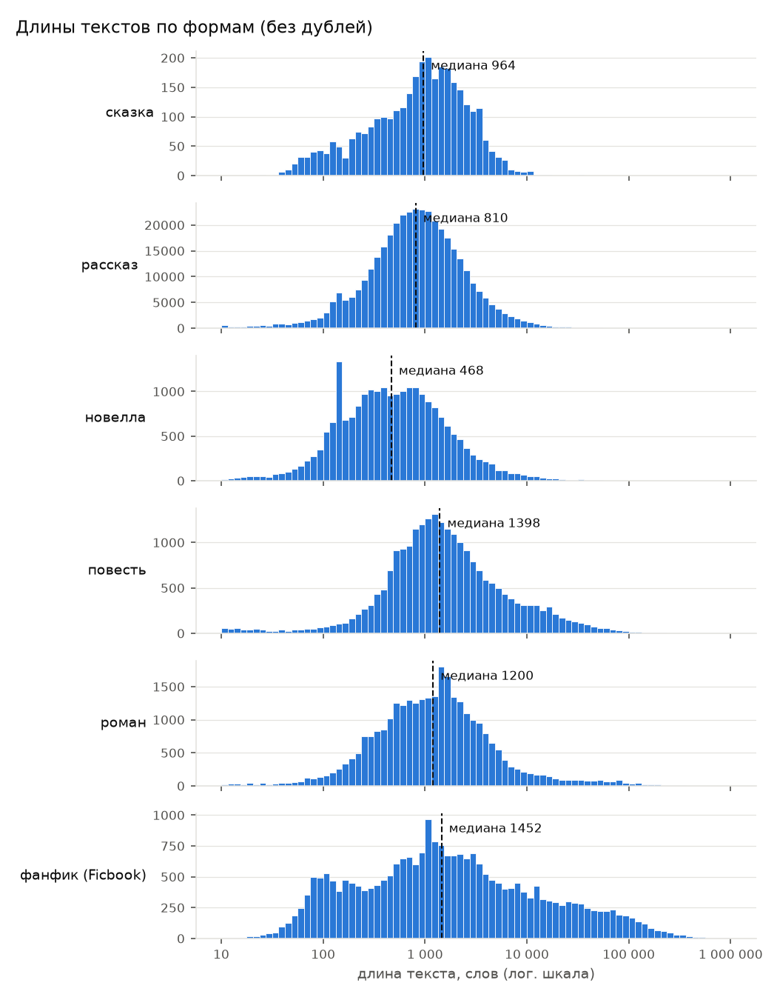
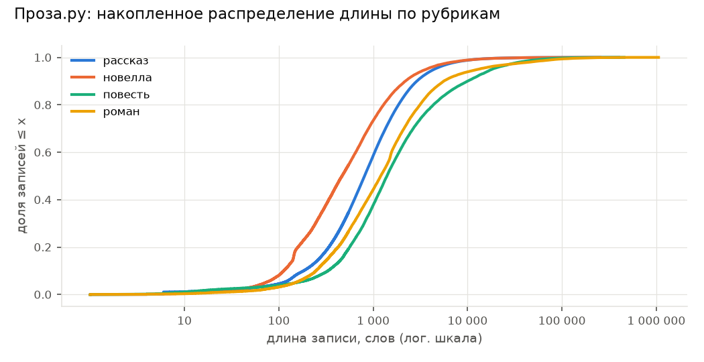

# Этап 0. Инвентаризация корпусов

Манифест: `data/interim/manifest.parquet`, хеш конфига `7795d78e81`, строк: 526672. Длина в словах — единый регулярный токенизатор (`src/common.py`), одинаковый для всех корпусов.

## 1. Сводка по корпусам и формам

Исходные записи → после удаления пустых текстов, точных и почти-дублей (Жаккар ≥ 0,8 по 5-словным шинглам).

| корпус | форма | записей | пустых | точн_дубли | почти_дубли | чистых | авторов | слов_млн | доля_стихоподобных |
|---|---|---|---|---|---|---|---|---|---|
| afanasyev | сказка (Афанасьев) | 579 | 5 | 0 | 1 | 573 | 276 | 0.42 | 0.031 |
| fairytales | сказка (fairytalez, пер.) | 3 270 | 0 | 6 | 8 | 3 256 | 142 | 4.49 | 0.04 |
| ficbook | фанфик (Ficbook) | 28 713 | 3 344 | 219 | 95 | 25 055 | 13 756 | 342 | 0.208 |
| proza | рассказ | 413 622 | 106 | 6 670 | 11 757 | 395 089 | 38 696 | 583 | 0.061 |
| proza | новелла | 24 594 | 21 | 520 | 1 394 | 22 659 | 3 224 | 26.2 | 0.195 |
| proza | повесть | 25 152 | 14 | 340 | 820 | 23 978 | 3 494 | 108 | 0.035 |
| proza | роман | 30 742 | 12 | 186 | 420 | 30 124 | 2 321 | 133 | 0.063 |

«Стихоподобный» — ≥ 8 непустых строк, из них ≥ 70 % короче 9 слов (эвристика из конфига; ловит и стихи, и диалоговые/«лесенкой» тексты, поэтому это верхняя оценка).

## 2. Распределение длин (слов), чистые тексты

| форма | n | p5 | p25 | p50 | p75 | p95 | среднее | макс | <400 | <1000 |
|---|---|---|---|---|---|---|---|---|---|---|
| сказка (Афанасьев) | 573 | 36 | 234 | 523 | 976 | 2 238 | 738 | 4 450 | 0.401 | 0.756 |
| сказка (fairytalez, пер.) | 3 256 | 93 | 401 | 964 | 1 820 | 3 926 | 1 380 | 34 955 | 0.248 | 0.515 |
| рассказ | 395 089 | 111 | 409 | 810 | 1 567 | 4 436 | 1 474 | 400 181 | 0.243 | 0.585 |
| новелла | 22 659 | 72 | 202 | 468 | 1 061 | 3 652 | 1 155 | 252 812 | 0.452 | 0.733 |
| повесть | 23 978 | 154 | 678 | 1 399 | 3 296 | 18 202 | 4 524 | 454 851 | 0.125 | 0.376 |
| роман | 30 124 | 150 | 519 | 1 201 | 2 529 | 13 002 | 4 423 | 1 054 690 | 0.188 | 0.442 |
| фанфик (Ficbook) | 25 055 | 75 | 375 | 1 453 | 6 768 | 71 856 | 13 665 | 1 306 751 | 0.259 | 0.414 |

`<400` — доля текстов короче 400 слов: при N = 20 это меньше 20 слов на сегмент.

## 3. Проза.ру: согласуется ли метка формы с длиной

Метка формы — это **рубрика сайта**, выбранная автором при публикации (`topic`: 02 рассказ, 21 новелла, 01 повесть, 04 роман), а не отдельное поле «форма».

| пара | OVL | точность_порога |
|---|---|---|
| рассказ – новелла | 0.781 | 0.605 |
| рассказ – повесть | 0.777 | 0.607 |
| рассказ – роман | 0.835 | 0.583 |
| новелла – повесть | 0.623 | 0.684 |
| новелла – роман | 0.708 | 0.646 |
| повесть – роман | 0.88 | 0.54 |

OVL — площадь пересечения плотностей log-длины (1 = распределения совпадают). «Точность порога» — сбалансированная точность лучшего одного порога длины (0,5 = длина не различает формы).

### 3.1. Записи-главы

| форма | записей | заголовок_как_у_главы | в_серии_от_3 | медиана_слов | текстов_на_автора_медиана |
|---|---|---|---|---|---|
| рассказ | 395 089 | 0.168 | 0.101 | 810 | 2 |
| новелла | 22 659 | 0.16 | 0.106 | 468 | 1 |
| повесть | 23 978 | 0.634 | 0.418 | 1 399 | 2 |
| роман | 30 124 | 0.733 | 0.455 | 1 201 | 2 |

«Заголовок как у главы» — заголовок содержит «глава/часть/продолжение/…» или номер. «В серии» — у того же автора ≥ 3 записей с совпадающей основой заголовка (после удаления номеров и слов-маркеров). Связи «глава → произведение» в данных нет, поэтому обе оценки эвристические.

**Склейка глав (этап 0b, `src/s00b_link_proza.py`).** Серия = автор + основа заголовка; серий из ≥ 3 записей: 2106; надёжно сшитых (`linked_ok`: есть начало, номера без пропусков, порядок номеров согласован с датами): 702 (486 авторов, медиана 16091 слов); из них с маркером конца (эпилог/окончание/…): 89. Ручная проверка 50 серий — `reports/00b_proza_linking_review.md`.

Случайные заголовки из рубрики «роман»:

- Подранки. Горечь желторотая ч. 4 гл. 2 18 плюс — 1152 сл.
- Добрынины. Часть 4. Глава 13 — 717 сл.
- 40 гл Успеть до прилёта борта — 2186 сл.
- 94 — 737 сл.
- Паутина. Книга вторая. Глава девятая — 2779 сл.
- Жизнь прожить гл 63 Планов громадьё — 1983 сл.
- Азбука жизни Глава 5 Часть 235 За волшебство — 315 сл.
- Сергей Степанов. Постлюбовь. Новый роман Глава 103 — 424 сл.
- Солнце встает с востока. 40. На втором причале — 662 сл.
- Похмелье взросления Гл. 14 Попытка быть как все — 1461 сл.
- Миссия 777 выполнима. Продолжение 103 — 422 сл.
- Ч. 4 Зов несбывшегося. Гл. 2 Раздумья — 1273 сл.

## 4. Сказки

### 4.1. Афанасьев, «Народные русские сказки» (основная фольклорная база)

- Источник: Викитека, подстраницы «Народные русские сказки (Афанасьев)/…» (общественное достояние); сырьё — `data/external/afanasyev/pages.jsonl`, разбор — `src/s00c_afanasyev.py`.
- Вариантов под номерами Афанасьева: 579 (№ 1–579, без пропусков и повторов); пустых в Викитеке: 5.
- Язык: {'ru': 523, 'uk': 54, 'be': 2} (украинские и белорусские варианты в сборнике есть; в базу идут только русские).
- Длина (чистые русские): {'p5': 39, 'p25': 267, 'p50': 552, 'p75': 1041, 'p95': 2263}; ≥ 600 слов: 244.
- `author_id` = сюжет (подстраница Викитеки): варианты одного сюжета зависимы, кластеризуем по нему.

### 4.2. fairytalez.sqlite (мировой фольклор в машинном переводе; проверка)

- Записей: 3270; у **всех** есть `url_en` — это русская версия англоязычного сайта fairytalez.com. Признак перевода восстанавливается тривиально: переведены все тексты, и переводились они **с английского** (в т.ч. «русские» сказки — например, сборник «Русская гирлянда», англ. Russian Garland, 1916).
- Качество перевода по ручному просмотру — машинное, с ошибками: «Кузнечик-гей» (англ. *the gay grasshopper*), автор «фонтан» (Лафонтен), «избушка-царевич» вместо имени героя.
- Народ восстанавливается из `tale_regions` (63 региона; у 27 % сказок больше одного региона, напр. nordic + scandinavian + danish).
- Стихоподобных среди чистых: 4.0% (басни Лафонтена и пр.).
- Тип текста (по списку авторов в конфиге): {'folk': 2599, 'fable': 366, 'literary': 291}. В базу идут только folk; басни (Эзоп, Лафонтен) и литературные сказки (Андерсен, Гауф, Уайльд, Перро, Пушкин…) исключаются.

Топ-15 регионов (сказка может входить в несколько):

| регион | сказок |
|---|---|
| north-american | 438 |
| greek | 328 |
| nordic | 295 |
| german | 290 |
| slavic | 281 |
| scandinavian | 237 |
| french | 212 |
| native-american | 175 |
| celtic | 169 |
| indian | 140 |
| italian | 134 |
| danish | 129 |
| english | 124 |
| african | 111 |
| chinese | 106 |

Крупнейшие «авторы» (на деле — сборники/собиратели; это поле пойдёт в `author_id`):

| сборник | сказок |
|---|---|
| Сказочные книги Эндрю Лэнга | 350 |
| Басни Эзопа | 266 |
| Братья Гримм | 235 |
| Чарльз Скиннер | 163 |
| Джозеф Джейкобс | 127 |
| Ганс Христиан Андерсен | 112 |
| фонтан | 100 |
| Томас Фредерик Крейн | 79 |
| Китайская книга сказок | 75 |
| Элси Спайсер Иллс | 65 |
| Паркер Филмор | 63 |
| Мейбл Кук Коул | 60 |

Регионы russian / ukrainian / slavic: 281 сказок, медиана 1357 слов. Но и они — обратный перевод с английского.

## 5. Ficbook

- Произведений в `ficbook_originals_2026.sqlite`: 28713; с хотя бы одной загруженной главой: 25369.
- Ориджиналы (фандом ровно «Ориджиналы»): 93.2%; остальное — фанфики по фандомам (BTS, Гарри Поттер…).
- Статус: {'finished': 27403, 'В процессе': 1191, nan: 112, 'Заморожен': 7}.
- Дата публикации: из карточки произведения 66.6%, по первой главе 30.0%, нет 3.3% (у пустых — без загруженных глав — даты нет).
- Лайки: из `works.likes` 66.9%, из плашек страницы (`metadata_json.badges`) 32.7%, нет 0.4%. Правило «первое число после статуса» совпадает с `works.likes` у 19 199 из 19 199 произведений; NULL в `works.likes` — это «0» на странице.
- С пропущенными главами (ошибка загрузки): 0.5%.
- Тег «Стихи»: 15.9%; стихоподобных по эвристике: 20.8%.
- Годы публикации: {2011.0: 1, 2012.0: 1, 2013.0: 6, 2014.0: 4, 2015.0: 12, 2016.0: 7, 2017.0: 24, 2018.0: 22, 2019.0: 35, 2020.0: 51, 2021.0: 58, 2022.0: 87, 2023.0: 137, 2024.0: 250, 2025.0: 6086, 2026.0: 20972}.

**Устройство глав.** Одно произведение = каталог `texts/YYYY/MM/<work_id>/` с файлами `part-NNN.txt`, по файлу на главу; в БД — таблица `chapter_texts` (номер, дата, путь). Последняя «глава» с адресом `thanks-author-page` — служебная страница, в тексты не включена.

| показатель | p5 | p25 | p50 | p75 | p95 | доля_одноглавых |
|---|---|---|---|---|---|---|
| глав на произведение | 1 | 1 | 1 | 4 | 25 | 0.656 |
| слов в главе | 119 | 830 | 1 756 | 3 184 | 6 975 |  |
| слов в произведении | 75 | 375 | 1 453 | 6 768 | 71 856 |  |

Лайки (ориджиналы, без NULL): {'p5': 0, 'p25': 0, 'p50': 1, 'p75': 7, 'p95': 101}.

Старая база `ficbook.sqlite`: 2412 произведений, 648 из них есть в новой; таблицы текстов нет — в манифест не включена.

## 6. Дедупликация

- Повторы одной записи в двух базах Проза.ру (одинаковый `story_id`, удалены до дедупликации): 168.
- Точные дубли (нормализованный текст совпадает), кроме первого экземпляра: 7941.
- Почти-дубли (MinHash 128, LSH 16×8, Жаккар ≥ 0,8), кроме самого длинного в кластере: 14495. Проверено пар-кандидатов: 231069, пропущено переполненных бакетов: 18.
- Кластеров почти-дублей: 9693; из них межкорпусных: 15, с разными формами: 605.
- Кластеров с разными авторами: 2159 (возможные заимствования/перепосты).

Крупнейшие кластеры:

| n | author | title | words | forms |
|---|---|---|---|---|
| 454 | pz:pinskid | Передавая Дар по Кругу | 143 | novella |
| 385 | pz:pinskid | Веский Вздох за Занавеской | 144 | novella |
| 324 | pz:yuri2008 | Булгак Владимир Выдающиeся Росияне Yale Нью-Хейвен | 7e+03 | novel,novella,story |
| 168 | pz:yuri2008 | Украинцы Откaз от Oтечествa 125 000 в Нидерландax | 4.54e+03 | novella,story |
| 122 | pz:yuri2008 | Aвтор книг G. Bush Presidential Library TX USA | 7.8e+03 | story |
| 120 | pz:yuri2008 | writer Uri Runtu Меркюри o Руди Нуреевe Mercury UK | 1.1e+04 | novel,novella,story |
| 118 | pz:nutrition | 118. Сообщения. Похудеть навсегда - Без диет! | 365 | story |
| 102 | pz:yuri2008 | писатель Рюнтю Юри Меркюри o Руди Нуреевe Mercury | 4.88e+03 | story |
| 93 | pz:yuri2008 | Фредди Меркьюри Biography Нуреев Ballet Runtu Uri | 1.34e+04 | novel,novella,story |
| 77 | pz:murka12 | Поезд Баку-Нахичевань | 990 | story |

## 7. Авторы и тексты на автора (чистые тексты)

| форма | авторов | текстов | на_автора_p50 | на_автора_p90 | на_автора_p99 | макс | доля_топ1проц_авторов | доля_авторов_с_1_текстом |
|---|---|---|---|---|---|---|---|---|
| сказка (Афанасьев) | 276 | 573 | 1 | 3 | 10 | 75 | 0.188 | 0.649 |
| сказка (fairytalez, пер.) | 142 | 3 256 | 8 | 46 | 253 | 350 | 0.189 | 0.268 |
| рассказ | 38 696 | 395 089 | 2 | 19 | 113 | 6 676 | 0.32 | 0.353 |
| новелла | 3 224 | 22 659 | 1 | 10 | 87 | 1 224 | 0.427 | 0.53 |
| повесть | 3 494 | 23 978 | 2 | 15 | 72 | 693 | 0.275 | 0.499 |
| роман | 2 321 | 30 124 | 2 | 27 | 173 | 1 931 | 0.326 | 0.447 |
| фанфик (Ficbook) | 13 756 | 25 055 | 1 | 3 | 12 | 221 | 0.141 | 0.74 |

Авторов Проза.ру, пишущих в ≥ 2 рубриках: 5318 из 41114 (для смешанных моделей это хорошо: эффект формы оценивается и внутри автора).

## 7a. Сколько остаётся при разных минимальных длинах

Чистые тексты без стихоподобных; Ficbook — только ориджиналы. В ячейке: доля оставшихся текстов / число авторов.

| форма | n | ≥200 | ≥400 | ≥600 | ≥1000 | ≥2000 | ≥5000 |
|---|---|---|---|---|---|---|---|
| сказка (Афанасьев) | 555 | 0.78 / 243 | 0.61 / 212 | 0.46 / 170 | 0.25 / 100 | 0.07 / 33 | 0.00 / 0 |
| сказка (fairytalez, пер.) | 3 125 | 0.89 / 139 | 0.78 / 136 | 0.68 / 129 | 0.50 / 121 | 0.23 / 85 | 0.03 / 34 |
| рассказ | 370 867 | 0.92 / 37461 | 0.79 / 35317 | 0.65 / 32336 | 0.44 / 26847 | 0.19 / 17329 | 0.04 / 6473 |
| новелла | 18 234 | 0.86 / 2875 | 0.64 / 2556 | 0.50 / 2240 | 0.32 / 1651 | 0.13 / 930 | 0.04 / 362 |
| повесть | 23 144 | 0.96 / 3317 | 0.89 / 3233 | 0.80 / 3123 | 0.64 / 2932 | 0.39 / 2504 | 0.18 / 1868 |
| роман | 28 220 | 0.95 / 2151 | 0.85 / 2071 | 0.74 / 1986 | 0.59 / 1861 | 0.33 / 1563 | 0.12 / 1099 |
| фанфик (Ficbook) | 18 035 | 0.95 / 10384 | 0.88 / 9543 | 0.80 / 8704 | 0.69 / 7390 | 0.50 / 5368 | 0.31 / 3391 |

Ficbook, если единица — глава: глав 104370, из них ≥ 1000 слов — 0.72.

## 7b. Аналитическая выборка по решениям Ворот 0 (`data/interim/analysis_set.parquet`)

Правила: ≥ 600 слов, без стихоподобных и дублей; повесть одной записью ≥ 10000, роман ≥ 20000 слов (короче или с «продолжение следует» — глава); форма склеенной серии — по суммарной длине теми же порогами; Ficbook — завершённые ориджиналы без пропусков глав.

| unit | corpus | form | единиц | авторов | медиана_слов | в_лимите_20 |
|---|---|---|---|---|---|---|
| chapter | ficbook | fanfic | 79 907 | 8 040 | 1 917 | 40 460 |
| chapter | proza | novel | 20 435 | 1 579 | 1 710 | 10 182 |
| chapter | proza | novella | 34 | 9 | 1 189 | 34 |
| chapter | proza | povest | 17 305 | 2 283 | 1 676 | 11 080 |
| chapter | proza | story | 321 | 41 | 1 403 | 199 |
| linked_work | proza | novel | 307 | 225 | 42 175 | 307 |
| linked_work | proza | povest | 150 | 120 | 13 920 | 150 |
| text | afanasyev | tale | 244 | 167 | 1 094 | 244 |
| text | fairytales | tale | 1 893 | 109 | 1 473 | 1 074 |
| text | ficbook | fanfic | 14 005 | 8 464 | 2 862 | 13 817 |
| text | proza | novel | 809 | 513 | 55 028 | 809 |
| text | proza | novella | 8 277 | 2 157 | 1 206 | 5 953 |
| text | proza | povest | 1 900 | 1 162 | 19 084 | 1 834 |
| text | proza | story | 220 113 | 31 693 | 1 313 | 146 508 |

### Завершённость (`is_complete`)

| unit | corpus | form | false | true | unknown |
|---|---|---|---|---|---|
| linked_work | proza | novel | 14 | 84 | 209 |
| linked_work | proza | povest | 5 | 21 | 124 |
| text | afanasyev | tale | 0 | 244 | 0 |
| text | fairytales | tale | 0 | 1 893 | 0 |
| text | ficbook | fanfic | 0 | 14 005 | 0 |
| text | proza | novel | 0 | 809 | 0 |
| text | proza | novella | 568 | 7 709 | 0 |
| text | proza | povest | 0 | 1 900 | 0 |
| text | proza | story | 3 379 | 216 734 | 0 |

Источник: Ficbook — статус произведения; Проза.ру — «продолжение следует» (false) / «конец», «закончено» (true) в последних 400 символах, иначе одиночная запись — true; склеенная серия — маркер конца в заголовках или в хвосте последней главы (true), «продолжение следует» в последней главе (false), иначе unknown; сказки — true.

### Строгие пороги (проверка устойчивости RQ1, RQ2)

| единица | форма | основной_порог | строгий_порог | авторов_строгий | строгий_и_завершённые |
|---|---|---|---|---|---|
| linked_work | novel | 307 | 167 | 126 | 56 |
| linked_work | povest | 150 | 63 | 54 | 10 |
| text | novel | 809 | 553 | 361 | 553 |
| text | povest | 1 900 | 1 323 | 830 | 1 323 |

Строгие пороги: повесть ≥ 15000, роман ≥ 40000 слов.

### Афанасьев: типы сказок при порогах 600 и 400

| тип | всего_рус | при_600 | при_400 | при_600_доля | при_400_доля |
|---|---|---|---|---|---|
| anecdote | 79 | 12 | 23 | 0.05 | 0.07 |
| animal | 82 | 14 | 30 | 0.06 | 0.09 |
| magic | 230 | 182 | 211 | 0.75 | 0.66 |
| novella | 56 | 23 | 40 | 0.09 | 0.12 |
| other | 71 | 13 | 17 | 0.05 | 0.05 |
| итого | 518 | 244 | 321 | 1 | 1 |

Типы — по номеру Афанасьева (жанровые разделы издания; разметка в `configs/s00_inventory.yaml`, `afanasyev_types`). animal — о животных, magic — волшебные (вкл. богатырские), novella — бытовые/новеллистические, anecdote — анекдоты, other — былички, легенды, небылицы, докучные сказки, прибаутки.

## 8. Что не вошло в манифест

| статус | причина | записей |
|---|---|---|
| 0 | Автор закрыл свою страницу | 25 420 |
| 0 | Произведение удалено автором | 20 |
| 0 | Страница не найдена | 1 001 |
|  |  | 9 |
|  | RuntimeError: HTTPSConnectionPool(host='proza.ru', | 19 |

- Новостной корпус — ещё не получен (пользователь обогащает его, будет позже).
- Ficbook: главы со статусом error/empty — см. раздел 5.
