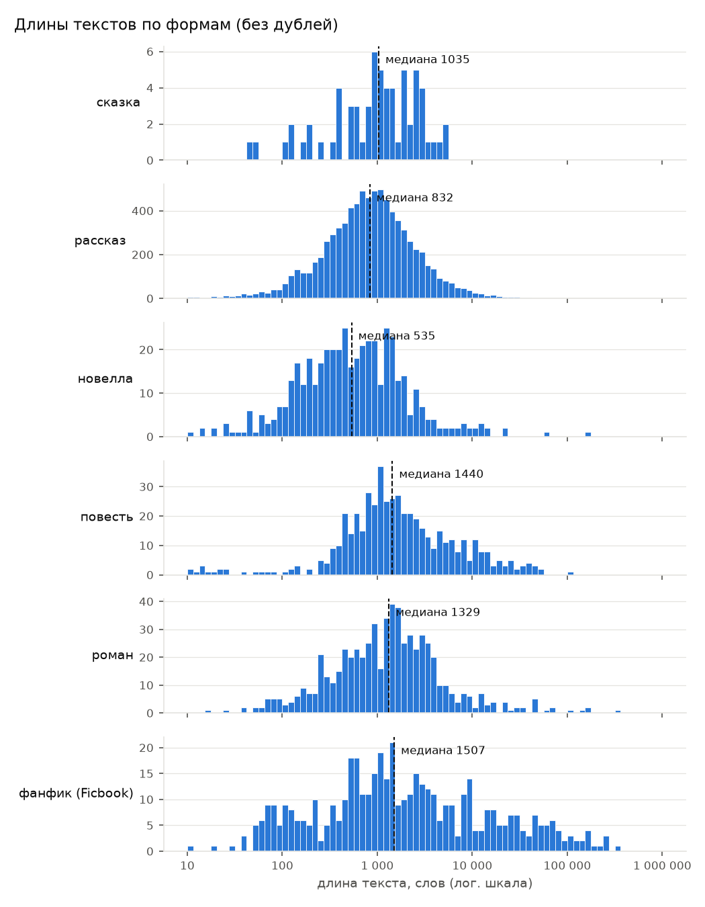
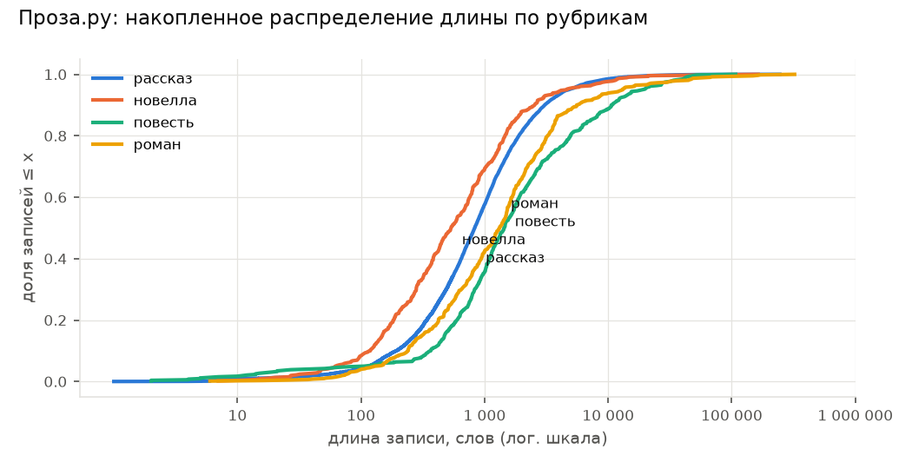

# Этап 0. Инвентаризация корпусов (ВЫБОРКА 2%)

Манифест: `data/interim/manifest_sample0.02.parquet`, хеш конфига `f2c12c37bb`, строк: 10530. Длина в словах — единый регулярный токенизатор (`src/common.py`), одинаковый для всех корпусов.

## 1. Сводка по корпусам и формам

Исходные записи → после удаления пустых текстов, точных и почти-дублей (Жаккар ≥ 0,8 по 5-словным шинглам).

| корпус | форма | записей | пустых | точн_дубли | почти_дубли | чистых | авторов | слов_млн | доля_стихоподобных |
|---|---|---|---|---|---|---|---|---|---|
| fairytales | сказка | 65 | 0 | 0 | 0 | 65 | 38 | 0.09 | 0.046 |
| ficbook | фанфик (Ficbook) | 549 | 71 | 0 | 0 | 478 | 453 | 6.77 | 0.197 |
| proza | рассказ | 8 280 | 2 | 14 | 25 | 8 239 | 4 678 | 13.2 | 0.065 |
| proza | новелла | 492 | 1 | 0 | 31 | 460 | 265 | 0.78 | 0.187 |
| proza | повесть | 523 | 1 | 1 | 1 | 520 | 339 | 2.25 | 0.037 |
| proza | роман | 621 | 0 | 0 | 0 | 621 | 314 | 2.78 | 0.087 |

«Стихоподобный» — ≥ 8 непустых строк, из них ≥ 70 % короче 9 слов (эвристика из конфига; ловит и стихи, и диалоговые/«лесенкой» тексты, поэтому это верхняя оценка).

## 2. Распределение длин (слов), чистые тексты

| форма | n | p5 | p25 | p50 | p75 | p95 | среднее | макс | <400 | <1000 |
|---|---|---|---|---|---|---|---|---|---|---|
| сказка | 65 | 126 | 547 | 1 035 | 2 039 | 3 840 | 1 426 | 5 316 | 0.154 | 0.462 |
| рассказ | 8 239 | 116 | 412 | 832 | 1 586 | 4 796 | 1 598 | 244 633 | 0.241 | 0.576 |
| новелла | 460 | 63 | 232 | 536 | 1 275 | 4 630 | 1 693 | 163 348 | 0.415 | 0.691 |
| повесть | 520 | 116 | 742 | 1 441 | 3 710 | 18 840 | 4 324 | 107 457 | 0.112 | 0.354 |
| роман | 621 | 143 | 532 | 1 329 | 2 736 | 13 128 | 4 483 | 322 496 | 0.18 | 0.424 |
| фанфик (Ficbook) | 478 | 73 | 500 | 1 508 | 8 409 | 73 263 | 14 156 | 331 391 | 0.218 | 0.397 |

`<400` — доля текстов короче 400 слов: при N = 20 это меньше 20 слов на сегмент.

## 3. Проза.ру: согласуется ли метка формы с длиной

Метка формы — это **рубрика сайта**, выбранная автором при публикации (`topic`: 02 рассказ, 21 новелла, 01 повесть, 04 роман), а не отдельное поле «форма».

| пара | OVL | точность_порога |
|---|---|---|
| рассказ – новелла | 0.789 | 0.591 |
| рассказ – повесть | 0.749 | 0.611 |
| рассказ – роман | 0.777 | 0.597 |
| новелла – повесть | 0.631 | 0.673 |
| новелла – роман | 0.687 | 0.639 |
| повесть – роман | 0.745 | 0.554 |

OVL — площадь пересечения плотностей log-длины (1 = распределения совпадают). «Точность порога» — сбалансированная точность лучшего одного порога длины (0,5 = длина не различает формы).

### 3.1. Записи-главы

| форма | записей | заголовок_как_у_главы | в_серии_от_3 | медиана_слов | текстов_на_автора_медиана |
|---|---|---|---|---|---|
| рассказ | 8 239 | 0.175 | 0.018 | 832 | 1 |
| новелла | 460 | 0.17 | 0.022 | 536 | 1 |
| повесть | 520 | 0.625 | 0.075 | 1 441 | 1 |
| роман | 621 | 0.733 | 0.14 | 1 329 | 1 |

«Заголовок как у главы» — заголовок содержит «глава/часть/продолжение/…» или номер. «В серии» — у того же автора ≥ 3 записей с совпадающей основой заголовка (после удаления номеров и слов-маркеров). Связи «глава → произведение» в данных нет, поэтому обе оценки эвристические.

Случайные заголовки из рубрики «роман»:

- Зимняя Война — 148241 сл.
- Triangles, глава 1, часть 15 — 2199 сл.
- Добрынины. Часть 6. Глава 7 — 712 сл.
- Перевернуть свой мир. 26. Правда, через двадцать л — 3149 сл.
- Глава 13. ЧП районного масштаба — 1725 сл.
- Курортная история. Часть 1-я — 468 сл.
- Добрынины. Часть 2. Глава 31 — 684 сл.
- Эпилог — 172 сл.
- Идя к цели 1 решение 8 — 1638 сл.
- Черта, гл. 17 — 895 сл.
- 208, 210 — 97 сл.
- Полёт бабочки — 1256 сл.

## 4. Сказки (fairytalez.sqlite)

- Записей: 65; у **всех** есть `url_en` — это русская версия англоязычного сайта fairytalez.com. Признак перевода восстанавливается тривиально: переведены все тексты, и переводились они **с английского** (в т.ч. «русские» сказки — например, сборник «Русская гирлянда», англ. Russian Garland, 1916).
- Качество перевода по ручному просмотру — машинное, с ошибками: «Кузнечик-гей» (англ. *the gay grasshopper*), автор «фонтан» (Лафонтен), «избушка-царевич» вместо имени героя.
- Народ восстанавливается из `tale_regions` (63 региона; у 27 % сказок больше одного региона, напр. nordic + scandinavian + danish).
- Стихоподобных среди чистых: 4.6% (басни Лафонтена и пр.).

Топ-15 регионов (сказка может входить в несколько):

| регион | сказок |
|---|---|
| nordic | 9 |
| scandinavian | 7 |
| north-american | 7 |
| slavic | 5 |
| french | 4 |
| chinese | 4 |
| danish | 4 |
| english | 4 |
| japanese | 4 |
| german | 4 |
| greek | 4 |
| celtic | 4 |
| italian | 3 |
| portuguese | 3 |
| irish | 3 |

Крупнейшие «авторы» (на деле — сборники/собиратели; это поле пойдёт в `author_id`):

| сборник | сказок |
|---|---|
| Сказочные книги Эндрю Лэнга | 6 |
| Китайская книга сказок | 4 |
| Ганс Христиан Андерсен | 4 |
| фонтан | 3 |
| Элси Спайсер Иллс | 3 |
| Чарльз Скиннер | 3 |
| Братья Гримм | 3 |
| Басни Эзопа | 3 |
| Истории из Пентамерона | 2 |
| Паркер Филмор | 2 |
| Йей Теодора Одзаки | 2 |
| Джеремайя Кёртин | 2 |

Регионы russian / ukrainian / slavic: 5 сказок, медиана 2807 слов. Но и они — обратный перевод с английского.

## 5. Ficbook

- Произведений в `ficbook_originals_2026.sqlite`: 549; с хотя бы одной загруженной главой: 478.
- Ориджиналы (фандом ровно «Ориджиналы»): 93.1%; остальное — фанфики по фандомам (BTS, Гарри Поттер…).
- Статус: {'finished': 519, 'В процессе': 29, nan: 1}.
- Нет даты публикации у произведения: 34.1% (из них дата восстановлена по первой главе: 167).
- Нет лайков (`likes` NULL): 34.1%. Лайки нужны для RQ5.
- С пропущенными главами (ошибка загрузки): 0.4%.
- Тег «Стихи»: 14.2%; стихоподобных по эвристике: 19.7%.
- Годы публикации: {2017.0: 1, 2020.0: 1, 2021.0: 1, 2022.0: 2, 2023.0: 1, 2024.0: 6, 2025.0: 112, 2026.0: 405}.

**Устройство глав.** Одно произведение = каталог `texts/YYYY/MM/<work_id>/` с файлами `part-NNN.txt`, по файлу на главу; в БД — таблица `chapter_texts` (номер, дата, путь). Последняя «глава» с адресом `thanks-author-page` — служебная страница, в тексты не включена.

| показатель | p5 | p25 | p50 | p75 | p95 | доля_одноглавых |
|---|---|---|---|---|---|---|
| глав на произведение | 1 | 1 | 1 | 5 | 26 | 0.653 |
| слов в главе | 166 | 871 | 1 531 | 2 624 | 5 432 |  |
| слов в произведении | 73 | 500 | 1 508 | 8 409 | 73 263 |  |

Лайки (ориджиналы, без NULL): {'p5': 1, 'p25': 1, 'p50': 5, 'p75': 20, 'p95': 152}.

Старая база `ficbook.sqlite`: 2412 произведений, 648 из них есть в новой; таблицы текстов нет — в манифест не включена.

## 6. Дедупликация

- Повторы одной записи в двух базах Проза.ру (одинаковый `story_id`, удалены до дедупликации): 4.
- Точные дубли (нормализованный текст совпадает), кроме первого экземпляра: 15.
- Почти-дубли (MinHash 128, LSH 16×8, Жаккар ≥ 0,8), кроме самого длинного в кластере: 57. Проверено пар-кандидатов: 648, пропущено переполненных бакетов: 0.
- Кластеров почти-дублей: 24; из них межкорпусных: 0, с разными формами: 0.
- Кластеров с разными авторами: 2 (возможные заимствования/перепосты).

Крупнейшие кластеры:

| n | author | title | words | forms |
|---|---|---|---|---|
| 32 | pz:pinskid | Принцип Действия Разврата | 143 | novella |
| 5 | pz:yuri2008 | Баранников Викт Выдающиeся Росияне Yale Нью-Хейвен | 7.11e+03 | story |
| 4 | pz:nutrition | 94. Сообщения. Похудеть навсегда - Без диет! | 365 | story |
| 3 | pz:murka12 | Поезд Баку-Нахичевань | 990 | story |
| 3 | pz:yuri2008 | США 2032 Showbiz USA Олимпиадa 2024 Runtu Uri RU | 4.93e+03 | story |
| 3 | pz:yuri2008 | Fred Mercury Меркьюри o соблазнax Руди Нуреевa UK | 1.1e+04 | story |
| 3 | pz:yuri2008 | США 1959 Джордж Баланчин Нью-Йорк балет Balanchine | 5.52e+03 | story |
| 2 | pz:murka12 | Клубника | 520 | story |
| 2 | pz:olegsoin2010 | Гусарские проказы 14 | 340 | story |
| 2 | pz:yuri2008 | Принстон Нуреев Фрэди Меркьюри Ninel Kurgapkina | 1.32e+04 | story |

## 7. Авторы и тексты на автора (чистые тексты)

| форма | авторов | текстов | на_автора_p50 | на_автора_p90 | на_автора_p99 | макс | доля_топ1проц_авторов | доля_авторов_с_1_текстом |
|---|---|---|---|---|---|---|---|---|
| сказка | 38 | 65 | 1 | 3 | 5 | 6 | 0.092 | 0.632 |
| рассказ | 4 678 | 8 239 | 1 | 3 | 12 | 132 | 0.162 | 0.746 |
| новелла | 265 | 460 | 1 | 3 | 14 | 17 | 0.104 | 0.74 |
| повесть | 339 | 520 | 1 | 2 | 12 | 18 | 0.129 | 0.796 |
| роман | 314 | 621 | 1 | 3 | 12 | 40 | 0.132 | 0.646 |
| фанфик (Ficbook) | 453 | 478 | 1 | 1 | 2 | 5 | 0.036 | 0.96 |

Авторов Проза.ру, пишущих в ≥ 2 рубриках: 234 из 5336 (для смешанных моделей это хорошо: эффект формы оценивается и внутри автора).

## 8. Что не вошло в манифест

(считается только при полном прогоне)

- Новостной корпус — ещё не получен (пользователь обогащает его, будет позже).
- Ficbook: главы со статусом error/empty — см. раздел 5.
