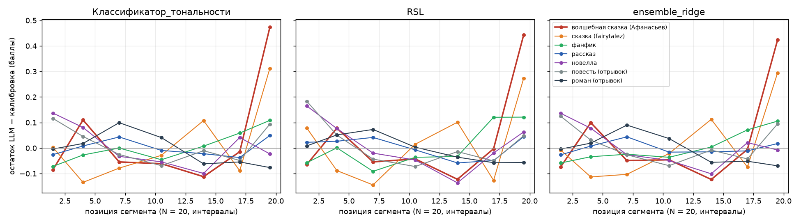

# Этап 2. Ансамбль сигналов и позиционная ошибка сигнала (Ворота 2, п. 1 и 2.1)

Серебро: 11391 сегментов N = 20, цель — LLM-тональность (deepseek-v4.1-flash). Признаки ансамбля: sent_positive, sent_negative, RSL, LinisCrowd, NRC_полярность, log_words; форма текста в признаки не входит. ρ Спирмена [95 % ДИ, бутстрэп по авторам, B = 1000].

## 1. Ансамбль

### 1.1. Серебро, out-of-fold (GroupKFold по авторам, 5 блоков)

| сигнал | художеств. проза | волшебная сказка (Афанасьев) | сказка (fairytalez) | фанфик | рассказ | новелла | повесть (отрывок) | роман (отрывок) |
|---|---|---|---|---|---|---|---|---|
| Классификатор_тональности | 0.57 [0.56; 0.59] | 0.30 [0.22; 0.37] | 0.49 [0.43; 0.55] | 0.56 [0.52; 0.59] | 0.55 [0.52; 0.59] | 0.56 [0.53; 0.59] | 0.59 [0.56; 0.62] | 0.58 [0.55; 0.61] |
| RSL | 0.47 [0.45; 0.48] | 0.37 [0.30; 0.44] | 0.47 [0.40; 0.53] | 0.45 [0.41; 0.48] | 0.44 [0.41; 0.48] | 0.43 [0.39; 0.47] | 0.51 [0.48; 0.54] | 0.51 [0.48; 0.55] |
| ensemble_ridge | 0.61 [0.60; 0.62] | 0.39 [0.32; 0.45] | 0.55 [0.48; 0.60] | 0.60 [0.56; 0.62] | 0.59 [0.56; 0.62] | 0.60 [0.56; 0.63] | 0.63 [0.60; 0.66] | 0.61 [0.58; 0.64] |
| ensemble_hgb | 0.61 [0.60; 0.63] | 0.39 [0.33; 0.45] | 0.55 [0.50; 0.61] | 0.60 [0.57; 0.63] | 0.59 [0.56; 0.62] | 0.60 [0.57; 0.63] | 0.63 [0.60; 0.65] | 0.61 [0.58; 0.64] |

Парная разница ρ(ансамбль) − ρ(классификатор), серебро out-of-fold:

| ансамбль | художеств. проза | волшебная сказка (Афанасьев) | сказка (fairytalez) |
|---|---|---|---|
| ensemble_ridge | +0.04 [+0.03; +0.04] | +0.09 [+0.06; +0.12] | +0.05 [+0.03; +0.08] |
| ensemble_hgb | +0.04 [+0.03; +0.05] | +0.09 [+0.05; +0.13] | +0.06 [+0.03; +0.09] |

Ridge (стандартизованные признаки, α = 100): sent_positive +0.168, sent_negative -0.295, RSL +0.102, LinisCrowd +0.135, NRC_полярность +0.060, log_words -0.088

### 1.2. Отложенная проверка: консенсус 6 LLM на золоте (обучение — всё серебро)

| сигнал | художеств. проза (n = 340) | Афанасьев (n = 60) |
|---|---|---|
| Классификатор_тональности | 0.58 [0.49; 0.66] | 0.35 [0.08; 0.60] |
| RSL | 0.44 [0.34; 0.53] | 0.29 [0.01; 0.54] |
| ensemble_ridge | 0.58 [0.49; 0.65] | 0.39 [0.12; 0.62] |
| ensemble_hgb | 0.58 [0.49; 0.65] | 0.40 [0.14; 0.62] |

| ансамбль − классификатор | художеств. проза | Афанасьев |
|---|---|---|
| ensemble_ridge | -0.00 [-0.04; +0.03] | +0.04 [-0.06; +0.14] |
| ensemble_hgb | -0.00 [-0.04; +0.04] | +0.05 [-0.08; +0.20] |

### 1.3. Критерий (решение Ворот 2)

- **ensemble_ridge**: Афанасьев (серебро, OOF) ρ = 0.39; разница с RSL +0.01 [-0.05; +0.08] → не заметно выше 0,37. Проза: разница с классификатором серебро +0.04 [+0.03; +0.04], золото -0.00 [-0.04; +0.03] → не хуже. **Итог: не проходит**.
- **ensemble_hgb**: Афанасьев (серебро, OOF) ρ = 0.39; разница с RSL +0.02 [-0.04; +0.08] → не заметно выше 0,37. Проза: разница с классификатором серебро +0.04 [+0.03; +0.05], золото -0.00 [-0.04; +0.04] → не хуже. **Итог: не проходит**.

## 2. Зависит ли ошибка сигнала от позиции сегмента (п. 2.1)

Калибровка внутри формы tone ~ a + b·сигнал (снимает сдвиг уровня и масштаб формы); остаток = LLM − калибровка, в баллах шкалы −2…+2. Положительный остаток — сигнал **занижает** тональность на этой позиции. Контраст: средний остаток первых 2 / последних 2 сегментов минус средний остаток середины (сегменты 3…18); 95 % ДИ — бутстрэп по авторам. Для ансамбля — out-of-fold прогноз.

| сигнал | форма | n | n начало | n конец | начало − середина | конец − середина |
|---|---|---|---|---|---|---|
| Классификатор_тональности | волшебная сказка (Афанасьев) | 699 | 83 | 52 | -0.05 [-0.23; +0.14] | +0.50 [+0.22; +0.79] ⚠ |
| Классификатор_тональности | сказка (fairytalez) | 699 | 70 | 75 | +0.05 [-0.13; +0.22] | +0.35 [+0.10; +0.58] ⚠ |
| Классификатор_тональности | фанфик | 1996 | 197 | 204 | -0.07 [-0.19; +0.05] | +0.11 [-0.04; +0.27] |
| Классификатор_тональности | рассказ | 1999 | 175 | 218 | -0.02 [-0.15; +0.11] | +0.05 [-0.09; +0.19] |
| Классификатор_тональности | новелла | 1998 | 201 | 194 | +0.15 [+0.03; +0.27] ⚠ | -0.01 [-0.16; +0.13] |
| Классификатор_тональности | повесть (отрывок) | 2000 | 215 | 167 | +0.14 [+0.04; +0.25] ⚠ | +0.12 [-0.02; +0.27] |
| Классификатор_тональности | роман (отрывок) | 2000 | 201 | 191 | -0.01 [-0.13; +0.10] | -0.09 [-0.20; +0.04] |
| RSL | волшебная сказка (Афанасьев) | 699 | 83 | 52 | -0.03 [-0.22; +0.15] | +0.48 [+0.20; +0.73] ⚠ |
| RSL | сказка (fairytalez) | 699 | 70 | 75 | +0.13 [-0.09; +0.34] | +0.32 [+0.08; +0.55] ⚠ |
| RSL | фанфик | 1996 | 197 | 204 | -0.05 [-0.17; +0.08] | +0.13 [-0.04; +0.30] |
| RSL | рассказ | 1999 | 175 | 218 | +0.03 [-0.10; +0.17] | +0.05 [-0.10; +0.20] |
| RSL | новелла | 1998 | 201 | 194 | +0.19 [+0.05; +0.32] ⚠ | +0.09 [-0.06; +0.24] |
| RSL | повесть (отрывок) | 2000 | 215 | 167 | +0.21 [+0.09; +0.33] ⚠ | +0.08 [-0.08; +0.22] |
| RSL | роман (отрывок) | 2000 | 201 | 191 | +0.00 [-0.12; +0.12] | -0.06 [-0.19; +0.07] |
| LinisCrowd | волшебная сказка (Афанасьев) | 699 | 83 | 52 | -0.02 [-0.21; +0.18] | +0.48 [+0.20; +0.77] ⚠ |
| LinisCrowd | сказка (fairytalez) | 699 | 70 | 75 | +0.05 [-0.11; +0.21] | +0.33 [+0.10; +0.56] ⚠ |
| LinisCrowd | фанфик | 1996 | 197 | 204 | -0.05 [-0.19; +0.09] | +0.16 [-0.00; +0.31] |
| LinisCrowd | рассказ | 1999 | 175 | 218 | +0.02 [-0.11; +0.16] | +0.02 [-0.13; +0.16] |
| LinisCrowd | новелла | 1998 | 201 | 194 | +0.19 [+0.05; +0.32] ⚠ | +0.05 [-0.10; +0.20] |
| LinisCrowd | повесть (отрывок) | 2000 | 215 | 167 | +0.21 [+0.10; +0.34] ⚠ | +0.12 [-0.03; +0.27] |
| LinisCrowd | роман (отрывок) | 2000 | 201 | 191 | +0.01 [-0.12; +0.13] | -0.07 [-0.20; +0.05] |
| NRC_полярность | волшебная сказка (Афанасьев) | 699 | 83 | 52 | -0.05 [-0.24; +0.13] | +0.47 [+0.20; +0.74] ⚠ |
| NRC_полярность | сказка (fairytalez) | 699 | 70 | 75 | +0.03 [-0.16; +0.25] | +0.38 [+0.15; +0.63] ⚠ |
| NRC_полярность | фанфик | 1996 | 197 | 204 | -0.10 [-0.24; +0.03] | +0.15 [-0.03; +0.33] |
| NRC_полярность | рассказ | 1999 | 175 | 218 | +0.06 [-0.10; +0.22] | +0.09 [-0.05; +0.23] |
| NRC_полярность | новелла | 1998 | 201 | 194 | +0.19 [+0.06; +0.33] ⚠ | +0.10 [-0.05; +0.26] |
| NRC_полярность | повесть (отрывок) | 2000 | 215 | 167 | +0.22 [+0.11; +0.35] ⚠ | +0.12 [-0.03; +0.28] |
| NRC_полярность | роман (отрывок) | 2000 | 201 | 191 | +0.02 [-0.12; +0.15] | -0.11 [-0.23; +0.03] |
| ensemble_ridge | волшебная сказка (Афанасьев) | 699 | 83 | 52 | -0.05 [-0.22; +0.14] | +0.45 [+0.18; +0.72] ⚠ |
| ensemble_ridge | сказка (fairytalez) | 699 | 70 | 75 | +0.03 [-0.14; +0.21] | +0.33 [+0.11; +0.56] ⚠ |
| ensemble_ridge | фанфик | 1996 | 197 | 204 | -0.05 [-0.17; +0.07] | +0.11 [-0.04; +0.26] |
| ensemble_ridge | рассказ | 1999 | 175 | 218 | -0.03 [-0.16; +0.10] | +0.02 [-0.11; +0.15] |
| ensemble_ridge | новелла | 1998 | 201 | 194 | +0.15 [+0.04; +0.27] ⚠ | +0.01 [-0.13; +0.15] |
| ensemble_ridge | повесть (отрывок) | 2000 | 215 | 167 | +0.15 [+0.04; +0.26] ⚠ | +0.12 [-0.02; +0.27] |
| ensemble_ridge | роман (отрывок) | 2000 | 201 | 191 | -0.01 [-0.12; +0.10] | -0.08 [-0.19; +0.03] |

⚠ — 95 % ДИ не содержит 0.

### Средний остаток по позиции 1…20 (сказки Афанасьева)

| сигнал | 1 | 2 | 3 | 4 | 5 | 6 | 7 | 8 | 9 | 10 | 11 | 12 | 13 | 14 | 15 | 16 | 17 | 18 | 19 | 20 |
|---|---|---|---|---|---|---|---|---|---|---|---|---|---|---|---|---|---|---|---|---|
| Классификатор_тональности | -0.19 | +0.04 | +0.10 | +0.08 | +0.14 | -0.27 | -0.05 | +0.15 | -0.09 | +0.06 | +0.02 | -0.17 | -0.18 | -0.27 | +0.09 | -0.29 | -0.02 | +0.22 | +0.27 | +0.71 |
| RSL | -0.18 | +0.07 | +0.07 | +0.12 | +0.05 | -0.28 | -0.05 | +0.17 | -0.08 | +0.09 | -0.00 | -0.14 | -0.18 | -0.21 | -0.00 | -0.24 | +0.02 | +0.17 | +0.29 | +0.63 |
| ensemble_ridge | -0.17 | +0.04 | +0.07 | +0.09 | +0.14 | -0.25 | -0.04 | +0.15 | -0.07 | +0.07 | -0.00 | -0.14 | -0.20 | -0.27 | +0.07 | -0.27 | -0.01 | +0.21 | +0.25 | +0.62 |
| n сегментов | 45 | 38 | 35 | 28 | 31 | 39 | 44 | 39 | 41 | 32 | 24 | 40 | 30 | 33 | 37 | 32 | 39 | 40 | 28 | 24 |

