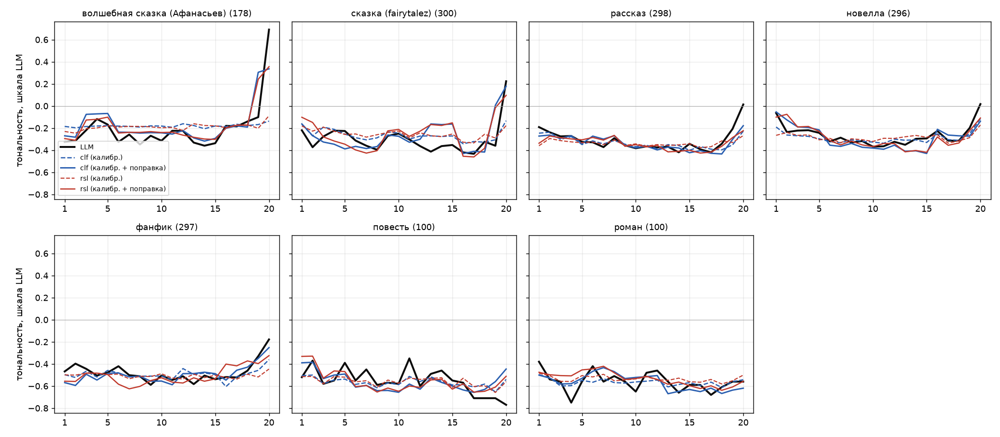

# LLM-дуги тональности и проверка классификатора с поправкой на позицию (Ворота 2, п. 2.2)

## 1. Поправка на позицию (серебро, GroupKFold по авторам, 5 блоков)

Остаток на отложенных авторах: «конец» = последние 2 сегмента − середина (3…18), «начало» = первые 2 − середина; ρ — Спирмен прогноза с LLM-тональностью внутри формы.

| сигнал | форма | конец: без поправки | конец: с поправкой | начало: без поправки | начало: с поправкой | ρ без / с поправкой |
|---|---|---|---|---|---|---|
| clf | волшебная сказка (Афанасьев) | +0.51 | +0.01 | -0.05 | -0.00 | 0.30 / 0.31 |
| clf | сказка (fairytalez) | +0.36 | +0.02 | +0.04 | -0.00 | 0.49 / 0.49 |
| clf | рассказ | +0.05 | -0.00 | -0.02 | -0.00 | 0.55 / 0.55 |
| clf | новелла | -0.01 | -0.00 | +0.15 | -0.00 | 0.56 / 0.56 |
| clf | фанфик | +0.11 | +0.00 | -0.07 | -0.00 | 0.56 / 0.55 |
| clf | повесть | +0.12 | +0.00 | +0.14 | +0.00 | 0.59 / 0.59 |
| clf | роман | -0.09 | -0.00 | -0.01 | -0.00 | 0.58 / 0.58 |
| rsl | волшебная сказка (Афанасьев) | +0.48 | +0.01 | -0.03 | -0.01 | 0.36 / 0.37 |
| rsl | сказка (fairytalez) | +0.32 | +0.02 | +0.13 | +0.01 | 0.46 / 0.46 |
| rsl | рассказ | +0.05 | -0.00 | +0.03 | -0.00 | 0.44 / 0.44 |
| rsl | новелла | +0.09 | -0.00 | +0.19 | +0.00 | 0.43 / 0.43 |
| rsl | фанфик | +0.12 | +0.00 | -0.05 | -0.01 | 0.44 / 0.43 |
| rsl | повесть | +0.08 | +0.00 | +0.21 | -0.00 | 0.51 / 0.51 |
| rsl | роман | -0.06 | -0.00 | +0.00 | +0.00 | 0.51 / 0.51 |

Поправка (на всём серебре), средний остаток по интервалам позиций 1–2, 3–5, 6–8, 9–12, 13–15, 16–18, 19–20:

| сигнал | форма | 1–2 | 3–5 | 6–8 | 9–12 | 13–15 | 16–18 | 19–20 |
|---|---|---|---|---|---|---|---|---|
| clf | волшебная сказка (Афанасьев) | -0.09 | +0.11 | -0.05 | -0.06 | -0.11 | -0.01 | +0.47 |
| clf | сказка (fairytalez) | +0.00 | -0.13 | -0.08 | -0.03 | +0.11 | -0.09 | +0.31 |
| clf | рассказ | -0.03 | +0.01 | +0.04 | -0.01 | -0.02 | -0.04 | +0.05 |
| clf | новелла | +0.14 | +0.08 | -0.03 | -0.05 | -0.10 | +0.04 | -0.02 |
| clf | фанфик | -0.07 | -0.03 | +0.00 | -0.05 | +0.01 | +0.06 | +0.11 |
| clf | повесть | +0.12 | +0.05 | -0.03 | -0.07 | -0.01 | -0.05 | +0.09 |
| clf | роман | -0.00 | +0.02 | +0.10 | +0.04 | -0.06 | -0.05 | -0.08 |
| rsl | волшебная сказка (Афанасьев) | -0.06 | +0.08 | -0.05 | -0.04 | -0.12 | -0.00 | +0.44 |
| rsl | сказка (fairytalez) | +0.08 | -0.09 | -0.14 | +0.01 | +0.10 | -0.13 | +0.27 |
| rsl | рассказ | +0.02 | +0.03 | +0.04 | -0.01 | -0.06 | -0.05 | +0.04 |
| rsl | новелла | +0.16 | +0.08 | -0.02 | -0.05 | -0.14 | -0.02 | +0.06 |
| rsl | фанфик | -0.06 | +0.00 | -0.09 | -0.04 | -0.03 | +0.12 | +0.12 |
| rsl | повесть | +0.18 | +0.05 | -0.04 | -0.07 | -0.01 | -0.05 | +0.05 |
| rsl | роман | +0.01 | +0.05 | +0.07 | +0.00 | -0.04 | -0.06 | -0.06 |

## 2. LLM-дуги: 1569 текстов полностью размечены (из 1579); стоимость 418.58 ₽

| форма | текстов | авторов |
|---|---|---|
| волшебная сказка (Афанасьев) | 178 | 120 |
| сказка (fairytalez) | 300 | 80 |
| рассказ | 298 | 298 |
| новелла | 296 | 296 |
| фанфик | 297 | 297 |
| повесть | 100 | 100 |
| роман | 100 | 100 |

### Картина концовок: последние 2 сегмента − середина, в баллах шкалы −2…+2

| сигнал | волшебная сказка (Афанасьев) | сказка (fairytalez) | рассказ | новелла | фанфик | повесть | роман |
|---|---|---|---|---|---|---|---|
| LLM | +0.55 [+0.43; +0.65] | +0.26 [+0.15; +0.39] | +0.25 [+0.16; +0.35] | +0.21 [+0.11; +0.31] | +0.25 [+0.14; +0.36] | -0.20 [-0.33; -0.05] | +0.01 [-0.11; +0.15] |
| clf (калибр.) | +0.03 [-0.01; +0.07] | +0.06 [+0.01; +0.10] | +0.06 [+0.02; +0.11] | +0.12 [+0.07; +0.18] | +0.09 [+0.04; +0.15] | -0.03 [-0.09; +0.04] | +0.02 [-0.02; +0.06] |
| clf (калибр. + поправка) | +0.53 [+0.50; +0.57] | +0.41 [+0.37; +0.46] | +0.11 [+0.07; +0.16] | +0.12 [+0.07; +0.17] | +0.21 [+0.15; +0.26] | +0.09 [+0.03; +0.16] | -0.06 [-0.11; -0.02] |
| rsl (калибр.) | +0.04 [+0.00; +0.08] | +0.03 [-0.02; +0.08] | +0.04 [+0.00; +0.08] | +0.07 [+0.02; +0.11] | +0.03 [-0.01; +0.06] | -0.05 [-0.10; -0.00] | +0.01 [-0.02; +0.05] |
| rsl (калибр. + поправка) | +0.52 [+0.48; +0.56] | +0.35 [+0.31; +0.39] | +0.10 [+0.06; +0.13] | +0.16 [+0.12; +0.20] | +0.16 [+0.12; +0.19] | +0.03 [-0.02; +0.08] | -0.05 [-0.08; -0.01] |

### Картина концовок: последние 2 сегмента − середина, после z-нормализации дуги внутри текста (форма дуги)

| сигнал | волшебная сказка (Афанасьев) | сказка (fairytalez) | рассказ | новелла | фанфик | повесть | роман |
|---|---|---|---|---|---|---|---|
| LLM | +0.64 [+0.51; +0.78] | +0.28 [+0.15; +0.42] | +0.31 [+0.20; +0.42] | +0.24 [+0.12; +0.35] | +0.30 [+0.18; +0.41] | -0.23 [-0.40; -0.07] | +0.02 [-0.13; +0.19] |
| clf (калибр.) | +0.10 [-0.04; +0.23] | +0.11 [+0.01; +0.22] | +0.12 [+0.03; +0.22] | +0.22 [+0.12; +0.32] | +0.17 [+0.07; +0.27] | -0.07 [-0.27; +0.14] | +0.13 [-0.03; +0.30] |
| clf (калибр. + поправка) | +1.79 [+1.71; +1.87] | +0.89 [+0.81; +0.98] | +0.24 [+0.15; +0.33] | +0.20 [+0.11; +0.30] | +0.38 [+0.28; +0.47] | +0.31 [+0.11; +0.51] | -0.25 [-0.40; -0.11] |
| rsl (калибр.) | +0.15 [+0.01; +0.29] | +0.08 [-0.02; +0.20] | +0.09 [-0.00; +0.18] | +0.18 [+0.08; +0.28] | +0.08 [-0.01; +0.17] | -0.16 [-0.33; +0.00] | +0.08 [-0.06; +0.24] |
| rsl (калибр. + поправка) | +1.60 [+1.48; +1.72] | +0.86 [+0.76; +0.96] | +0.22 [+0.13; +0.31] | +0.42 [+0.32; +0.51] | +0.48 [+0.39; +0.57] | +0.11 [-0.06; +0.28] | -0.24 [-0.38; -0.09] |

### Начала: первые 2 сегмента − середина, после z-нормализации

| сигнал | волшебная сказка (Афанасьев) | сказка (fairytalez) | рассказ | новелла | фанфик | повесть | роман |
|---|---|---|---|---|---|---|---|
| LLM | -0.11 [-0.22; -0.00] | +0.06 [-0.03; +0.14] | +0.18 [+0.07; +0.28] | +0.19 [+0.08; +0.29] | +0.07 [-0.03; +0.17] | +0.13 [-0.04; +0.30] | +0.17 [-0.01; +0.35] |
| clf (калибр.) | -0.01 [-0.14; +0.11] | +0.12 [+0.04; +0.20] | +0.23 [+0.13; +0.32] | +0.16 [+0.07; +0.25] | -0.02 [-0.12; +0.08] | +0.16 [-0.02; +0.32] | +0.32 [+0.17; +0.49] |
| clf (калибр. + поправка) | -0.22 [-0.32; -0.13] | +0.22 [+0.14; +0.30] | +0.18 [+0.08; +0.27] | +0.47 [+0.38; +0.57] | -0.14 [-0.24; -0.05] | +0.61 [+0.43; +0.77] | +0.24 [+0.10; +0.41] |
| rsl (калибр.) | -0.20 [-0.33; -0.07] | +0.13 [+0.04; +0.21] | +0.04 [-0.05; +0.12] | +0.11 [+0.02; +0.20] | +0.05 [-0.06; +0.14] | +0.13 [-0.05; +0.31] | +0.24 [+0.06; +0.42] |
| rsl (калибр. + поправка) | -0.27 [-0.39; -0.15] | +0.42 [+0.34; +0.50] | +0.11 [+0.02; +0.21] | +0.61 [+0.52; +0.70] | -0.10 [-0.20; -0.01] | +0.85 [+0.69; +1.00] | +0.23 [+0.06; +0.40] |

### Сказка против прозы на LLM-дугах: разница «форма − Афанасьев» [95 % ДИ, бутстрэп по авторам]

Рассказы, новеллы, фанфики отобраны в диапазоне длины сказок базы (5–95-й перцентиль), поэтому сравнение с ними сопоставлено по длине; повести и романы — отрывками ≈ 350 слов, по длине не сопоставимы.

| метрика | Афанасьев | сказка (fairytalez) | рассказ | новелла | фанфик | повесть | роман |
|---|---|---|---|---|---|---|---|
| концовка, баллы | +0.55 | -0.28 [-0.45; -0.11] | -0.29 [-0.44; -0.14] | -0.34 [-0.50; -0.18] | -0.29 [-0.45; -0.13] | -0.74 [-0.91; -0.57] | -0.53 [-0.72; -0.35] |
| концовка, z | +0.64 | -0.36 [-0.56; -0.16] | -0.33 [-0.51; -0.15] | -0.40 [-0.59; -0.22] | -0.34 [-0.51; -0.14] | -0.87 [-1.08; -0.64] | -0.62 [-0.83; -0.40] |
| начало, z | -0.11 | +0.16 [+0.02; +0.30] | +0.29 [+0.13; +0.44] | +0.30 [+0.13; +0.45] | +0.17 [+0.02; +0.33] | +0.23 [+0.02; +0.44] | +0.28 [+0.05; +0.50] |

### Согласие дуг: медиана по текстам ρ Спирмена (LLM, сигнал) по 20 позициям [IQR]

| сигнал | волшебная сказка (Афанасьев) | сказка (fairytalez) | рассказ | новелла | фанфик | повесть | роман |
|---|---|---|---|---|---|---|---|
| clf (калибр.) | 0.31 [0.15; 0.44] | 0.47 [0.32; 0.61] | 0.44 [0.29; 0.61] | 0.45 [0.29; 0.60] | 0.43 [0.28; 0.58] | 0.41 [0.23; 0.57] | 0.33 [0.17; 0.46] |
| clf (калибр. + поправка) | 0.35 [0.19; 0.50] | 0.43 [0.30; 0.59] | 0.45 [0.27; 0.61] | 0.45 [0.28; 0.59] | 0.43 [0.29; 0.58] | 0.39 [0.22; 0.56] | 0.34 [0.19; 0.44] |
| rsl (калибр.) | 0.32 [0.13; 0.47] | 0.41 [0.26; 0.56] | 0.38 [0.19; 0.51] | 0.35 [0.20; 0.49] | 0.32 [0.15; 0.49] | 0.33 [0.20; 0.52] | 0.28 [0.14; 0.43] |
| rsl (калибр. + поправка) | 0.34 [0.17; 0.49] | 0.40 [0.27; 0.54] | 0.37 [0.20; 0.52] | 0.36 [0.21; 0.49] | 0.30 [0.15; 0.48] | 0.33 [0.18; 0.51] | 0.30 [0.13; 0.46] |

## 3. Эмоции LLM по зонам текста (только описательно)

Доля сегментов с данной доминирующей эмоцией, %.

| форма | зона | гнев | грусть | нейтрально | отвращение | радость | страх | удивление |
|---|---|---|---|---|---|---|---|---|
| волшебная сказка (Афанасьев) | конец (19–20) | 7.60 | 9.30 | 23.60 | 4.50 | 46.30 | 5.30 | 3.40 |
| волшебная сказка (Афанасьев) | начало (1–2) | 4.80 | 23.90 | 52.00 | 1.70 | 7.00 | 7.90 | 2.80 |
| волшебная сказка (Афанасьев) | середина (3–18) | 7.30 | 13.50 | 47.10 | 3.70 | 13.00 | 11.50 | 3.80 |
| сказка (fairytalez) | конец (19–20) | 6.20 | 18.30 | 30.70 | 4.30 | 29.70 | 7.70 | 3.20 |
| сказка (fairytalez) | начало (1–2) | 4.00 | 21.50 | 49.70 | 4.00 | 8.70 | 9.00 | 3.20 |
| сказка (fairytalez) | середина (3–18) | 5.80 | 19.00 | 42.10 | 3.90 | 12.20 | 12.80 | 4.20 |
| рассказ | конец (19–20) | 3.20 | 27.40 | 29.20 | 6.10 | 27.70 | 5.00 | 1.30 |
| рассказ | начало (1–2) | 3.40 | 22.00 | 41.10 | 7.40 | 18.50 | 5.00 | 2.70 |
| рассказ | середина (3–18) | 5.00 | 23.90 | 35.90 | 7.70 | 15.30 | 9.10 | 3.20 |
| новелла | конец (19–20) | 2.90 | 26.60 | 29.70 | 5.30 | 25.80 | 6.90 | 2.90 |
| новелла | начало (1–2) | 2.90 | 21.80 | 45.10 | 6.80 | 17.70 | 4.10 | 1.70 |
| новелла | середина (3–18) | 4.70 | 23.30 | 37.10 | 8.50 | 16.70 | 7.00 | 2.70 |
| фанфик | конец (19–20) | 3.90 | 25.90 | 18.70 | 9.90 | 29.30 | 10.40 | 1.90 |
| фанфик | начало (1–2) | 4.50 | 24.20 | 36.00 | 9.10 | 13.60 | 10.60 | 1.90 |
| фанфик | середина (3–18) | 5.90 | 22.00 | 23.50 | 10.70 | 18.20 | 16.90 | 2.90 |
| повесть | конец (19–20) | 6.00 | 41.00 | 23.00 | 9.50 | 9.50 | 10.00 | 1.00 |
| повесть | начало (1–2) | 3.00 | 30.50 | 33.50 | 8.00 | 13.00 | 10.00 | 2.00 |
| повесть | середина (3–18) | 5.00 | 30.00 | 30.00 | 10.40 | 13.10 | 10.60 | 0.90 |
| роман | конец (19–20) | 6.00 | 28.50 | 28.50 | 10.00 | 13.00 | 13.00 | 1.00 |
| роман | начало (1–2) | 5.50 | 26.00 | 38.00 | 10.50 | 11.50 | 8.00 | 0.50 |
| роман | середина (3–18) | 5.30 | 26.60 | 32.20 | 12.40 | 10.90 | 11.80 | 0.80 |
