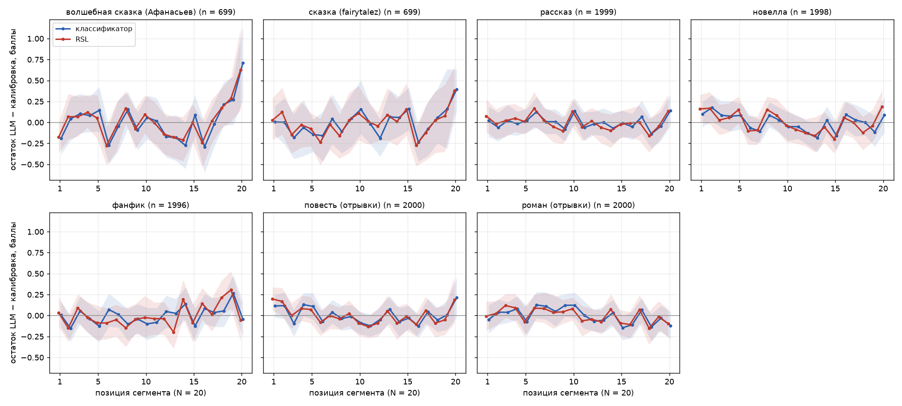

# Позиционная ошибка сигналов тональности (Ворота 2, п. 2.1; методический раздел)

Серебро: 11391 сегментов N = 20 (deepseek-v4.1-flash). Остаток = LLM-тональность − калибровка сигнала внутри формы (tone ~ a + b·сигнал; снимает сдвиг уровня и масштаб формы), в баллах шкалы −2…+2. Положительный остаток — сигнал **занижает** тональность на этой позиции. 95 % ДИ — бутстрэп по авторам (B = 1000).

## 1. Остаток по позиции, все формы

Таблица значений (позиция × форма × сигнал, n, остаток, ДИ): `reports/02_position_error_by_form.csv`. Позиции сэмплированы случайно, n на позицию у Афанасьева 24–45 — ДИ отдельной позиции широкие; контрасты «первые/последние 2 против середины» — в `reports/02_ensemble_position.md`.

## 2. 15 концовок сказок (позиции 19–20) с наибольшим остатком классификатора

| # | форма | позиция | слов | LLM | классификатор (сырой) | калибр. | RSL | остаток | текст |
|---|---|---|---|---|---|---|---|---|---|
| 1 | сказка (fairytalez) | 20 | 66 | +2 | -0.43 | -0.57 | +0.000 | +2.57 | Так колдун сгорел, а солдат собрал его прах и развеял по всем четырём ветрам. С тех пор в деревне воцарился мир. И крестьяне благодарили солдата. Он оставался в своей стране, оставался там до тех пор, пока не был удовлетворен, а затем со своими деньгами возвращался на императорскую службу: он отслужил свой срок, вышел в отставку, а затем прожил свою жизнь счастливо, любя хорошее и избегая плохого. |
| 2 | волшебная сказка (Афанасьев) | 20 | 163 | +2 | -0.62 | -0.44 | -0.043 | +2.44 | Но дурак говорил: — Помните ли, милостивый государь, как дурак к вам приезжал на печи во дворец и вы его и с дочерью, засмоля в бочку, пустили в море? Итак, узнайте теперь меня, что я — тот самый Емеля! Король, видя его пред собою, весьма испугался и не знал, что делать; а дурак в то время пошёл за его дочерью и привёл её пред короля. Король, увидя … вали её с великолепием. А на другой день дурак сделал великолепный пир для всех министров, а для простого народу выставлены были чаны с разными напитками. И как веселье отошло, то король отдавал ему своё королевство; но он не захотел. После того король поехал в своё королевство, а дурак остался в своём дворце и жил благополучно. |
| 3 | волшебная сказка (Афанасьев) | 20 | 85 | +2 | -0.41 | -0.30 | +0.000 | +2.30 | В ту ж минуту оборотилась она опять булавкою; Иван крестьянский сын воткнул её в воротник и поехал дальше. Приезжает к царю; царь увидал чудного коня, принимает доброго молодца с честию и рассказывает, как у него дочь украли. Иван говорит: — Не горюй, государь! Я её назад привёз. Вышел в другую комнату; царевна оборотилась красной девицей. Иван взял её за руку и привёл к царю. Царь ещё больше возрадовался, взял себе коня, а дочь отдал замуж за Ивана крестьянского сына. Иван и поныне живёт с молодой женою. |
| 4 | сказка (fairytalez) | 19 | 44 | +2 | -0.08 | -0.17 | +0.045 | +2.17 | Наши мулы вернулись домой, нагруженные всем золотом мира, и теперь оно лежит во дворе. Никто во всей стране не может быть так богат, как мы!» В одно мгновение дровосек вскочил на ноги и побежал во двор, где остановился, ослепленный блеском монет, лежащих вокруг него. |
| 5 | волшебная сказка (Афанасьев) | 20 | 21 | +2 | -0.02 | -0.03 | +0.048 | +2.03 | Подошла Хаврошечка, и веточки приклонились, и яблочки опустились. Барин на ней женился, и стала она в добре поживать, лиха не знавать. |
| 6 | сказка (fairytalez) | 19 | 138 | +1 | -0.81 | -1.01 | +0.000 | +2.01 | Подойдя к запертому столу, он достал маленькую чёрную глиняную бутылочку и капнул из неё каплю жидкости на губы распростертого на земле человека. Через несколько секунд лицо короля покрылось лёгким румянцем. Ещё капля – и на бледном лице промелькнуло живое выражение. Ещё капля – и через короткое время глаза открылись и с пониманием взглянули на гру … ановлен в своей семье и на своем месте в государстве, поскольку узурпатор после одной или двух слабых попыток удержать свою власть позорно бежал из страны. Вскоре после этого Хянь-Чжун имел личную беседу с королём. «Я очень хочу, — сказал он, — чтобы Ваше Величество поняло причину, по которой в Вашу жизнь пришло такое несчастье. |
| 7 | волшебная сказка (Афанасьев) | 20 | 61 | +2 | +0.07 | +0.03 | +0.033 | +1.97 | Едет то твой батюшка», — отвечала царь-девица; выходила сама навстречу, брала его за руки белые, целовала его в уста сахарные и вела его в шатры белые, садила за столы дубовые, кормила и поила досыта. Потом поехали они к царю и приняли законный брак и, побыв недолгое время в этом царстве, отправились на кораблях во владенье царь-девицы; там они царствовали долго и благополучно. |
| 8 | волшебная сказка (Афанасьев) | 20 | 62 | +2 | +0.12 | +0.06 | +0.016 | +1.94 | Утром увидал царь и в свой черёд испугался; поскорей послал к дурню дорогие уборы и платья, велел во дворец просить с царевной венчаться. Дурень нарядился в те дорогие уборы, сделался таким молодцом, что и сказать нельзя! Явился к царю, обвенчался с царевною, получил большое приданое и стал разумным и догадливым. Царь с царицею его полюбили, а царевна в нем души не чаяла. |
| 9 | сказка (fairytalez) | 20 | 45 | +1 | -0.73 | -0.91 | +0.000 | +1.91 | И всё же это очень странно, и я не думаю, что она совсем умерла, ведь мёртвые всегда виляют хвостами!» При этих словах мисс Крокодил начала очень легонько вилять хвостом, а мистер Шакал убежал, покатываясь со смеху и приговаривая: «Ого! Ого! Так мертвецы всегда виляют хвостами!» |
| 10 | сказка (fairytalez) | 20 | 55 | +1 | -0.36 | -0.49 | +0.000 | +1.49 | «Я когда-нибудь рассказывал вам сказку о „Серебряном блюдце и прозрачном яблоке“?» «Нет, нет, никогда!» — закричали одновременно Ваня и Маруся. Старый Петя сделал последнюю затяжку из трубки, а Ваня и Маруся заёрзали от волнения. Потом он отпил глоток чаю. И начал: Примечание: Далее вы можете прочитать его первый рассказ, « Сказка о серебряном блюдце и прозрачном яблоке». |
| 11 | волшебная сказка (Афанасьев) | 20 | 76 | +1 | -0.67 | -0.48 | -0.066 | +1.48 | Во имя мое сукна рвите, пташиц берите и мосты ломите!» От того под горою гам сделался; у царь-девицы дети устрашилися и сказали ей, что неприятель подступает. А она в ответ: «Какой неприятель! То идет ваш тятька, у него такая ухватка!» Иван-царевич пришел на корабль, с царь-девицею обнялся, в уста поцеловался; она корабль от берегу отвалила и пошла в дивье царство, вышла за него там замуж, и стали они жить да быть, и теперь живут, хлеб жуют. |
| 12 | волшебная сказка (Афанасьев) | 20 | 48 | +2 | +0.83 | +0.54 | +0.062 | +1.46 | В тот самый час всё царство ожило, по улицам и в домах народ засуетился, во дворец явилась царевна с генералами, со свитою, и стали все благодарствовать солдату и величать его своим государем. На другой день женился он на прекрасной царевне и зажил с нею в любви и радости. |
| 13 | сказка (fairytalez) | 20 | 126 | +1 | -0.31 | -0.43 | +0.032 | +1.43 | «Где я?» — спросила она слабым голосом. «Умоляю, расскажи мне, что случилось». Тогда они рассказали ей, что видели, и наконец красавице стало ясно, что после всех этих лет Лиса-Дух покинула её тело. Она снова стала собой. Долгое время ей не удавалось убедить людей в её истории; все говорили, что она, должно быть, сошла с ума; что боги спасли ей жиз …  ее во дворце, они увидели ее ступни, которые снова стали естественного размера, и тогда они поняли, что она говорила правду. История о том, как Таки стала женой знатного дворянина, который долго восхищался её красотой, слишком длинна, чтобы рассказывать её здесь. Однако мы уверены в одном: она прожила долгую и счастливую жизнь. |
| 14 | волшебная сказка (Афанасьев) | 19 | 22 | +1 | -0.58 | -0.42 | +0.045 | +1.42 | Ён разказав им все, што было. Гусака таго яны стали харашо кармить и паить; стали жить да паживать да добры мысли мать. |
| 15 | волшебная сказка (Афанасьев) | 20 | 95 | +2 | +0.90 | +0.59 | +0.032 | +1.41 | — Если теперь упустишь Василису Премудрую, — сказала она, — то уж больше никогда её не найдёшь. Как ни оборачивалась Василиса Премудрая, Иван-богатырь не выпускал её из рук; наконец оборотилась она стрелою, Иван-богатырь взял стрелу и переломил надвое. В ту ж минуту явилась перед ним Василиса Премудрая и сказала: — Ну, Иван-богатырь, теперь отдаюсь я в твою волю! Баба-яга подарила им ковёр-самолёт, и они полетели на ковре-самолёте в своё государство; через три дня на четвёртый опустился ковёр прямо на дворец. Король встретил своего сына и невестку с великою радостию, сделал большой пир, а после сделал вместо себя королём Ивана-богатыря. |

## 3. 15 начал новелл и повестей (позиции 1–2) с наибольшим остатком классификатора

| # | форма | позиция | слов | LLM | классификатор (сырой) | калибр. | RSL | остаток | текст |
|---|---|---|---|---|---|---|---|---|---|
| 1 | повесть (отрывки) | 1 | 357 | +2 | -0.11 | -0.42 | +0.000 | +2.42 | — Ух ты, он говорящий!!! И всамделишный!!! Крот повернулся в сторону Илюши, подбоченился и улыбнулся: — Ну вот! Я же ещё не потерял слух. Я точно вышел на голоса! — и через маленькую паузу добавил, — Привет. Меня зовут княжич, Крофидон Семнадцатый Всеслышащий. Княжич — значит сын князя. А вас как звать-величать? — Илюша м-меня зовут. А брата моего  …  кротов засмеяться. Они захохотали, похлопывая себя по бокам. Илюша, а за ним и Кирюша, тоже подхватили заразительный смех этих необычных ночных гостей, и скоро вся компания заливалась вовсю. И вот, охая и постанывая от смеха, кроты достали из невидимых кармашков носовые платочки, вытерли под очками выступившие слезы, и сказали: |
| 2 | новелла | 2 | 36 | +2 | -0.14 | -0.35 | +0.000 | +2.35 | В их большой квартире с утра до вечера, а частенько и далеко за полночь, раздаются: музыка, смех, песни под гитару и пианино, бой африканских барабанов. А какие картины они пишут! Их характер отражается и в живописи. |
| 3 | новелла | 1 | 94 | +2 | +0.05 | -0.10 | +0.021 | +2.10 | Апрель представился во всей своей красе: тёплый воздух окутывал словно перьевое одеяло всё вокруг, постепенно зарождалась новая жизнь в природе - начали прилетать птицы, некоторые цветы, как деревья, стали зацветать, снег практически сошёл, и по полям хлынула холодная вода. Именно так пришла весна вступить в свои права. И не только в природе, но и в душах людей, которые всю зиму были в спячке. Исключением не стали Маржана и Драгомил. Маржана была особенно мила, и даже красива, что присуще всем юным девочкам. Белокурая, глаза точно чёрная смородина, а губы - малина. Низенького роста и худенькая как тростинка. |
| 4 | повесть (отрывки) | 1 | 359 | +1 | -0.51 | -1.05 | -0.022 | +2.05 | Но уже после первой минуты наблюдения происходящего, после первых фраз вражеских офицеров, она отметила, что беседа более похожа на переговоры, на обсуждение вопросов, связанных с пленными солдатами и офицерами, на обсуждение вопроса… капитуляции 6й армии Вермахта, насмерть зажатой в Сталинграде. У Розы по телу пробежали мурашки, она невольно улыбн … ия адъютанту, затем, посмотрев на них: - Следуйте за мной. – сам пошел по коридору. Роза двигалась последней, стараясь не отставать. Уже в кабинете, не предлагая им сесть: - Надеюсь понимаете, что все, что здесь увидели и услышали, является государственной тайной и не подлежит разглашению ни в каком виде, ни при каких ситуациях. |
| 5 | повесть (отрывки) | 2 | 358 | +1 | -0.48 | -1.00 | +0.020 | +2.00 | Переспелов аж подскочил от радости: да вот же он – политработник, берите его, готовенького! Со знанием языка как быть, – спросите вы? А где они найдут, собственно, вообще политработника со знанием эфиопского языка? Да такого в природе просто не существует! – Значит, достаточно и английского языка, которым Переспелов худо-бедно владеет! И ведь тут г … не имеется. - А что я там делать буду? – на всякий случай спросил Виктор. - Как что? – удивился Переспелов. – То же, что и здесь: баранку крутить! - А, ну это подойдёт, – со сдержанной радостью говорил Виктор, представляя, каким героем теперь он будет выглядеть среди своих, дома: в Африке служил, в Эфиопии, на другом континенте! |
| 6 | новелла | 2 | 81 | +1 | -0.61 | -0.99 | +0.012 | +1.99 | Была среди них смуглая половчанка Элга и сынишка её малолетний, Айдак. В лохмотьях и грязи, сжав зубы, прошли они свой путь. Все удивлялись их стойкости. Князь тоже приметил эту пару и велел в обоз посадить, так и добрались они с обозом и дружиной до города. Через несколько месяцев, под зиму, пришли они в город. Князь дал ей одежду приличную, поселил стряпухой во дворце. А через несколько месяцев отдал её в жёны за рядовича дружинного бездетного, приглянулась тому чернявая и глазастая половчанка. |
| 7 | новелла | 2 | 354 | +1 | -0.61 | -0.99 | +0.003 | +1.99 | Там всё тот же воздух, который предназначен для её - и только её! - лёгких, та же земля, приспособленная всеми своими пазами, выпуклостями и впадинками для её маленьких ступней, тот же режим и темп душевной жизни. Однако и её лёгкие, и её маленькие ступни, и вся её душа там, за дверцей, вдруг наполнились какой-то особенной силой! - И всё же, Полуэк … ушательницей несколько витиеватых, не всегда оправданно рискованных, иногда чуть туманных и не совсем отчётливых, но не лишённых внутренней логики и оригинальности сюжетов из жизни Мундштука и его таксы по кличке Помидорка. - Почему Помидорка-то? - удивилась подруга, услышав первую историю, которая называлась «С места в карьер». |
| 8 | новелла | 1 | 49 | +1 | -0.58 | -0.95 | -0.082 | +1.95 | Война закончилась. Страна с облегчением вздохнула, собрала все свои силы, оставшиеся после суровой и тяжёлой битвы, и начала новую трудовую жизнь на военном пепелище. Израненные, бескрайние просторы её, где проходили жестокие бои, начали покрываться лугами, зарастать лесами. На полях битв сажали хлеб, убирали урожаи. Многочисленные шрамы войны потихоньку разглаживались. |
| 9 | новелла | 2 | 64 | +2 | +0.17 | +0.06 | +0.016 | +1.94 | Прохладное море тянуло нас в свою лазурь и мы радостно плюхались в его прозрачные воды. Солнце садилось. Мы валялись на песке. Золотистый оттенок ее кожи с налипшим на ногах песком пробуждал во мне желание прикоснуться, кончиками пальцев провести по линии ее бедра вниз по ноге до самой лодыжки, стряхнуть эти твердые крупинки, которые так бесстыдно прилипли и снова проскользить вверх, ощущая прохладу ее кожи. |
| 10 | новелла | 2 | 37 | +1 | -0.49 | -0.83 | +0.027 | +1.83 | навыпуск, и наглухо закрытый дорогой «Андрей». Какой русский не любит майских праздников! Весна уже на взлёте, лето еще не оперилось. Чистотель городская. Вечер шестичасового пошиба, на грани между обязанностью и правом, прозой и поэзией, пропуском и контрамаркой. |
| 11 | новелла | 2 | 62 | +2 | +0.26 | +0.19 | +0.016 | +1.81 | Он такой могущественный и такой нежный. Они столько лет знали друг друга, столько болтали о политике, литературе, философии, религии, судьбах родины и прочей ненужной дребедени, когда им нужен был всего лишь один поцелуй! Поцелуй, который решал всё, который определял, он это или опять не он. И он произошёл. Произошёл, и мир вдруг встал на свои места, вернул пошатнувшуюся гармонию, утерянный Адамом рай. |
| 12 | новелла | 2 | 265 | +1 | -0.47 | -0.80 | +0.011 | +1.80 | И все произошло как-то буднично, тихо и не заметно. Они почему-то даже слово «любовь» избегали. Как будто считали себя недостойным данного слова. Уже близился новый 1997 год, когда они лежали вдвоем в теплом сумраке четвертой комнаты, и тесно прижимаясь, друг к другу. Она почему-то громким шепотом шептала ему, хотя в комнате не было ни кого кроме и … семи холмам Мурома, был еще один маленький кусочек счастья. Было что-то светлое, спокойное, ласковое. Из писем Алексея: Катюша, а я ведь по-прежнему продолжаю тебя любить. Где, бы я не был, меня всегда тянет домой, потому что дома всегда ждешь меня ты, дом у меня ассоциируется с тобой. Ведь я знаю, что ты меня дома всегда ждешь. |
| 13 | повесть (отрывки) | 2 | 352 | +1 | -0.30 | -0.72 | +0.003 | +1.72 | А если бы и попытались к нам подсадить язву или противного «гондурасца», мы бы смогли любого пассажира развернуть на противоположную сторону. Получилось так, что третью нашу подругу муж вытащил из вагона за минуту до отправления. У них там семейная передряга произошла. Так что ты смело можешь занимать хоть две верхние полки. — Я вижу вы весёлые дев … ядом Германа. — Не надо ничего покупать, — сказал он, — у меня две бутылки Совиньона есть. Да и не купишь быстро на остановках ничего в наше время. Михаил Сергеевич жёстко обошёлся со спиртным и виноградниками. — Да дефицит спиртосодержащих напитков был устроен Михаилом Сергеевичем, но не Горбачёвым, а тем, кого даже КГБ боится. |
| 14 | повесть (отрывки) | 2 | 356 | +1 | -0.28 | -0.68 | -0.008 | +1.68 | Этими деньгами мы рассчитывались за различные вымышленные услуги, покупки. Денис был истинным скупердяем и «великим экономистом». Он пользовался услугами девочек, так как говорил, что давно растратил деньги, выделенные в начале игры, а на самом деле прятал их со своей напарницей в кротиную норку. Он был обычным мальчишкой: шкодливым, в то же время  … тролируемо льющихся, до алого цвета лица. Время шло… Мы взрослели, и нам хотелось всё больше и больше времени проводить вместе, в различных соревнованиях, противоборствах. Папа придумывал для нас всё новые и новые конкурсы. Вот один из них: нужно было как можно больше снять гаек и болтов с деталей за определенный период времени. |
| 15 | новелла | 1 | 39 | +2 | +0.39 | +0.36 | -0.026 | +1.64 | Лето – огромное пространство, каникульный омут – отвыкание от обыденной расфасовки дня. Лето – мечта! Мастер своего дела: одурманит запахами, очарует, уведёт в поля-леса-дубравы. Забудешь о городской жизни, будто и нет вовсе никаких шумных улиц, домов, закрывающих небо, фабрик дымных - тоже нет. |

## 4. Связан ли остаток концовок сказок с длиной сегмента

| форма | сигнал | медиана слов: конец / середина | терцили длины, слов | ρ(длина, остаток) в концовках | конец − середина: короткие | конец − середина: средние | конец − середина: длинные | эффект концовки при контроле log(слов) |
|---|---|---|---|---|---|---|---|---|
| волшебная сказка (Афанасьев) | классификатор | 61 / 61 | ≤48 / 48–77 / >77 | +0.16 (n = 52) | +0.42 (n конц. 18) | +0.36 (n конц. 20) | +0.80 (n конц. 14) | +0.51 [+0.24; +0.77] |
| волшебная сказка (Афанасьев) | RSL | 61 / 61 | ≤48 / 48–77 / >77 | +0.18 (n = 52) | +0.31 (n конц. 18) | +0.32 (n конц. 20) | +0.88 (n конц. 14) | +0.47 [+0.21; +0.74] |
| сказка (fairytalez) | классификатор | 72 / 68 | ≤53 / 53–90 / >90 | -0.05 (n = 75) | +0.32 (n конц. 27) | +0.61 (n конц. 20) | +0.19 (n конц. 28) | +0.35 [+0.12; +0.59] |
| сказка (fairytalez) | RSL | 72 / 68 | ≤53 / 53–90 / >90 | +0.01 (n = 75) | +0.32 (n конц. 27) | +0.43 (n конц. 20) | +0.24 (n конц. 28) | +0.31 [+0.08; +0.54] |

## 5. Что видно на примерах (чтение агента, 15 + 15)

**Концовки сказок.** Почти все — сюжетная развязка без оценочной лексики: свадьба («обвенчался с царевною», «приняли
законный брак»), награда и богатство («нагруженные всем золотом мира»), исцеление и возвращение («лицо короля покрылось
лёгким румянцем»), формула благополучия («стала она в добре поживать, лиха не знавать», «стали жить да поживать»).
LLM ставит +1…+2, классификатор — около нуля или ниже (−0,8…+0,1 сырой оценки): для него это нейтральное
повествование о действиях, а местами — «тревожные» слова предыдущего эпизода (сгорел, прах, испугался, неприятель).
Отдельный случай — диалектная запись («Ён разказав им все, што было… стали жить да паживать»): классификатор её
не понимает. Формульные концовки-присказки («и я там был, мёд-пиво пил») среди 15 не встретились.

**Начала новелл и повестей.** Эпиграфов и посвящений среди 15 нет (они, вероятно, удалены очисткой этапа 1 или
редки в первых двух сегментах). Это **светлая экспозиция**: лирическое описание природы и сезона («Апрель представился
во всей своей красе», «Лето – мечта!»), уютная или ироническая завязка («В их большой квартире… музыка, смех»,
«Денис был истинным скупердяем»), знакомство с героями, начало романтической линии. Тон задаётся описанием
и иронией, а не оценочными словами; классификатор оценивает такие фрагменты как нейтральные или слегка негативные.
В 2–3 случаях спорна скорее оценка LLM (переговоры о капитуляции → +1; «Война закончилась. Страна с облегчением
вздохнула…» → +1 — LLM, видимо, оценивает облегчение и надежду).

**Длина сегмента** эффект концовок не объясняет: медиана длины концовок и середины одинакова (61 / 61 слово
у Афанасьева), эффект есть во всех терцилях длины и сохраняется с контролем log(слов) (+0,51 [+0,24; +0,77]
у Афанасьева; +0,35 [+0,12; +0,59] у fairytalez).

**Вывод для методического раздела.** Лексические и нейросетевые сигналы тональности, обученные на отзывах и
соцсетях, недооценивают *сюжетно выраженную* тональность — счастливую развязку сказки и светлую экспозицию прозы.
Ошибка привязана к позиции в тексте, поэтому z-нормализация дуги её не устраняет: по таким сигналам сказка выглядит
«плоской» в финале. Оговорка: LLM может переоценивать концовки, «зная» жанровую условность счастливого конца; это
проверит только человеческая разметка (концовки сказок включаются в протокол студентов с повышенной долей).
