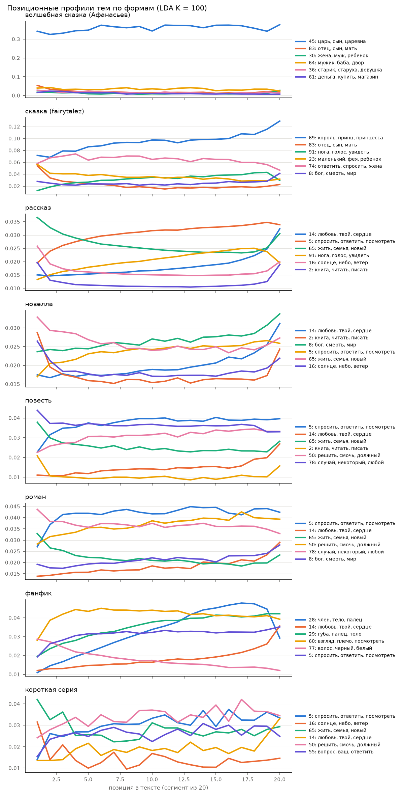

# Этап 3. Темы и позиционные профили — LDA K = 100

Обучающая выборка: 46795 документов по 200 содержательных лемм, поровну на 6 групп форм (сказка = Афанасьев + fairytalez до нормы); словарь 31130 лемм; log-likelihood/слово -9.360. Слишком частые (> 30 % документов) и удалённые: один, сам, мой, есть, дом, первый, наш, смотреть, лицо, думать, друг.

Средняя когерентность c_v: 0.615. «Сказочных» тем (доля у Афанасьева или fairytalez > 3× средней по прочим формам): 12.

## Темы

| тема | c_v | слова | доля_afanasyev | доля_fairytales | доля_прочие_формы | сказочная |
|---|---|---|---|---|---|---|
| 0 | 0.684 | школа, класс, учитель, урок, школьный, ученик, учиться, учительница, родитель, ребята, ребенок, директор | 0.001 | 0.001 | 0.007 | 0 |
| 1 | 0.667 | сон, ночь, спать, утро, кровать, проснуться, спасть, лечь, уснуть, комната, час, постель | 0.015 | 0.017 | 0.012 | 0 |
| 2 | 0.647 | книга, читать, писать, автор, стих, писатель, поэт, история, роман, написать, текст, рассказ | 0.001 | 0.001 | 0.010 | 0 |
| 3 | 0.456 | всякий, местный, подобный, собственный, пора, очередной, случай, молодой, хозяин, труд, сей, приятель | 0.004 | 0.004 | 0.017 | 0 |
| 4 | 0.629 | работа, работать, завод, рабочий, начальник, цех, мастер, район, новый, поселок, город, строительство | 0.001 | 0.001 | 0.008 | 0 |
| 5 | 0.656 | спросить, ответить, посмотреть, твой, выйти, подумать, понять, подойти, улыбнуться, увидеть, ладный, ждать | 0.007 | 0.016 | 0.030 | 0 |
| 6 | 0.678 | дверь, комната, окно, открыть, этаж, квартира, ключ, коридор, лестница, стена, выйти, войти | 0.005 | 0.007 | 0.011 | 0 |
| 7 | 0.532 | девушка, парень, молодой, юноша, мужчина, пара, посмотреть, минута, подойти, подруга, мысль, паренек | 0.001 | 0.003 | 0.004 | 0 |
| 8 | 0.509 | бог, смерть, мир, земля, твой, душа, сила, дух, умереть, зло, должный, великий | 0.007 | 0.022 | 0.016 | 0 |
| 9 | 0.691 | волк, медведь, зверь, заяц, лис, охотник, лес, шакал, лиса, кролик, лев, олень | 0.015 | 0.014 | 0.003 | 1 |
| 10 | 0.646 | телефон, позвонить, номер, звонить, трубка, звонок, голос, час, сообщение, ответить, привет, минута | 0.001 | 0.001 | 0.009 | 0 |
| 11 | 0.524 | русский, князь, язык, народ, век, земля, великий, город, имя, казак, еврей, история | 0.002 | 0.001 | 0.009 | 0 |
| 12 | 0.681 | птица, великан, крыло, змея, перо, орел, ворон, голубь, дерево, ворона, тор, увидеть | 0.014 | 0.023 | 0.003 | 1 |
| 13 | 0.553 | город, улица, здание, площадь, центр, городской, мост, стена, двор, местный, новый, парк | 0.001 | 0.003 | 0.011 | 0 |
| 14 | 0.621 | любовь, твой, сердце, любить, слеза, душа, счастие, счастливый, любимый, жить, плакать, боль | 0.005 | 0.011 | 0.016 | 0 |
| 15 | 0.646 | лес, дерево, трава, ветка, лесной, дорога, куст, гриб, болото, костер, земля, ствол | 0.006 | 0.008 | 0.009 | 0 |
| 16 | 0.613 | солнце, небо, ветер, свет, цвет, цветок, земля, звезда, луч, воздух, белый, яркий | 0.004 | 0.019 | 0.015 | 0 |
| 17 | 0.547 | фотография, бумага, стол, роман, книга, старый, лист, имя, страница, читать, помнить, буква | 0.001 | 0.001 | 0.008 | 0 |
| 18 | 0.644 | экран, система, телефон, сообщение, новый, компьютер, камера, сеть, ноутбук, интернет, монитор, работать | 0.000 | 0.001 | 0.008 | 0 |
| 19 | 0.652 | рыба, река, берег, вода, рыбак, лодка, рыбалка, озеро, сеть, рыбка, лягушка, поймать | 0.008 | 0.009 | 0.003 | 0 |
| 20 | 0.630 | команда, мяч, тренер, тренировка, спортивный, спорт, игра, соревнование, ребята, играть, футбол, матч | 0.000 | 0.001 | 0.004 | 0 |
| 21 | 0.532 | мир, сознание, духовный, дух, тело, душа, бог, мысль, смысл, новый, человеческий, реальность | 0.001 | 0.002 | 0.013 | 0 |
| 22 | 0.650 | голос, взгляд, ответить, посмотреть, чувствовать, кивнуть, спросить, тишина, шаг, почувствовать, произнести, бояться | 0.002 | 0.005 | 0.016 | 0 |
| 23 | 0.596 | маленький, фея, ребенок, дерево, увидеть, прекрасный, мальчик, большой, земля, добрый, больший, старый | 0.002 | 0.059 | 0.003 | 1 |
| 24 | 0.587 | комната, кухня, вода, квартира, ванная, дверь, вещь, кровать, одежда, выйти, пол, полотенце | 0.002 | 0.003 | 0.010 | 0 |
| 25 | 0.552 | понимать, понять, должный, любить, твой, хороший, пытаться, отношение, чувствовать, чувство, бояться, считать | 0.004 | 0.012 | 0.033 | 0 |
| 26 | 0.641 | бутылка, вино, пить, выпить, стол, пиво, бокал, водка, стакан, коньяк, напиток, налить | 0.005 | 0.003 | 0.007 | 0 |
| 27 | 0.624 | собака, кот, кошка, пес, хозяин, крыса, лапа, мышь, хвост, котенок, животное, хозяйка | 0.007 | 0.006 | 0.006 | 0 |
| 28 | 0.638 | член, тело, палец, бедро, губа, живот, рот, грудь, язык, нога, стон, удовольствие | 0.001 | 0.001 | 0.010 | 0 |
| 29 | 0.715 | губа, палец, тело, плечо, ладонь, кожа, дыхание, поцелуй, волос, щека, грудь, шея | 0.001 | 0.003 | 0.014 | 0 |
| 30 | 0.623 | жена, муж, ребенок, дочь, женщина, семья, жить, свадьба, сын, квартира, молодой, супруг | 0.008 | 0.009 | 0.012 | 0 |
| 31 | 0.619 | свет, темнота, стена, окно, темный, тень, черный, ночь, голос, звук, фонарь, старый | 0.002 | 0.007 | 0.014 | 0 |
| 32 | 0.567 | сила, магия, дракон, древний, свет, мир, камень, черный, магический, ритуал, клан, энергия | 0.000 | 0.002 | 0.006 | 0 |
| 33 | 0.586 | бабушка, дед, вера, дедушка, могила, кладбище, внук, умереть, гроб, жить, смерть, старый | 0.005 | 0.002 | 0.005 | 0 |
| 34 | 0.668 | комната, стол, стена, окно, пол, кресло, дверь, диван, стул, шкаф, зеркало, кровать | 0.002 | 0.004 | 0.008 | 0 |
| 35 | 0.659 | гора, камень, скала, пещера, вершина, путь, горный, дорога, склон, холм, река, земля | 0.003 | 0.011 | 0.007 | 0 |
| 36 | 0.599 | старик, старуха, девушка, старый, ведьма, старушка, дочь, мать, девочка, маленький, женщина, вода | 0.016 | 0.032 | 0.002 | 1 |
| 37 | 0.594 | огонь, дождь, ветер, небо, костер, пламя, вода, гореть, туча, земля, гром, молния | 0.006 | 0.008 | 0.005 | 0 |
| 38 | 0.602 | поезд, вагон, автобус, станция, вокзал, билет, ехать, остановка, путь, дорога, пассажир, окно | 0.000 | 0.000 | 0.004 | 0 |
| 39 | 0.571 | золотой, кольцо, золото, подарок, камень, монета, найти, вещь, карман, сокровище, шкатулка, ящик | 0.005 | 0.011 | 0.004 | 0 |
| 40 | 0.690 | война, военный, офицер, солдат, командир, армия, служба, генерал, фронт, товарищ, капитан, часть | 0.003 | 0.001 | 0.014 | 0 |
| 41 | 0.647 | мама, папа, ребенок, девочка, родитель, тетя, бабушка, маленький, детский, мальчик, дядя, отец | 0.002 | 0.003 | 0.014 | 0 |
| 42 | 0.677 | театр, фильм, сцена, режиссер, роль, зал, спектакль, актер, зритель, кино, артист, съемка | 0.000 | 0.001 | 0.006 | 0 |
| 43 | 0.577 | система, решение, работа, развитие, уровень, новый, процесс, вопрос, должный, проект, возможность, проблема | 0.000 | 0.001 | 0.012 | 0 |
| 44 | 0.530 | какой-то, твой, ладный, парень, мужик, понять, понимать, дурак, всякий, подумать, черт, слушать | 0.009 | 0.003 | 0.021 | 0 |
| 45 | 0.570 | царь, сын, царевна, царевич, спрашивать, добрый, молодец, дурак, поехать, твой, царство, отвечать | 0.534 | 0.010 | 0.002 | 1 |
| 46 | 0.536 | деревня, поле, село, корова, колхоз, хозяйство, работа, земля, работать, деревенский, лето, молоко | 0.005 | 0.004 | 0.007 | 0 |
| 47 | 0.641 | картина, художник, ария, искусство, работа, музей, рисовать, портрет, выставка, рисунок, краска, галерея | 0.000 | 0.001 | 0.004 | 0 |
| 48 | 0.709 | врач, больница, палата, доктор, больной, медсестра, медицинский, операция, пациент, болезнь, лечение, помощь | 0.000 | 0.001 | 0.008 | 0 |
| 49 | 0.705 | институт, студент, университет, учиться, курс, профессор, экзамен, школа, учеба, преподаватель, поступить, наука | 0.001 | 0.001 | 0.008 | 0 |
| 50 | 0.539 | решить, смочь, должный, найти, конец, прийтись, помочь, вернуться, путь, остаться, сила, помощь | 0.005 | 0.045 | 0.030 | 0 |
| 51 | 0.618 | вода, море, берег, песок, озеро, волна, морской, пляж, солнце, остров, река, океан | 0.004 | 0.011 | 0.006 | 0 |
| 52 | 0.656 | суд, полиция, полицейский, судья, следователь, преступление, убийство, ваш, документ, адвокат, закон, свидетель | 0.001 | 0.002 | 0.008 | 0 |
| 53 | 0.510 | новый, вика, праздник, вечер, гость, час, неделя, месяц, последний, рождение, встреча, решить | 0.001 | 0.004 | 0.011 | 0 |
| 54 | 0.582 | господин, ваш, мистер, граф, хозяин, миссис, дама, госпожа, молодой, леди, слуга, сэр | 0.002 | 0.007 | 0.004 | 0 |
| 55 | 0.607 | вопрос, ваш, ответить, спросить, разговор, ответ, понять, понимать, произнести, голос, какой-то, продолжить | 0.003 | 0.010 | 0.025 | 0 |
| 56 | 0.618 | царь, император, великий, ваш, дворец, султан, город, величество, господин, раб, слуга, приказать | 0.005 | 0.035 | 0.005 | 1 |
| 57 | 0.703 | демон, обезьяна, ангел, маг, волшебник, колдун, инь, тан, убить, хмель, облик, змея | 0.000 | 0.003 | 0.001 | 0 |
| 58 | 0.648 | корабль, капитан, море, остров, берег, лодка, борт, морской, судно, флот, порт, палуба | 0.006 | 0.007 | 0.005 | 0 |
| 59 | 0.576 | сад, дерево, яблоко, цветок, плод, расти, земля, куст, яблоня, участок, растение, лист | 0.004 | 0.007 | 0.004 | 0 |
| 60 | 0.688 | взгляд, плечо, посмотреть, улыбнуться, спросить, палец, кивнуть, губа, вздохнуть, голос, твой, ладонь | 0.004 | 0.005 | 0.024 | 0 |
| 61 | 0.608 | деньга, купить, магазин, рубль, тысяча, продать, цена, квартира, сумма, товар, рынок, платить | 0.012 | 0.006 | 0.015 | 0 |
| 62 | 0.534 | мужчина, женщина, взгляд, молодой, увидеть, выйти, подойти, внимание, улица, какой-то, заметить, дверь | 0.002 | 0.006 | 0.014 | 0 |
| 63 | 0.622 | голос, боль, тишина, взгляд, тяжелый, холодный, воздух, сердце, стена, страх, палец, собственный | 0.002 | 0.003 | 0.020 | 0 |
| 64 | 0.641 | мужик, баба, двор, деревня, изба, печь, баня, хозяин, дрова, дед, барин, бабка | 0.057 | 0.002 | 0.008 | 1 |
| 65 | 0.591 | жить, семья, новый, работа, ребенок, хороший, любить, работать, город, детство, родитель, история | 0.003 | 0.008 | 0.024 | 0 |
| 66 | 0.696 | работа, кабинет, директор, работать, начальник, отдел, офис, сотрудник, документ, коллега, новый, рабочий | 0.001 | 0.001 | 0.009 | 0 |
| 67 | 0.613 | кровь, тело, боль, нож, нога, рана, кожа, удар, убить, кость, живой, сила | 0.005 | 0.007 | 0.012 | 0 |
| 68 | 0.575 | игра, играть, карта, шахматы, доска, партия, ход, игрок, выиграть, слон, сыграть, проиграть | 0.001 | 0.001 | 0.002 | 0 |
| 69 | 0.734 | король, принц, принцесса, королева, прекрасный, дворец, дочь, ответить, увидеть, юноша, должный, замок | 0.009 | 0.151 | 0.003 | 1 |
| 70 | 0.626 | музыка, песня, петь, играть, танец, танцевать, мелодия, музыкант, гитара, музыкальный, голос, звук | 0.002 | 0.005 | 0.006 | 0 |
| 71 | 0.636 | должный, резервуар, система, устройство, оборудование, труба, станция, газ, зона, прибор, работа, давление | 0.000 | 0.000 | 0.005 | 0 |
| 72 | 0.653 | сигарета, курить, дым, закурить, пачка, карман, трубка, сережка, толика, табак, зажигалка, бросить | 0.001 | 0.001 | 0.002 | 0 |
| 73 | 0.611 | письмо, писать, написать, март, конверт, август, май, получить, книга, адрес, область, родиться | 0.002 | 0.001 | 0.003 | 0 |
| 74 | 0.619 | ответить, спросить, жена, отправиться, должный, увидеть, вернуться, хозяин, бедный, дорога, найти, принести | 0.021 | 0.102 | 0.004 | 1 |
| 75 | 0.599 | доктор, больной, лекарство, врач, болезнь, общий, образ, маска, касаться, таблетка, смысл, хиппи | 0.001 | 0.002 | 0.002 | 0 |
| 76 | 0.624 | стол, хлеб, еда, мясо, тарелка, обед, кухня, блюдо, ужин, готовить, суп, съесть | 0.008 | 0.010 | 0.010 | 0 |
| 77 | 0.578 | волос, черный, белый, платье, длинный, цвет, одежда, красный, рубашка, высокий, синий, костюм | 0.004 | 0.008 | 0.014 | 0 |
| 78 | 0.553 | случай, некоторый, любой, образ, причина, являться, часть, разный, подобный, вопрос, должный, событие | 0.002 | 0.008 | 0.034 | 0 |
| 79 | 0.629 | машина, дорога, водитель, ехать, автомобиль, сидение, руль, задний, колесо, поехать, город, трасса | 0.001 | 0.001 | 0.010 | 0 |
| 80 | 0.529 | спрашивать, отвечать, улыбаться, стоить, смеяться, брать, выходить, взгляд, плечо, слышать, садиться, подходить | 0.002 | 0.004 | 0.010 | 0 |
| 81 | 0.557 | мысль, чувство, мир, душа, какой-то, момент, новый, сила, ощущение, чувствовать, воспоминание, желание | 0.002 | 0.007 | 0.030 | 0 |
| 82 | 0.638 | святой, церковь, храм, бог, отец, священник, молитва, монастырь, господь, божий, монах, молиться | 0.004 | 0.005 | 0.007 | 0 |
| 83 | 0.656 | отец, сын, мать, ребенок, мальчик, дочь, родитель, семья, женщина, твой, жить, родиться | 0.018 | 0.024 | 0.011 | 0 |
| 84 | 0.660 | самолет, полет, аэропорт, лететь, вертолет, высота, летчик, летать, рейс, пилот, посадка, скорость | 0.000 | 0.000 | 0.003 | 0 |
| 85 | 0.627 | меч, воин, дракон, враг, рыцарь, земля, удар, бой, сила, убить, битва, оружие | 0.008 | 0.022 | 0.005 | 1 |
| 86 | 0.605 | страна, война, власть, народ, советский, государство, новый, российский, мир, русский, мировой, правительство | 0.001 | 0.001 | 0.016 | 0 |
| 87 | 0.635 | поехать, город, приехать, час, ехать, решить, работа, уехать, вечер, купить, жить, ходить | 0.004 | 0.003 | 0.017 | 0 |
| 88 | 0.630 | снег, зима, лед, зимний, мороз, холод, ветер, улица, снежный, теплый, елка, шапка | 0.002 | 0.003 | 0.006 | 0 |
| 89 | 0.537 | стрела, вождь, мальчик, женщина, увидеть, старик, убить, вигвам, мужчина, племя, юноша, земля | 0.002 | 0.026 | 0.002 | 1 |
| 90 | 0.679 | оружие, стрелять, выстрел, пистолет, пуля, танк, бой, солдат, боец, автомат, ружье, патрон | 0.002 | 0.001 | 0.008 | 0 |
| 91 | 0.631 | нога, голос, увидеть, упасть, бежать, схватить, сила, крик, спина, броситься, кричать, услышать | 0.012 | 0.033 | 0.021 | 0 |
| 92 | 0.584 | женщина, мужчина, любовь, женский, отношение, муж, жена, мужской, брак, любить, секс, желание | 0.000 | 0.002 | 0.005 | 0 |
| 93 | 0.595 | планета, земля, ученый, космический, система, космос, звезда, вселенная, мир, луна, пространство, лаборатория | 0.000 | 0.001 | 0.007 | 0 |
| 94 | 0.670 | чай, кофе, чашка, пить, стол, кружка, чайник, кафе, столик, запах, кухня, вкус | 0.001 | 0.002 | 0.007 | 0 |
| 95 | 0.568 | нога, нос, палец, маленький, край, спина, длинный, угол, огромный, сапог, конец, деревянный | 0.007 | 0.006 | 0.014 | 0 |
| 96 | 0.632 | ребята, мишка, парень, лагерь, пацан, мужик, мальчишка, милиция, бандит, охранник, бить, улица | 0.001 | 0.001 | 0.006 | 0 |
| 97 | 0.618 | конь, лошадь, ехать, дорога, седло, конюшня, поехать, князь, всадник, кобыла, копыто, сесть | 0.026 | 0.014 | 0.002 | 1 |
| 98 | 0.585 | брат, сестра, старший, младший, дядя, отец, слава, второй, жить, сын, мать, двоюродный | 0.010 | 0.010 | 0.004 | 0 |
| 99 | 0.564 | девушка, красивый, подруга, любить, девочка, красавица, улыбка, взгляд, женщина, молодой, нравиться, милый | 0.002 | 0.006 | 0.014 | 0 |

## Позиционные профили (N = 20)

Для каждой формы — темы с самым сильным позиционным эффектом: отношение средней доли темы в последних 3 сегментах к первым 3 (≫ 1 — тема концовки, ≪ 1 — тема начала); показаны темы со средней долей ≥ 1 %.

- **волшебная сказка (Афанасьев)** — концовка: 91 (нога, голос, увидеть, упасть) ×1.52; 12 (птица, великан, крыло, змея) ×1.45; 44 (какой-то, твой, ладный, парень) ×1.25; 60 (взгляд, плечо, посмотреть, улыбнуться) ×1.24
  — начало: 61 (деньга, купить, магазин, рубль) ×0.35; 83 (отец, сын, мать, ребенок) ×0.49; 36 (старик, старуха, девушка, старый) ×0.65; 9 (волк, медведь, зверь, заяц) ×0.80
- **сказка (fairytalez)** — концовка: 91 (нога, голос, увидеть, упасть) ×2.12; 69 (король, принц, принцесса, королева) ×1.60; 85 (меч, воин, дракон, враг) ×1.47; 14 (любовь, твой, сердце, любить) ×1.41
  — начало: 83 (отец, сын, мать, ребенок) ×0.52; 23 (маленький, фея, ребенок, дерево) ×0.65; 65 (жить, семья, новый, работа) ×0.67; 35 (гора, камень, скала, пещера) ×0.68
- **рассказ** — концовка: 14 (любовь, твой, сердце, любить) ×1.78; 91 (нога, голос, увидеть, упасть) ×1.53; 5 (спросить, ответить, посмотреть, твой) ×1.48; 8 (бог, смерть, мир, земля) ×1.36
  — начало: 13 (город, улица, здание, площадь) ×0.63; 77 (волос, черный, белый, платье) ×0.67; 15 (лес, дерево, трава, ветка) ×0.77; 99 (девушка, красивый, подруга, любить) ×0.79
- **новелла** — концовка: 14 (любовь, твой, сердце, любить) ×1.54; 91 (нога, голос, увидеть, упасть) ×1.40; 5 (спросить, ответить, посмотреть, твой) ×1.35; 8 (бог, смерть, мир, земля) ×1.30
  — начало: 13 (город, улица, здание, площадь) ×0.69; 77 (волос, черный, белый, платье) ×0.71; 11 (русский, князь, язык, народ) ×0.75; 99 (девушка, красивый, подруга, любить) ×0.79
- **повесть** — концовка: 14 (любовь, твой, сердце, любить) ×2.02; 8 (бог, смерть, мир, земля) ×1.42; 91 (нога, голос, увидеть, упасть) ×1.37; 50 (решить, смочь, должный, найти) ×1.34
  — начало: 77 (волос, черный, белый, платье) ×0.62; 99 (девушка, красивый, подруга, любить) ×0.68; 13 (город, улица, здание, площадь) ×0.73; 64 (мужик, баба, двор, деревня) ×0.73
- **роман** — концовка: 14 (любовь, твой, сердце, любить) ×1.69; 8 (бог, смерть, мир, земля) ×1.38; 91 (нога, голос, увидеть, упасть) ×1.38; 21 (мир, сознание, духовный, дух) ×1.30
  — начало: 77 (волос, черный, белый, платье) ×0.57; 99 (девушка, красивый, подруга, любить) ×0.61; 62 (мужчина, женщина, взгляд, молодой) ×0.68; 65 (жить, семья, новый, работа) ×0.74
- **фанфик** — концовка: 28 (член, тело, палец, бедро) ×2.87; 14 (любовь, твой, сердце, любить) ×2.24; 29 (губа, палец, тело, плечо) ×1.80; 91 (нога, голос, увидеть, упасть) ×1.45
  — начало: 77 (волос, черный, белый, платье) ×0.49; 62 (мужчина, женщина, взгляд, молодой) ×0.63; 99 (девушка, красивый, подруга, любить) ×0.68; 3 (всякий, местный, подобный, собственный) ×0.72
- **короткая серия** — концовка: 14 (любовь, твой, сердце, любить) ×1.86; 5 (спросить, ответить, посмотреть, твой) ×1.57; 91 (нога, голос, увидеть, упасть) ×1.52; 10 (телефон, позвонить, номер, звонить) ×1.48
  — начало: 13 (город, улица, здание, площадь) ×0.48; 16 (солнце, небо, ветер, свет) ×0.63; 77 (волос, черный, белый, платье) ×0.63; 31 (свет, темнота, стена, окно) ×0.67

## Метрики траектории по формам

### N = 10 (медианы)

| форма | текстов | лемм_в_сегменте | скорость | объём | извилистость | поз_концентрация |
|---|---|---|---|---|---|---|
| волшебная сказка (Афанасьев) | 179 | 54.000 | 0.460 | 0.363 | 1.118 | 0.221 |
| сказка (fairytalez) | 1 893 | 58.000 | 0.582 | 0.455 | 1.109 | 0.328 |
| рассказ | 217 936 | 53.000 | 0.635 | 0.482 | 1.092 | 0.376 |
| новелла | 8 197 | 49.000 | 0.627 | 0.475 | 1.095 | 0.369 |
| повесть | 2 028 | 741.500 | 0.536 | 0.413 | 1.064 | 0.242 |
| роман | 1 079 | 1968.000 | 0.448 | 0.345 | 1.059 | 0.167 |
| фанфик | 13 701 | 112.000 | 0.592 | 0.454 | 1.086 | 0.321 |
| короткая серия | 230 | 214.500 | 0.625 | 0.474 | 1.076 | 0.336 |

### N = 20 (медианы)

| форма | текстов | лемм_в_сегменте | скорость | объём | извилистость | поз_концентрация |
|---|---|---|---|---|---|---|
| волшебная сказка (Афанасьев) | 179 | 26.500 | 0.481 | 0.384 | 1.193 | 0.209 |
| сказка (fairytalez) | 1 893 | 29.000 | 0.584 | 0.465 | 1.170 | 0.294 |
| рассказ | 217 538 | 26.500 | 0.616 | 0.481 | 1.141 | 0.321 |
| новелла | 8 144 | 24.500 | 0.607 | 0.472 | 1.145 | 0.310 |
| повесть | 2 028 | 371.000 | 0.589 | 0.476 | 1.090 | 0.261 |
| роман | 1 079 | 980.500 | 0.510 | 0.413 | 1.084 | 0.188 |
| фанфик | 13 665 | 56.000 | 0.596 | 0.470 | 1.134 | 0.292 |
| короткая серия | 230 | 109.250 | 0.641 | 0.515 | 1.108 | 0.329 |

Ранговая корреляция метрик с log(содержательных лемм в сегменте), все тексты: speed +0.45, volume +0.61, circuitousness -0.49, pos_concentration +0.33.

Внутри диапазонов размера сегмента (содержательных лемм на сегмент; группы ≥ 30 текстов):

| лемм_в_сегм | форма | n | скорость | поз_концентрация |
|---|---|---|---|---|
| ≤20 | фанфик | 2 453 | 0.579 | 0.283 |
| ≤20 | новелла | 3 152 | 0.584 | 0.292 |
| ≤20 | рассказ | 74 146 | 0.586 | 0.295 |
| ≤20 | волшебная сказка (Афанасьев) | 62 | 0.527 | 0.238 |
| ≤20 | сказка (fairytalez) | 556 | 0.578 | 0.284 |
| 21–40 | фанфик | 3 028 | 0.620 | 0.321 |
| 21–40 | новелла | 2 756 | 0.623 | 0.331 |
| 21–40 | рассказ | 80 733 | 0.627 | 0.334 |
| 21–40 | волшебная сказка (Афанасьев) | 76 | 0.480 | 0.207 |
| 21–40 | сказка (fairytalez) | 767 | 0.594 | 0.304 |
| 41–80 | фанфик | 2 568 | 0.633 | 0.327 |
| 41–80 | новелла | 1 367 | 0.635 | 0.334 |
| 41–80 | короткая серия | 59 | 0.652 | 0.354 |
| 41–80 | рассказ | 41 569 | 0.647 | 0.349 |
| 41–80 | волшебная сказка (Афанасьев) | 38 | 0.431 | 0.184 |
| 41–80 | сказка (fairytalez) | 472 | 0.580 | 0.296 |
| 81–160 | фанфик | 1 744 | 0.618 | 0.305 |
| 81–160 | новелла | 558 | 0.627 | 0.313 |
| 81–160 | короткая серия | 95 | 0.641 | 0.329 |
| 81–160 | рассказ | 14 912 | 0.645 | 0.335 |
| 81–160 | сказка (fairytalez) | 90 | 0.571 | 0.276 |
| 161–400 | фанфик | 1 668 | 0.584 | 0.261 |
| 161–400 | роман | 36 | 0.595 | 0.258 |
| 161–400 | новелла | 243 | 0.615 | 0.292 |
| 161–400 | повесть | 1 123 | 0.615 | 0.285 |
| 161–400 | короткая серия | 55 | 0.634 | 0.307 |
| 161–400 | рассказ | 4 989 | 0.616 | 0.295 |
| >400 | фанфик | 2 201 | 0.485 | 0.170 |
| >400 | роман | 1 043 | 0.509 | 0.186 |
| >400 | новелла | 68 | 0.536 | 0.221 |
| >400 | повесть | 900 | 0.548 | 0.220 |
| >400 | рассказ | 1 189 | 0.549 | 0.226 |

**Важно:** скорость, объём и позиционная концентрация сильно зависят от размера сегмента: длинный сегмент усредняет темы, и траектория становится глаже независимо от сюжета (тот же эффект, что для эмоциональных дуг, Ворота 2, п. 4). Сравнение форм по этим метрикам — только при сопоставимом размере сегмента и с контролем шума (этап 4).
