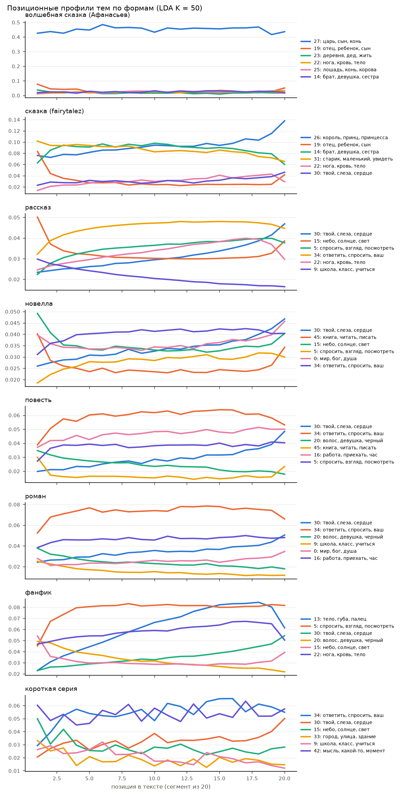

# Этап 3. Темы и позиционные профили — LDA K = 50

Обучающая выборка: 46795 документов по 200 содержательных лемм, поровну на 6 групп форм (сказка = Афанасьев + fairytalez до нормы); словарь 31130 лемм; log-likelihood/слово -9.349. Слишком частые (> 30 % документов) и удалённые: один, сам, мой, есть, дом, первый, наш, смотреть, лицо, думать, друг.

Средняя когерентность c_v: 0.594. «Сказочных» тем (доля у Афанасьева или fairytalez > 3× средней по прочим формам): 8.

## Темы

| тема | c_v | слова | доля_afanasyev | доля_fairytales | доля_прочие_формы | сказочная |
|---|---|---|---|---|---|---|
| 0 | 0.487 | мир, бог, душа, дух, сила, земля, свет, человеческий, новый, тело, путь, великий | 0.002 | 0.010 | 0.021 | 0 |
| 1 | 0.695 | врач, доктор, больница, больной, палата, болезнь, медсестра, лекарство, медицинский, пациент, операция, лечение | 0.001 | 0.002 | 0.011 | 0 |
| 2 | 0.593 | деньга, работа, купить, работать, новый, квартира, магазин, рубль, тысяча, цена, хороший, продать | 0.009 | 0.008 | 0.024 | 0 |
| 3 | 0.652 | капитан, служба, офицер, командир, военный, товарищ, лейтенант, начальник, генерал, армия, полковник, солдат | 0.003 | 0.001 | 0.009 | 0 |
| 4 | 0.628 | дверь, комната, окно, кровать, стол, квартира, открыть, стена, пол, выйти, спать, кухня | 0.011 | 0.019 | 0.032 | 0 |
| 5 | 0.638 | спросить, взгляд, посмотреть, ответить, девушка, парень, улыбнуться, плечо, голос, кивнуть, подойти, твой | 0.006 | 0.012 | 0.045 | 0 |
| 6 | 0.548 | господин, ваш, император, царь, великий, должный, слуга, город, хозяин, отправиться, раб, госпожа | 0.006 | 0.075 | 0.013 | 1 |
| 7 | 0.549 | музыка, песня, играть, сцена, петь, танец, театр, зал, танцевать, фильм, концерт, музыкальный | 0.002 | 0.004 | 0.011 | 0 |
| 8 | 0.510 | понимать, пытаться, какой-то, спрашивать, любить, стоить, отвечать, нравиться, хотеться, твой, понять, смеяться | 0.005 | 0.012 | 0.032 | 0 |
| 9 | 0.707 | школа, класс, учиться, учитель, урок, институт, студент, работать, школьный, родитель, курс, университет | 0.001 | 0.002 | 0.017 | 0 |
| 10 | 0.581 | стол, чай, хлеб, еда, кухня, тарелка, обед, мясо, вода, готовить, блюдо, вкусный | 0.008 | 0.013 | 0.017 | 0 |
| 11 | 0.495 | русский, князь, народ, язык, земля, великий, город, казак, век, имя, история, страна | 0.004 | 0.003 | 0.012 | 0 |
| 12 | 0.663 | война, солдат, бой, немец, военный, армия, фронт, враг, оружие, боец, боевой, командир | 0.002 | 0.002 | 0.015 | 0 |
| 13 | 0.715 | тело, губа, палец, грудь, член, кожа, поцелуй, бедро, шея, рот, нога, живот | 0.002 | 0.003 | 0.020 | 0 |
| 14 | 0.580 | брат, девушка, сестра, юноша, ответить, вода, спросить, увидеть, мать, сын, вернуться, старуха | 0.020 | 0.116 | 0.006 | 1 |
| 15 | 0.622 | небо, солнце, свет, ветер, земля, дождь, воздух, ночь, дерево, цветок, звезда, цвет | 0.011 | 0.033 | 0.029 | 0 |
| 16 | 0.567 | работа, приехать, час, поехать, решить, ждать, телефон, позвонить, вечер, выйти, утро, неделя | 0.006 | 0.006 | 0.038 | 0 |
| 17 | 0.620 | святой, церковь, вера, бог, храм, отец, священник, молитва, господь, монастырь, божий, монах | 0.005 | 0.006 | 0.008 | 0 |
| 18 | 0.586 | собака, кот, кошка, пес, хозяин, ария, крыса, лапа, хвост, хозяйка, мышь, котенок | 0.008 | 0.007 | 0.007 | 0 |
| 19 | 0.677 | отец, ребенок, сын, жена, мать, муж, дочь, семья, жить, женщина, родитель, брат | 0.019 | 0.025 | 0.024 | 0 |
| 20 | 0.540 | волос, девушка, черный, женщина, белый, платье, длинный, цвет, мужчина, высокий, красивый, взгляд | 0.006 | 0.014 | 0.027 | 0 |
| 21 | 0.646 | суд, полиция, полицейский, судья, убийство, преступление, следователь, начальник, документ, тюрьма, ваш, камера | 0.002 | 0.003 | 0.013 | 0 |
| 22 | 0.622 | нога, кровь, тело, спина, сила, удар, упасть, боль, пол, крик, стена, голос | 0.016 | 0.023 | 0.039 | 0 |
| 23 | 0.473 | деревня, дед, жить, двор, поле, село, работа, лето, старый, работать, огород, земля | 0.016 | 0.006 | 0.019 | 0 |
| 24 | 0.602 | игра, играть, команда, мяч, тренер, тренировка, карта, спортивный, спорт, игрок, победа, шахматы | 0.001 | 0.002 | 0.007 | 0 |
| 25 | 0.536 | лошадь, конь, корова, хозяин, дорога, ответить, спросить, пастух, овца, жена, мешок, деньга | 0.033 | 0.063 | 0.005 | 1 |
| 26 | 0.741 | король, принц, принцесса, королева, дворец, прекрасный, дочь, увидеть, должный, фея, ответить, золотой | 0.011 | 0.138 | 0.004 | 1 |
| 27 | 0.558 | царь, сын, конь, брат, добрый, царевна, поехать, царевич, спрашивать, старик, дурак, твой | 0.644 | 0.015 | 0.003 | 1 |
| 28 | 0.521 | случай, должный, вопрос, отношение, любой, возможность, являться, образ, некоторый, собственный, проблема, цель | 0.002 | 0.009 | 0.051 | 0 |
| 29 | 0.666 | голос, взгляд, тишина, свет, палец, чувствовать, воздух, шаг, тень, сердце, мир, холодный | 0.003 | 0.007 | 0.038 | 0 |
| 30 | 0.546 | твой, слеза, сердце, смерть, жить, душа, любить, любовь, умереть, боль, должный, остаться | 0.013 | 0.029 | 0.031 | 0 |
| 31 | 0.563 | старик, маленький, увидеть, дерево, мальчик, ребенок, земля, старый, должный, большой, найти, лес | 0.006 | 0.133 | 0.007 | 1 |
| 32 | 0.618 | мама, бабушка, ребенок, папа, девочка, мальчик, дядя, отец, маленький, родитель, детский, тетя | 0.008 | 0.007 | 0.022 | 0 |
| 33 | 0.460 | город, улица, здание, стена, площадь, центр, небольшой, большой, огромный, местный, находиться, окно | 0.002 | 0.005 | 0.020 | 0 |
| 34 | 0.535 | ответить, спросить, ваш, вопрос, понять, твой, решить, понимать, подумать, разговор, должный, рассказать | 0.006 | 0.024 | 0.051 | 0 |
| 35 | 0.469 | система, планета, мир, мозг, тело, новый, энергия, ваш, земля, космический, уровень, пространство | 0.000 | 0.001 | 0.013 | 0 |
| 36 | 0.659 | меч, великан, дракон, сила, земля, демон, воин, убить, рыцарь, стрела, огромный, маг | 0.008 | 0.050 | 0.009 | 1 |
| 37 | 0.613 | бутылка, вино, стол, пить, выпить, пиво, бокал, стакан, водка, столик, кофе, напиток | 0.005 | 0.004 | 0.010 | 0 |
| 38 | 0.697 | лес, вода, гора, река, дорога, дерево, путь, камень, земля, берег, костер, озеро | 0.005 | 0.014 | 0.017 | 0 |
| 39 | 0.610 | страна, власть, народ, советский, война, новый, государство, российский, партия, работа, государственный, союз | 0.001 | 0.001 | 0.022 | 0 |
| 40 | 0.617 | машина, дорога, водитель, ехать, автомобиль, автобус, сидение, поехать, руль, минута, задний, колесо | 0.002 | 0.001 | 0.013 | 0 |
| 41 | 0.621 | письмо, телефон, писать, написать, фотография, стол, бумага, экран, кабинет, сообщение, читать, номер | 0.003 | 0.002 | 0.016 | 0 |
| 42 | 0.472 | мысль, какой-то, момент, сон, понять, чувство, новый, сила, смочь, конец, решить, последний | 0.004 | 0.019 | 0.049 | 0 |
| 43 | 0.580 | снег, поезд, вагон, дорога, станция, лед, окно, зима, вокзал, мороз, зимний, снежный | 0.002 | 0.003 | 0.009 | 0 |
| 44 | 0.649 | вода, море, берег, корабль, рыба, остров, лодка, морской, река, волна, рыбак, капитан | 0.014 | 0.022 | 0.010 | 0 |
| 45 | 0.613 | книга, читать, писать, роман, художник, картина, история, автор, стих, писатель, поэт, написать | 0.001 | 0.002 | 0.017 | 0 |
| 46 | 0.606 | работа, самолет, должный, завод, работать, рабочий, полет, цех, оборудование, объект, метр, система | 0.001 | 0.001 | 0.012 | 0 |
| 47 | 0.672 | птица, волк, медведь, лес, охотник, зверь, заяц, лис, крыло, охота, шакал, орел | 0.028 | 0.027 | 0.005 | 1 |
| 48 | 0.597 | любовь, женщина, любить, девушка, мужчина, чувство, душа, счастие, сердце, красивый, молодой, любимый | 0.003 | 0.010 | 0.031 | 0 |
| 49 | 0.488 | мужик, какой-то, парень, всякий, баба, ладный, нога, ребята, общий, нос, пацан, курить | 0.023 | 0.005 | 0.038 | 0 |

## Позиционные профили (N = 20)

Для каждой формы — темы с самым сильным позиционным эффектом: отношение средней доли темы в последних 3 сегментах к первым 3 (≫ 1 — тема концовки, ≪ 1 — тема начала); показаны темы со средней долей ≥ 1 %.

- **волшебная сказка (Афанасьев)** — концовка: 22 (нога, кровь, тело, спина) ×2.00; 26 (король, принц, принцесса, королева) ×1.83; 10 (стол, чай, хлеб, еда) ×1.47; 31 (старик, маленький, увидеть, дерево) ×1.19
  — начало: 2 (деньга, работа, купить, работать) ×0.48; 19 (отец, ребенок, сын, жена) ×0.59; 32 (мама, бабушка, ребенок, папа) ×0.62; 23 (деревня, дед, жить, двор) ×0.67
- **сказка (fairytalez)** — концовка: 22 (нога, кровь, тело, спина) ×1.93; 26 (король, принц, принцесса, королева) ×1.57; 30 (твой, слеза, сердце, смерть) ×1.52; 36 (меч, великан, дракон, сила) ×1.44
  — начало: 19 (отец, ребенок, сын, жена) ×0.56; 2 (деньга, работа, купить, работать) ×0.65; 38 (лес, вода, гора, река) ×0.67; 32 (мама, бабушка, ребенок, папа) ×0.72
- **рассказ** — концовка: 30 (твой, слеза, сердце, смерть) ×1.75; 5 (спросить, взгляд, посмотреть, ответить) ×1.45; 21 (суд, полиция, полицейский, судья) ×1.39; 22 (нога, кровь, тело, спина) ×1.34
  — начало: 9 (школа, класс, учиться, учитель) ×0.60; 33 (город, улица, здание, стена) ×0.64; 20 (волос, девушка, черный, женщина) ×0.67; 23 (деревня, дед, жить, двор) ×0.71
- **новелла** — концовка: 30 (твой, слеза, сердце, смерть) ×1.57; 5 (спросить, взгляд, посмотреть, ответить) ×1.43; 21 (суд, полиция, полицейский, судья) ×1.28; 22 (нога, кровь, тело, спина) ×1.24
  — начало: 33 (город, улица, здание, стена) ×0.68; 9 (школа, класс, учиться, учитель) ×0.70; 20 (волос, девушка, черный, женщина) ×0.72; 23 (деревня, дед, жить, двор) ×0.77
- **повесть** — концовка: 30 (твой, слеза, сердце, смерть) ×1.99; 21 (суд, полиция, полицейский, судья) ×1.52; 1 (врач, доктор, больница, больной) ×1.34; 22 (нога, кровь, тело, спина) ×1.26
  — начало: 9 (школа, класс, учиться, учитель) ×0.58; 20 (волос, девушка, черный, женщина) ×0.60; 23 (деревня, дед, жить, двор) ×0.66; 33 (город, улица, здание, стена) ×0.72
- **роман** — концовка: 30 (твой, слеза, сердце, смерть) ×1.74; 21 (суд, полиция, полицейский, судья) ×1.42; 35 (система, планета, мир, мозг) ×1.34; 12 (война, солдат, бой, немец) ×1.31
  — начало: 9 (школа, класс, учиться, учитель) ×0.52; 20 (волос, девушка, черный, женщина) ×0.56; 23 (деревня, дед, жить, двор) ×0.69; 33 (город, улица, здание, стена) ×0.74
- **фанфик** — концовка: 13 (тело, губа, палец, грудь) ×2.50; 30 (твой, слеза, сердце, смерть) ×1.93; 5 (спросить, взгляд, посмотреть, ответить) ×1.32; 22 (нога, кровь, тело, спина) ×1.23
  — начало: 9 (школа, класс, учиться, учитель) ×0.47; 20 (волос, девушка, черный, женщина) ×0.50; 33 (город, улица, здание, стена) ×0.59; 2 (деньга, работа, купить, работать) ×0.70
- **короткая серия** — концовка: 30 (твой, слеза, сердце, смерть) ×1.59; 21 (суд, полиция, полицейский, судья) ×1.50; 34 (ответить, спросить, ваш, вопрос) ×1.44; 12 (война, солдат, бой, немец) ×1.43
  — начало: 9 (школа, класс, учиться, учитель) ×0.55; 33 (город, улица, здание, стена) ×0.56; 23 (деревня, дед, жить, двор) ×0.63; 15 (небо, солнце, свет, ветер) ×0.64

## Метрики траектории по формам

### N = 10 (медианы)

| форма | текстов | лемм_в_сегменте | скорость | объём | извилистость | поз_концентрация |
|---|---|---|---|---|---|---|
| волшебная сказка (Афанасьев) | 179 | 54.000 | 0.387 | 0.306 | 1.155 | 0.156 |
| сказка (fairytalez) | 1 893 | 58.000 | 0.537 | 0.419 | 1.151 | 0.275 |
| рассказ | 217 936 | 53.000 | 0.580 | 0.441 | 1.124 | 0.310 |
| новелла | 8 197 | 49.000 | 0.577 | 0.438 | 1.126 | 0.309 |
| повесть | 2 028 | 741.500 | 0.454 | 0.348 | 1.089 | 0.175 |
| роман | 1 079 | 1968.000 | 0.368 | 0.284 | 1.084 | 0.116 |
| фанфик | 13 701 | 112.000 | 0.517 | 0.399 | 1.120 | 0.247 |
| короткая серия | 230 | 214.500 | 0.541 | 0.419 | 1.099 | 0.261 |

### N = 20 (медианы)

| форма | текстов | лемм_в_сегменте | скорость | объём | извилистость | поз_концентрация |
|---|---|---|---|---|---|---|
| волшебная сказка (Афанасьев) | 179 | 26.500 | 0.417 | 0.337 | 1.254 | 0.159 |
| сказка (fairytalez) | 1 893 | 29.000 | 0.553 | 0.441 | 1.232 | 0.256 |
| рассказ | 217 538 | 26.500 | 0.577 | 0.452 | 1.190 | 0.275 |
| новелла | 8 144 | 24.500 | 0.572 | 0.446 | 1.194 | 0.269 |
| повесть | 2 028 | 371.000 | 0.508 | 0.411 | 1.126 | 0.193 |
| роман | 1 079 | 980.500 | 0.428 | 0.349 | 1.119 | 0.136 |
| фанфик | 13 665 | 56.000 | 0.540 | 0.427 | 1.184 | 0.236 |
| короткая серия | 230 | 109.250 | 0.577 | 0.463 | 1.150 | 0.262 |

Ранговая корреляция метрик с log(содержательных лемм в сегменте), все тексты: speed +0.12, volume +0.34, circuitousness -0.47, pos_concentration +0.04.

Внутри диапазонов размера сегмента (содержательных лемм на сегмент; группы ≥ 30 текстов):

| лемм_в_сегм | форма | n | скорость | поз_концентрация |
|---|---|---|---|---|
| ≤20 | фанфик | 2 453 | 0.551 | 0.249 |
| ≤20 | новелла | 3 152 | 0.562 | 0.262 |
| ≤20 | рассказ | 74 146 | 0.563 | 0.264 |
| ≤20 | волшебная сказка (Афанасьев) | 62 | 0.495 | 0.202 |
| ≤20 | сказка (fairytalez) | 556 | 0.560 | 0.259 |
| 21–40 | фанфик | 3 028 | 0.574 | 0.267 |
| 21–40 | новелла | 2 756 | 0.586 | 0.286 |
| 21–40 | рассказ | 80 733 | 0.587 | 0.285 |
| 21–40 | волшебная сказка (Афанасьев) | 76 | 0.410 | 0.156 |
| 21–40 | сказка (fairytalez) | 767 | 0.559 | 0.260 |
| 41–80 | фанфик | 2 568 | 0.568 | 0.260 |
| 41–80 | новелла | 1 367 | 0.583 | 0.274 |
| 41–80 | короткая серия | 59 | 0.594 | 0.291 |
| 41–80 | рассказ | 41 569 | 0.593 | 0.286 |
| 41–80 | волшебная сказка (Афанасьев) | 38 | 0.370 | 0.131 |
| 41–80 | сказка (fairytalez) | 472 | 0.539 | 0.248 |
| 81–160 | фанфик | 1 744 | 0.542 | 0.233 |
| 81–160 | новелла | 558 | 0.561 | 0.246 |
| 81–160 | короткая серия | 95 | 0.573 | 0.261 |
| 81–160 | рассказ | 14 912 | 0.578 | 0.264 |
| 81–160 | сказка (fairytalez) | 90 | 0.510 | 0.228 |
| 161–400 | фанфик | 1 668 | 0.496 | 0.192 |
| 161–400 | роман | 36 | 0.504 | 0.189 |
| 161–400 | новелла | 243 | 0.536 | 0.223 |
| 161–400 | повесть | 1 123 | 0.535 | 0.215 |
| 161–400 | короткая серия | 55 | 0.562 | 0.232 |
| 161–400 | рассказ | 4 989 | 0.540 | 0.225 |
| >400 | фанфик | 2 201 | 0.401 | 0.121 |
| >400 | роман | 1 043 | 0.425 | 0.134 |
| >400 | новелла | 68 | 0.467 | 0.165 |
| >400 | повесть | 900 | 0.466 | 0.161 |
| >400 | рассказ | 1 189 | 0.469 | 0.166 |

**Важно:** скорость, объём и позиционная концентрация сильно зависят от размера сегмента: длинный сегмент усредняет темы, и траектория становится глаже независимо от сюжета (тот же эффект, что для эмоциональных дуг, Ворота 2, п. 4). Сравнение форм по этим метрикам — только при сопоставимом размере сегмента и с контролем шума (этап 4).
