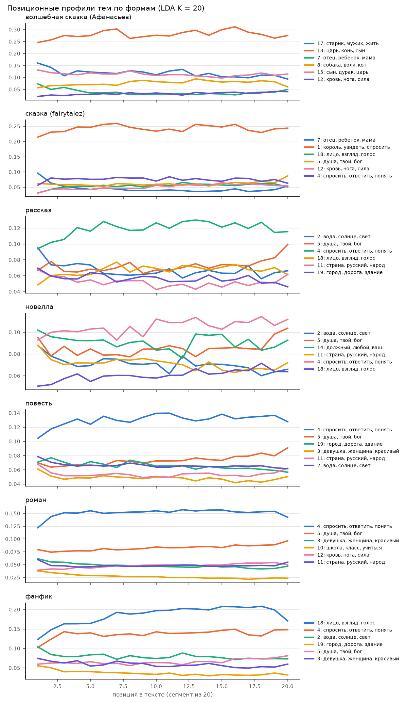

# Этап 3. Темы и позиционные профили — LDA K = 20 (ВЫБОРКА)

Обучающая выборка: 4800 документов по 200 содержательных лемм, поровну на 6 групп форм (сказка = Афанасьев + fairytalez до нормы); словарь 9786 лемм; log-likelihood/слово -8.750. Слишком частые (> 30 % документов) и удалённые: один, сам, мой, есть, дом, наш, первый, думать, смотреть, друг.

Средняя когерентность c_v: 0.614. «Сказочных» тем (доля у Афанасьева или fairytalez > 3× средней по прочим формам): 5.

## Темы

| тема | c_v | слова | доля_afanasyev | доля_fairytales | доля_прочие_формы | сказочная |
|---|---|---|---|---|---|---|
| 0 | 0.736 | война, медаль, рядовой, отечественный, солдат, военный, офицер, победа, орден, командир, великий, товарищ | 0.003 | 0.003 | 0.021 | 0 |
| 1 | 0.536 | король, увидеть, спросить, должный, ответить, принц, принцесса, прекрасный, вернуться, отправиться, дочь, земля | 0.015 | 0.379 | 0.019 | 1 |
| 2 | 0.573 | вода, солнце, свет, земля, небо, ветер, черный, гора, воздух, огромный, стена, темный | 0.012 | 0.063 | 0.067 | 0 |
| 3 | 0.575 | девушка, женщина, красивый, молодой, волос, любить, маленький, платье, красота, мужчина, цвет, белый | 0.010 | 0.037 | 0.050 | 0 |
| 4 | 0.653 | спросить, ответить, понять, понимать, твой, вопрос, решить, девушка, подумать, телефон, какой-то, должный | 0.014 | 0.047 | 0.130 | 0 |
| 5 | 0.524 | душа, твой, бог, мир, любовь, сила, мысль, чувство, сердце, свет, понять, святой | 0.012 | 0.064 | 0.070 | 0 |
| 6 | 0.620 | стол, пить, чай, бутылка, кухня, вода, выпить, стакан, принести, кофе, водка, еда | 0.017 | 0.024 | 0.040 | 0 |
| 7 | 0.640 | отец, ребенок, мама, мать, сын, жить, муж, родитель, семья, сестра, дочь, жена | 0.019 | 0.038 | 0.052 | 0 |
| 8 | 0.626 | собака, волк, кот, медведь, птица, лес, хозяин, заяц, берег, корова, хвост, охотник | 0.091 | 0.071 | 0.019 | 1 |
| 9 | 0.518 | работа, деньга, работать, новый, письмо, жена, получить, хороший, поехать, жить, машина, писать | 0.012 | 0.024 | 0.069 | 0 |
| 10 | 0.727 | школа, класс, учиться, роман, парень, учитель, урок, читать, курс, новый, ходить, ребята | 0.003 | 0.004 | 0.030 | 0 |
| 11 | 0.607 | страна, русский, народ, книга, советский, власть, война, новый, история, век, часть, язык | 0.004 | 0.013 | 0.050 | 0 |
| 12 | 0.567 | кровь, нога, сила, тело, удар, страх, убить, живой, смерть, кричать, лицо, упасть | 0.020 | 0.044 | 0.049 | 0 |
| 13 | 0.797 | царь, конь, сын, молодец, царевна, царевич, поехать, добрый, девица, брат, земля, море | 0.381 | 0.026 | 0.009 | 1 |
| 14 | 0.550 | должный, любой, ваш, отношение, мир, какой-то, жить, смысл, считать, желание, случай, образ | 0.005 | 0.021 | 0.077 | 0 |
| 15 | 0.609 | сын, дурак, царь, король, деньга, купец, корабль, ваш, солдат, купеческий, жена, дворец | 0.164 | 0.019 | 0.008 | 1 |
| 16 | 0.574 | дверь, комната, окно, ночь, сон, открыть, кровать, выйти, спать, стол, стена, квартира | 0.020 | 0.038 | 0.058 | 0 |
| 17 | 0.571 | старик, мужик, жить, брат, старуха, деревня, двор, старый, дед, бог, печь, лес | 0.178 | 0.041 | 0.024 | 1 |
| 18 | 0.757 | лицо, взгляд, голос, парень, палец, плечо, губа, спина, ладонь, секунда, нога, посмотреть | 0.015 | 0.032 | 0.100 | 0 |
| 19 | 0.519 | город, дорога, здание, улица, час, начальник, ехать, самолет, местный, поезд, путь, ребята | 0.005 | 0.010 | 0.059 | 0 |

## Позиционные профили (N = 20)

Для каждой формы — темы с самым сильным позиционным эффектом: отношение средней доли темы в последних 3 сегментах к первым 3 (≫ 1 — тема концовки, ≪ 1 — тема начала); показаны темы со средней долей ≥ 1 %.

- **волшебная сказка (Афанасьев)** — концовка: 12 (кровь, нога, сила, тело) ×1.65; 1 (король, увидеть, спросить, должный) ×1.25; 6 (стол, пить, чай, бутылка) ×1.23; 5 (душа, твой, бог, мир) ×1.20
  — начало: 7 (отец, ребенок, мама, мать) ×0.70; 17 (старик, мужик, жить, брат) ×0.76; 19 (город, дорога, здание, улица) ×0.85; 11 (страна, русский, народ, книга) ×0.92
- **сказка (fairytalez)** — концовка: 12 (кровь, нога, сила, тело) ×1.42; 18 (лицо, взгляд, голос, парень) ×1.39; 5 (душа, твой, бог, мир) ×1.23; 13 (царь, конь, сын, молодец) ×1.12
  — начало: 7 (отец, ребенок, мама, мать) ×0.63; 17 (старик, мужик, жить, брат) ×0.79; 9 (работа, деньга, работать, новый) ×0.80; 3 (девушка, женщина, красивый, молодой) ×0.86
- **рассказ** — концовка: 12 (кровь, нога, сила, тело) ×1.27; 1 (король, увидеть, спросить, должный) ×1.25; 5 (душа, твой, бог, мир) ×1.24; 4 (спросить, ответить, понять, понимать) ×1.18
  — начало: 2 (вода, солнце, свет, земля) ×0.77; 19 (город, дорога, здание, улица) ×0.80; 10 (школа, класс, учиться, роман) ×0.84; 3 (девушка, женщина, красивый, молодой) ×0.85
- **новелла** — концовка: 18 (лицо, взгляд, голос, парень) ×1.25; 12 (кровь, нога, сила, тело) ×1.20; 4 (спросить, ответить, понять, понимать) ×1.13; 1 (король, увидеть, спросить, должный) ×1.13
  — начало: 10 (школа, класс, учиться, роман) ×0.77; 2 (вода, солнце, свет, земля) ×0.79; 11 (страна, русский, народ, книга) ×0.87; 14 (должный, любой, ваш, отношение) ×0.90
- **повесть** — концовка: 1 (король, увидеть, спросить, должный) ×1.35; 5 (душа, твой, бог, мир) ×1.28; 12 (кровь, нога, сила, тело) ×1.27; 4 (спросить, ответить, понять, понимать) ×1.15
  — начало: 10 (школа, класс, учиться, роман) ×0.73; 19 (город, дорога, здание, улица) ×0.81; 17 (старик, мужик, жить, брат) ×0.84; 6 (стол, пить, чай, бутылка) ×0.88
- **роман** — концовка: 12 (кровь, нога, сила, тело) ×1.29; 1 (король, увидеть, спросить, должный) ×1.20; 5 (душа, твой, бог, мир) ×1.19; 0 (война, медаль, рядовой, отечественный) ×1.13
  — начало: 10 (школа, класс, учиться, роман) ×0.67; 3 (девушка, женщина, красивый, молодой) ×0.77; 6 (стол, пить, чай, бутылка) ×0.85; 17 (старик, мужик, жить, брат) ×0.87
- **фанфик** — концовка: 18 (лицо, взгляд, голос, парень) ×1.33; 5 (душа, твой, бог, мир) ×1.24; 12 (кровь, нога, сила, тело) ×1.21; 4 (спросить, ответить, понять, понимать) ×1.16
  — начало: 10 (школа, класс, учиться, роман) ×0.58; 19 (город, дорога, здание, улица) ×0.69; 9 (работа, деньга, работать, новый) ×0.78; 11 (страна, русский, народ, книга) ×0.80

## Метрики траектории по формам

### N = 10 (медианы)

| форма | текстов | лемм_в_сегменте | скорость | объём | извилистость | поз_концентрация |
|---|---|---|---|---|---|---|
| волшебная сказка (Афанасьев) | 179 | 51.000 | 0.358 | 0.270 | 1.214 | 0.121 |
| сказка (fairytalez) | 300 | 52.250 | 0.402 | 0.299 | 1.180 | 0.147 |
| рассказ | 296 | 46.000 | 0.413 | 0.309 | 1.175 | 0.155 |
| новелла | 296 | 43.750 | 0.414 | 0.307 | 1.169 | 0.156 |
| повесть | 447 | 563.000 | 0.280 | 0.210 | 1.148 | 0.070 |
| роман | 596 | 1643.750 | 0.209 | 0.157 | 1.151 | 0.040 |
| фанфик | 296 | 104.750 | 0.359 | 0.268 | 1.167 | 0.117 |

### N = 20 (медианы)

| форма | текстов | лемм_в_сегменте | скорость | объём | извилистость | поз_концентрация |
|---|---|---|---|---|---|---|
| волшебная сказка (Афанасьев) | 179 | 25.000 | 0.379 | 0.299 | 1.345 | 0.118 |
| сказка (fairytalez) | 300 | 26.250 | 0.415 | 0.320 | 1.295 | 0.135 |
| рассказ | 296 | 22.500 | 0.418 | 0.320 | 1.263 | 0.139 |
| новелла | 295 | 22.000 | 0.417 | 0.318 | 1.264 | 0.134 |
| повесть | 447 | 281.000 | 0.333 | 0.264 | 1.208 | 0.085 |
| роман | 596 | 825.500 | 0.253 | 0.202 | 1.206 | 0.050 |
| фанфик | 296 | 52.000 | 0.384 | 0.297 | 1.254 | 0.115 |

Ранговая корреляция метрик с log(содержательных лемм в сегменте), все тексты: speed -0.79, volume -0.74, circuitousness -0.49, pos_concentration -0.81.

Внутри диапазонов размера сегмента (содержательных лемм на сегмент; группы ≥ 30 текстов):

| лемм_в_сегм | форма | n | скорость | поз_концентрация |
|---|---|---|---|---|
| ≤20 | фанфик | 64 | 0.411 | 0.130 |
| ≤20 | новелла | 137 | 0.420 | 0.135 |
| ≤20 | рассказ | 132 | 0.418 | 0.137 |
| ≤20 | волшебная сказка (Афанасьев) | 70 | 0.403 | 0.128 |
| ≤20 | сказка (fairytalez) | 112 | 0.424 | 0.141 |
| 21–40 | фанфик | 58 | 0.418 | 0.138 |
| 21–40 | новелла | 89 | 0.426 | 0.144 |
| 21–40 | рассказ | 86 | 0.427 | 0.146 |
| 21–40 | волшебная сказка (Афанасьев) | 74 | 0.374 | 0.119 |
| 21–40 | сказка (fairytalez) | 105 | 0.417 | 0.136 |
| 41–80 | фанфик | 67 | 0.396 | 0.121 |
| 41–80 | новелла | 37 | 0.413 | 0.130 |
| 41–80 |  | 64 | 0.425 | 0.139 |
| 41–80 | рассказ | 51 | 0.420 | 0.146 |
| 41–80 | волшебная сказка (Афанасьев) | 33 | 0.328 | 0.097 |
| 41–80 | сказка (fairytalez) | 71 | 0.401 | 0.125 |
| 81–160 | фанфик | 33 | 0.360 | 0.100 |
| 81–160 |  | 114 | 0.397 | 0.116 |
| 161–400 | фанфик | 33 | 0.313 | 0.077 |
| 161–400 | роман | 50 | 0.312 | 0.072 |
| 161–400 | повесть | 328 | 0.349 | 0.090 |
| >400 | фанфик | 41 | 0.228 | 0.040 |
| >400 | роман | 546 | 0.247 | 0.048 |
| >400 | повесть | 114 | 0.282 | 0.060 |

**Важно:** скорость, объём и позиционная концентрация сильно зависят от размера сегмента: длинный сегмент усредняет темы, и траектория становится глаже независимо от сюжета (тот же эффект, что для эмоциональных дуг, Ворота 2, п. 4). Сравнение форм по этим метрикам — только при сопоставимом размере сегмента и с контролем шума (этап 4).
