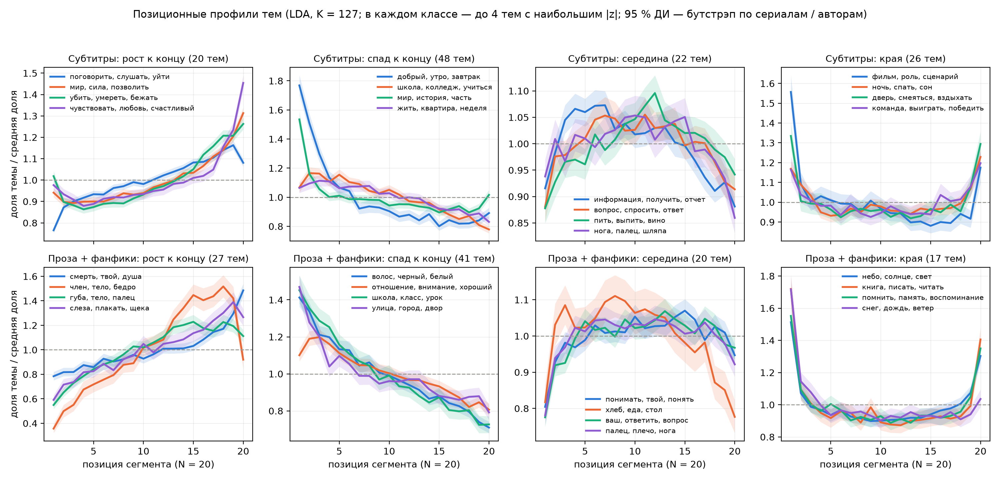

# Этап 3s — Plot Arceology: темы субтитров и прозы + фанфиков

Отдельная LDA на каждом корпусе (правила словаря — этап 3). Позиционный профиль темы — средняя доля темы в сегменте по позиции (N = 20 равных по словам частей), сначала внутри единицы (сериал / автор), затем по единицам. R — профиль, делённый на среднюю долю темы (R = 1 — тема распределена ровно). Компоненты формы — проекции R на ортогональные многочлены Лежандра позиции: линейная (> 0 — рост к концу) и квадратичная (> 0 — края, < 0 — середина); z — относительно нулевой модели (перестановка сегментов внутри текста, 200 раз). Тема значима, если амплитуда профиля больше, чем в нулевой модели (FDR q = 0.05); класс — компонента с большим |z|.

## K = 50

### субтитры сериалов (Ororo, русские субтитры): 26943 текстов, 3423 единиц; ll/слово -9.331, средняя c_npmi 0.071

Классы формы профиля: спад к концу — 24, края — 10, рост к концу — 10, середина — 6.

Проверка: 12 частей экранного времени (как у Schmidt) вместо 20 частей по словам — совпадение классов 94%; r(z лин.) = 0.99, r(z кв.) = 0.95.

Все 50 тем (по убыванию силы позиционного профиля)

| тема | слова | доля, % | класс | R(1) | R(N) | max R | пик | z лин. | z кв. | p (амплитуда) | c_npmi |
|---|---|---|---|---|---|---|---|---|---|---|---|
| 45 | рассказать, верить, право, позволить, собираться, правда, случиться, уйти | 5.46 | рост к концу | 0.81 | 1.20 | 1.21 | 19 | 67.85 | 6.84 | 0.005 | 0.03 |
| 32 | отец, сын, уйти, случиться, поговорить, просить, рассказать, забрать | 3.92 | рост к концу | 0.91 | 1.18 | 1.18 | 20 | 38.18 | 9.83 | 0.005 | 0.05 |
| 6 | убить, оружие, стрелять, пистолет, черт, умереть, бежать, черта | 1.94 | рост к концу | 0.98 | 1.21 | 1.23 | 19 | 31.83 | 16.85 | 0.005 | 0.07 |
| 25 | школа, класс, колледж, учиться, родитель, учитель, урок, университет | 1.40 | спад к концу | 1.12 | 0.78 | 1.17 | 3 | -30.18 | -5.98 | 0.005 | 0.05 |
| 37 | чувствовать, тип, момент, готовый, чувство, последний, решение, пройти | 3.48 | рост к концу | 0.88 | 1.19 | 1.19 | 20 | 27.59 | 8.93 | 0.005 | 0.01 |
| 47 | мир, сила, магия, спасти, убить, ведьма, свет, кровь | 2.38 | края | 1.28 | 1.19 | 1.28 | 1 | 7.00 | 21.70 | 0.005 | 0.02 |
| 4 | чувак, черт, черта, слушать, ребята, извинить, подождать, тип | 3.67 | рост к концу | 0.83 | 1.06 | 1.06 | 17 | 20.03 | -7.33 | 0.005 | 0.05 |
| 46 | позвонить, телефон, звонить, извинить, поговорить, номер, сообщение, неделя | 4.34 | спад к концу | 0.95 | 0.91 | 1.08 | 3 | -19.64 | -11.30 | 0.005 | 0.10 |
| 40 | папа, добрый, милый, утро, девочка, малыш, спать, ночь | 2.12 | края | 1.16 | 1.20 | 1.20 | 20 | -1.95 | 19.46 | 0.005 | 0.08 |
| 18 | еда, готовить, вкус, блюдо, приготовить, кухня, ресторан, шеф | 1.67 | спад к концу | 1.01 | 0.82 | 1.08 | 9 | -18.39 | -13.00 | 0.005 | 0.18 |
| 10 | шоу, видео, фото, эфир, история, новость, увидеть, звезда | 1.18 | спад к концу | 1.23 | 0.93 | 1.23 | 1 | -18.07 | 4.14 | 0.005 | -0.02 |
| 13 | женщина, нравиться, девушка, секс, мужчина, свидание, отношение, встречаться | 2.90 | середина | 0.93 | 0.85 | 1.06 | 11 | -7.95 | -18.06 | 0.005 | 0.09 |
| 33 | фильм, роль, сцена, сценарий, снимать, актер, режиссер, съемка | 0.74 | края | 1.54 | 1.13 | 1.54 | 1 | -14.07 | 17.21 | 0.005 | 0.19 |
| 35 | выглядеть, нравиться, цвет, костюм, волос, носить, красный, надеть | 1.71 | середина | 0.94 | 0.80 | 1.08 | 10 | -13.22 | -16.77 | 0.005 | 0.08 |
| 22 | дверь, смеяться, вздыхать, телефон, музыка, звук, извинить, смех | 0.65 | края | 1.34 | 1.26 | 1.34 | 1 | 0.21 | 16.21 | 0.005 | 0.12 |
| 38 | вопрос, информация, расследование, отношение, получить, считать, никакой, имя | 2.82 | середина | 0.90 | 0.88 | 1.05 | 6 | -8.86 | -15.84 | 0.005 | 0.03 |
| 34 | город, земля, лошадь, ферма, дорога, лес, шериф, жить | 1.29 | спад к концу | 1.19 | 0.92 | 1.19 | 1 | -15.59 | 2.71 | 0.005 | 0.03 |
| 26 | вода, земля, животное, океан, лес, планета, морской, огромный | 1.24 | спад к концу | 1.12 | 0.88 | 1.12 | 1 | -14.87 | -2.01 | 0.005 | 0.06 |
| 20 | полиция, детектив, полицейский, офицер, убийство, сэр, копа, инспектор | 1.46 | спад к концу | 1.08 | 0.91 | 1.09 | 3 | -14.84 | 0.46 | 0.005 | 0.09 |
| 5 | просить, решить, готовый, вопрос, право, проблема, ждать, надеяться | 6.17 | рост к концу | 0.87 | 1.03 | 1.05 | 19 | 14.42 | -7.19 | 0.005 | 0.00 |
| 9 | компания, бизнес, деньга, сделка, клиент, миллион, проблема, контракт | 1.64 | спад к концу | 0.96 | 0.83 | 1.09 | 6 | -14.42 | -10.17 | 0.005 | 0.06 |
| 8 | наслать, след, полиция, тело, убийство, камера, жертва, проверить | 1.59 | спад к концу | 0.92 | 0.82 | 1.11 | 5 | -14.11 | -12.38 | 0.005 | 0.10 |
| 24 | комната, дверь, вещь, спать, ночь, жить, помнить, сон | 3.01 | спад к концу | 1.04 | 0.93 | 1.05 | 3 | -13.55 | -1.37 | 0.005 | 0.06 |
| 39 | доктор, лекарство, врач, болезнь, рак, пациент, лечение, мозг | 1.20 | спад к концу | 0.99 | 0.79 | 1.08 | 7 | -13.46 | -11.47 | 0.005 | 0.13 |
| 30 | мистер, сэр, мисс, миссис, добрый, просить, леди, женщина | 2.44 | спад к концу | 0.99 | 0.90 | 1.06 | 5 | -13.21 | -5.65 | 0.005 | 0.08 |
| 0 | книга, писать, написать, читать, письмо, история, статья, прочитать | 1.06 | спад к концу | 1.08 | 0.96 | 1.08 | 1 | -12.71 | -1.56 | 0.005 | 0.16 |
| 11 | мир, история, часть, некоторый, считать, больший, использовать, жить | 3.64 | спад к концу | 1.13 | 1.01 | 1.13 | 1 | -11.22 | 7.02 | 0.005 | 0.02 |
| 7 | суд, адвокат, обвинение, мистер, судья, тюрьма, честь, присяжный | 1.33 | рост к концу | 0.96 | 1.07 | 1.17 | 19 | 11.05 | 6.15 | 0.005 | 0.16 |
| 41 | свадьба, любовь, счастливый, жена, рада, брак, познакомиться, муж | 2.22 | края | 1.07 | 1.11 | 1.11 | 20 | -0.86 | 10.84 | 0.005 | 0.08 |
| 16 | убить, смерть, убийство, убийца, тело, мертвый, умереть, убивать | 1.62 | края | 1.19 | 1.03 | 1.19 | 1 | 1.14 | 10.65 | 0.005 | 0.10 |
| 19 | доктор, больница, врач, операция, пациент, кровь, сердце, нога | 1.35 | спад к концу | 1.02 | 0.84 | 1.08 | 4 | -10.46 | -4.13 | 0.005 | 0.12 |
| 15 | пить, вечеринка, выпить, рождение, рождество, вино, извинить, принести | 2.21 | спад к концу | 0.96 | 0.93 | 1.05 | 6 | -10.16 | -9.36 | 0.005 | 0.08 |
| 36 | президент, страна, правительство, политика, господин, штат, белый, выборы | 1.32 | спад к концу | 1.12 | 0.95 | 1.12 | 1 | -9.96 | 5.67 | 0.005 | 0.08 |
| 2 | система, компьютер, телефон, код, доступ, использовать, камера, связь | 1.27 | середина | 0.99 | 0.88 | 1.07 | 13 | -6.34 | -9.52 | 0.005 | 0.10 |
| 44 | черт, слушать, господь, хватить, мать, мужик, хрен, дерьмо | 3.57 | рост к концу | 0.96 | 0.99 | 1.04 | 16 | 9.10 | -4.30 | 0.005 | 0.06 |
| 12 | деньга, доллар, тысяча, получить, заплатить, счет, купить, миллион | 2.01 | середина | 0.95 | 0.88 | 1.06 | 6 | -6.14 | -8.95 | 0.005 | 0.14 |
| 31 | агент, убить, босс, имя, узнать, тюрьма, операция, сделка | 1.61 | спад к концу | 1.09 | 0.92 | 1.09 | 1 | -8.77 | -1.71 | 0.005 | 0.01 |
| 42 | земля, планета, корабль, звезда, луна, вселенная, космос, космический | 0.84 | спад к концу | 1.24 | 0.99 | 1.24 | 1 | -8.49 | 7.61 | 0.005 | 0.13 |
| 29 | сэр, война, солдат, армия, военный, генерал, капитан, приказ | 0.99 | спад к концу | 1.11 | 0.98 | 1.11 | 1 | -8.41 | 4.52 | 0.005 | 0.12 |
| 43 | собака, животное, птица, кошка, маленький, дерево, кот, кролик | 1.34 | середина | 0.94 | 0.89 | 1.05 | 5 | -6.68 | -7.90 | 0.005 | -0.02 |
| 48 | игра, команда, играть, мяч, игрок, выиграть, тренер, победа | 1.57 | края | 1.08 | 1.03 | 1.08 | 1 | 3.29 | 7.34 | 0.005 | 0.21 |
| 27 | король, королева, отец, величество, брат, лорд, сын, принц | 1.42 | края | 1.11 | 1.06 | 1.11 | 1 | -1.53 | 7.20 | 0.005 | 0.12 |
| 1 | самолет, лодка, корабль, остров, капитан, вода, море, борт | 0.93 | края | 1.11 | 1.01 | 1.11 | 1 | -5.63 | 7.00 | 0.005 | 0.05 |
| 3 | наркотик, кларк, курить, росс, продавать, кокаин, таблетка, героин | 0.42 | спад к концу | 1.01 | 0.79 | 1.08 | 14 | -6.76 | -6.61 | 0.005 | -0.10 |
| 49 | картина, искусство, кайло, художник, музей, карта, финн, перевод | 0.41 | спад к концу | 1.08 | 1.08 | 1.08 | 20 | -6.66 | 0.03 | 0.005 | -0.16 |
| 14 | церковь, господь, отец, святой, верить, вера, божий, священник | 1.06 | края | 1.04 | 1.16 | 1.16 | 20 | 5.38 | 6.58 | 0.005 | 0.07 |
| 28 | отец, семья, мать, жить, брат, сестра, папа, сын | 3.38 | рост к концу | 0.99 | 1.03 | 1.04 | 19 | 6.19 | 0.67 | 0.005 | 0.08 |
| 17 | минута, здание, бомба, готовый, люк, пожар, команда, поезд | 1.89 | рост к концу | 0.99 | 0.96 | 1.10 | 17 | 5.99 | -0.17 | 0.005 | -0.06 |
| 21 | машина, ехать, поехать, дорога, автобус, водитель, грузовик, фургон | 1.19 | спад к концу | 1.02 | 0.94 | 1.05 | 2 | -5.12 | -0.44 | 0.005 | 0.13 |
| 23 | песня, музыка, играть, петь, группа, танцевать, концерт, танец | 0.93 | спад к концу | 1.02 | 1.00 | 1.05 | 11 | -3.52 | -1.69 | 0.015 | 0.09 |

### проза + фанфики (Проза.ру, Ficbook): 10099 текстов, 9173 единиц; ll/слово -9.439, средняя c_npmi 0.095

Классы формы профиля: спад к концу — 16, рост к концу — 13, середина — 10, края — 9, плоский — 2.

Все 50 тем (по убыванию силы позиционного профиля)

| тема | слова | доля, % | класс | R(1) | R(N) | max R | пик | z лин. | z кв. | p (амплитуда) | c_npmi |
|---|---|---|---|---|---|---|---|---|---|---|---|
| 22 | губа, тело, палец, грудь, член, поцелуй, бедро, шея | 2.37 | рост к концу | 0.44 | 1.00 | 1.34 | 18 | 44.62 | -15.32 | 0.005 | 0.14 |
| 40 | волос, женщина, черный, белый, платье, цвет, длинный, мужчина | 2.33 | спад к концу | 1.33 | 0.74 | 1.33 | 1 | -36.75 | 4.39 | 0.005 | 0.12 |
| 35 | душа, боль, мысль, сила, сердце, мир, жить, страх | 3.85 | рост к концу | 0.85 | 1.34 | 1.34 | 20 | 36.14 | 9.79 | 0.005 | 0.05 |
| 2 | школа, класс, учиться, учитель, урок, институт, студент, школьный | 1.70 | спад к концу | 1.48 | 0.80 | 1.48 | 1 | -35.93 | 11.13 | 0.005 | 0.13 |
| 5 | спросить, ответить, твой, посмотреть, понять, голос, улыбнуться, понимать | 5.65 | рост к концу | 0.59 | 1.03 | 1.07 | 17 | 34.87 | -24.77 | 0.005 | 0.07 |
| 38 | небо, солнце, свет, ветер, земля, воздух, дождь, дерево | 3.68 | края | 1.60 | 1.19 | 1.60 | 1 | -15.07 | 32.05 | 0.005 | 0.12 |
| 7 | нога, удар, спина, сила, увидеть, упасть, голос, земля | 3.31 | рост к концу | 0.68 | 0.96 | 1.18 | 16 | 30.66 | -13.72 | 0.005 | 0.04 |
| 15 | всякий, любой, подобный, случай, собственный, душа, отношение, никакой | 3.62 | спад к концу | 1.10 | 0.91 | 1.14 | 2 | -26.60 | 2.63 | 0.005 | 0.03 |
| 34 | девушка, парень, молодой, подруга, мужчина, красивый, звать, взгляд | 1.50 | спад к концу | 1.11 | 0.76 | 1.17 | 2 | -25.32 | -4.21 | 0.005 | 0.07 |
| 33 | город, улица, поезд, автобус, вагон, дорога, здание, путь | 1.55 | спад к концу | 1.49 | 0.90 | 1.49 | 1 | -24.59 | 12.93 | 0.005 | 0.12 |
| 48 | стена, комната, окно, старый, деревянный, этаж, небольшой, угол | 1.71 | спад к концу | 1.25 | 0.75 | 1.25 | 1 | -23.17 | 2.40 | 0.005 | 0.09 |
| 8 | книга, писать, читать, роман, художник, автор, картина, стих | 1.65 | края | 1.51 | 1.30 | 1.51 | 1 | -8.83 | 21.48 | 0.005 | 0.13 |
| 3 | деревня, лошадь, поле, село, двор, корова, конь, колхоз | 1.28 | спад к концу | 1.14 | 0.80 | 1.14 | 2 | -21.43 | -2.08 | 0.005 | 0.09 |
| 27 | старик, смерть, умереть, живой, могила, старый, жить, кладбище | 0.87 | рост к концу | 0.90 | 1.50 | 1.50 | 20 | 19.26 | 10.04 | 0.005 | 0.05 |
| 36 | русский, город, язык, век, история, народ, имя, древний | 1.23 | спад к концу | 1.43 | 1.00 | 1.43 | 1 | -17.62 | 12.83 | 0.005 | 0.08 |
| 19 | суд, полиция, полицейский, ваш, документ, следователь, убийство, преступление | 0.97 | рост к концу | 0.76 | 1.10 | 1.15 | 19 | 16.08 | -2.84 | 0.005 | -0.02 |
| 45 | любовь, любить, женщина, твой, мужчина, душа, чувство, сердце | 2.39 | рост к концу | 0.98 | 1.48 | 1.48 | 20 | 15.86 | 15.80 | 0.005 | 0.07 |
| 20 | мужик, какой-то, нога, баба, парень, ладный, твой, всякий | 2.97 | середина | 0.85 | 0.85 | 1.07 | 6 | -4.82 | -15.31 | 0.005 | 0.02 |
| 39 | работа, работать, начальник, рабочий, директор, новый, завод, кабинет | 1.46 | спад к концу | 1.08 | 0.85 | 1.14 | 2 | -14.86 | 0.29 | 0.005 | 0.14 |
| 30 | приехать, поехать, телефон, работа, позвонить, ждать, час, решить | 3.21 | рост к концу | 0.86 | 1.08 | 1.08 | 20 | 13.84 | -4.04 | 0.005 | 0.09 |
| 10 | стол, чай, кухня, хлеб, еда, тарелка, вода, обед | 1.80 | середина | 0.82 | 0.82 | 1.11 | 8 | -7.62 | -13.21 | 0.005 | 0.14 |
| 0 | лес, дерево, дорога, вода, снег, гора, река, земля | 2.02 | спад к концу | 1.12 | 0.84 | 1.12 | 1 | -12.77 | -3.15 | 0.005 | 0.08 |
| 32 | бог, храм, святой, церковь, отец, вера, молитва, господь | 1.05 | рост к концу | 0.92 | 1.28 | 1.28 | 20 | 11.97 | 4.87 | 0.005 | 0.17 |
| 28 | демон, сила, магия, дракон, кровь, твой, свет, мир | 1.09 | рост к концу | 0.93 | 1.07 | 1.10 | 19 | 11.04 | -0.71 | 0.005 | 0.02 |
| 1 | голос, взгляд, тишина, свет, шаг, палец, сердце, чувствовать | 3.88 | рост к концу | 0.92 | 1.06 | 1.06 | 19 | 10.56 | -0.60 | 0.005 | 0.04 |
| 9 | понимать, спрашивать, отвечать, стоить, улыбаться, пытаться, смеяться, чувствовать | 2.74 | середина | 0.88 | 0.88 | 1.05 | 6 | -3.45 | -10.36 | 0.005 | 0.04 |
| 46 | мир, сознание, тело, новый, душа, реальность, планета, мысль | 1.64 | края | 1.15 | 1.15 | 1.15 | 20 | 3.15 | 9.96 | 0.005 | 0.01 |
| 49 | врач, доктор, больница, палата, больной, болезнь, медицинский, медсестра | 0.96 | рост к концу | 0.89 | 0.96 | 1.12 | 19 | 8.71 | -3.23 | 0.005 | 0.23 |
| 18 | отец, ребенок, жена, муж, сын, мать, семья, жить | 2.98 | края | 1.08 | 1.04 | 1.09 | 2 | -3.75 | 8.45 | 0.005 | 0.14 |
| 23 | какой-то, решить, момент, вопрос, понять, мысль, случай, должный | 6.80 | середина | 0.94 | 0.98 | 1.03 | 10 | -1.40 | -8.44 | 0.005 | 0.02 |
| 14 | страна, война, власть, народ, советский, русский, государство, российский | 1.41 | края | 1.21 | 1.07 | 1.21 | 1 | -4.42 | 8.23 | 0.005 | 0.13 |
| 21 | бутылка, вино, пить, стол, пиво, выпить, бокал, водка | 0.85 | середина | 0.90 | 0.83 | 1.08 | 7 | -5.02 | -7.89 | 0.005 | 0.15 |
| 41 | мама, ребенок, папа, девочка, отец, мальчик, родитель, маленький | 2.11 | края | 1.12 | 1.01 | 1.12 | 1 | -6.34 | 7.85 | 0.005 | 0.12 |
| 29 | игра, играть, команда, тренер, тренировка, мяч, спорт, спортивный | 0.58 | спад к концу | 0.98 | 0.83 | 1.08 | 3 | -6.90 | -5.21 | 0.005 | 0.11 |
| 31 | стол, взгляд, палец, посмотреть, плечо, карман, кивнуть, спросить | 2.04 | середина | 0.88 | 0.94 | 1.07 | 4 | -3.85 | -6.68 | 0.005 | 0.05 |
| 4 | деньга, купить, магазин, рубль, тысяча, квартира, цена, продать | 1.66 | спад к концу | 0.96 | 0.88 | 1.07 | 3 | -5.51 | -3.19 | 0.005 | 0.15 |
| 47 | дверь, комната, квартира, открыть, окно, выйти, этаж, коридор | 1.93 | середина | 0.92 | 0.89 | 1.04 | 6 | 0.51 | -5.27 | 0.005 | 0.15 |
| 43 | война, командир, солдат, военный, офицер, армия, бой, служба | 1.46 | середина | 0.95 | 0.91 | 1.05 | 9 | 0.20 | -5.18 | 0.005 | 0.16 |
| 26 | должный, вопрос, система, являться, возможность, уровень, процесс, проблема | 2.52 | спад к концу | 1.03 | 0.93 | 1.03 | 2 | -4.93 | -1.05 | 0.005 | 0.05 |
| 37 | бабушка, дед, письмо, писать, дедушка, мишка, написать, внук | 0.64 | края | 1.03 | 1.14 | 1.14 | 20 | 0.19 | 4.28 | 0.015 | 0.04 |
| 25 | телефон, экран, сообщение, фотография, камера, компьютер, фото, сеть | 1.28 | края | 1.11 | 1.05 | 1.11 | 1 | -3.89 | 4.21 | 0.005 | 0.07 |
| 42 | тело, кровь, нога, вода, кожа, боль, палец, пол | 2.32 | рост к концу | 1.02 | 0.90 | 1.07 | 16 | 3.82 | -3.14 | 0.005 | 0.06 |
| 17 | сон, ночь, спать, кровать, комната, утро, проснуться, спасть | 2.24 | края | 1.07 | 1.10 | 1.10 | 20 | 3.30 | 3.77 | 0.005 | 0.15 |
| 16 | ваш, господин, гость, мистер, хозяин, молодой, стол, просить | 0.81 | спад к концу | 0.95 | 0.95 | 1.08 | 7 | -3.66 | -3.20 | 0.005 | 0.03 |
| 13 | собака, кот, кошка, пес, хозяин, лапа, волк, птица | 1.11 | спад к концу | 0.91 | 0.96 | 1.07 | 7 | -3.39 | -3.37 | 0.005 | 0.13 |
| 12 | вода, море, берег, корабль, остров, лодка, рыба, капитан | 0.94 | спад к концу | 1.07 | 0.93 | 1.07 | 1 | -2.60 | -1.11 | 0.005 | 0.16 |
| 24 | музыка, песня, сцена, играть, театр, петь, зал, танец | 1.08 | середина | 1.02 | 0.98 | 1.06 | 11 | -1.53 | -2.32 | 0.040 | 0.16 |
| 11 | самолет, должный, система, полет, планета, земля, высота, станция | 0.84 | середина | 0.98 | 0.93 | 1.09 | 16 | 1.31 | -1.82 | 0.015 | 0.04 |
| 44 | князь, король, царь, воин, великий, принц, император, конь | 0.84 | плоский | 1.00 | 0.96 | 1.05 | 5 | -2.04 | -1.29 | 0.537 | 0.07 |
| 6 | машина, дорога, водитель, ехать, автомобиль, сидение, руль, поехать | 1.08 | плоский | 1.01 | 0.94 | 1.07 | 3 | -2.20 | -1.52 | 0.154 | 0.21 |

### Сопоставление тем двух корпусов (K = 50; общий словарь 20123 лемм; взаимно ближайшие пары — 32; показаны 30 самых похожих)

| субтитры: тема | проза: тема | сходство (1 − JSD) | класс: субтитры | класс: проза | r профилей R |
|---|---|---|---|---|---|
| 14: церковь, господь, отец, святой, верить, вера | 32: бог, храм, святой, церковь, отец, вера | 0.44 | края | рост к концу | +0.78 |
| 46: позвонить, телефон, звонить, извинить, поговорить, номер | 30: приехать, поехать, телефон, работа, позвонить, ждать | 0.44 | спад к концу | рост к концу | -0.53 |
| 12: деньга, доллар, тысяча, получить, заплатить, счет | 4: деньга, купить, магазин, рубль, тысяча, квартира | 0.43 | середина | спад к концу | +0.73 |
| 21: машина, ехать, поехать, дорога, автобус, водитель | 6: машина, дорога, водитель, ехать, автомобиль, сидение | 0.43 | спад к концу | плоский | +0.50 |
| 48: игра, команда, играть, мяч, игрок, выиграть | 29: игра, играть, команда, тренер, тренировка, мяч | 0.43 | края | спад к концу | -0.66 |
| 28: отец, семья, мать, жить, брат, сестра | 18: отец, ребенок, жена, муж, сын, мать | 0.42 | рост к концу | края | -0.32 |
| 18: еда, готовить, вкус, блюдо, приготовить, кухня | 10: стол, чай, кухня, хлеб, еда, тарелка | 0.41 | спад к концу | середина | +0.79 |
| 29: сэр, война, солдат, армия, военный, генерал | 43: война, командир, солдат, военный, офицер, армия | 0.39 | спад к концу | середина | -0.40 |
| 25: школа, класс, колледж, учиться, родитель, учитель | 2: школа, класс, учиться, учитель, урок, институт | 0.39 | спад к концу | спад к концу | +0.87 |
| 11: мир, история, часть, некоторый, считать, больший | 26: должный, вопрос, система, являться, возможность, уровень | 0.39 | спад к концу | спад к концу | +0.36 |
| 47: мир, сила, магия, спасти, убить, ведьма | 28: демон, сила, магия, дракон, кровь, твой | 0.39 | края | рост к концу | +0.24 |
| 19: доктор, больница, врач, операция, пациент, кровь | 49: врач, доктор, больница, палата, больной, болезнь | 0.37 | спад к концу | рост к концу | -0.42 |
| 27: король, королева, отец, величество, брат, лорд | 44: князь, король, царь, воин, великий, принц | 0.37 | края | плоский | -0.30 |
| 36: президент, страна, правительство, политика, господин, штат | 14: страна, война, власть, народ, советский, русский | 0.36 | спад к концу | края | +0.66 |
| 24: комната, дверь, вещь, спать, ночь, жить | 17: сон, ночь, спать, кровать, комната, утро | 0.36 | спад к концу | края | -0.44 |
| 0: книга, писать, написать, читать, письмо, история | 8: книга, писать, читать, роман, художник, автор | 0.36 | спад к концу | края | +0.31 |
| 23: песня, музыка, играть, петь, группа, танцевать | 24: музыка, песня, сцена, играть, театр, петь | 0.36 | спад к концу | середина | +0.49 |
| 1: самолет, лодка, корабль, остров, капитан, вода | 12: вода, море, берег, корабль, остров, лодка | 0.35 | края | спад к концу | +0.21 |
| 37: чувствовать, тип, момент, готовый, чувство, последний | 23: какой-то, решить, момент, вопрос, понять, мысль | 0.35 | рост к концу | середина | -0.25 |
| 44: черт, слушать, господь, хватить, мать, мужик | 20: мужик, какой-то, нога, баба, парень, ладный | 0.34 | рост к концу | середина | +0.16 |
| 43: собака, животное, птица, кошка, маленький, дерево | 13: собака, кот, кошка, пес, хозяин, лапа | 0.32 | середина | спад к концу | +0.79 |
| 45: рассказать, верить, право, позволить, собираться, правда | 35: душа, боль, мысль, сила, сердце, мир | 0.32 | рост к концу | рост к концу | +0.94 |
| 35: выглядеть, нравиться, цвет, костюм, волос, носить | 40: волос, женщина, черный, белый, платье, цвет | 0.31 | середина | спад к концу | +0.48 |
| 20: полиция, детектив, полицейский, офицер, убийство, сэр | 19: суд, полиция, полицейский, ваш, документ, следователь | 0.31 | спад к концу | рост к концу | -0.93 |
| 2: система, компьютер, телефон, код, доступ, использовать | 25: телефон, экран, сообщение, фотография, камера, компьютер | 0.31 | середина | края | -0.23 |
| 30: мистер, сэр, мисс, миссис, добрый, просить | 16: ваш, господин, гость, мистер, хозяин, молодой | 0.31 | спад к концу | спад к концу | +0.73 |
| 41: свадьба, любовь, счастливый, жена, рада, брак | 45: любовь, любить, женщина, твой, мужчина, душа | 0.28 | края | рост к концу | +0.64 |
| 34: город, земля, лошадь, ферма, дорога, лес | 0: лес, дерево, дорога, вода, снег, гора | 0.26 | спад к концу | спад к концу | +0.86 |
| 42: земля, планета, корабль, звезда, луна, вселенная | 11: самолет, должный, система, полет, планета, земля | 0.26 | спад к концу | середина | -0.23 |
| 15: пить, вечеринка, выпить, рождение, рождество, вино | 21: бутылка, вино, пить, стол, пиво, выпить | 0.26 | спад к концу | середина | +0.78 |

Пар со сходством ≥ 0,5: 0; из них с одинаковым классом формы профиля — 0.

## K = 100

### субтитры сериалов (Ororo, русские субтитры): 26943 текстов, 3423 единиц; ll/слово -9.359, средняя c_npmi 0.053

Классы формы профиля: спад к концу — 44, рост к концу — 18, середина — 18, края — 17, плоский — 3.

Проверка: 12 частей экранного времени (как у Schmidt) вместо 20 частей по словам — совпадение классов 86%; r(z лин.) = 0.99, r(z кв.) = 0.97.

Все 100 тем (по убыванию силы позиционного профиля)

| тема | слова | доля, % | класс | R(1) | R(N) | max R | пик | z лин. | z кв. | p (амплитуда) | c_npmi |
|---|---|---|---|---|---|---|---|---|---|---|---|
| 49 | убить, умереть, рассказать, мертвый, отец, уйти, верить, убивать | 3.24 | рост к концу | 1.01 | 1.23 | 1.23 | 20 | 47.15 | 22.02 | 0.005 | 0.06 |
| 62 | добрый, утро, неделя, вечер, час, завтрак, кофе, минута | 0.73 | спад к концу | 1.66 | 0.87 | 1.66 | 1 | -44.65 | 24.88 | 0.005 | 0.07 |
| 24 | ненавидеть, слушать, поговорить, злиться, чувствовать, нравиться, право, проблема | 2.53 | рост к концу | 0.77 | 1.05 | 1.18 | 19 | 40.71 | -5.08 | 0.005 | 0.03 |
| 17 | хватить, просить, уходить, отпустить, прекратить, сын, оставить, мать | 1.49 | рост к концу | 0.93 | 1.20 | 1.20 | 20 | 33.47 | 9.90 | 0.005 | 0.05 |
| 34 | школа, колледж, класс, учиться, родитель, учитель, урок, университет | 1.07 | спад к концу | 1.08 | 0.79 | 1.17 | 2 | -30.20 | -6.05 | 0.005 | 0.06 |
| 99 | готовый, ждать, решение, надеяться, остаться, решить, шанс, принять | 2.83 | рост к концу | 0.89 | 1.23 | 1.23 | 20 | 26.92 | 13.51 | 0.005 | 0.03 |
| 70 | мир, сила, сердце, смерть, любовь, жить, душа, умереть | 2.18 | края | 1.13 | 1.33 | 1.33 | 20 | 26.40 | 26.91 | 0.005 | 0.04 |
| 76 | верить, рассказать, правда, право, узнать, врать, считать, история | 1.90 | рост к концу | 0.82 | 1.05 | 1.07 | 19 | 24.16 | -8.32 | 0.005 | 0.05 |
| 59 | город, земля, местный, страна, житель, мир, парк, жить | 0.69 | спад к концу | 1.50 | 0.94 | 1.50 | 1 | -23.72 | 13.64 | 0.005 | -0.03 |
| 44 | послать, двигаться, готовый, минута, черт, уходить, поезд, ждать | 1.64 | рост к концу | 0.95 | 1.17 | 1.17 | 20 | 23.31 | 9.14 | 0.005 | 0.04 |
| 56 | полиция, детектив, полицейский, офицер, копа, имя, агент, машина | 1.52 | спад к концу | 1.07 | 0.87 | 1.12 | 3 | -21.32 | -2.32 | 0.005 | 0.07 |
| 96 | жить, квартира, переехать, неделя, месяц, город, сосед, хлой | 1.05 | спад к концу | 1.03 | 0.84 | 1.10 | 4 | -21.28 | -5.61 | 0.005 | -0.03 |
| 68 | уволить, офис, босс, проблема, отдел, компания, сотрудник, получить | 0.95 | спад к концу | 0.99 | 0.86 | 1.15 | 4 | -20.97 | -5.19 | 0.005 | 0.04 |
| 30 | собираться, конец, мера, вещь, получить, крайний, часть, никакой | 2.74 | рост к концу | 0.93 | 1.09 | 1.09 | 20 | 18.95 | 3.31 | 0.005 | 0.01 |
| 65 | купить, магазин, туалет, коробка, извинить, принести, вещь, мороженое | 1.34 | спад к концу | 1.00 | 0.86 | 1.09 | 4 | -18.89 | -8.65 | 0.005 | 0.01 |
| 22 | черт, черта, дерьмо, чертов, чертовый, ублюдок, приятель, слушать | 1.36 | рост к концу | 0.88 | 1.13 | 1.13 | 20 | 18.80 | 3.70 | 0.005 | 0.08 |
| 89 | чувствовать, момент, тип, чувство, помнить, увидеть, часть, почувствовать | 2.31 | рост к концу | 0.95 | 1.17 | 1.17 | 20 | 18.47 | 7.24 | 0.005 | 0.03 |
| 33 | дверь, смеяться, вздыхать, звук, извинить, музыка, телефон, смех | 0.52 | края | 1.36 | 1.26 | 1.36 | 1 | -1.00 | 16.16 | 0.005 | 0.12 |
| 78 | вопрос, спросить, ответ, ответить, рассказать, задать, спрашивать, задавать | 1.61 | середина | 0.89 | 0.90 | 1.06 | 7 | -3.54 | -16.11 | 0.005 | 0.11 |
| 48 | убийство, убийца, тело, убить, наслать, жертва, смерть, след | 1.21 | спад к концу | 1.09 | 0.90 | 1.09 | 1 | -15.88 | -0.77 | 0.005 | 0.12 |
| 41 | фильм, роль, сцена, сценарий, снимать, актер, режиссер, съемка | 0.54 | спад к концу | 1.52 | 1.11 | 1.52 | 1 | -14.55 | 14.55 | 0.005 | 0.19 |
| 10 | вечеринка, рождение, пригласить, вечер, ужин, подарок, гость, рада | 1.26 | спад к концу | 1.04 | 0.94 | 1.08 | 2 | -14.55 | -2.03 | 0.005 | 0.08 |
| 3 | ночь, спать, сон, спокойный, проснуться, спасть, кровать, пора | 0.82 | края | 1.13 | 1.27 | 1.27 | 20 | 3.41 | 14.27 | 0.005 | 0.13 |
| 72 | компания, деньга, бизнес, миллион, доллар, рынок, продавать, цена | 0.88 | спад к концу | 1.02 | 0.86 | 1.10 | 7 | -13.07 | -6.22 | 0.005 | 0.17 |
| 52 | мир, исследование, ученый, доктор, наука, профессор, существовать, эксперимент | 1.05 | спад к концу | 1.17 | 0.94 | 1.17 | 1 | -13.05 | 2.40 | 0.005 | 0.07 |
| 55 | готовить, еда, вкус, блюдо, пирог, соус, приготовить, сыр | 0.93 | спад к концу | 0.96 | 0.80 | 1.09 | 8 | -12.97 | -11.24 | 0.005 | 0.17 |
| 74 | книга, читать, писать, картина, написать, искусство, роман, художник | 0.70 | спад к концу | 1.06 | 0.93 | 1.06 | 1 | -12.94 | -2.79 | 0.005 | 0.03 |
| 15 | шоу, эфир, звезда, дама, сцена, большой, шутка, новость | 0.77 | спад к концу | 1.37 | 1.01 | 1.37 | 1 | -12.85 | 12.01 | 0.005 | 0.03 |
| 61 | решение, считать, любой, вопрос, позволить, случай, просить, следовать | 2.89 | середина | 0.86 | 0.96 | 1.03 | 9 | 2.79 | -12.44 | 0.005 | 0.02 |
| 4 | девочка, папа, милый, малыш, дорогой, маленький, мальчик, скучать | 1.80 | рост к концу | 0.97 | 1.23 | 1.23 | 20 | 12.14 | 11.73 | 0.005 | 0.07 |
| 29 | имя, документ, ключ, запись, проверить, карта, искать, камера | 0.97 | середина | 0.90 | 0.87 | 1.08 | 6 | -3.03 | -12.06 | 0.005 | 0.04 |
| 91 | письмо, написать, писать, статья, видео, история, фото, газета | 0.81 | спад к концу | 1.00 | 0.92 | 1.09 | 5 | -11.65 | -4.80 | 0.005 | 0.10 |
| 45 | корабль, земля, планета, луна, звезда, космос, космический, система | 0.48 | края | 1.31 | 1.05 | 1.31 | 1 | -4.60 | 11.32 | 0.005 | 0.09 |
| 20 | страна, война, русский, правительство, мир, агент, американец, американский | 0.77 | спад к концу | 1.22 | 0.93 | 1.22 | 1 | -11.23 | 5.90 | 0.005 | 0.10 |
| 66 | мистер, сэр, мисс, миссис, просить, добрый, леди, полагать | 1.65 | спад к концу | 0.97 | 0.91 | 1.07 | 5 | -11.05 | -6.72 | 0.005 | 0.08 |
| 95 | тюрьма, срок, перевод, финн, убийство, преступление, камера, суд | 0.35 | края | 1.08 | 1.42 | 1.42 | 20 | 6.59 | 11.02 | 0.005 | -0.18 |
| 73 | система, доступ, агент, код, компьютер, безопасность, команда, связь | 1.11 | середина | 0.96 | 0.87 | 1.05 | 9 | -6.65 | -10.61 | 0.005 | 0.07 |
| 32 | костюм, носить, надеть, одежда, выглядеть, снять, вещь, шляпа | 0.86 | спад к концу | 0.98 | 0.84 | 1.06 | 5 | -10.58 | -10.51 | 0.005 | 0.09 |
| 43 | животное, лес, дерево, самец, самка, хищник, детеныш, добыча | 0.58 | спад к концу | 1.03 | 0.88 | 1.07 | 5 | -10.56 | -5.18 | 0.005 | 0.05 |
| 53 | просить, решить, пора, господь, хватить, забыть, слушать, милый | 2.81 | спад к концу | 1.03 | 0.95 | 1.03 | 1 | -10.52 | -4.08 | 0.005 | 0.02 |
| 7 | пить, выпить, вино, чай, бар, пиво, кофе, принести | 1.16 | середина | 0.89 | 0.92 | 1.06 | 12 | 0.72 | -10.40 | 0.005 | 0.12 |
| 6 | доктор, операция, больница, врач, кровь, сердце, пациент, мозг | 0.91 | спад к концу | 0.98 | 0.81 | 1.10 | 4 | -10.22 | -4.69 | 0.005 | 0.11 |
| 47 | волос, выглядеть, лицо, нравиться, красивый, нос, похожий, прическа | 0.60 | спад к концу | 1.01 | 0.86 | 1.10 | 9 | -10.22 | -8.23 | 0.005 | 0.02 |
| 79 | отец, папа, сын, семья, дочь, дедушка, помнить, бабушка | 1.25 | рост к концу | 0.98 | 1.06 | 1.07 | 19 | 10.16 | 2.65 | 0.005 | 0.07 |
| 37 | рождество, рождественский, подарок, праздник, лан, мина, желание, лести | 0.21 | края | 1.27 | 1.16 | 1.27 | 1 | -4.82 | 9.95 | 0.005 | -0.09 |
| 71 | вода, океан, лед, волна, морской, рыба, море, земля | 0.65 | спад к концу | 1.19 | 0.89 | 1.19 | 1 | -9.89 | 0.25 | 0.005 | 0.06 |
| 75 | доктор, врач, лекарство, больница, пациент, рак, таблетка, принимать | 0.66 | спад к концу | 0.99 | 0.83 | 1.06 | 7 | -9.79 | -6.41 | 0.005 | 0.13 |
| 85 | извинить, поговорить, слушать, подождать, встреча, просить, проблема, позвонить | 2.39 | середина | 0.85 | 0.99 | 1.05 | 8 | -2.95 | -9.71 | 0.005 | 0.05 |
| 13 | идея, нравиться, выглядеть, часть, создать, использовать, показать, больший | 0.83 | спад к концу | 1.02 | 0.91 | 1.08 | 5 | -9.28 | -4.13 | 0.005 | 0.02 |
| 18 | ресторан, еда, шеф, ужин, арча, кухня, столик, заказать | 0.42 | спад к концу | 1.02 | 0.86 | 1.10 | 11 | -9.22 | -6.64 | 0.005 | 0.04 |
| 8 | мозг, тело, проблема, чувствовать, стресс, здоровье, память, вдох | 0.71 | середина | 0.94 | 0.83 | 1.07 | 10 | -6.00 | -9.21 | 0.005 | -0.02 |
| 92 | план, украсть, спасти, идея, вернуть, поймать, искать, подождать | 1.13 | рост к концу | 0.93 | 1.01 | 1.06 | 17 | 9.11 | -2.83 | 0.005 | 0.01 |
| 19 | секс, сексуальный, заниматься, женщина, член, девушка, нравиться, мужчина | 0.69 | середина | 0.99 | 0.83 | 1.07 | 14 | -3.43 | -8.89 | 0.005 | 0.09 |
| 94 | наркотик, курить, кокаин, героин, товар, травка, деньга, продавать | 0.36 | середина | 0.99 | 0.79 | 1.07 | 8 | -6.37 | -8.83 | 0.005 | 0.10 |
| 98 | деньга, доллар, тысяча, заплатить, счет, получить, миллион, купить | 1.53 | середина | 0.93 | 0.88 | 1.06 | 6 | -4.24 | -8.76 | 0.005 | 0.16 |
| 12 | слушать, мужик, мать, сука, дерьмо, черт, хрен, жопа | 1.29 | рост к концу | 0.93 | 1.02 | 1.04 | 15 | 8.63 | -3.17 | 0.005 | 0.08 |
| 5 | поговорить, рассказать, случиться, полиция, позвонить, муж, узнать, жена | 2.03 | середина | 0.92 | 0.96 | 1.03 | 13 | 2.66 | -8.49 | 0.005 | 0.06 |
| 57 | вода, газ, энергия, труба, проблема, земля, воздух, использовать | 0.36 | середина | 0.91 | 0.79 | 1.09 | 6 | -4.96 | -8.35 | 0.005 | -0.06 |
| 69 | камень, золото, древний, музей, сокровище, история, карта, искать | 0.33 | спад к концу | 1.21 | 0.92 | 1.21 | 1 | -8.26 | 0.74 | 0.005 | 0.03 |
| 54 | суд, адвокат, мистер, судья, честь, присяжный, обвинение, свидетель | 0.69 | рост к концу | 0.97 | 0.99 | 1.18 | 19 | 7.94 | 3.26 | 0.005 | 0.19 |
| 77 | платье, нравиться, мода, модель, образ, выглядеть, красивый, одежда | 0.37 | спад к концу | 0.98 | 0.81 | 1.10 | 10 | -7.91 | -5.77 | 0.005 | 0.10 |
| 31 | президент, мэр, выборы, сенатор, политика, штат, страна, кампания | 0.61 | спад к концу | 1.09 | 0.93 | 1.10 | 2 | -7.84 | 3.49 | 0.005 | 0.11 |
| 50 | оружие, пистолет, стрелять, убить, пуля, выстрел, застрелить, выстрелить | 0.58 | рост к концу | 1.02 | 1.01 | 1.11 | 19 | 7.71 | 4.06 | 0.005 | 0.19 |
| 90 | умереть, смерть, мертвый, похороны, тело, живой, призрак, убить | 0.77 | края | 1.13 | 1.06 | 1.13 | 1 | -2.57 | 7.47 | 0.005 | 0.10 |
| 97 | чувак, тип, ребята, слушать, черт, детка, погодить, нравиться | 1.25 | середина | 0.89 | 0.97 | 1.04 | 13 | 1.68 | -7.45 | 0.005 | 0.05 |
| 25 | девушка, имя, звать, женщина, девочка, мужчина, помнить, искать | 0.69 | спад к концу | 1.05 | 0.91 | 1.05 | 1 | -7.24 | -4.21 | 0.005 | 0.04 |
| 28 | лошадь, лес, дерево, лагерь, шериф, гора, земля, ранчо | 0.64 | спад к концу | 1.08 | 0.92 | 1.08 | 1 | -7.14 | -2.07 | 0.005 | -0.00 |
| 81 | ферма, роза, цветок, растение, сад, молоко, фермер, пчела | 0.33 | спад к концу | 0.98 | 0.84 | 1.10 | 5 | -7.04 | -6.17 | 0.005 | -0.12 |
| 82 | вирус, болезнь, кролик, грипп, грант, больной, вакцина, корь | 0.25 | спад к концу | 1.05 | 0.81 | 1.10 | 7 | -6.85 | -4.14 | 0.005 | -0.13 |
| 21 | дверь, комната, открыть, окно, ключ, стена, увидеть, войти | 1.21 | середина | 0.96 | 0.93 | 1.04 | 10 | -2.07 | -6.67 | 0.005 | 0.09 |
| 11 | мир, черный, история, семья, белый, страна, общество, считать | 1.31 | спад к концу | 1.08 | 0.99 | 1.08 | 1 | -6.67 | 2.20 | 0.005 | 0.00 |
| 63 | король, королева, величество, лорд, принц, королевский, отец, принцесса | 0.62 | края | 1.15 | 1.02 | 1.15 | 1 | -5.45 | 6.44 | 0.005 | 0.16 |
| 88 | нравиться, свидание, девушка, отношение, встречаться, пара, тип, любовь | 1.27 | середина | 0.94 | 0.97 | 1.05 | 12 | -2.59 | -6.42 | 0.005 | 0.05 |
| 9 | обвинение, доказательство, расследование, полиция, запись, убийство, адвокат, преступление | 1.21 | рост к концу | 0.93 | 1.00 | 1.05 | 17 | 6.36 | -2.46 | 0.005 | 0.14 |
| 35 | команда, выиграть, победить, гонка, бой, готовый, победа, молодец | 0.74 | края | 1.07 | 1.08 | 1.08 | 20 | 3.42 | 6.01 | 0.005 | 0.07 |
| 84 | ударить, кровь, нож, помнить, нога, лицо, упасть, удар | 0.93 | рост к концу | 0.90 | 0.93 | 1.08 | 17 | 5.98 | -4.71 | 0.005 | 0.09 |
| 42 | самолет, бомба, пилот, лететь, взрыв, рейс, полет, час | 0.39 | края | 1.13 | 1.03 | 1.13 | 1 | -2.28 | 5.74 | 0.005 | 0.14 |
| 40 | лодка, корабль, остров, вода, капитан, море, борт, берег | 0.48 | спад к концу | 1.06 | 0.97 | 1.08 | 3 | -5.68 | 1.72 | 0.010 | 0.09 |
| 64 | красный, цвет, торт, синий, зеленый, нравиться, выглядеть, желтый | 0.38 | середина | 0.97 | 0.89 | 1.06 | 13 | -0.51 | -5.58 | 0.005 | 0.09 |
| 51 | телефон, звонить, позвонить, сообщение, номер, звонок, перезвонить, трубка | 1.05 | середина | 0.91 | 0.98 | 1.04 | 3 | -2.42 | -5.42 | 0.005 | 0.18 |
| 26 | война, армия, сражаться, враг, бой, народ, город, битва | 0.74 | края | 1.14 | 1.01 | 1.14 | 1 | -2.29 | 5.14 | 0.005 | 0.10 |
| 46 | магия, ведьма, сила, демон, дракон, заклинание, темный, меч | 0.46 | края | 1.22 | 1.04 | 1.22 | 1 | -2.34 | 5.13 | 0.005 | 0.02 |
| 87 | птица, яйцо, животное, маленький, тигр, золотой, курица, дикий | 0.48 | спад к концу | 1.00 | 0.94 | 1.07 | 3 | -5.04 | -1.90 | 0.005 | -0.12 |
| 1 | предатель, игра, роба, верный, игрок, стол, имя, выбрать | 0.22 | рост к концу | 1.08 | 1.08 | 1.12 | 17 | 4.86 | 4.45 | 0.005 | 0.03 |
| 14 | сделка, подписать, лить, контракт, договор, заключить, соглашение, адвокат | 0.48 | середина | 0.93 | 0.93 | 1.05 | 8 | 2.47 | -4.75 | 0.005 | 0.03 |
| 27 | сэр, капитан, солдат, генерал, лейтенант, война, военный, армия | 0.48 | спад к концу | 1.07 | 0.95 | 1.09 | 3 | -4.70 | 1.27 | 0.020 | 0.12 |
| 39 | женщина, мужчина, женский, беременный, мужской, беременность, муж, роды | 0.38 | спад к концу | 1.09 | 0.87 | 1.09 | 1 | -4.67 | -1.31 | 0.005 | 0.00 |
| 60 | собака, кошка, кот, мышь, пес, животное, вещь, щенок | 0.30 | спад к концу | 1.03 | 0.92 | 1.06 | 7 | -4.62 | -1.25 | 0.005 | -0.05 |
| 86 | жена, свадьба, муж, брак, женщина, любовь, счастливый, жениться | 0.85 | края | 1.08 | 1.08 | 1.08 | 20 | 3.96 | 4.60 | 0.005 | 0.10 |
| 0 | поехать, ехать, приехать, отель, час, уехать, автобус, машина | 1.34 | спад к концу | 0.99 | 1.01 | 1.08 | 3 | -4.27 | 4.10 | 0.005 | 0.07 |
| 36 | церковь, отец, господь, святой, священник, брат, божий, грех | 0.71 | края | 1.03 | 1.08 | 1.08 | 20 | 3.92 | 4.26 | 0.005 | 0.11 |
| 2 | машина, ехать, поехать, грузовик, дорога, фургон, водитель, руль | 0.88 | спад к концу | 0.98 | 0.91 | 1.05 | 2 | -4.09 | -2.20 | 0.005 | 0.10 |
| 80 | мадам, месье, росс, марь, сеньор, сэр, тара, земля | 0.27 | спад к концу | 1.03 | 0.92 | 1.07 | 3 | -4.03 | -2.49 | 0.020 | -0.26 |
| 38 | люк, огонь, пожар, пожарный, здание, город, гореть, свет | 0.36 | края | 1.09 | 1.04 | 1.09 | 1 | -0.75 | 3.96 | 0.025 | 0.02 |
| 23 | песня, музыка, играть, петь, группа, альбом, концерт, нравиться | 0.66 | спад к концу | 1.03 | 0.99 | 1.04 | 8 | -2.65 | -1.94 | 0.005 | 0.10 |
| 83 | монстр, змея, вампир, кровь, медведь, убить, волк, зомби | 0.41 | края | 1.11 | 0.98 | 1.11 | 1 | -2.25 | 2.35 | 0.025 | -0.15 |
| 93 | игра, играть, команда, мяч, игрок, тренер, матч, футбол | 0.88 | края | 1.07 | 0.95 | 1.07 | 1 | -0.04 | 1.80 | 0.010 | 0.23 |
| 67 | танец, танцевать, бал, кайлить, выпускной, девочка, показать, балет | 0.28 | плоский | 0.99 | 0.94 | 1.04 | 13 | -0.48 | -1.29 | 0.925 | -0.04 |
| 16 | семья, брат, сестра, мать, отец, родитель, сын, дочь | 1.36 | плоский | 1.00 | 0.98 | 1.04 | 14 | 1.70 | -1.25 | 0.229 | 0.08 |
| 58 | кайло, вера, церковь, верить, религия, культ, религиозный, еврей | 0.26 | плоский | 1.04 | 0.96 | 1.05 | 6 | -4.45 | -1.93 | 0.060 | -0.15 |

### проза + фанфики (Проза.ру, Ficbook): 10099 текстов, 9173 единиц; ll/слово -9.465, средняя c_npmi 0.087

Классы формы профиля: спад к концу — 34, рост к концу — 22, края — 17, середина — 14, плоский — 13.

Все 100 тем (по убыванию силы позиционного профиля)

| тема | слова | доля, % | класс | R(1) | R(N) | max R | пик | z лин. | z кв. | p (амплитуда) | c_npmi |
|---|---|---|---|---|---|---|---|---|---|---|---|
| 6 | волос, черный, длинный, высокий, взгляд, мужчина, цвет, белый | 1.60 | спад к концу | 1.45 | 0.71 | 1.45 | 1 | -41.12 | 8.57 | 0.005 | 0.10 |
| 7 | слеза, плакать, голос, простить, щека, слава, посмотреть, обнять | 1.22 | рост к концу | 0.56 | 1.28 | 1.35 | 19 | 34.22 | -1.49 | 0.005 | 0.06 |
| 83 | школа, класс, учитель, учиться, урок, студент, институт, школьный | 1.27 | спад к концу | 1.45 | 0.76 | 1.45 | 1 | -34.10 | 8.32 | 0.005 | 0.13 |
| 76 | член, тело, живот, рот, бедро, палец, язык, нога | 0.78 | рост к концу | 0.36 | 0.92 | 1.49 | 17 | 31.40 | -10.51 | 0.005 | 0.12 |
| 39 | губа, палец, тело, кожа, ладонь, грудь, поцелуй, шея | 1.83 | рост к концу | 0.57 | 1.06 | 1.22 | 18 | 30.87 | -13.58 | 0.005 | 0.15 |
| 60 | душа, сердце, твой, любовь, жить, любить, судьба, боль | 1.65 | рост к концу | 0.91 | 1.58 | 1.58 | 20 | 28.95 | 16.62 | 0.005 | 0.06 |
| 86 | история, помнить, роман, память, рассказать, жить, воспоминание, рассказ | 1.17 | края | 1.69 | 1.33 | 1.69 | 1 | -11.92 | 27.38 | 0.005 | 0.08 |
| 72 | небо, солнце, звезда, свет, земля, луч, ветер, луна | 1.10 | края | 1.60 | 1.37 | 1.60 | 1 | -4.52 | 26.86 | 0.005 | 0.13 |
| 46 | твой, понимать, понять, спросить, ответить, вопрос, должный, любить | 3.42 | рост к концу | 0.72 | 1.05 | 1.07 | 14 | 25.25 | -15.20 | 0.005 | 0.05 |
| 65 | город, улица, здание, площадь, центр, городской, местный, мост | 1.01 | спад к концу | 1.49 | 0.80 | 1.49 | 1 | -24.38 | 8.98 | 0.005 | 0.08 |
| 0 | некоторый, часть, случай, являться, разный, число, количество, любой | 1.76 | спад к концу | 1.23 | 0.87 | 1.23 | 1 | -24.28 | 4.95 | 0.005 | 0.03 |
| 17 | работа, новый, работать, заниматься, хороший, неделя, месяц, приходиться | 2.16 | спад к концу | 1.13 | 0.87 | 1.13 | 2 | -23.02 | 0.25 | 0.005 | 0.04 |
| 14 | страх, боль, сила, пытаться, должный, тело, мысль, чувствовать | 2.10 | рост к концу | 0.81 | 1.10 | 1.13 | 16 | 22.28 | -3.41 | 0.005 | 0.04 |
| 44 | деревня, поле, село, корова, колхоз, хозяйство, земля, лошадь | 0.69 | спад к концу | 1.30 | 0.77 | 1.30 | 1 | -20.79 | 3.24 | 0.005 | 0.10 |
| 42 | спросить, взгляд, ответить, посмотреть, улыбнуться, произнести, кивнуть, голос | 3.38 | середина | 0.70 | 0.97 | 1.05 | 9 | 8.31 | -20.64 | 0.005 | 0.10 |
| 45 | кровь, нога, нож, тело, пистолет, левый, рана, правый | 1.06 | рост к концу | 0.73 | 1.01 | 1.14 | 16 | 20.02 | -7.23 | 0.005 | 0.08 |
| 35 | спросить, ответить, выйти, посмотреть, подойти, ждать, увидеть, вернуться | 2.44 | рост к концу | 0.67 | 1.03 | 1.08 | 18 | 19.89 | -14.22 | 0.005 | 0.05 |
| 52 | книга, читать, писать, автор, писатель, стих, поэт, написать | 0.82 | края | 1.55 | 1.35 | 1.55 | 1 | -7.05 | 19.31 | 0.005 | 0.16 |
| 66 | вера, смерть, умереть, могила, кладбище, живой, мертвый, гроб | 0.41 | рост к концу | 0.90 | 1.56 | 1.56 | 20 | 18.80 | 9.66 | 0.005 | 0.07 |
| 59 | нога, увидеть, бежать, упасть, голос, спина, сила, успеть | 2.27 | рост к концу | 0.75 | 0.89 | 1.13 | 16 | 17.78 | -13.47 | 0.005 | 0.03 |
| 22 | дождь, ветер, небо, окно, серый, солнце, погода, улица | 0.85 | края | 1.90 | 1.02 | 1.90 | 1 | -15.13 | 17.72 | 0.005 | 0.13 |
| 32 | девушка, парень, подруга, молодой, красивый, девчонка, мужчина, нравиться | 1.09 | спад к концу | 1.03 | 0.79 | 1.15 | 3 | -17.55 | -5.31 | 0.005 | 0.07 |
| 92 | комната, стол, стена, окно, дверь, пол, кровать, кресло | 1.05 | спад к концу | 1.24 | 0.78 | 1.24 | 1 | -16.70 | 1.50 | 0.005 | 0.13 |
| 57 | новый, мир, сила, путь, будущее, понимать, найти, должный | 1.04 | рост к концу | 1.01 | 1.47 | 1.47 | 20 | 15.96 | 13.30 | 0.005 | 0.02 |
| 26 | решить, должный, случай, смочь, прийтись, момент, конец, найти | 3.23 | рост к концу | 0.81 | 1.04 | 1.06 | 18 | 15.93 | -11.92 | 0.005 | 0.01 |
| 21 | вика, суд, полиция, полицейский, следователь, судья, убийство, преступление | 0.64 | рост к концу | 0.77 | 1.10 | 1.19 | 17 | 15.48 | -1.76 | 0.005 | -0.05 |
| 37 | собственный, герой, молодой, пора, сей, всякий, полный, судьба | 1.41 | спад к концу | 1.16 | 0.95 | 1.16 | 1 | -15.28 | 7.16 | 0.005 | -0.01 |
| 1 | голос, взгляд, тишина, шаг, чувствовать, посмотреть, сердце, ответить | 2.39 | рост к концу | 0.82 | 1.11 | 1.11 | 20 | 15.11 | -3.47 | 0.005 | 0.05 |
| 75 | отношение, разговор, чувство, вопрос, понимать, какой-то, внимание, мысль | 2.66 | спад к концу | 0.96 | 0.82 | 1.07 | 3 | -14.95 | -10.72 | 0.005 | 0.03 |
| 84 | нога, рубашка, одежда, брюки, белый, черный, куртка, штаны | 0.64 | спад к концу | 1.10 | 0.75 | 1.16 | 2 | -13.68 | -3.84 | 0.005 | 0.16 |
| 96 | любовь, любить, чувство, счастие, душа, счастливый, сердце, любимый | 1.43 | рост к концу | 0.99 | 1.42 | 1.42 | 20 | 13.04 | 11.71 | 0.005 | 0.08 |
| 61 | меч, удар, дракон, черный, бой, сила, враг, синий | 0.58 | рост к концу | 0.75 | 0.99 | 1.18 | 18 | 12.98 | -3.41 | 0.005 | 0.00 |
| 10 | стол, хлеб, еда, мясо, тарелка, кухня, обед, картошка | 1.07 | середина | 0.83 | 0.77 | 1.12 | 8 | -7.72 | -12.64 | 0.005 | 0.16 |
| 13 | двор, забор, сад, домик, участок, дача, земля, дерево | 0.51 | спад к концу | 1.18 | 0.81 | 1.18 | 1 | -12.43 | 1.14 | 0.005 | 0.12 |
| 48 | квартира, жить, работа, работать, город, новый, деньга, семья | 1.31 | спад к концу | 1.14 | 0.93 | 1.15 | 2 | -11.60 | 4.07 | 0.005 | 0.07 |
| 64 | война, армия, фронт, военный, город, советский, область, победа | 0.61 | края | 1.34 | 1.31 | 1.34 | 1 | -3.46 | 11.26 | 0.005 | 0.14 |
| 62 | ребенок, девочка, мальчик, мама, маленький, детский, родитель, взрослый | 1.26 | спад к концу | 1.16 | 0.96 | 1.16 | 1 | -11.23 | 5.66 | 0.005 | 0.14 |
| 47 | снег, зима, лед, мороз, зимний, новый, снежный, елка | 0.60 | края | 1.52 | 1.05 | 1.52 | 1 | -10.05 | 10.76 | 0.005 | 0.06 |
| 11 | какой-то, всякий, подумать, дурак, хороший, ладный, какой-нибудь, последний | 1.54 | середина | 0.89 | 0.87 | 1.06 | 6 | -4.96 | -10.00 | 0.005 | -0.03 |
| 89 | поезд, вагон, автобус, станция, вокзал, ехать, остановка, билет | 0.45 | спад к концу | 1.29 | 0.99 | 1.29 | 1 | -9.81 | 6.87 | 0.005 | 0.22 |
| 79 | солдат, бой, немец, война, боец, командир, танк, боевой | 0.70 | середина | 0.77 | 0.82 | 1.14 | 8 | 4.95 | -9.72 | 0.005 | 0.15 |
| 93 | парень, бить, драка, кулак, удар, пацан, пьяный, мальчишка | 0.63 | середина | 0.81 | 0.81 | 1.09 | 9 | 0.14 | -9.51 | 0.005 | 0.04 |
| 99 | работа, завод, работать, рабочий, цех, мастер, новый, бригада | 0.49 | спад к концу | 1.03 | 0.77 | 1.13 | 5 | -9.47 | -3.74 | 0.005 | 0.08 |
| 80 | врач, доктор, больница, палата, больной, болезнь, медсестра, медицинский | 0.86 | рост к концу | 0.85 | 0.96 | 1.11 | 19 | 9.42 | -4.11 | 0.005 | 0.24 |
| 82 | русский, язык, народ, страна, век, немецкий, еврей, английский | 0.66 | спад к концу | 1.23 | 1.00 | 1.23 | 1 | -9.41 | 6.91 | 0.005 | 0.08 |
| 33 | бог, мир, земля, дух, душа, великий, народ, божий | 0.85 | рост к концу | 1.00 | 1.35 | 1.35 | 20 | 9.05 | 7.89 | 0.005 | 0.06 |
| 67 | парень, ладный, пара, твой, какой-то, плечо, нравиться, выглядеть | 0.78 | спад к концу | 0.95 | 0.85 | 1.12 | 6 | -8.73 | -6.85 | 0.005 | 0.02 |
| 29 | работа, директор, кабинет, начальник, работать, отдел, сотрудник, рабочий | 0.87 | спад к концу | 1.07 | 0.87 | 1.12 | 2 | -8.73 | -0.17 | 0.005 | 0.16 |
| 28 | брат, сестра, дядя, отец, старший, семья, мать, тетя | 0.69 | спад к концу | 1.19 | 1.03 | 1.19 | 1 | -8.48 | 6.73 | 0.005 | 0.17 |
| 8 | мир, свет, мысль, тело, какой-то, пространство, странный, сон | 1.90 | края | 1.14 | 1.07 | 1.14 | 1 | -0.18 | 8.19 | 0.005 | 0.04 |
| 71 | лес, дерево, волк, ветка, гриб, лесной, трава, дорога | 0.82 | спад к концу | 1.07 | 0.86 | 1.09 | 6 | -7.89 | -3.87 | 0.005 | 0.05 |
| 43 | мужик, баба, нога, старый, бабка, тетка, хозяин, двор | 1.05 | середина | 0.89 | 0.90 | 1.07 | 8 | -5.96 | -7.88 | 0.005 | -0.04 |
| 91 | страна, власть, народ, война, советский, государство, новый, партия | 0.91 | спад к концу | 1.20 | 0.99 | 1.20 | 1 | -7.42 | 5.48 | 0.005 | 0.14 |
| 24 | улыбаться, спрашивать, стоить, отвечать, выходить, нога, смеяться, взгляд | 1.39 | середина | 0.80 | 0.93 | 1.05 | 14 | 4.08 | -7.30 | 0.005 | 0.04 |
| 94 | команда, тренер, тренировка, спортивный, мяч, игра, ребята, спорт | 0.36 | спад к концу | 1.08 | 0.81 | 1.13 | 6 | -7.28 | -2.23 | 0.005 | 0.15 |
| 41 | бутылка, вино, пить, пиво, выпить, водка, бокал, стол | 0.68 | середина | 0.88 | 0.82 | 1.09 | 7 | -3.27 | -7.22 | 0.005 | 0.26 |
| 40 | платье, золотой, кольцо, красивый, черный, подарок, белый, зеркало | 0.68 | спад к концу | 1.05 | 0.89 | 1.08 | 4 | -7.05 | -2.58 | 0.005 | 0.07 |
| 98 | женщина, мужчина, молодой, женский, мужской, девушка, дама, жена | 0.44 | спад к концу | 1.04 | 0.90 | 1.07 | 5 | -6.74 | -1.34 | 0.005 | 0.06 |
| 63 | цветок, цвет, роза, букет, сад, дерево, запах, зеленый | 0.56 | края | 1.28 | 1.12 | 1.28 | 1 | -5.36 | 6.46 | 0.005 | 0.15 |
| 30 | ваш, господин, граф, хозяин, молодой, госпожа, слуга, князь | 0.39 | спад к концу | 1.00 | 0.87 | 1.12 | 5 | -6.44 | -2.38 | 0.005 | 0.01 |
| 2 | мысль, минута, увидеть, час, какой-то, выйти, пройти, улица | 1.36 | спад к концу | 1.10 | 0.97 | 1.10 | 1 | -6.35 | 1.04 | 0.005 | 0.03 |
| 85 | вода, ванная, ведро, полотенце, баня, кухня, вещь, чистый | 0.66 | середина | 0.88 | 0.82 | 1.10 | 12 | -4.32 | -6.11 | 0.005 | 0.01 |
| 18 | бабушка, дед, старик, дедушка, внук, старый, старушка, внучка | 0.40 | края | 1.15 | 1.09 | 1.15 | 1 | -3.36 | 5.83 | 0.005 | 0.10 |
| 70 | гора, камень, дорога, путь, скала, пещера, вода, горный | 0.67 | спад к концу | 1.11 | 0.84 | 1.11 | 1 | -5.66 | -3.11 | 0.005 | 0.15 |
| 95 | голос, палец, боль, воздух, тяжелый, тело, кровь, запах | 1.70 | рост к концу | 1.03 | 0.94 | 1.09 | 16 | 5.58 | 0.85 | 0.005 | 0.05 |
| 90 | вода, берег, река, рыба, море, озеро, лодка, рыбалка | 0.69 | спад к концу | 1.11 | 0.86 | 1.11 | 1 | -5.56 | -1.59 | 0.005 | 0.18 |
| 87 | поехать, час, приехать, ехать, город, номер, решить, поездка | 1.03 | края | 1.13 | 1.07 | 1.13 | 1 | -0.48 | 5.51 | 0.005 | 0.07 |
| 97 | ария, парк, март, гулять, парка, август, мороженое, скамейка | 0.19 | спад к концу | 1.14 | 0.95 | 1.14 | 1 | -5.25 | 0.52 | 0.010 | -0.14 |
| 58 | церковь, храм, святой, отец, священник, монастырь, бог, молитва | 0.45 | рост к концу | 0.95 | 1.11 | 1.11 | 20 | 5.24 | 1.15 | 0.005 | 0.21 |
| 50 | должный, закон, право, свобода, общество, любой, власть, правило | 0.94 | рост к концу | 0.98 | 1.06 | 1.07 | 18 | 5.03 | 1.67 | 0.005 | 0.06 |
| 34 | чай, кофе, чашка, стол, пить, кухня, кружка, столик | 0.68 | спад к концу | 0.94 | 0.93 | 1.09 | 6 | -4.91 | -3.89 | 0.005 | 0.20 |
| 68 | планета, земля, космический, космос, ученый, звезда, вселенная, система | 0.46 | края | 1.11 | 1.08 | 1.11 | 1 | 0.66 | 4.85 | 0.020 | 0.02 |
| 25 | свет, огонь, темнота, ночь, гореть, пламя, черный, свеча | 0.64 | края | 1.16 | 1.10 | 1.16 | 1 | 2.98 | 4.60 | 0.005 | 0.12 |
| 81 | деньга, купить, магазин, рубль, тысяча, цена, сумма, продать | 1.12 | середина | 0.92 | 0.89 | 1.05 | 3 | -3.86 | -4.45 | 0.005 | 0.18 |
| 20 | дверь, этаж, коридор, комната, окно, открыть, квартира, ключ | 1.35 | середина | 0.94 | 0.90 | 1.04 | 9 | -0.96 | -4.26 | 0.010 | 0.15 |
| 16 | картина, художник, искусство, музей, работа, рисовать, портрет, рисунок | 0.43 | спад к концу | 1.07 | 1.00 | 1.11 | 6 | -4.13 | 1.20 | 0.005 | 0.13 |
| 9 | сон, ночь, спать, кровать, утро, проснуться, спасть, комната | 1.54 | края | 1.10 | 1.13 | 1.13 | 20 | 3.00 | 4.10 | 0.005 | 0.18 |
| 38 | жена, муж, ребенок, сын, женщина, семья, дочь, мать | 1.21 | края | 0.99 | 1.08 | 1.08 | 20 | 3.17 | 4.08 | 0.010 | 0.14 |
| 55 | письмо, писать, бумага, стол, написать, фотография, лист, читать | 0.82 | рост к концу | 1.00 | 1.16 | 1.16 | 20 | 3.94 | 3.38 | 0.005 | 0.08 |
| 77 | игра, играть, карта, шахматы, доска, партия, ход, игрок | 0.22 | середина | 0.87 | 0.95 | 1.11 | 13 | -1.88 | -3.51 | 0.005 | 0.12 |
| 56 | командир, служба, офицер, капитан, военный, товарищ, генерал, лейтенант | 0.55 | середина | 0.98 | 0.87 | 1.06 | 3 | -3.34 | -3.42 | 0.010 | 0.21 |
| 49 | мама, отец, мать, папа, сын, дочь, родитель, твой | 0.92 | края | 0.97 | 1.03 | 1.05 | 19 | 0.12 | 3.21 | 0.030 | 0.14 |
| 88 | конь, князь, лошадь, казак, воин, земля, хан, войско | 0.38 | спад к концу | 0.97 | 0.91 | 1.07 | 6 | -3.02 | -2.50 | 0.025 | 0.14 |
| 31 | король, принц, император, царь, дворец, королева, великий, ваш | 0.45 | спад к концу | 1.13 | 1.01 | 1.13 | 1 | -2.98 | 2.89 | 0.010 | 0.13 |
| 73 | гость, мистер, праздник, свадьба, подарок, стол, миссис, рождение | 0.45 | края | 1.05 | 1.13 | 1.13 | 20 | 2.08 | 2.88 | 0.025 | -0.07 |
| 53 | должный, крыса, резервуар, люк, двигатель, устройство, топливо, газ | 0.18 | середина | 0.89 | 0.86 | 1.12 | 13 | 0.93 | -2.15 | 0.015 | -0.10 |
| 51 | телефон, номер, позвонить, трубка, звонить, звонок, сообщение, голос | 0.97 | края | 0.99 | 1.06 | 1.07 | 6 | -0.28 | 0.79 | 0.035 | 0.15 |
| 12 | машина, дорога, водитель, ехать, автомобиль, сидение, руль, поехать | 0.92 | плоский | 0.98 | 0.95 | 1.05 | 8 | -0.74 | -1.94 | 0.179 | 0.21 |
| 19 | корабль, капитан, море, остров, борт, морской, самолет, берег | 0.44 | плоский | 1.06 | 1.00 | 1.07 | 19 | -0.49 | 1.33 | 0.682 | 0.11 |
| 69 | альфа, мина, альф, омег, рей, омега, запах, метка | 0.09 | плоский | 0.93 | 0.99 | 1.08 | 3 | -0.02 | -1.48 | 0.950 | -0.11 |
| 74 | музыка, песня, петь, играть, танец, танцевать, музыкальный, концерт | 0.65 | плоский | 0.97 | 0.95 | 1.06 | 14 | -0.58 | -3.05 | 0.224 | 0.20 |
| 5 | система, экран, робот, работать, сигнал, код, монитор, режим | 0.67 | плоский | 1.06 | 0.95 | 1.06 | 1 | -0.56 | 0.66 | 0.149 | 0.00 |
| 23 | сигарета, курить, дым, карман, пачка, закурить, достать, бросить | 0.31 | плоский | 0.96 | 0.93 | 1.09 | 11 | -2.94 | -2.39 | 0.065 | 0.17 |
| 27 | собака, кот, кошка, пес, хозяин, лапа, хвост, животное | 0.68 | плоский | 0.93 | 0.98 | 1.05 | 4 | -2.79 | -2.02 | 0.080 | 0.12 |
| 4 | работа, проект, страна, вопрос, организация, система, развитие, проблема | 0.83 | плоский | 1.07 | 0.97 | 1.07 | 1 | -1.50 | 2.48 | 0.587 | 0.09 |
| 3 | птица, крыло, лис, ворон, ворона, гнездо, голубь, перо | 0.37 | плоский | 0.94 | 1.00 | 1.07 | 15 | -0.76 | -1.05 | 0.597 | -0.05 |
| 36 | мир, сознание, мысль, смысл, мозг, реальность, тело, состояние | 1.32 | плоский | 1.04 | 0.98 | 1.04 | 1 | -0.29 | 0.78 | 0.284 | 0.09 |
| 15 | театр, фильм, сцена, роль, режиссер, спектакль, актер, зал | 0.49 | плоский | 1.08 | 0.96 | 1.08 | 1 | -4.11 | 0.23 | 0.045 | 0.18 |
| 78 | маска, общий, образ, бандит, решить, касаться, хиппи, доля | 0.08 | плоский | 0.87 | 0.89 | 1.13 | 18 | 1.21 | -1.97 | 0.294 | 0.04 |
| 54 | демон, магия, сила, маг, ведьма, магический, ангел, мир | 0.43 | плоский | 0.95 | 1.07 | 1.07 | 20 | 2.92 | -0.03 | 0.607 | -0.03 |

### Сопоставление тем двух корпусов (K = 100; общий словарь 20123 лемм; взаимно ближайшие пары — 56; показаны 30 самых похожих)

| субтитры: тема | проза: тема | сходство (1 − JSD) | класс: субтитры | класс: проза | r профилей R |
|---|---|---|---|---|---|
| 2: машина, ехать, поехать, грузовик, дорога, фургон | 12: машина, дорога, водитель, ехать, автомобиль, сидение | 0.45 | спад к концу | плоский | +0.34 |
| 34: школа, колледж, класс, учиться, родитель, учитель | 83: школа, класс, учитель, учиться, урок, студент | 0.43 | спад к концу | спад к концу | +0.86 |
| 98: деньга, доллар, тысяча, заплатить, счет, получить | 81: деньга, купить, магазин, рубль, тысяча, цена | 0.40 | середина | середина | +0.81 |
| 55: готовить, еда, вкус, блюдо, пирог, соус | 10: стол, хлеб, еда, мясо, тарелка, кухня | 0.40 | спад к концу | середина | +0.88 |
| 79: отец, папа, сын, семья, дочь, дедушка | 49: мама, отец, мать, папа, сын, дочь | 0.40 | рост к концу | края | +0.07 |
| 21: дверь, комната, открыть, окно, ключ, стена | 20: дверь, этаж, коридор, комната, окно, открыть | 0.40 | середина | середина | +0.51 |
| 3: ночь, спать, сон, спокойный, проснуться, спасть | 9: сон, ночь, спать, кровать, утро, проснуться | 0.39 | края | края | +0.78 |
| 23: песня, музыка, играть, петь, группа, альбом | 74: музыка, песня, петь, играть, танец, танцевать | 0.39 | спад к концу | плоский | +0.32 |
| 32: костюм, носить, надеть, одежда, выглядеть, снять | 84: нога, рубашка, одежда, брюки, белый, черный | 0.39 | спад к концу | спад к концу | +0.84 |
| 0: поехать, ехать, приехать, отель, час, уехать | 87: поехать, час, приехать, ехать, город, номер | 0.38 | спад к концу | края | +0.12 |
| 51: телефон, звонить, позвонить, сообщение, номер, звонок | 51: телефон, номер, позвонить, трубка, звонить, звонок | 0.38 | середина | края | -0.05 |
| 16: семья, брат, сестра, мать, отец, родитель | 28: брат, сестра, дядя, отец, старший, семья | 0.37 | плоский | спад к концу | -0.46 |
| 96: жить, квартира, переехать, неделя, месяц, город | 48: квартира, жить, работа, работать, город, новый | 0.37 | спад к концу | спад к концу | +0.71 |
| 75: доктор, врач, лекарство, больница, пациент, рак | 80: врач, доктор, больница, палата, больной, болезнь | 0.37 | спад к концу | рост к концу | -0.36 |
| 93: игра, играть, команда, мяч, игрок, тренер | 94: команда, тренер, тренировка, спортивный, мяч, игра | 0.36 | края | спад к концу | -0.05 |
| 41: фильм, роль, сцена, сценарий, снимать, актер | 15: театр, фильм, сцена, роль, режиссер, спектакль | 0.36 | спад к концу | плоский | +0.60 |
| 40: лодка, корабль, остров, вода, капитан, море | 19: корабль, капитан, море, остров, борт, морской | 0.35 | спад к концу | плоский | +0.31 |
| 74: книга, читать, писать, картина, написать, искусство | 52: книга, читать, писать, автор, писатель, стих | 0.35 | спад к концу | края | +0.21 |
| 61: решение, считать, любой, вопрос, позволить, случай | 26: решить, должный, случай, смочь, прийтись, момент | 0.35 | середина | рост к концу | +0.64 |
| 78: вопрос, спросить, ответ, ответить, рассказать, задать | 46: твой, понимать, понять, спросить, ответить, вопрос | 0.34 | середина | рост к концу | +0.36 |
| 52: мир, исследование, ученый, доктор, наука, профессор | 36: мир, сознание, мысль, смысл, мозг, реальность | 0.33 | спад к концу | плоский | +0.06 |
| 90: умереть, смерть, мертвый, похороны, тело, живой | 66: вера, смерть, умереть, могила, кладбище, живой | 0.33 | края | рост к концу | +0.22 |
| 36: церковь, отец, господь, святой, священник, брат | 58: церковь, храм, святой, отец, священник, монастырь | 0.33 | края | рост к концу | +0.54 |
| 63: король, королева, величество, лорд, принц, королевский | 31: король, принц, император, царь, дворец, королева | 0.33 | края | спад к концу | +0.65 |
| 73: система, доступ, агент, код, компьютер, безопасность | 5: система, экран, робот, работать, сигнал, код | 0.33 | середина | плоский | -0.06 |
| 60: собака, кошка, кот, мышь, пес, животное | 27: собака, кот, кошка, пес, хозяин, лапа | 0.32 | спад к концу | плоский | +0.52 |
| 68: уволить, офис, босс, проблема, отдел, компания | 29: работа, директор, кабинет, начальник, работать, отдел | 0.32 | спад к концу | спад к концу | +0.78 |
| 45: корабль, земля, планета, луна, звезда, космос | 68: планета, земля, космический, космос, ученый, звезда | 0.31 | края | края | +0.71 |
| 70: мир, сила, сердце, смерть, любовь, жить | 60: душа, сердце, твой, любовь, жить, любить | 0.31 | края | рост к концу | +0.88 |
| 7: пить, выпить, вино, чай, бар, пиво | 41: бутылка, вино, пить, пиво, выпить, водка | 0.31 | середина | середина | +0.72 |

Пар со сходством ≥ 0,5: 0; из них с одинаковым классом формы профиля — 0.

## K = 127

### субтитры сериалов (Ororo, русские субтитры): 26943 текстов, 3423 единиц; ll/слово -9.371, средняя c_npmi 0.056

Классы формы профиля: спад к концу — 48, края — 26, середина — 22, рост к концу — 20, плоский — 11.

Проверка: 12 частей экранного времени (как у Schmidt) вместо 20 частей по словам — совпадение классов 80%; r(z лин.) = 0.99, r(z кв.) = 0.96.

Все 127 тем (по убыванию силы позиционного профиля)

| тема | слова | доля, % | класс | R(1) | R(N) | max R | пик | z лин. | z кв. | p (амплитуда) | c_npmi |
|---|---|---|---|---|---|---|---|---|---|---|---|
| 5 | поговорить, слушать, уйти, случиться, право, проблема, чувствовать, плохой | 3.69 | рост к концу | 0.77 | 1.08 | 1.16 | 19 | 49.37 | -5.58 | 0.005 | 0.02 |
| 35 | мир, сила, позволить, путь, верить, единственный, спасти, конец | 2.50 | рост к концу | 0.94 | 1.31 | 1.31 | 20 | 46.83 | 18.87 | 0.005 | 0.03 |
| 15 | добрый, утро, завтрак, вечер, извинить, кофе, мистер, неделя | 0.52 | спад к концу | 1.77 | 0.89 | 1.77 | 1 | -41.08 | 27.88 | 0.005 | 0.06 |
| 72 | убить, умереть, бежать, уйти, спасти, уходить, живой, мертвый | 2.33 | рост к концу | 1.02 | 1.26 | 1.26 | 20 | 40.34 | 24.27 | 0.005 | 0.06 |
| 69 | чувствовать, любовь, счастливый, сердце, чувство, увидеть, нравиться, душа | 1.52 | рост к концу | 0.98 | 1.45 | 1.45 | 20 | 36.80 | 25.57 | 0.005 | 0.04 |
| 58 | школа, колледж, учиться, класс, учитель, родитель, урок, университет | 0.98 | спад к концу | 1.07 | 0.78 | 1.17 | 2 | -28.79 | -6.14 | 0.005 | 0.03 |
| 21 | черт, чертов, дерьмо, ублюдок, хватить, гребаный, господь, заткнуться | 0.87 | рост к концу | 0.89 | 1.22 | 1.22 | 20 | 28.69 | 6.97 | 0.005 | 0.08 |
| 25 | рассказать, правда, верить, врать, ложь, история, лгать, узнать | 1.33 | рост к концу | 0.85 | 1.13 | 1.15 | 19 | 27.60 | -0.12 | 0.005 | 0.11 |
| 60 | мир, история, часть, город, жить, страна, век, больший | 1.15 | спад к концу | 1.53 | 1.02 | 1.53 | 1 | -23.58 | 21.85 | 0.005 | 0.04 |
| 78 | боль, смерть, причинить, умереть, чувствовать, вред, убить, жить | 0.74 | рост к концу | 0.94 | 1.24 | 1.24 | 20 | 23.44 | 7.41 | 0.005 | 0.07 |
| 83 | жить, квартира, неделя, сосед, переехать, месяц, улица, ходить | 0.85 | спад к концу | 1.06 | 0.83 | 1.11 | 3 | -20.76 | -4.41 | 0.005 | 0.05 |
| 115 | убить, рассказать, полиция, случиться, поговорить, отец, дочь, позвонить | 1.25 | рост к концу | 0.93 | 1.08 | 1.12 | 18 | 20.33 | 2.61 | 0.005 | 0.06 |
| 89 | полиция, детектив, полицейский, офицер, убийство, расследование, наслать, участок | 1.36 | спад к концу | 1.02 | 0.87 | 1.11 | 3 | -18.57 | -2.71 | 0.005 | 0.13 |
| 117 | офис, уволить, клиент, встреча, подписать, контракт, проблема, босс | 0.98 | спад к концу | 0.99 | 0.85 | 1.16 | 3 | -18.52 | -4.87 | 0.005 | 0.04 |
| 2 | фильм, роль, сценарий, снимать, сцена, актер, режиссер, съемка | 0.49 | края | 1.56 | 1.17 | 1.56 | 1 | -14.09 | 16.56 | 0.005 | 0.22 |
| 122 | ночь, спать, сон, спокойный, кровать, проснуться, спасть, час | 0.89 | края | 1.17 | 1.23 | 1.23 | 20 | 0.97 | 16.53 | 0.005 | 0.14 |
| 19 | рада, познакомиться, рад, встреча, ужин, извинить, нравиться, поговорить | 1.87 | спад к концу | 0.93 | 0.94 | 1.08 | 5 | -16.05 | -10.29 | 0.005 | 0.05 |
| 109 | агент, операция, информация, цель, секретный, безопасность, команда, узнать | 0.81 | спад к концу | 1.15 | 0.94 | 1.15 | 1 | -16.00 | 2.87 | 0.005 | 0.05 |
| 59 | просить, прощение, ждать, бояться, кларк, помощь, обещать, право | 1.27 | рост к концу | 0.84 | 1.10 | 1.10 | 20 | 15.93 | -1.36 | 0.005 | -0.00 |
| 112 | шоу, эфир, интервью, новость, прямой, звезда, реклама, телевидение | 0.49 | спад к концу | 1.29 | 0.91 | 1.29 | 1 | -15.51 | 5.07 | 0.005 | 0.01 |
| 100 | дверь, смеяться, вздыхать, звук, музыка, телефон, смех, стук | 0.48 | края | 1.33 | 1.29 | 1.33 | 1 | -0.37 | 15.43 | 0.005 | 0.12 |
| 38 | туалет, вода, принести, извинить, пахнуть, съесть, запах, еда | 0.89 | спад к концу | 0.99 | 0.88 | 1.07 | 3 | -13.31 | -6.96 | 0.005 | 0.06 |
| 68 | доктор, врач, больница, пациент, операция, рак, лекарство, медсестра | 0.95 | спад к концу | 0.98 | 0.79 | 1.07 | 3 | -13.29 | -8.67 | 0.005 | 0.12 |
| 18 | еда, готовить, блюдо, ресторан, кухня, соус, приготовить, ужин | 0.94 | спад к концу | 0.95 | 0.81 | 1.08 | 9 | -13.27 | -12.47 | 0.005 | 0.20 |
| 44 | вечеринка, вечер, устроить, ребята, пригласить, устраивать, выпускной, бал | 0.44 | спад к концу | 1.02 | 0.85 | 1.09 | 6 | -12.99 | -4.96 | 0.005 | 0.08 |
| 1 | информация, получить, отчет, произойти, доказательство, список, расследование, вопрос | 1.55 | середина | 0.92 | 0.88 | 1.07 | 7 | -12.01 | -12.90 | 0.005 | 0.04 |
| 107 | команда, выиграть, победить, победа, конкурс, победитель, соревнование, поздравлять | 0.58 | края | 1.16 | 1.20 | 1.20 | 20 | 1.87 | 12.75 | 0.005 | 0.12 |
| 62 | вопрос, спросить, ответ, ответить, задать, задавать, спрашивать, рассказать | 1.04 | середина | 0.88 | 0.91 | 1.06 | 11 | -1.14 | -12.43 | 0.005 | 0.11 |
| 73 | кофе, чай, чашка, молоко, лан, сахар, пить, принести | 0.24 | спад к концу | 1.01 | 0.89 | 1.15 | 4 | -12.33 | -2.80 | 0.005 | 0.07 |
| 82 | отец, сын, мать, семья, дочь, мальчик, родитель, жить | 1.07 | рост к концу | 0.98 | 1.05 | 1.06 | 19 | 12.10 | 0.45 | 0.005 | 0.08 |
| 80 | пить, выпить, вино, бар, пиво, бутылка, принести, напиток | 1.04 | середина | 0.88 | 0.94 | 1.10 | 12 | 5.17 | -11.80 | 0.005 | 0.14 |
| 13 | нога, палец, шляпа, лицо, рот, маленький, большой, мешок | 0.88 | середина | 0.94 | 0.86 | 1.05 | 10 | -3.08 | -11.80 | 0.005 | -0.00 |
| 91 | тело, кровь, наслать, днк, след, отпечаток, образец, жертва | 0.50 | спад к концу | 0.96 | 0.82 | 1.13 | 4 | -11.51 | -6.09 | 0.005 | 0.19 |
| 102 | костюм, одежда, платье, носить, надеть, нравиться, выглядеть, мода | 0.63 | середина | 0.94 | 0.77 | 1.10 | 6 | -11.08 | -11.47 | 0.005 | 0.13 |
| 118 | книга, читать, писать, написать, роман, прочитать, история, страница | 0.54 | спад к концу | 1.10 | 0.98 | 1.10 | 1 | -11.38 | 0.20 | 0.005 | 0.17 |
| 56 | вещь, коробка, комната, стена, убрать, мусор, нравиться, кухня | 0.62 | спад к концу | 0.98 | 0.84 | 1.14 | 6 | -11.09 | -7.28 | 0.005 | -0.02 |
| 125 | компания, бизнес, деньга, миллион, доллар, рынок, цена, продажа | 0.82 | спад к концу | 1.00 | 0.88 | 1.09 | 6 | -11.05 | -5.87 | 0.005 | 0.16 |
| 106 | город, мэр, городской, рабочий, совет, шериф, нефть, шахта | 0.27 | спад к концу | 1.11 | 0.84 | 1.11 | 1 | -11.01 | -1.58 | 0.005 | -0.07 |
| 110 | земля, мир, будущее, спасти, робот, план, планета, сила | 0.36 | края | 1.37 | 1.09 | 1.37 | 1 | -1.64 | 10.90 | 0.005 | 0.01 |
| 81 | купить, магазин, продавать, покупать, продать, донна, билет, коробка | 0.48 | спад к концу | 0.97 | 0.86 | 1.11 | 6 | -10.69 | -8.14 | 0.005 | 0.02 |
| 67 | тюрьма, обвинение, преступление, суд, убийство, срок, адвокат, арестовать | 0.65 | края | 1.01 | 1.20 | 1.20 | 20 | 8.68 | 10.45 | 0.005 | 0.12 |
| 103 | нравиться, девушка, свидание, тип, отношение, встречаться, пара, женщина | 1.29 | середина | 0.91 | 0.92 | 1.05 | 12 | -1.64 | -10.44 | 0.005 | 0.05 |
| 105 | видео, фото, сообщение, сайт, интернет, телефон, соцсеть, написать | 0.44 | спад к концу | 1.01 | 0.88 | 1.08 | 4 | -9.87 | -5.34 | 0.005 | 0.10 |
| 113 | идея, использовать, создать, выглядеть, форма, деталь, часть, нравиться | 0.68 | середина | 0.92 | 0.83 | 1.06 | 7 | -7.51 | -9.79 | 0.005 | 0.03 |
| 41 | извинить, подождать, слушать, поговорить, минута, происходить, дорогой, оставить | 1.87 | рост к концу | 0.87 | 1.04 | 1.04 | 20 | 9.78 | -4.60 | 0.005 | 0.04 |
| 43 | земля, планета, вода, звезда, солнце, свет, мир, лед | 0.61 | спад к концу | 1.31 | 0.95 | 1.31 | 1 | -9.73 | 5.14 | 0.005 | 0.12 |
| 4 | животное, лес, самец, дерево, самка, детеныш, хищник, морской | 0.63 | спад к концу | 0.97 | 0.85 | 1.09 | 5 | -9.69 | -6.45 | 0.005 | 0.06 |
| 92 | черта, приятель, чертовый, собираться, маленький, дерьмо, задница, придурок | 0.99 | рост к концу | 0.91 | 1.01 | 1.07 | 18 | 9.65 | -1.22 | 0.005 | 0.03 |
| 28 | рождество, подарок, рождественский, праздник, снег, счастливый, семья, елка | 0.20 | края | 1.28 | 1.14 | 1.28 | 1 | -5.52 | 9.50 | 0.005 | -0.00 |
| 26 | рождение, подарок, торт, вечеринка, праздник, купить, желание, сюрприз | 0.29 | спад к концу | 1.23 | 1.00 | 1.23 | 1 | -9.46 | 6.58 | 0.005 | 0.06 |
| 65 | имя, помнить, звать, девушка, женщина, искать, узнать, мужчина | 1.54 | спад к концу | 1.00 | 0.93 | 1.05 | 9 | -9.36 | -6.50 | 0.005 | 0.03 |
| 23 | оружие, пистолет, стрелять, убить, пуля, выстрел, застрелить, выстрелить | 0.51 | рост к концу | 1.00 | 1.03 | 1.15 | 19 | 9.30 | 4.40 | 0.005 | 0.19 |
| 85 | история, статья, газета, новость, журналист, репортер, семья, писать | 0.56 | спад к концу | 1.15 | 1.00 | 1.15 | 1 | -9.00 | 4.36 | 0.005 | 0.10 |
| 75 | система, компьютер, код, доступ, использовать, программа, взломать, данные | 0.65 | середина | 0.96 | 0.89 | 1.06 | 14 | -2.07 | -8.90 | 0.005 | 0.12 |
| 84 | суд, присяжный, честь, мистер, показание, свидетель, обвинение, судья | 0.48 | рост к концу | 0.91 | 0.94 | 1.16 | 18 | 8.87 | 0.40 | 0.005 | 0.20 |
| 30 | лошадь, земля, ферма, шериф, гора, поле, фермер, ранчо | 0.48 | спад к концу | 1.09 | 0.87 | 1.09 | 1 | -8.82 | -2.28 | 0.005 | 0.00 |
| 74 | картина, искусство, художник, рисовать, музей, нарисовать, выставка, галерея | 0.27 | спад к концу | 0.99 | 0.86 | 1.13 | 6 | -8.78 | -6.76 | 0.005 | 0.13 |
| 98 | страна, правительство, война, министр, мир, американец, президент, американский | 0.53 | спад к концу | 1.18 | 0.91 | 1.18 | 1 | -8.73 | 4.70 | 0.005 | 0.10 |
| 104 | ребята, тип, готовый, чувствовать, справиться, команда, выглядеть, момент | 1.34 | рост к концу | 0.92 | 1.03 | 1.06 | 19 | 8.68 | -1.22 | 0.005 | 0.02 |
| 45 | наркотик, таблетка, принимать, лекарство, препарат, принять, героин, кокаин | 0.30 | середина | 0.96 | 0.81 | 1.12 | 14 | -6.37 | -8.55 | 0.005 | 0.10 |
| 124 | волос, выглядеть, лицо, нравиться, красивый, девочка, прическа, маска | 0.55 | спад к концу | 1.02 | 0.87 | 1.08 | 6 | -8.31 | -7.54 | 0.005 | 0.01 |
| 49 | папа, отец, семья, сын, сынок, дочь, помнить, старый | 0.67 | края | 1.01 | 1.16 | 1.16 | 20 | 7.26 | 8.17 | 0.005 | 0.04 |
| 16 | решение, план, принять, решить, готовый, проблема, конец, следующий | 2.02 | рост к концу | 0.87 | 1.04 | 1.04 | 20 | 8.13 | -4.87 | 0.005 | 0.03 |
| 101 | чувствовать, момент, проблема, происходить, вещь, отношение, некоторый, часть | 2.31 | середина | 0.93 | 0.96 | 1.04 | 11 | 1.21 | -8.07 | 0.005 | 0.02 |
| 27 | мисс, мистер, миссис, леди, мадам, дорогой, сэр, добрый | 0.97 | спад к концу | 0.99 | 0.88 | 1.06 | 5 | -7.83 | -5.79 | 0.005 | 0.08 |
| 51 | телефон, звонить, позвонить, номер, сообщение, звонок, поговорить, оставить | 1.19 | середина | 0.91 | 0.95 | 1.04 | 6 | -2.34 | -7.74 | 0.005 | 0.18 |
| 3 | убить, убийство, убийца, убивать, смерть, жертва, тело, полиция | 1.01 | края | 1.15 | 1.06 | 1.15 | 1 | 2.84 | 7.64 | 0.005 | 0.12 |
| 90 | вирус, болезнь, клетка, лаборатория, исследование, грипп, лекарство, доктор | 0.41 | спад к концу | 1.02 | 0.78 | 1.09 | 7 | -7.48 | -6.87 | 0.005 | 0.03 |
| 48 | умереть, смерть, мертвый, тело, похороны, живой, убить, умирать | 0.67 | края | 1.12 | 1.06 | 1.12 | 1 | -0.98 | 7.37 | 0.005 | 0.10 |
| 20 | деньга, доллар, тысяча, счет, заплатить, получить, миллион, платить | 1.39 | середина | 0.94 | 0.91 | 1.04 | 5 | -4.00 | -7.29 | 0.005 | 0.16 |
| 94 | война, армия, солдат, военный, генерал, бой, немец, морской | 0.40 | спад к концу | 1.13 | 0.94 | 1.13 | 1 | -7.20 | 1.78 | 0.005 | 0.11 |
| 52 | девочка, милый, малыш, маленький, папа, мальчик, дорогой, мамочка | 1.14 | края | 0.99 | 1.16 | 1.16 | 20 | 4.90 | 7.18 | 0.005 | 0.08 |
| 120 | торт, пирог, вкус, масло, шоколад, нравиться, хлеб, мороженое | 0.37 | спад к концу | 1.01 | 0.87 | 1.08 | 6 | -7.09 | -5.15 | 0.005 | -0.00 |
| 33 | птица, яйцо, свинья, маленький, курица, паук, утка, корь | 0.28 | спад к концу | 1.00 | 0.88 | 1.08 | 4 | -7.03 | -2.69 | 0.005 | -0.21 |
| 32 | самолет, рейс, лететь, аэропорт, пилот, полет, летать, час | 0.28 | края | 1.17 | 1.07 | 1.17 | 1 | -4.17 | 6.86 | 0.005 | 0.21 |
| 87 | корабль, капитан, борт, флот, пират, команда, экипаж, адмирал | 0.26 | спад к концу | 1.22 | 1.01 | 1.22 | 1 | -6.74 | 5.79 | 0.005 | 0.04 |
| 8 | предатель, игра, верный, игрок, рута, стол, имя, щит | 0.17 | края | 1.11 | 1.10 | 1.15 | 17 | 4.58 | 6.41 | 0.005 | -0.02 |
| 37 | король, королева, величество, принц, лорд, королевский, принцесса, леди | 0.46 | края | 1.14 | 1.05 | 1.14 | 1 | -4.58 | 6.19 | 0.005 | 0.17 |
| 46 | поезд, автобус, ехать, дорога, поехать, путь, мост, отель | 0.44 | края | 1.17 | 1.03 | 1.17 | 1 | -5.40 | 6.01 | 0.005 | 0.06 |
| 12 | слушать, мужик, мать, хрен, господь, сука, жопа, хер | 1.57 | рост к концу | 0.94 | 0.99 | 1.03 | 12 | 5.90 | -5.69 | 0.005 | 0.09 |
| 31 | игра, играть, карта, выиграть, ставка, игрок, правило, проиграть | 0.40 | середина | 0.97 | 0.96 | 1.05 | 9 | -1.22 | -5.83 | 0.005 | 0.07 |
| 14 | президент, сенатор, выборы, штат, кампания, страна, голос, господин | 0.35 | края | 1.13 | 0.97 | 1.13 | 1 | -3.85 | 5.55 | 0.005 | 0.11 |
| 11 | война, народ, брат, сражаться, армия, великий, воин, отец | 0.73 | края | 1.18 | 1.03 | 1.18 | 1 | -2.64 | 5.54 | 0.005 | 0.07 |
| 77 | красный, цвет, дерево, роза, цветок, зеленый, синий, свет | 0.37 | спад к концу | 1.06 | 0.92 | 1.08 | 9 | -5.54 | -5.40 | 0.005 | 0.07 |
| 40 | мистер, сэр, мисс, миссис, просить, господин, доктор, добрый | 0.64 | спад к концу | 1.00 | 0.94 | 1.06 | 4 | -5.47 | -2.76 | 0.005 | 0.07 |
| 9 | сцена, шоу, театр, роль, шутка, дама, играть, пьеса | 0.41 | спад к концу | 1.21 | 0.94 | 1.21 | 1 | -5.43 | 2.81 | 0.005 | 0.00 |
| 6 | камера, запись, видео, фотография, наблюдение, снимать, увидеть, фото | 0.40 | середина | 0.93 | 0.92 | 1.05 | 12 | 1.74 | -5.28 | 0.005 | 0.12 |
| 71 | считать, право, закон, совет, правило, вопрос, член, мнение | 1.11 | середина | 0.92 | 0.94 | 1.03 | 9 | -0.84 | -5.25 | 0.005 | 0.02 |
| 64 | поехать, уехать, приехать, ехать, остаться, машина, уезжать, час | 1.39 | края | 0.97 | 1.04 | 1.05 | 19 | -0.73 | 5.19 | 0.005 | 0.09 |
| 17 | женщина, беременный, роды, беременность, мать, молоко, родиться, малыш | 0.24 | спад к концу | 1.09 | 0.82 | 1.09 | 1 | -5.03 | -1.27 | 0.005 | 0.07 |
| 47 | магия, ведьма, призрак, сила, демон, камень, вампир, монстр | 0.61 | края | 1.18 | 1.05 | 1.18 | 1 | -2.81 | 4.83 | 0.005 | -0.01 |
| 111 | кровь, нога, упасть, травма, рана, кость, случиться, шея | 0.56 | спад к концу | 0.97 | 0.90 | 1.08 | 2 | -4.72 | -1.50 | 0.005 | 0.10 |
| 10 | танец, танцевать, клуб, музыка, танцевальный, потанцевать, балет, показать | 0.23 | середина | 0.90 | 0.96 | 1.10 | 12 | 1.47 | -4.72 | 0.025 | 0.06 |
| 79 | собака, кошка, животное, кот, мышь, змея, пес, рен | 0.36 | середина | 0.96 | 0.91 | 1.07 | 5 | -2.30 | -4.54 | 0.010 | -0.16 |
| 55 | вода, лодка, остров, море, пляж, река, рыба, берег | 0.59 | спад к концу | 1.05 | 0.98 | 1.06 | 3 | -4.52 | 0.28 | 0.005 | 0.14 |
| 123 | украсть, золото, ключ, вор, вернуть, ограбление, искать, нора | 0.45 | спад к концу | 1.05 | 0.89 | 1.05 | 1 | -4.52 | -3.44 | 0.005 | -0.03 |
| 42 | минута, двигаться, послать, команда, ждать, прием, час, здание | 1.03 | рост к концу | 0.99 | 1.01 | 1.09 | 17 | 4.43 | 3.09 | 0.005 | 0.02 |
| 76 | мера, крайний, собираться, лить, случай, вещь, позволить, никакой | 0.71 | рост к концу | 0.93 | 1.01 | 1.03 | 13 | 4.40 | -2.48 | 0.005 | -0.01 |
| 22 | машина, ехать, поехать, фургон, грузовик, дорога, водитель, руль | 0.84 | спад к концу | 0.98 | 0.91 | 1.05 | 2 | -4.26 | -2.33 | 0.005 | 0.12 |
| 36 | дверь, открыть, комната, ключ, окно, увидеть, войти, выйти | 1.05 | середина | 0.94 | 0.95 | 1.05 | 17 | 4.13 | -4.23 | 0.005 | 0.11 |
| 54 | адвокат, суд, право, подать, иск, судья, клиент, судебный | 0.40 | спад к концу | 0.99 | 0.91 | 1.10 | 5 | -4.19 | -2.85 | 0.005 | 0.15 |
| 86 | свадьба, кольцо, невеста, жениться, брак, выйти, свадебный, жених | 0.35 | края | 1.10 | 1.08 | 1.10 | 1 | -1.11 | 4.19 | 0.005 | 0.10 |
| 121 | черный, белый, женщина, чернокожий, право, мужчина, белые, мир | 0.30 | середина | 0.98 | 0.90 | 1.07 | 9 | -3.66 | -4.12 | 0.010 | 0.04 |
| 93 | игра, команда, играть, мяч, тренер, игрок, матч, футбол | 0.65 | края | 1.08 | 0.97 | 1.08 | 1 | 2.66 | 4.03 | 0.005 | 0.23 |
| 61 | песня, музыка, играть, петь, группа, альбом, концерт, музыкальный | 0.59 | спад к концу | 1.04 | 0.98 | 1.04 | 6 | -3.80 | -1.84 | 0.015 | 0.12 |
| 34 | церковь, святой, отец, господь, вера, священник, верить, божий | 0.68 | края | 1.07 | 1.09 | 1.09 | 20 | 0.29 | 3.79 | 0.005 | 0.11 |
| 70 | чувак, тип, ребята, слушать, черт, детка, погодить, братан | 0.96 | середина | 0.92 | 0.98 | 1.04 | 11 | 3.54 | -3.64 | 0.005 | 0.07 |
| 57 | мозг, мир, тело, теория, существовать, разум, человеческий, вселенная | 0.74 | спад к концу | 1.10 | 1.01 | 1.10 | 1 | -3.58 | 0.39 | 0.005 | 0.07 |
| 0 | господин, господь, имя, земля, просить, мальчик, хозяин, раб | 0.38 | рост к концу | 1.02 | 1.04 | 1.10 | 18 | 3.49 | 3.40 | 0.005 | 0.01 |
| 119 | письмо, написать, писать, имя, почта, отправить, получить, записка | 0.40 | середина | 0.93 | 0.94 | 1.06 | 4 | -2.16 | -3.28 | 0.010 | 0.06 |
| 39 | бомба, луна, взрыв, ракета, космос, миссия, запуск, полет | 0.37 | края | 1.12 | 0.91 | 1.12 | 1 | -0.63 | 2.95 | 0.005 | -0.06 |
| 88 | женщина, жена, муж, мужчина, брак, миссис, женатый, развод | 0.86 | середина | 1.05 | 0.95 | 1.05 | 1 | -0.19 | -2.86 | 0.005 | 0.10 |
| 96 | гонка, машина, скорость, мотоцикл, секунда, гонщик, двигатель, команда | 0.22 | края | 1.08 | 0.92 | 1.10 | 18 | 0.14 | 2.70 | 0.005 | -0.02 |
| 99 | кровь, убить, волк, меч, бежать, лес, сердце, старый | 0.65 | края | 1.07 | 0.97 | 1.07 | 1 | -0.35 | 1.56 | 0.015 | -0.01 |
| 50 | дышать, сердце, давление, приступ, дыхание, сердечный, пульс, кровь | 0.44 | спад к концу | 1.06 | 0.93 | 1.07 | 15 | -1.52 | 0.93 | 0.005 | 0.06 |
| 66 | надеяться, ждать, рад, уверенный, получить, внимание, увидеть, готовый | 2.28 | края | 0.93 | 1.04 | 1.04 | 20 | -0.80 | 1.25 | 0.005 | 0.00 |
| 63 | хватить, просить, решить, милый, пора, господь, забыть, слушать | 2.82 | плоский | 1.03 | 0.99 | 1.03 | 1 | -2.81 | -0.87 | 0.050 | 0.01 |
| 116 | люк, роба, пицца, лор, перси, дева, сидень, сет | 0.12 | плоский | 1.09 | 0.97 | 1.09 | 1 | -0.87 | 0.91 | 0.259 | -0.25 |
| 114 | сделка, деньга, убить, босс, брат, семья, клуб, наркотик | 0.81 | плоский | 1.01 | 0.94 | 1.04 | 15 | 0.66 | -3.17 | 0.065 | 0.02 |
| 108 | кайло, лагерь, играть, палатка, шахматы, ход, доска, лагер | 0.10 | плоский | 1.07 | 0.97 | 1.07 | 1 | -1.64 | -0.36 | 0.876 | -0.12 |
| 97 | брат, сестра, семья, отец, дядя, бабушка, жить, тетя | 0.86 | плоский | 1.01 | 0.98 | 1.05 | 12 | -1.19 | -0.44 | 0.139 | 0.06 |
| 95 | секс, женщина, сексуальный, мужчина, заниматься, член, финн, перевод | 0.47 | плоский | 1.02 | 1.03 | 1.05 | 5 | -0.90 | -1.35 | 0.065 | -0.07 |
| 53 | огонь, пожар, пожарный, сжечь, медведь, гореть, дым, здание | 0.27 | плоский | 1.07 | 1.03 | 1.07 | 1 | -0.72 | 2.11 | 0.348 | -0.04 |
| 29 | шеф, грант, росс, м-р, кара, малик, карма, минута | 0.11 | плоский | 1.04 | 0.99 | 1.06 | 11 | -0.82 | -0.22 | 0.821 | -0.33 |
| 24 | дон, курить, сигарета, сало, травка, риза, трава, курение | 0.12 | плоский | 0.99 | 0.93 | 1.07 | 13 | -1.10 | -2.74 | 0.418 | -0.13 |
| 7 | сэр, капитан, лейтенант, сержант, полковник, майор, приказ, офицер | 0.26 | плоский | 0.95 | 0.99 | 1.06 | 3 | 0.59 | -0.16 | 0.537 | 0.11 |
| 126 | бой, удар, драться, чемпион, бить, левый, драка, победить | 0.23 | плоский | 0.97 | 0.91 | 1.09 | 13 | 1.37 | -1.79 | 0.080 | -0.04 |

### проза + фанфики (Проза.ру, Ficbook): 10099 текстов, 9173 единиц; ll/слово -9.475, средняя c_npmi 0.083

Классы формы профиля: спад к концу — 41, рост к концу — 27, плоский — 22, середина — 20, края — 17.

Все 127 тем (по убыванию силы позиционного профиля)

| тема | слова | доля, % | класс | R(1) | R(N) | max R | пик | z лин. | z кв. | p (амплитуда) | c_npmi |
|---|---|---|---|---|---|---|---|---|---|---|---|
| 41 | волос, черный, белый, длинный, цвет, женщина, платье, высокий | 1.79 | спад к концу | 1.41 | 0.71 | 1.41 | 1 | -34.82 | 6.09 | 0.005 | 0.13 |
| 54 | смерть, твой, душа, умереть, сердце, жить, остаться, боль | 1.44 | рост к концу | 0.78 | 1.48 | 1.48 | 20 | 33.54 | 10.69 | 0.005 | 0.05 |
| 3 | отношение, внимание, хороший, общение, разговор, нравиться, характер, общий | 1.79 | спад к концу | 1.10 | 0.81 | 1.20 | 3 | -33.19 | -1.01 | 0.005 | 0.06 |
| 85 | член, тело, бедро, палец, рот, живот, язык, стон | 0.77 | рост к концу | 0.36 | 0.92 | 1.52 | 18 | 31.63 | -9.32 | 0.005 | 0.15 |
| 119 | губа, тело, палец, поцелуй, грудь, кожа, ладонь, шея | 1.55 | рост к концу | 0.55 | 1.11 | 1.23 | 15 | 30.65 | -11.48 | 0.005 | 0.15 |
| 83 | школа, класс, урок, учитель, школьный, учиться, ученик, учительница | 0.77 | спад к концу | 1.45 | 0.73 | 1.45 | 1 | -29.71 | 7.27 | 0.005 | 0.22 |
| 16 | слеза, плакать, щека, голос, простить, обнять, сердце, колено | 0.74 | рост к концу | 0.59 | 1.27 | 1.39 | 19 | 28.28 | -0.46 | 0.005 | 0.10 |
| 43 | голос, чувствовать, посмотреть, бояться, взгляд, ответить, тишина, шаг | 1.70 | рост к концу | 0.66 | 1.16 | 1.17 | 19 | 27.47 | -6.00 | 0.005 | 0.05 |
| 63 | небо, солнце, свет, ветер, звезда, земля, мир, луч | 1.67 | края | 1.51 | 1.30 | 1.51 | 1 | -3.64 | 26.48 | 0.005 | 0.13 |
| 4 | улица, город, двор, окно, здание, крыша, старый, забор | 0.95 | спад к концу | 1.47 | 0.79 | 1.47 | 1 | -25.58 | 9.80 | 0.005 | 0.07 |
| 40 | случай, некоторый, часть, разный, причина, подобный, большой, общий | 2.07 | спад к концу | 1.21 | 0.88 | 1.21 | 1 | -23.71 | 5.13 | 0.005 | 0.02 |
| 82 | книга, писать, читать, автор, писатель, стих, поэт, написать | 0.75 | края | 1.72 | 1.41 | 1.72 | 1 | -6.63 | 23.17 | 0.005 | 0.21 |
| 87 | город, местный, житель, село, деревня, край, район, жить | 0.55 | спад к концу | 1.67 | 0.90 | 1.67 | 1 | -22.32 | 13.24 | 0.005 | 0.11 |
| 74 | спросить, ответить, посмотреть, улыбнуться, твой, понять, произнести, подойти | 2.38 | рост к концу | 0.63 | 1.03 | 1.08 | 18 | 22.00 | -19.63 | 0.005 | 0.08 |
| 106 | помнить, память, воспоминание, детство, жить, пора, вспомнить, история | 0.82 | края | 1.55 | 1.35 | 1.55 | 1 | -4.70 | 21.57 | 0.005 | 0.08 |
| 122 | любовь, любить, твой, сердце, душа, счастие, счастливый, чувство | 1.52 | рост к концу | 0.98 | 1.62 | 1.62 | 20 | 21.23 | 19.62 | 0.005 | 0.09 |
| 19 | нога, увидеть, упасть, бежать, спина, земля, сила, успеть | 2.11 | рост к концу | 0.72 | 0.94 | 1.15 | 17 | 20.30 | -11.15 | 0.005 | 0.06 |
| 71 | город, кафе, парк, ресторан, улица, парка, вечер, местный | 0.73 | спад к концу | 1.51 | 0.85 | 1.51 | 1 | -19.28 | 8.17 | 0.005 | 0.08 |
| 27 | снег, дождь, ветер, зима, окно, небо, улица, погода | 0.94 | края | 1.72 | 1.04 | 1.72 | 1 | -13.47 | 19.09 | 0.005 | 0.16 |
| 31 | институт, студент, университет, учиться, курс, профессор, экзамен, школа | 0.68 | спад к концу | 1.44 | 0.86 | 1.44 | 1 | -19.00 | 8.72 | 0.005 | 0.20 |
| 89 | новый, мир, история, будущее, путь, город, прошлое, момент | 0.64 | края | 1.28 | 1.61 | 1.61 | 20 | 8.74 | 18.95 | 0.005 | 0.03 |
| 20 | работа, час, неделя, утро, вечер, работать, новый, месяц | 1.29 | спад к концу | 1.25 | 0.85 | 1.25 | 1 | -17.94 | 1.28 | 0.005 | 0.04 |
| 5 | удар, боль, сила, крик, голос, кровь, пол, ярость | 1.01 | рост к концу | 0.74 | 0.91 | 1.18 | 16 | 17.50 | -8.87 | 0.005 | 0.09 |
| 59 | кровь, нож, тело, рана, боль, убить, вампир, труп | 0.49 | рост к концу | 0.69 | 1.08 | 1.19 | 19 | 15.86 | -4.31 | 0.005 | 0.00 |
| 56 | деревня, поле, корова, село, колхоз, земля, хозяйство, огород | 0.49 | спад к концу | 1.19 | 0.80 | 1.23 | 2 | -15.45 | 2.30 | 0.005 | 0.07 |
| 96 | девушка, парень, молодой, мужчина, юноша, подруга, красивый, звать | 0.70 | спад к концу | 1.04 | 0.81 | 1.12 | 4 | -14.44 | -2.73 | 0.005 | 0.08 |
| 70 | суд, судья, закон, адвокат, право, документ, прокурор, свидетель | 0.32 | рост к концу | 0.74 | 1.19 | 1.24 | 18 | 14.05 | -1.05 | 0.005 | 0.10 |
| 13 | приехать, поехать, уехать, неделя, ехать, решить, жена, город | 1.36 | рост к концу | 0.91 | 1.20 | 1.20 | 20 | 13.89 | 2.93 | 0.005 | 0.08 |
| 26 | убить, смерть, убивать, страх, бояться, враг, жертва, ребенок | 0.80 | рост к концу | 0.83 | 1.14 | 1.14 | 20 | 13.85 | -0.36 | 0.005 | 0.07 |
| 48 | жить, квартира, работа, работать, новый, деньга, город, семья | 1.04 | спад к концу | 1.19 | 0.87 | 1.19 | 1 | -13.51 | 5.15 | 0.005 | 0.06 |
| 29 | глядеть, бог, душа, хозяин, всякий, молодой, барин, слава | 0.99 | спад к концу | 1.01 | 0.91 | 1.10 | 2 | -13.44 | -2.92 | 0.005 | -0.08 |
| 61 | старик, могила, кладбище, земля, старый, гроб, смерть, умереть | 0.28 | рост к концу | 0.89 | 1.49 | 1.49 | 20 | 12.98 | 7.65 | 0.005 | 0.10 |
| 81 | понимать, твой, понять, любить, какой-то, пытаться, должный, простить | 2.16 | середина | 0.80 | 0.95 | 1.07 | 15 | 7.93 | -12.27 | 0.005 | 0.02 |
| 118 | решить, случай, должный, прийтись, момент, путь, новый, смочь | 2.33 | рост к концу | 0.86 | 1.03 | 1.04 | 17 | 12.03 | -9.77 | 0.005 | 0.01 |
| 104 | хлеб, еда, стол, мясо, тарелка, кухня, обед, кусок | 0.90 | середина | 0.82 | 0.78 | 1.11 | 8 | -6.46 | -12.00 | 0.005 | 0.19 |
| 98 | ваш, ответить, вопрос, спросить, разговор, произнести, просить, понять | 1.61 | середина | 0.78 | 0.97 | 1.07 | 13 | 8.72 | -11.81 | 0.005 | 0.07 |
| 80 | палец, плечо, нога, посмотреть, нос, ладонь, карман, губа | 1.50 | середина | 0.78 | 0.92 | 1.05 | 12 | 3.96 | -11.43 | 0.005 | 0.06 |
| 115 | бог, мир, душа, дух, земля, божий, твой, грех | 0.66 | рост к концу | 1.01 | 1.37 | 1.37 | 20 | 11.00 | 8.36 | 0.005 | 0.09 |
| 0 | мир, свет, тишина, тень, воздух, стена, запах, тяжелый | 1.78 | края | 1.23 | 1.02 | 1.23 | 1 | -5.46 | 10.80 | 0.005 | 0.06 |
| 64 | ребенок, девочка, мальчик, маленький, детский, мама, малыш, взрослый | 0.93 | спад к концу | 1.15 | 0.92 | 1.15 | 1 | -10.65 | 3.58 | 0.005 | 0.12 |
| 73 | стол, дверь, комната, кресло, кабинет, стул, стена, зал | 0.65 | спад к концу | 1.13 | 0.81 | 1.13 | 1 | -10.40 | -0.04 | 0.005 | 0.13 |
| 46 | лес, дерево, дорога, ветка, трава, лесной, гриб, куст | 0.75 | спад к концу | 1.17 | 0.83 | 1.17 | 1 | -10.34 | -1.60 | 0.005 | 0.12 |
| 11 | мужик, какой-то, баба, ладный, пьяный, пить, пацан, всякий | 1.46 | середина | 0.87 | 0.85 | 1.05 | 6 | -4.57 | -10.18 | 0.005 | 0.01 |
| 33 | стрелять, выстрел, оружие, пистолет, танк, бой, боец, командир | 0.49 | рост к концу | 0.66 | 0.89 | 1.15 | 15 | 10.10 | -8.06 | 0.005 | 0.15 |
| 97 | работа, работать, завод, начальник, рабочий, директор, отдел, цех | 0.66 | спад к концу | 1.06 | 0.86 | 1.13 | 2 | -9.83 | 0.39 | 0.005 | 0.17 |
| 126 | врач, доктор, больница, палата, больной, болезнь, медсестра, пациент | 0.79 | рост к концу | 0.85 | 0.96 | 1.10 | 19 | 9.68 | -4.14 | 0.005 | 0.23 |
| 51 | спросить, выйти, ответить, подумать, увидеть, девушка, решить, посмотреть | 1.74 | середина | 0.75 | 1.01 | 1.05 | 7 | 8.10 | -9.48 | 0.005 | 0.05 |
| 99 | герой, судьба, подобный, конец, великий, образ, иной, история | 0.92 | края | 1.18 | 1.08 | 1.18 | 1 | -6.02 | 9.17 | 0.005 | 0.02 |
| 112 | полицейский, полиция, следователь, милиция, парень, бандит, милиционер, документ | 0.43 | рост к концу | 0.79 | 1.00 | 1.12 | 17 | 8.91 | -3.59 | 0.005 | 0.00 |
| 66 | твой, понимать, нужный, понять, должный, хороший, смочь, найти | 1.96 | рост к концу | 0.82 | 1.02 | 1.05 | 12 | 8.73 | -8.55 | 0.005 | 0.04 |
| 2 | взгляд, голос, улыбка, губа, произнести, улыбнуться, мужчина, легкий | 1.70 | середина | 0.81 | 0.92 | 1.11 | 5 | -5.18 | -8.64 | 0.005 | 0.08 |
| 45 | танец, танцевать, платье, дама, подруга, девушка, музыка, клуб | 0.41 | спад к концу | 1.02 | 0.86 | 1.11 | 6 | -8.61 | -4.23 | 0.005 | 0.05 |
| 76 | комната, кухня, вода, кровать, квартира, ванная, вещь, шкаф | 0.87 | спад к концу | 0.93 | 0.83 | 1.12 | 3 | -8.57 | -4.60 | 0.005 | 0.11 |
| 35 | век, древний, история, народ, великий, имя, поколение, предок | 0.39 | края | 1.33 | 1.13 | 1.33 | 1 | -6.43 | 8.42 | 0.005 | 0.07 |
| 52 | поезд, вагон, станция, вокзал, путь, ехать, купе, дорога | 0.31 | спад к концу | 1.31 | 1.04 | 1.31 | 1 | -8.06 | 8.04 | 0.005 | 0.20 |
| 109 | бутылка, вино, пить, пиво, выпить, бокал, стол, стакан | 0.61 | середина | 0.87 | 0.83 | 1.08 | 8 | -3.76 | -8.00 | 0.005 | 0.26 |
| 72 | март, май, август, область, родиться, июнь, апрель, сентябрь | 0.17 | края | 1.30 | 1.39 | 1.39 | 20 | 1.86 | 7.85 | 0.005 | 0.16 |
| 110 | магазин, купить, рынок, товар, продавец, покупать, продать, деньга | 0.36 | спад к концу | 1.04 | 0.78 | 1.13 | 3 | -7.74 | -2.94 | 0.005 | 0.15 |
| 34 | праздник, новый, подарок, рождение, елка, новогодний, праздничный, рождество | 0.36 | края | 1.29 | 1.20 | 1.29 | 1 | -0.81 | 7.61 | 0.005 | 0.06 |
| 42 | цветок, сад, цвет, роза, дерево, букет, запах, трава | 0.63 | спад к концу | 1.28 | 1.07 | 1.28 | 1 | -7.57 | 6.44 | 0.005 | 0.14 |
| 24 | спрашивать, улыбаться, стоить, отвечать, смеяться, выходить, подходить, брать | 1.26 | середина | 0.81 | 0.96 | 1.07 | 14 | 5.62 | -7.48 | 0.005 | 0.06 |
| 124 | бабушка, дед, дядя, дедушка, тетя, внук, мама, старушка | 0.41 | спад к концу | 1.15 | 1.03 | 1.15 | 1 | -7.34 | 4.67 | 0.005 | 0.10 |
| 18 | письмо, писать, написать, конверт, записка, адрес, почта, читать | 0.30 | рост к концу | 0.87 | 1.18 | 1.18 | 20 | 7.33 | 0.77 | 0.005 | 0.17 |
| 44 | ребенок, сын, мать, отец, дочь, семья, муж, жена | 1.27 | края | 1.05 | 1.13 | 1.13 | 20 | 2.83 | 7.32 | 0.005 | 0.15 |
| 86 | мир, сила, должный, цель, жить, собственный, любовь, душа | 1.36 | рост к концу | 0.98 | 1.14 | 1.14 | 20 | 7.30 | 4.12 | 0.005 | 0.04 |
| 113 | парень, твой, плечо, пара, ладный, святой, выглядеть, ярый | 0.52 | спад к концу | 0.94 | 0.85 | 1.11 | 6 | -7.29 | -5.18 | 0.005 | 0.01 |
| 117 | ария, меч, бой, удар, оружие, воин, стрела, битва | 0.33 | рост к концу | 0.76 | 0.95 | 1.13 | 16 | 7.26 | -3.88 | 0.005 | -0.03 |
| 10 | баба, вода, баня, двор, печь, деревня, печка, дрова | 0.61 | спад к концу | 0.97 | 0.83 | 1.10 | 2 | -7.23 | -5.32 | 0.005 | 0.02 |
| 38 | стена, метр, лестница, подвал, земля, труба, кирпич, доска | 0.58 | середина | 0.95 | 0.76 | 1.08 | 16 | -3.17 | -7.12 | 0.005 | 0.04 |
| 36 | церковь, храм, святой, отец, священник, монастырь, бог, молитва | 0.43 | рост к концу | 0.94 | 1.16 | 1.16 | 20 | 6.90 | 1.89 | 0.005 | 0.21 |
| 9 | мысль, чувство, душа, чувствовать, какой-то, сила, момент, ощущение | 2.19 | рост к концу | 0.91 | 1.01 | 1.05 | 17 | 6.61 | -0.82 | 0.005 | 0.06 |
| 111 | игра, играть, команда, тренер, мяч, спортивный, спорт, тренировка | 0.44 | спад к концу | 1.00 | 0.84 | 1.08 | 5 | -6.50 | -3.72 | 0.005 | 0.09 |
| 1 | гора, камень, дорога, горный, пещера, скала, путь, склон | 0.51 | спад к концу | 1.12 | 0.87 | 1.12 | 1 | -6.32 | -1.87 | 0.005 | 0.15 |
| 47 | нога, тело, вода, палец, кожа, рот, кровь, воздух | 1.25 | середина | 1.01 | 0.85 | 1.07 | 12 | 1.61 | -6.16 | 0.005 | 0.07 |
| 123 | брат, отец, сестра, мать, старший, младший, семья, сын | 0.53 | спад к концу | 1.08 | 0.98 | 1.10 | 2 | -6.10 | 2.19 | 0.005 | 0.15 |
| 8 | мишка, коробка, банк, пакет, конфета, славка, шарик, яблоко | 0.34 | середина | 0.83 | 0.87 | 1.11 | 14 | -1.04 | -5.99 | 0.005 | -0.26 |
| 90 | работа, работать, кабинет, директор, офис, компания, коллега, сотрудник | 0.54 | спад к концу | 1.05 | 0.92 | 1.08 | 2 | -5.96 | -0.18 | 0.005 | 0.12 |
| 30 | король, принц, господин, ваш, император, граф, королева, замок | 0.44 | спад к концу | 1.11 | 0.93 | 1.13 | 5 | -5.81 | 1.29 | 0.005 | 0.09 |
| 68 | город, музей, здание, дворец, мост, площадь, памятник, собор | 0.33 | спад к концу | 1.15 | 0.92 | 1.15 | 1 | -5.55 | 0.98 | 0.005 | 0.08 |
| 103 | автобус, номер, час, ехать, остановка, гостиница, поехать, дорога | 0.54 | спад к концу | 1.05 | 0.91 | 1.09 | 3 | -5.18 | 0.04 | 0.005 | 0.11 |
| 65 | планета, земля, космический, звезда, космос, луна, вселенная, человечество | 0.31 | края | 1.16 | 1.09 | 1.16 | 19 | 1.85 | 4.91 | 0.005 | 0.08 |
| 28 | русский, язык, немецкий, еврей, английский, страна, французский, немец | 0.42 | спад к концу | 1.09 | 0.95 | 1.09 | 1 | -4.91 | 1.95 | 0.005 | 0.14 |
| 92 | служба, офицер, командир, капитан, военный, товарищ, солдат, лейтенант | 0.52 | спад к концу | 1.01 | 0.84 | 1.06 | 3 | -4.72 | -2.34 | 0.010 | 0.21 |
| 91 | страна, власть, народ, советский, война, государство, новый, российский | 0.81 | края | 1.21 | 0.99 | 1.21 | 1 | -4.28 | 4.69 | 0.005 | 0.14 |
| 55 | книга, бумага, стол, читать, страница, старый, лист, фотография | 0.81 | спад к концу | 1.06 | 1.05 | 1.06 | 1 | -4.67 | 1.40 | 0.005 | 0.06 |
| 102 | вода, берег, река, рыба, озеро, лодка, мост, рыбалка | 0.49 | спад к концу | 1.07 | 0.79 | 1.10 | 4 | -4.66 | -3.97 | 0.005 | 0.17 |
| 17 | вопрос, ответ, решение, проблема, ситуация, задавать, понимать, желание | 0.73 | середина | 0.91 | 0.96 | 1.06 | 16 | 2.89 | -4.63 | 0.005 | 0.05 |
| 53 | какой-то, внимание, решить, понять, странный, момент, мысль, увидеть | 1.48 | середина | 0.97 | 0.93 | 1.04 | 7 | -3.26 | -4.58 | 0.010 | 0.03 |
| 88 | море, вода, берег, песок, остров, пляж, волна, морской | 0.41 | края | 1.19 | 1.04 | 1.19 | 1 | -3.71 | 4.56 | 0.005 | 0.17 |
| 23 | свет, окно, комната, темнота, дверь, фонарь, свеча, стена | 0.71 | края | 1.28 | 1.00 | 1.28 | 1 | -4.29 | 4.54 | 0.005 | 0.11 |
| 25 | сон, ночь, спать, кровать, утро, проснуться, спасть, комната | 1.32 | края | 1.08 | 1.16 | 1.16 | 20 | 3.08 | 4.37 | 0.005 | 0.18 |
| 114 | собака, пес, хозяин, щенок, собачий, хвост, лапа, лай | 0.32 | середина | 0.88 | 0.92 | 1.08 | 5 | -1.55 | -4.13 | 0.025 | 0.20 |
| 39 | лагерь, отряд, зона, камера, тюрьма, барак, лагер, картавый | 0.15 | середина | 0.87 | 0.86 | 1.10 | 11 | -1.92 | -4.09 | 0.020 | -0.04 |
| 50 | гость, хозяин, стол, хозяйка, женщина, молодой, гостья, комната | 0.30 | спад к концу | 0.96 | 0.84 | 1.07 | 8 | -4.08 | -3.79 | 0.005 | 0.08 |
| 15 | дверь, открыть, комната, этаж, квартира, коридор, ключ, лестница | 1.19 | середина | 0.88 | 0.94 | 1.07 | 18 | 1.67 | -3.83 | 0.005 | 0.15 |
| 62 | чай, кофе, чашка, стол, пить, кухня, кружка, чайник | 0.60 | спад к концу | 0.96 | 0.94 | 1.11 | 8 | -3.82 | -3.26 | 0.005 | 0.22 |
| 69 | демон, дракон, ангел, существо, крыло, голод, монстр, хвост | 0.23 | рост к концу | 0.93 | 1.01 | 1.09 | 19 | 3.82 | -1.95 | 0.015 | -0.00 |
| 78 | деньга, тысяча, рубль, сумма, платить, счет, купить, банк | 0.83 | середина | 0.89 | 0.91 | 1.05 | 11 | 0.18 | -3.78 | 0.005 | 0.21 |
| 67 | князь, конь, лошадь, казак, русский, дорога, всадник, царь | 0.31 | спад к концу | 0.98 | 0.92 | 1.07 | 3 | -3.58 | -2.11 | 0.040 | 0.09 |
| 12 | война, армия, военный, фронт, солдат, немец, победа, советский | 0.71 | края | 1.13 | 1.08 | 1.13 | 1 | -2.26 | 3.51 | 0.010 | 0.19 |
| 75 | крыса, змея, мышь, паук, муха, овца, нора, жук | 0.17 | середина | 0.90 | 0.87 | 1.13 | 13 | -0.58 | -3.49 | 0.010 | -0.27 |
| 49 | картина, художник, искусство, работа, рисовать, портрет, рисунок, краска | 0.30 | спад к концу | 0.99 | 0.99 | 1.10 | 6 | -3.11 | -0.37 | 0.005 | 0.15 |
| 32 | кот, кошка, котенок, лапа, животное, маленький, хвост, кошачий | 0.36 | спад к концу | 0.95 | 1.03 | 1.12 | 2 | -3.04 | 0.92 | 0.015 | 0.09 |
| 79 | должный, резервуар, оборудование, газ, устройство, топливо, труба, система | 0.19 | середина | 0.91 | 0.90 | 1.13 | 17 | 1.04 | -2.39 | 0.020 | -0.02 |
| 57 | система, экран, робот, сигнал, код, монитор, секунда, управление | 0.54 | рост к концу | 1.01 | 0.96 | 1.07 | 2 | 1.20 | 0.94 | 0.010 | -0.02 |
| 37 | сигарета, курить, дым, закурить, пачка, толика, зажигалка, достать | 0.23 | плоский | 1.02 | 0.93 | 1.08 | 6 | -2.48 | -1.64 | 0.179 | 0.08 |
| 125 | золотой, кольцо, монета, золото, камень, серебряный, вещь, украшение | 0.37 | плоский | 1.00 | 0.98 | 1.13 | 4 | -2.51 | 0.17 | 0.090 | 0.06 |
| 58 | царь, бог, великий, народ, земля, раб, воин, богиня | 0.28 | плоский | 0.99 | 1.04 | 1.11 | 12 | 0.34 | 0.50 | 0.338 | 0.04 |
| 120 | сила, магия, маг, ведьма, магический, мир, черный, эльф | 0.36 | плоский | 0.93 | 1.01 | 1.05 | 19 | 3.11 | -1.90 | 0.308 | 0.02 |
| 6 | корабль, капитан, море, морской, борт, судно, флот, порт | 0.31 | плоский | 1.08 | 0.97 | 1.08 | 1 | -0.59 | 0.26 | 0.771 | 0.20 |
| 7 | мир, сознание, тело, мозг, реальность, энергия, мысль, вселенная | 0.91 | плоский | 1.03 | 1.00 | 1.05 | 17 | 0.46 | 1.02 | 0.836 | 0.08 |
| 60 | телефон, номер, трубка, позвонить, звонок, звонить, сообщение, минута | 0.85 | плоский | 1.01 | 1.06 | 1.06 | 5 | -1.25 | 0.98 | 0.129 | 0.16 |
| 116 | альфа, мина, альф, омег, рей, запах, омега, метка | 0.09 | плоский | 0.95 | 0.99 | 1.11 | 7 | -0.98 | -1.68 | 0.821 | -0.09 |
| 121 | голос, звук, тишина, музыка, слышать, шум, слушать, услышать | 0.38 | плоский | 1.11 | 0.94 | 1.11 | 1 | -3.22 | 1.45 | 0.065 | 0.13 |
| 93 | птица, крыло, ворона, ворон, гнездо, перо, бабочка, голубь | 0.23 | плоский | 1.02 | 1.02 | 1.10 | 7 | -1.45 | 1.08 | 0.687 | -0.07 |
| 77 | волк, зверь, медведь, охотник, охота, лес, лис, заяц | 0.30 | плоский | 0.91 | 0.92 | 1.11 | 9 | -0.04 | -3.90 | 0.045 | 0.04 |
| 94 | женщина, мужчина, муж, жена, любовь, женский, молодой, ребенок | 0.60 | плоский | 0.99 | 0.98 | 1.05 | 13 | -0.20 | -1.63 | 0.935 | 0.10 |
| 108 | песня, музыка, играть, сцена, петь, театр, зал, концерт | 0.61 | плоский | 0.98 | 0.98 | 1.07 | 10 | -0.17 | -2.85 | 0.070 | 0.13 |
| 107 | свадьба, невеста, жених, жена, жениться, гость, молодой, родитель | 0.25 | плоский | 0.94 | 1.15 | 1.15 | 20 | 1.96 | 0.50 | 0.279 | 0.14 |
| 105 | фильм, режиссер, кино, экран, роль, камера, съемка, снимать | 0.41 | плоский | 1.09 | 1.02 | 1.09 | 1 | -4.06 | 1.13 | 0.045 | 0.16 |
| 22 | развитие, система, работа, уровень, страна, проект, новый, общество | 0.78 | плоский | 1.04 | 0.96 | 1.05 | 6 | -1.99 | 1.43 | 0.383 | 0.06 |
| 21 | мистер, миссис, леди, аллах, мисс, сэр, брак, эдем | 0.10 | плоский | 0.89 | 0.99 | 1.12 | 14 | 0.96 | -1.32 | 0.303 | -0.12 |
| 84 | вера, костер, палатка, рюкзак, огонь, сережка, экспедиция, лагерь | 0.18 | плоский | 0.91 | 1.04 | 1.11 | 14 | 2.75 | -1.88 | 0.194 | -0.25 |
| 101 | мама, папа, отец, мать, родитель, дочь, сын, комната | 0.62 | плоский | 1.01 | 1.02 | 1.07 | 19 | 0.12 | 1.92 | 0.433 | 0.12 |
| 100 | самолет, полет, лететь, вертолет, аэропорт, летчик, летать, высота | 0.23 | плоский | 1.01 | 1.09 | 1.09 | 20 | 1.89 | 2.20 | 0.055 | 0.14 |
| 14 | машина, дорога, водитель, ехать, автомобиль, сидение, руль, задний | 0.82 | плоский | 1.00 | 0.93 | 1.06 | 11 | -0.74 | -2.07 | 0.065 | 0.21 |
| 95 | вика, роман, зеркало, фея, ром, отражение, свет, корт | 0.08 | плоский | 0.94 | 1.14 | 1.14 | 20 | 3.00 | 0.11 | 0.104 | -0.26 |

### Сопоставление тем двух корпусов (K = 127; общий словарь 20123 лемм; взаимно ближайшие пары — 71; показаны 30 самых похожих)

| субтитры: тема | проза: тема | сходство (1 − JSD) | класс: субтитры | класс: проза | r профилей R |
|---|---|---|---|---|---|
| 68: доктор, врач, больница, пациент, операция, рак | 126: врач, доктор, больница, палата, больной, болезнь | 0.44 | спад к концу | рост к концу | -0.34 |
| 22: машина, ехать, поехать, фургон, грузовик, дорога | 14: машина, дорога, водитель, ехать, автомобиль, сидение | 0.44 | спад к концу | плоский | +0.26 |
| 20: деньга, доллар, тысяча, счет, заплатить, получить | 78: деньга, тысяча, рубль, сумма, платить, счет | 0.44 | середина | середина | +0.70 |
| 122: ночь, спать, сон, спокойный, кровать, проснуться | 25: сон, ночь, спать, кровать, утро, проснуться | 0.43 | края | края | +0.78 |
| 36: дверь, открыть, комната, ключ, окно, увидеть | 15: дверь, открыть, комната, этаж, квартира, коридор | 0.41 | середина | середина | +0.64 |
| 97: брат, сестра, семья, отец, дядя, бабушка | 123: брат, отец, сестра, мать, старший, младший | 0.40 | плоский | спад к концу | -0.05 |
| 18: еда, готовить, блюдо, ресторан, кухня, соус | 104: хлеб, еда, стол, мясо, тарелка, кухня | 0.40 | спад к концу | середина | +0.90 |
| 74: картина, искусство, художник, рисовать, музей, нарисовать | 49: картина, художник, искусство, работа, рисовать, портрет | 0.39 | спад к концу | спад к концу | +0.51 |
| 93: игра, команда, играть, мяч, тренер, игрок | 111: игра, играть, команда, тренер, мяч, спортивный | 0.38 | края | спад к концу | -0.51 |
| 51: телефон, звонить, позвонить, номер, сообщение, звонок | 60: телефон, номер, трубка, позвонить, звонок, звонить | 0.38 | середина | плоский | -0.12 |
| 88: женщина, жена, муж, мужчина, брак, миссис | 94: женщина, мужчина, муж, жена, любовь, женский | 0.38 | середина | плоский | +0.24 |
| 64: поехать, уехать, приехать, ехать, остаться, машина | 13: приехать, поехать, уехать, неделя, ехать, решить | 0.38 | края | рост к концу | +0.04 |
| 58: школа, колледж, учиться, класс, учитель, родитель | 83: школа, класс, урок, учитель, школьный, учиться | 0.37 | спад к концу | спад к концу | +0.88 |
| 118: книга, читать, писать, написать, роман, прочитать | 82: книга, писать, читать, автор, писатель, стих | 0.37 | спад к концу | края | +0.35 |
| 82: отец, сын, мать, семья, дочь, мальчик | 44: ребенок, сын, мать, отец, дочь, семья | 0.36 | рост к концу | края | +0.23 |
| 94: война, армия, солдат, военный, генерал, бой | 12: война, армия, военный, фронт, солдат, немец | 0.36 | спад к концу | края | +0.47 |
| 32: самолет, рейс, лететь, аэропорт, пилот, полет | 100: самолет, полет, лететь, вертолет, аэропорт, летчик | 0.36 | края | плоский | +0.23 |
| 119: письмо, написать, писать, имя, почта, отправить | 18: письмо, писать, написать, конверт, записка, адрес | 0.36 | середина | рост к концу | -0.24 |
| 2: фильм, роль, сценарий, снимать, сцена, актер | 105: фильм, режиссер, кино, экран, роль, камера | 0.35 | края | плоский | +0.67 |
| 61: песня, музыка, играть, петь, группа, альбом | 108: песня, музыка, играть, сцена, петь, театр | 0.35 | спад к концу | плоский | +0.50 |
| 37: король, королева, величество, принц, лорд, королевский | 30: король, принц, господин, ваш, император, граф | 0.35 | края | спад к концу | +0.56 |
| 34: церковь, святой, отец, господь, вера, священник | 115: бог, мир, душа, дух, земля, божий | 0.35 | края | рост к концу | +0.54 |
| 69: чувствовать, любовь, счастливый, сердце, чувство, увидеть | 122: любовь, любить, твой, сердце, душа, счастие | 0.34 | рост к концу | рост к концу | +0.96 |
| 55: вода, лодка, остров, море, пляж, река | 88: море, вода, берег, песок, остров, пляж | 0.34 | спад к концу | края | +0.50 |
| 5: поговорить, слушать, уйти, случиться, право, проблема | 81: понимать, твой, понять, любить, какой-то, пытаться | 0.33 | рост к концу | середина | +0.65 |
| 80: пить, выпить, вино, бар, пиво, бутылка | 109: бутылка, вино, пить, пиво, выпить, бокал | 0.33 | середина | середина | +0.57 |
| 98: страна, правительство, война, министр, мир, американец | 91: страна, власть, народ, советский, война, государство | 0.33 | спад к концу | края | +0.82 |
| 49: папа, отец, семья, сын, сынок, дочь | 101: мама, папа, отец, мать, родитель, дочь | 0.33 | края | плоский | +0.30 |
| 89: полиция, детектив, полицейский, офицер, убийство, расследование | 112: полицейский, полиция, следователь, милиция, парень, бандит | 0.32 | спад к концу | рост к концу | -0.65 |
| 117: офис, уволить, клиент, встреча, подписать, контракт | 90: работа, работать, кабинет, директор, офис, компания | 0.32 | спад к концу | спад к концу | +0.74 |

Пар со сходством ≥ 0,5: 0; из них с одинаковым классом формы профиля — 0.

