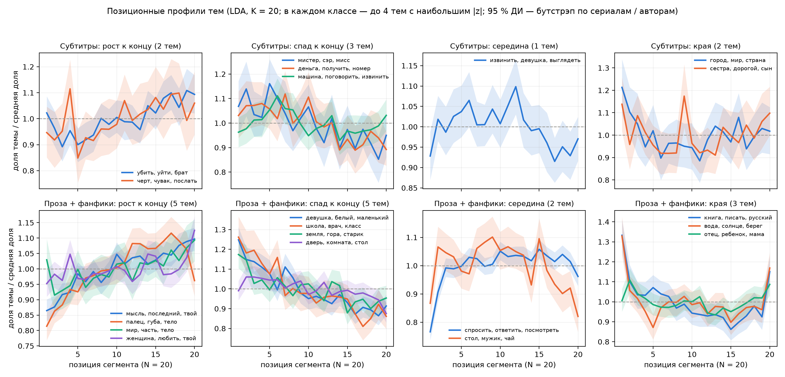

# Этап 3s — Plot Arceology: темы субтитров и прозы + фанфиков (выборочный прогон)

Отдельная LDA на каждом корпусе (правила словаря — этап 3). Позиционный профиль темы — средняя доля темы в сегменте по позиции (N = 20 равных по словам частей), сначала внутри единицы (сериал / автор), затем по единицам. R — профиль, делённый на среднюю долю темы (R = 1 — тема распределена ровно). Компоненты формы — проекции R на ортогональные многочлены Лежандра позиции: линейная (> 0 — рост к концу) и квадратичная (> 0 — края, < 0 — середина); z — относительно нулевой модели (перестановка сегментов внутри текста, 200 раз). Тема значима, если амплитуда профиля больше, чем в нулевой модели (FDR q = 0.05); класс — компонента с большим |z|.

## K = 20

### субтитры сериалов (Ororo, русские субтитры): 337 текстов, 117 единиц; ll/слово -8.263, средняя c_npmi 0.034

Классы формы профиля: плоский — 12, спад к концу — 3, края — 2, рост к концу — 2, середина — 1.

Проверка: 12 частей экранного времени (как у Schmidt) вместо 20 частей по словам — совпадение классов 80%; r(z лин.) = 0.94, r(z кв.) = 0.91.

Все 20 тем (по убыванию силы позиционного профиля)

| тема | слова | доля, % | класс | R(1) | R(N) | max R | пик | z лин. | z кв. | p (амплитуда) | c_npmi |
|---|---|---|---|---|---|---|---|---|---|---|---|
| 18 | убить, уйти, брат, просить, умереть, рассказать, случиться, сын | 9.10 | рост к концу | 1.02 | 1.09 | 1.11 | 19 | 6.39 | 2.68 | 0.005 | 0.03 |
| 12 | мистер, сэр, мисс, добрый, просить, женщина, господин, утро | 4.14 | спад к концу | 1.07 | 0.95 | 1.16 | 5 | -5.54 | 0.09 | 0.005 | 0.06 |
| 6 | деньга, получить, номер, самолет, купить, запись, компания, имя | 4.85 | спад к концу | 1.03 | 0.89 | 1.12 | 7 | -5.47 | -1.00 | 0.005 | 0.02 |
| 2 | извинить, девушка, выглядеть, поговорить, школа, вечер, жить, познакомиться | 9.51 | середина | 0.93 | 0.97 | 1.10 | 12 | -2.21 | -4.12 | 0.005 | -0.00 |
| 19 | город, мир, страна, земля, президент, штат, история, сила | 3.31 | края | 1.21 | 1.02 | 1.21 | 1 | -1.38 | 3.62 | 0.015 | 0.04 |
| 10 | черт, чувак, послать, план, дерьмо, лодка, слушать, достать | 3.96 | рост к концу | 0.95 | 1.06 | 1.11 | 4 | 3.52 | 0.14 | 0.015 | 0.01 |
| 8 | сестра, дорогой, сын, мадам, принцесса, ждать, король, ведьма | 3.46 | края | 1.14 | 1.10 | 1.17 | 9 | 0.29 | 3.14 | 0.005 | -0.02 |
| 17 | машина, поговорить, извинить, позвонить, телефон, приехать, помнить, подождать | 8.65 | спад к концу | 0.96 | 1.03 | 1.11 | 6 | -1.68 | -0.45 | 0.020 | 0.01 |
| 5 | капитан, корабль, мозг, мир, ребенок, использовать, происходить, причина | 4.09 | плоский | 0.92 | 0.98 | 1.12 | 11 | 0.75 | -2.12 | 0.060 | -0.04 |
| 7 | ребенок, папа, мать, спать, ночь, господь, рождение, деньга | 6.92 | плоский | 0.99 | 1.04 | 1.04 | 19 | 0.40 | 1.61 | 0.891 | 0.01 |
| 9 | пара, любовь, конец, свидание, идеальный, отношение, выбрать, готовый | 3.56 | плоский | 1.08 | 0.97 | 1.16 | 19 | 0.90 | 1.76 | 0.214 | 0.05 |
| 1 | вопрос, книга, проблема, какой-то, женщина, чувствовать, ночь, ждать | 7.26 | плоский | 0.98 | 1.06 | 1.06 | 20 | 1.85 | 1.83 | 0.657 | -0.02 |
| 11 | полиция, камера, проверить, связь, узнать, тюрьма, телефон, агент | 4.59 | плоский | 1.07 | 0.96 | 1.11 | 3 | -2.84 | -0.87 | 0.065 | -0.00 |
| 4 | смерть, тело, умереть, мертвый, наркотик, семья, история, считать | 4.12 | плоский | 1.03 | 1.00 | 1.08 | 16 | 1.33 | 0.82 | 0.308 | 0.04 |
| 13 | суд, адвокат, показание, свидетель, честь, обвинение, доказательство, убийство | 2.36 | плоский | 0.88 | 0.91 | 1.12 | 17 | 1.23 | -2.46 | 0.522 | 0.18 |
| 14 | чувствовать, часть, вода, минута, дышать, готовый, сработать, момент | 4.52 | плоский | 0.95 | 0.95 | 1.11 | 14 | 2.22 | -0.80 | 0.388 | -0.00 |
| 15 | слушать, играть, идея, музыка, час, песня, группа, показать | 6.08 | плоский | 0.95 | 0.90 | 1.08 | 8 | -1.58 | -3.21 | 0.085 | 0.04 |
| 16 | игра, команда, играть, мир, готовый, сила, ребята, победить | 4.20 | плоский | 1.06 | 1.10 | 1.14 | 18 | 2.19 | 1.68 | 0.159 | 0.04 |
| 3 | блюдо, готовить, вкус, кухня, шеф, приготовить, соус, использовать | 1.53 | плоский | 0.81 | 0.93 | 1.14 | 10 | -0.39 | -1.52 | 0.726 | 0.25 |
| 0 | доктор, лес, врач, больница, папа, помогать, право, черт | 3.79 | плоский | 1.00 | 0.91 | 1.06 | 3 | -1.52 | -0.93 | 0.766 | -0.02 |

### проза + фанфики (Проза.ру, Ficbook): 999 текстов, 963 единиц; ll/слово -8.801, средняя c_npmi 0.062

Классы формы профиля: спад к концу — 5, рост к концу — 5, плоский — 5, края — 3, середина — 2.

Все 20 тем (по убыванию силы позиционного профиля)

| тема | слова | доля, % | класс | R(1) | R(N) | max R | пик | z лин. | z кв. | p (амплитуда) | c_npmi |
|---|---|---|---|---|---|---|---|---|---|---|---|
| 14 | девушка, белый, маленький, красивый, молодой, волос, цвет, черный | 4.94 | спад к концу | 1.25 | 0.91 | 1.25 | 1 | -14.14 | 3.73 | 0.005 | 0.10 |
| 13 | мысль, последний, твой, сон, слышать, должный, смочь, сила | 8.43 | рост к концу | 0.86 | 1.10 | 1.10 | 20 | 13.32 | -2.38 | 0.005 | 0.01 |
| 16 | палец, губа, тело, взгляд, голос, парень, плечо, спина | 7.56 | рост к концу | 0.81 | 0.96 | 1.12 | 17 | 12.74 | -6.76 | 0.005 | 0.06 |
| 8 | школа, врач, класс, доктор, учиться, урок, учитель, палата | 2.39 | спад к концу | 1.26 | 0.86 | 1.26 | 1 | -11.92 | 3.32 | 0.005 | -0.05 |
| 10 | спросить, ответить, посмотреть, парень, девушка, улыбнуться, решить, вопрос | 11.44 | середина | 0.77 | 0.96 | 1.06 | 15 | 8.47 | -10.05 | 0.005 | 0.05 |
| 6 | книга, писать, русский, читать, история, роман, новый, имя | 3.77 | края | 1.33 | 1.15 | 1.33 | 1 | -7.54 | 9.31 | 0.005 | 0.09 |
| 18 | вода, солнце, берег, небо, ночь, ветер, дождь, кот | 3.40 | края | 1.33 | 1.17 | 1.33 | 1 | -2.92 | 7.56 | 0.005 | 0.04 |
| 2 | земля, гора, старик, лес, город, трава, дорога, деревня | 3.53 | спад к концу | 1.17 | 0.95 | 1.17 | 1 | -7.53 | 2.04 | 0.005 | 0.06 |
| 12 | стол, мужик, чай, хлеб, пить, гость, двор, бутылка | 3.69 | середина | 0.87 | 0.82 | 1.10 | 9 | -3.75 | -7.46 | 0.005 | 0.07 |
| 1 | дверь, комната, стол, телефон, окно, открыть, выйти, квартира | 6.16 | спад к концу | 0.99 | 0.88 | 1.06 | 2 | -6.59 | -2.14 | 0.005 | 0.09 |
| 0 | работа, работать, деньга, новый, страна, город, начальник, рабочий | 5.74 | спад к концу | 1.09 | 0.90 | 1.09 | 1 | -5.45 | 0.79 | 0.005 | 0.04 |
| 3 | мир, часть, тело, ваш, земля, планета, путь, точка | 3.61 | рост к концу | 1.03 | 1.09 | 1.09 | 20 | 4.96 | 1.68 | 0.005 | 0.06 |
| 7 | отец, ребенок, мама, мать, сын, брат, родитель, жить | 5.72 | края | 1.00 | 1.09 | 1.11 | 2 | -0.97 | 4.58 | 0.005 | 0.14 |
| 5 | женщина, любить, твой, любовь, мужчина, понимать, муж, отношение | 8.02 | рост к концу | 0.95 | 1.13 | 1.13 | 20 | 4.54 | 2.22 | 0.005 | 0.07 |
| 19 | бог, король, отец, святой, церковь, мир, царь, душа | 2.87 | рост к концу | 1.06 | 1.10 | 1.10 | 16 | 3.13 | 2.71 | 0.010 | 0.06 |
| 11 | любой, вопрос, жить, право, новый, сила, случай, нужный | 6.22 | плоский | 1.07 | 1.01 | 1.07 | 1 | -1.13 | 1.61 | 0.264 | 0.01 |
| 9 | деньга, купить, магазин, вика, тысяча, хороший, убить, рынок | 1.75 | плоский | 0.86 | 1.01 | 1.10 | 15 | 2.47 | -1.83 | 0.224 | -0.05 |
| 15 | война, медаль, рядовой, военный, солдат, победа, офицер, отечественный | 2.11 | плоский | 1.00 | 1.01 | 1.11 | 19 | 1.88 | 1.04 | 0.741 | 0.27 |
| 4 | машина, дорога, ехать, город, час, поехать, поезд, самолет | 3.42 | плоский | 1.07 | 0.92 | 1.07 | 6 | -2.97 | 0.84 | 0.139 | 0.09 |
| 17 | нога, черный, собака, бежать, какой-то, стена, увидеть, свет | 5.23 | плоский | 1.02 | 0.95 | 1.06 | 16 | 0.70 | -0.39 | 0.109 | 0.02 |

### Сопоставление тем двух корпусов (K = 20; общий словарь 3426 лемм; взаимно ближайшие пары — 11; показаны 11 самых похожих)

| субтитры: тема | проза: тема | сходство (1 − JSD) | класс: субтитры | класс: проза | r профилей R |
|---|---|---|---|---|---|
| 17: машина, поговорить, извинить, позвонить, телефон, приехать | 10: спросить, ответить, посмотреть, парень, девушка, улыбнуться | 0.19 | спад к концу | середина | +0.09 |
| 2: извинить, девушка, выглядеть, поговорить, школа, вечер | 5: женщина, любить, твой, любовь, мужчина, понимать | 0.19 | середина | рост к концу | -0.22 |
| 7: ребенок, папа, мать, спать, ночь, господь | 7: отец, ребенок, мама, мать, сын, брат | 0.18 | плоский | края | +0.56 |
| 18: убить, уйти, брат, просить, умереть, рассказать | 13: мысль, последний, твой, сон, слышать, должный | 0.18 | рост к концу | рост к концу | +0.60 |
| 5: капитан, корабль, мозг, мир, ребенок, использовать | 3: мир, часть, тело, ваш, земля, планета | 0.17 | плоский | рост к концу | -0.02 |
| 8: сестра, дорогой, сын, мадам, принцесса, ждать | 19: бог, король, отец, святой, церковь, мир | 0.16 | края | рост к концу | +0.21 |
| 6: деньга, получить, номер, самолет, купить, запись | 0: работа, работать, деньга, новый, страна, город | 0.16 | спад к концу | спад к концу | +0.41 |
| 3: блюдо, готовить, вкус, кухня, шеф, приготовить | 12: стол, мужик, чай, хлеб, пить, гость | 0.15 | плоский | середина | +0.38 |
| 0: доктор, лес, врач, больница, папа, помогать | 8: школа, врач, класс, доктор, учиться, урок | 0.15 | плоский | спад к концу | +0.25 |
| 14: чувствовать, часть, вода, минута, дышать, готовый | 16: палец, губа, тело, взгляд, голос, парень | 0.14 | плоский | рост к концу | +0.58 |
| 19: город, мир, страна, земля, президент, штат | 2: земля, гора, старик, лес, город, трава | 0.14 | края | спад к концу | +0.45 |

Пар со сходством ≥ 0,5: 0; из них с одинаковым классом формы профиля — 0.

