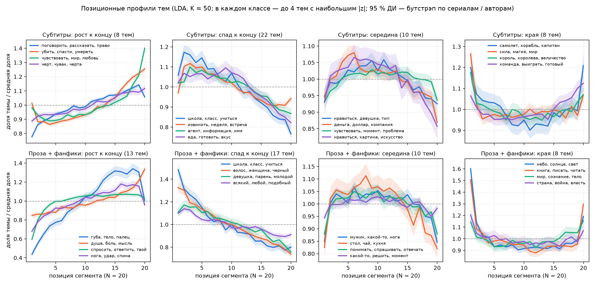
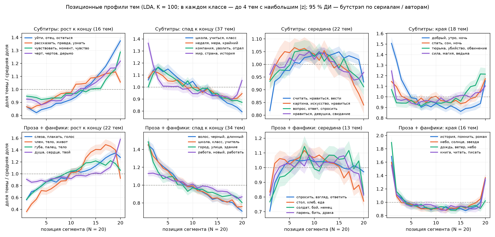
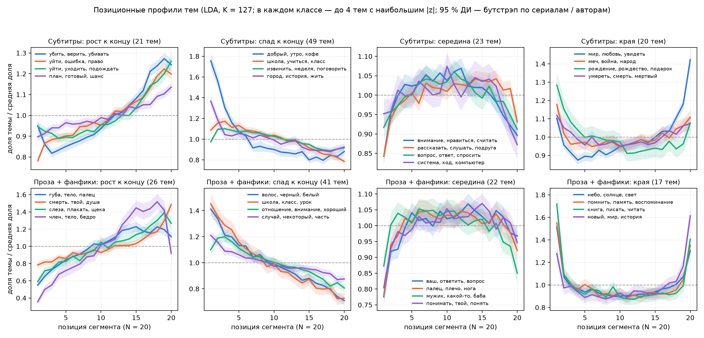

# Этап 3s — Plot Arceology: темы субтитров и прозы + фанфиков

Отдельная LDA на каждом корпусе (правила словаря — этап 3). Позиционный профиль темы — средняя доля темы в сегменте по позиции (N = 20 равных по словам частей), сначала внутри единицы (сериал / автор), затем по единицам. R — профиль, делённый на среднюю долю темы (R = 1 — тема распределена ровно). Компоненты формы — проекции R на ортогональные многочлены Лежандра позиции: линейная (> 0 — рост к концу) и квадратичная (> 0 — края, < 0 — середина); z — относительно нулевой модели (перестановка сегментов внутри текста, 200 раз). Тема значима, если амплитуда профиля больше, чем в нулевой модели (FDR q = 0.05); класс — компонента с большим |z|.

## K = 50

### субтитры сериалов (Ororo, русские субтитры): 26925 текстов, 3423 единиц; ll/слово -9.245, средняя c_npmi 0.069

Классы формы профиля: спад к концу — 22, середина — 10, рост к концу — 8, края — 8, плоский — 2.

Проверка: 12 частей экранного времени (как у Schmidt) вместо 20 частей по словам — совпадение классов 90%; r(z лин.) = 0.99, r(z кв.) = 0.96.

Все 50 тем (по убыванию силы позиционного профиля)

| тема | слова | доля, % | класс | R(1) | R(N) | max R | пик | z лин. | z кв. | p (амплитуда) | c_npmi |
|---|---|---|---|---|---|---|---|---|---|---|---|
| 1 | поговорить, рассказать, право, узнать, случиться, верить, вопрос, правда | 7.05 | рост к концу | 0.78 | 1.06 | 1.14 | 19 | 55.17 | -13.02 | 0.005 | 0.03 |
| 30 | убить, спасти, умереть, остаться, живой, мертвый, оставить, план | 4.78 | рост к концу | 1.01 | 1.25 | 1.25 | 20 | 54.19 | 27.19 | 0.005 | 0.05 |
| 16 | чувствовать, мир, любовь, увидеть, сердце, помнить, последний, чувство | 4.13 | рост к концу | 0.98 | 1.40 | 1.40 | 20 | 48.74 | 31.13 | 0.005 | 0.02 |
| 32 | школа, класс, учиться, учитель, колледж, родитель, урок, занятие | 1.26 | спад к концу | 1.06 | 0.77 | 1.17 | 2 | -32.93 | -6.16 | 0.005 | 0.13 |
| 15 | извинить, неделя, встреча, рад, поговорить, готовый, слушать, проблема | 5.19 | спад к концу | 0.97 | 0.94 | 1.12 | 3 | -31.11 | -4.83 | 0.005 | 0.03 |
| 34 | черт, чувак, черта, слушать, ребята, тип, подождать, извинить | 2.89 | рост к концу | 0.89 | 1.12 | 1.12 | 20 | 27.91 | 2.29 | 0.005 | 0.06 |
| 42 | агент, информация, имя, узнать, расследование, получить, операция, безопасность | 2.28 | спад к концу | 1.02 | 0.87 | 1.10 | 3 | -21.19 | -10.72 | 0.005 | 0.04 |
| 49 | папа, отец, милый, сын, дорогой, поговорить, мальчик, семья | 2.16 | рост к концу | 0.96 | 1.23 | 1.23 | 20 | 20.09 | 13.30 | 0.005 | 0.04 |
| 24 | еда, готовить, вкус, блюдо, приготовить, ужин, кухня, попробовать | 1.59 | спад к концу | 1.02 | 0.82 | 1.10 | 9 | -19.24 | -12.46 | 0.005 | 0.14 |
| 20 | город, земля, жить, золото, местный, дерево, вода, парк | 1.07 | спад к концу | 1.22 | 0.85 | 1.22 | 1 | -17.81 | 1.02 | 0.005 | -0.02 |
| 31 | мир, использовать, вопрос, исследование, история, часть, создать, некоторый | 2.66 | спад к концу | 1.10 | 0.97 | 1.10 | 1 | -16.93 | 1.35 | 0.005 | 0.01 |
| 12 | женщина, выглядеть, волос, мужчина, лицо, носить, нравиться, одежда | 2.37 | спад к концу | 0.97 | 0.82 | 1.06 | 6 | -16.25 | -15.98 | 0.005 | 0.07 |
| 22 | оружие, пистолет, стрелять, послать, пуля, двигаться, выстрел, черт | 1.28 | рост к концу | 1.00 | 1.09 | 1.15 | 18 | 16.12 | 7.56 | 0.005 | 0.07 |
| 7 | убийство, убить, убийца, полиция, тело, детектив, наслать, жертва | 2.51 | спад к концу | 1.06 | 0.89 | 1.07 | 5 | -16.06 | -2.40 | 0.005 | 0.11 |
| 36 | фильм, шоу, сцена, снимать, роль, актер, съемка, сценарий | 1.26 | спад к концу | 1.31 | 1.00 | 1.31 | 1 | -15.78 | 11.31 | 0.005 | 0.16 |
| 47 | вода, животное, лес, мир, земля, природа, океан, дерево | 1.11 | спад к концу | 1.12 | 0.89 | 1.12 | 1 | -15.43 | -2.53 | 0.005 | 0.10 |
| 6 | доктор, врач, больница, пациент, кровь, лекарство, операция, мозг | 2.05 | спад к концу | 1.00 | 0.83 | 1.08 | 4 | -14.68 | -7.91 | 0.005 | 0.10 |
| 19 | самолет, корабль, капитан, лететь, полет, пилот, рейс, перевод | 0.66 | края | 1.20 | 1.21 | 1.21 | 20 | -2.88 | 14.63 | 0.005 | 0.03 |
| 33 | нравиться, девушка, тип, свидание, секс, отношение, встречаться, чувствовать | 2.65 | середина | 0.95 | 0.93 | 1.06 | 11 | -5.43 | -13.17 | 0.005 | 0.05 |
| 8 | книга, писать, написать, история, читать, письмо, статья, газета | 1.37 | спад к концу | 1.02 | 0.94 | 1.07 | 5 | -12.80 | -3.90 | 0.005 | 0.16 |
| 48 | деньга, доллар, компания, миллион, тысяча, бизнес, получить, купить | 2.56 | середина | 0.95 | 0.87 | 1.08 | 6 | -10.91 | -12.33 | 0.005 | 0.12 |
| 40 | сила, магия, мир, призрак, ведьма, кровь, монстр, вампир | 1.50 | края | 1.27 | 1.07 | 1.27 | 1 | -4.48 | 12.28 | 0.005 | -0.04 |
| 18 | мистер, сэр, мисс, миссис, добрый, просить, доктор, леди | 1.42 | спад к концу | 1.01 | 0.91 | 1.07 | 3 | -12.12 | -3.48 | 0.005 | 0.10 |
| 39 | чувствовать, момент, проблема, тип, некоторый, вещь, происходить, отношение | 3.96 | середина | 0.93 | 0.94 | 1.03 | 9 | 1.76 | -12.03 | 0.005 | 0.03 |
| 41 | король, королева, величество, брат, отец, принц, лорд, принцесса | 1.25 | края | 1.18 | 1.07 | 1.18 | 1 | -3.00 | 11.64 | 0.005 | 0.13 |
| 43 | нравиться, картина, искусство, выглядеть, цвет, художник, рисовать, идея | 0.94 | середина | 0.93 | 0.86 | 1.07 | 6 | -8.62 | -11.33 | 0.005 | 0.05 |
| 26 | команда, выиграть, готовый, победить, победа, гонка, ребята, последний | 1.59 | края | 1.06 | 1.12 | 1.12 | 20 | 7.32 | 11.32 | 0.005 | 0.06 |
| 27 | война, армия, сэр, военный, солдат, генерал, страна, бомба | 0.97 | спад к концу | 1.16 | 0.92 | 1.16 | 1 | -10.71 | 2.87 | 0.005 | 0.10 |
| 10 | вечеринка, свадьба, рождение, рождество, подарок, платье, счастливый, праздник | 1.45 | спад к концу | 1.15 | 1.01 | 1.15 | 1 | -10.68 | 7.43 | 0.005 | 0.08 |
| 46 | президент, страна, белый, правительство, штат, власть, мэр, политика | 1.56 | спад к концу | 1.09 | 0.95 | 1.09 | 2 | -10.55 | 4.29 | 0.005 | 0.05 |
| 13 | вода, нога, люк, попробовать, дерево, держать, штука, ребята | 2.01 | середина | 0.94 | 0.89 | 1.05 | 9 | -2.75 | -10.14 | 0.005 | -0.00 |
| 0 | суд, адвокат, обвинение, тюрьма, судья, мистер, показание, честь | 1.64 | рост к концу | 0.96 | 1.04 | 1.12 | 19 | 9.92 | 3.44 | 0.005 | 0.15 |
| 21 | собака, маленький, малыш, животное, кошка, кот, съесть, кролик | 1.18 | спад к концу | 1.01 | 0.92 | 1.06 | 6 | -9.75 | -4.98 | 0.005 | 0.01 |
| 25 | наркотик, деньга, клуб, банда, босс, копа, дон, тюрьма | 0.94 | спад к концу | 1.05 | 0.83 | 1.05 | 1 | -9.16 | -7.54 | 0.005 | -0.02 |
| 4 | телефон, позвонить, звонить, сообщение, номер, звонок, поговорить, оставить | 2.27 | середина | 0.91 | 0.97 | 1.04 | 11 | -1.12 | -8.64 | 0.005 | 0.12 |
| 2 | ночь, спать, пить, утро, добрый, выпить, сон, спокойный | 2.90 | края | 1.08 | 1.07 | 1.09 | 2 | -5.89 | 8.47 | 0.005 | 0.11 |
| 35 | лошадь, шериф, ферма, свинья, земля, корова, звать, птица | 0.72 | спад к концу | 1.03 | 0.91 | 1.08 | 4 | -8.04 | -3.85 | 0.005 | -0.05 |
| 17 | дверь, комната, вещь, ключ, жить, открыть, окно, квартира | 2.13 | спад к концу | 0.98 | 0.90 | 1.06 | 4 | -7.70 | -5.30 | 0.005 | 0.07 |
| 23 | система, сигнал, код, компьютер, связь, использовать, минута, бомба | 1.41 | середина | 0.98 | 0.88 | 1.07 | 16 | -1.82 | -7.54 | 0.005 | 0.02 |
| 45 | лодка, вода, остров, корабль, капитан, море, рыба, пляж | 0.69 | спад к концу | 1.11 | 0.99 | 1.11 | 1 | -7.02 | 3.81 | 0.005 | 0.09 |
| 14 | земля, планета, звезда, солнце, вселенная, энергия, свет, кларк | 0.54 | края | 1.27 | 1.02 | 1.27 | 1 | -5.05 | 6.79 | 0.005 | 0.12 |
| 5 | церковь, отец, господь, святой, вера, верить, сестра, божий | 1.00 | края | 1.05 | 1.12 | 1.12 | 20 | 4.15 | 5.18 | 0.005 | 0.11 |
| 37 | игра, предатель, играть, карта, игрок, верный, выбрать, имя | 0.47 | рост к концу | 1.00 | 1.06 | 1.08 | 18 | 5.10 | 2.46 | 0.005 | 0.04 |
| 29 | черт, слушать, господь, хватить, просить, мать, мужик, хрен | 4.18 | середина | 0.96 | 0.99 | 1.02 | 15 | 3.57 | -4.55 | 0.005 | 0.02 |
| 11 | машина, ехать, поехать, дорога, поезд, автобус, час, грузовик | 1.47 | спад к концу | 1.02 | 0.96 | 1.05 | 2 | -3.50 | 1.14 | 0.030 | 0.10 |
| 3 | жена, муж, женщина, просить, мужчина, дорогой, леди, добрый | 2.76 | середина | 0.96 | 1.01 | 1.02 | 14 | 2.95 | -3.45 | 0.020 | 0.06 |
| 38 | игра, играть, команда, мяч, тренер, игрок, матч, поле | 0.84 | края | 1.07 | 0.91 | 1.07 | 1 | -0.88 | 1.49 | 0.005 | 0.22 |
| 44 | отец, семья, мать, брат, сестра, сын, жить, умереть | 2.56 | середина | 1.02 | 0.96 | 1.03 | 17 | 0.37 | -1.30 | 0.035 | 0.09 |
| 9 | песня, музыка, играть, группа, петь, нравиться, концерт, танцевать | 0.97 | плоский | 1.04 | 0.97 | 1.04 | 11 | -2.78 | -2.05 | 0.144 | 0.11 |
| 28 | полиция, девушка, поговорить, случиться, рассказать, женщина, дочь, искать | 1.81 | плоский | 1.03 | 0.98 | 1.03 | 1 | -0.55 | -1.35 | 0.129 | 0.03 |

### проза + фанфики (Проза.ру, Ficbook): 10099 текстов, 9173 единиц; ll/слово -9.439, средняя c_npmi 0.095

Классы формы профиля: спад к концу — 17, рост к концу — 13, середина — 10, края — 8, плоский — 2.

Все 50 тем (по убыванию силы позиционного профиля)

| тема | слова | доля, % | класс | R(1) | R(N) | max R | пик | z лин. | z кв. | p (амплитуда) | c_npmi |
|---|---|---|---|---|---|---|---|---|---|---|---|
| 22 | губа, тело, палец, грудь, член, поцелуй, бедро, шея | 2.37 | рост к концу | 0.44 | 1.00 | 1.34 | 18 | 45.04 | -16.39 | 0.005 | 0.14 |
| 2 | школа, класс, учиться, учитель, урок, институт, студент, школьный | 1.70 | спад к концу | 1.48 | 0.80 | 1.48 | 1 | -35.06 | 11.54 | 0.005 | 0.13 |
| 35 | душа, боль, мысль, сила, сердце, мир, жить, страх | 3.85 | рост к концу | 0.85 | 1.34 | 1.34 | 20 | 34.31 | 10.65 | 0.005 | 0.05 |
| 40 | волос, женщина, черный, белый, платье, цвет, длинный, мужчина | 2.33 | спад к концу | 1.33 | 0.74 | 1.33 | 1 | -32.61 | 4.30 | 0.005 | 0.12 |
| 38 | небо, солнце, свет, ветер, земля, воздух, дождь, дерево | 3.68 | края | 1.60 | 1.19 | 1.60 | 1 | -14.55 | 32.15 | 0.005 | 0.12 |
| 5 | спросить, ответить, твой, посмотреть, понять, голос, улыбнуться, понимать | 5.65 | рост к концу | 0.59 | 1.03 | 1.07 | 17 | 31.91 | -27.30 | 0.005 | 0.07 |
| 7 | нога, удар, спина, сила, увидеть, упасть, голос, земля | 3.31 | рост к концу | 0.68 | 0.96 | 1.18 | 16 | 29.86 | -13.45 | 0.005 | 0.04 |
| 34 | девушка, парень, молодой, подруга, мужчина, красивый, звать, взгляд | 1.50 | спад к концу | 1.11 | 0.76 | 1.17 | 2 | -26.05 | -4.07 | 0.005 | 0.07 |
| 15 | всякий, любой, подобный, случай, собственный, душа, отношение, никакой | 3.62 | спад к концу | 1.10 | 0.91 | 1.14 | 2 | -24.75 | 2.39 | 0.005 | 0.03 |
| 48 | стена, комната, окно, старый, деревянный, этаж, небольшой, угол | 1.71 | спад к концу | 1.25 | 0.75 | 1.25 | 1 | -23.25 | 2.73 | 0.005 | 0.09 |
| 33 | город, улица, поезд, автобус, вагон, дорога, здание, путь | 1.55 | спад к концу | 1.49 | 0.90 | 1.49 | 1 | -22.70 | 14.09 | 0.005 | 0.12 |
| 8 | книга, писать, читать, роман, художник, автор, картина, стих | 1.65 | края | 1.51 | 1.30 | 1.51 | 1 | -8.66 | 21.86 | 0.005 | 0.13 |
| 45 | любовь, любить, женщина, твой, мужчина, душа, чувство, сердце | 2.39 | рост к концу | 0.98 | 1.48 | 1.48 | 20 | 19.37 | 15.66 | 0.005 | 0.07 |
| 3 | деревня, лошадь, поле, село, двор, корова, конь, колхоз | 1.28 | спад к концу | 1.14 | 0.80 | 1.14 | 2 | -17.97 | -2.02 | 0.005 | 0.09 |
| 27 | старик, смерть, умереть, живой, могила, старый, жить, кладбище | 0.87 | рост к концу | 0.90 | 1.50 | 1.50 | 20 | 17.54 | 11.00 | 0.005 | 0.05 |
| 19 | суд, полиция, полицейский, ваш, документ, следователь, убийство, преступление | 0.97 | рост к концу | 0.76 | 1.10 | 1.15 | 19 | 17.25 | -2.97 | 0.005 | -0.02 |
| 36 | русский, город, язык, век, история, народ, имя, древний | 1.23 | спад к концу | 1.43 | 1.00 | 1.43 | 1 | -15.15 | 14.36 | 0.005 | 0.08 |
| 39 | работа, работать, начальник, рабочий, директор, новый, завод, кабинет | 1.46 | спад к концу | 1.08 | 0.85 | 1.14 | 2 | -14.86 | 0.38 | 0.005 | 0.14 |
| 20 | мужик, какой-то, нога, баба, парень, ладный, твой, всякий | 2.97 | середина | 0.85 | 0.85 | 1.07 | 6 | -4.61 | -14.85 | 0.005 | 0.02 |
| 30 | приехать, поехать, телефон, работа, позвонить, ждать, час, решить | 3.21 | рост к концу | 0.86 | 1.08 | 1.08 | 20 | 13.85 | -3.93 | 0.005 | 0.09 |
| 0 | лес, дерево, дорога, вода, снег, гора, река, земля | 2.02 | спад к концу | 1.12 | 0.84 | 1.12 | 1 | -13.37 | -3.46 | 0.005 | 0.08 |
| 32 | бог, храм, святой, церковь, отец, вера, молитва, господь | 1.05 | рост к концу | 0.92 | 1.28 | 1.28 | 20 | 13.21 | 5.21 | 0.005 | 0.17 |
| 10 | стол, чай, кухня, хлеб, еда, тарелка, вода, обед | 1.80 | середина | 0.82 | 0.82 | 1.11 | 8 | -7.46 | -13.01 | 0.005 | 0.14 |
| 9 | понимать, спрашивать, отвечать, стоить, улыбаться, пытаться, смеяться, чувствовать | 2.74 | середина | 0.88 | 0.88 | 1.05 | 6 | -3.65 | -11.10 | 0.005 | 0.04 |
| 28 | демон, сила, магия, дракон, кровь, твой, свет, мир | 1.09 | рост к концу | 0.93 | 1.07 | 1.10 | 19 | 10.95 | -0.68 | 0.005 | 0.02 |
| 1 | голос, взгляд, тишина, свет, шаг, палец, сердце, чувствовать | 3.88 | рост к концу | 0.92 | 1.06 | 1.06 | 19 | 10.16 | -0.39 | 0.005 | 0.04 |
| 46 | мир, сознание, тело, новый, душа, реальность, планета, мысль | 1.64 | края | 1.15 | 1.15 | 1.15 | 20 | 3.47 | 9.57 | 0.005 | 0.01 |
| 49 | врач, доктор, больница, палата, больной, болезнь, медицинский, медсестра | 0.96 | рост к концу | 0.89 | 0.96 | 1.12 | 19 | 9.32 | -3.26 | 0.005 | 0.23 |
| 23 | какой-то, решить, момент, вопрос, понять, мысль, случай, должный | 6.80 | середина | 0.94 | 0.98 | 1.03 | 10 | -1.68 | -8.31 | 0.005 | 0.02 |
| 14 | страна, война, власть, народ, советский, русский, государство, российский | 1.41 | края | 1.21 | 1.07 | 1.21 | 1 | -4.79 | 7.90 | 0.005 | 0.13 |
| 41 | мама, ребенок, папа, девочка, отец, мальчик, родитель, маленький | 2.11 | края | 1.12 | 1.01 | 1.12 | 1 | -6.88 | 7.77 | 0.005 | 0.12 |
| 21 | бутылка, вино, пить, стол, пиво, выпить, бокал, водка | 0.85 | середина | 0.90 | 0.83 | 1.08 | 7 | -4.63 | -7.69 | 0.005 | 0.15 |
| 18 | отец, ребенок, жена, муж, сын, мать, семья, жить | 2.98 | края | 1.08 | 1.04 | 1.09 | 2 | -3.78 | 7.68 | 0.005 | 0.14 |
| 31 | стол, взгляд, палец, посмотреть, плечо, карман, кивнуть, спросить | 2.04 | середина | 0.88 | 0.94 | 1.07 | 4 | -4.05 | -7.08 | 0.005 | 0.05 |
| 29 | игра, играть, команда, тренер, тренировка, мяч, спорт, спортивный | 0.58 | спад к концу | 0.98 | 0.83 | 1.08 | 3 | -6.07 | -4.74 | 0.005 | 0.11 |
| 47 | дверь, комната, квартира, открыть, окно, выйти, этаж, коридор | 1.93 | середина | 0.92 | 0.89 | 1.04 | 6 | 0.56 | -5.84 | 0.005 | 0.15 |
| 26 | должный, вопрос, система, являться, возможность, уровень, процесс, проблема | 2.52 | спад к концу | 1.03 | 0.93 | 1.03 | 2 | -5.56 | -1.16 | 0.005 | 0.05 |
| 43 | война, командир, солдат, военный, офицер, армия, бой, служба | 1.46 | середина | 0.95 | 0.91 | 1.05 | 9 | 0.14 | -5.53 | 0.005 | 0.16 |
| 4 | деньга, купить, магазин, рубль, тысяча, квартира, цена, продать | 1.66 | спад к концу | 0.96 | 0.88 | 1.07 | 3 | -5.38 | -3.06 | 0.005 | 0.15 |
| 37 | бабушка, дед, письмо, писать, дедушка, мишка, написать, внук | 0.64 | края | 1.03 | 1.14 | 1.14 | 20 | 0.14 | 4.22 | 0.020 | 0.04 |
| 25 | телефон, экран, сообщение, фотография, камера, компьютер, фото, сеть | 1.28 | спад к концу | 1.11 | 1.05 | 1.11 | 1 | -4.14 | 4.06 | 0.005 | 0.07 |
| 42 | тело, кровь, нога, вода, кожа, боль, палец, пол | 2.32 | рост к концу | 1.02 | 0.90 | 1.07 | 16 | 4.05 | -3.00 | 0.005 | 0.06 |
| 13 | собака, кот, кошка, пес, хозяин, лапа, волк, птица | 1.11 | спад к концу | 0.91 | 0.96 | 1.07 | 7 | -3.83 | -3.59 | 0.005 | 0.13 |
| 17 | сон, ночь, спать, кровать, комната, утро, проснуться, спасть | 2.24 | края | 1.07 | 1.10 | 1.10 | 20 | 3.20 | 3.49 | 0.005 | 0.15 |
| 16 | ваш, господин, гость, мистер, хозяин, молодой, стол, просить | 0.81 | спад к концу | 0.95 | 0.95 | 1.08 | 7 | -3.44 | -3.31 | 0.005 | 0.03 |
| 12 | вода, море, берег, корабль, остров, лодка, рыба, капитан | 0.94 | спад к концу | 1.07 | 0.93 | 1.07 | 1 | -3.12 | -1.01 | 0.010 | 0.16 |
| 24 | музыка, песня, сцена, играть, театр, петь, зал, танец | 1.08 | середина | 1.02 | 0.98 | 1.06 | 11 | -1.45 | -2.07 | 0.025 | 0.16 |
| 11 | самолет, должный, система, полет, планета, земля, высота, станция | 0.84 | середина | 0.98 | 0.93 | 1.09 | 16 | 1.12 | -1.61 | 0.005 | 0.04 |
| 44 | князь, король, царь, воин, великий, принц, император, конь | 0.84 | плоский | 1.00 | 0.96 | 1.05 | 5 | -2.41 | -1.36 | 0.527 | 0.07 |
| 6 | машина, дорога, водитель, ехать, автомобиль, сидение, руль, поехать | 1.08 | плоский | 1.01 | 0.94 | 1.07 | 3 | -2.37 | -1.31 | 0.184 | 0.21 |

### Сопоставление тем двух корпусов (K = 50; общий словарь 15619 лемм; взаимно ближайшие пары — 34; показаны 30 самых похожих)

| субтитры: тема | проза: тема | сходство (1 − JSD) | класс: субтитры | класс: проза | r профилей R |
|---|---|---|---|---|---|
| 45: лодка, вода, остров, корабль, капитан, море | 12: вода, море, берег, корабль, остров, лодка | 0.46 | спад к концу | спад к концу | +0.33 |
| 11: машина, ехать, поехать, дорога, поезд, автобус | 6: машина, дорога, водитель, ехать, автомобиль, сидение | 0.45 | спад к концу | плоский | +0.25 |
| 6: доктор, врач, больница, пациент, кровь, лекарство | 49: врач, доктор, больница, палата, больной, болезнь | 0.44 | спад к концу | рост к концу | -0.40 |
| 5: церковь, отец, господь, святой, вера, верить | 32: бог, храм, святой, церковь, отец, вера | 0.44 | края | рост к концу | +0.76 |
| 48: деньга, доллар, компания, миллион, тысяча, бизнес | 4: деньга, купить, магазин, рубль, тысяча, квартира | 0.44 | середина | спад к концу | +0.78 |
| 44: отец, семья, мать, брат, сестра, сын | 18: отец, ребенок, жена, муж, сын, мать | 0.42 | середина | края | -0.22 |
| 32: школа, класс, учиться, учитель, колледж, родитель | 2: школа, класс, учиться, учитель, урок, институт | 0.42 | спад к концу | спад к концу | +0.82 |
| 24: еда, готовить, вкус, блюдо, приготовить, ужин | 10: стол, чай, кухня, хлеб, еда, тарелка | 0.41 | спад к концу | середина | +0.79 |
| 31: мир, использовать, вопрос, исследование, история, часть | 26: должный, вопрос, система, являться, возможность, уровень | 0.41 | спад к концу | спад к концу | +0.65 |
| 16: чувствовать, мир, любовь, увидеть, сердце, помнить | 35: душа, боль, мысль, сила, сердце, мир | 0.40 | рост к концу | рост к концу | +0.94 |
| 41: король, королева, величество, брат, отец, принц | 44: князь, король, царь, воин, великий, принц | 0.40 | края | плоский | -0.25 |
| 39: чувствовать, момент, проблема, тип, некоторый, вещь | 23: какой-то, решить, момент, вопрос, понять, мысль | 0.38 | середина | середина | +0.68 |
| 27: война, армия, сэр, военный, солдат, генерал | 43: война, командир, солдат, военный, офицер, армия | 0.37 | спад к концу | середина | -0.26 |
| 40: сила, магия, мир, призрак, ведьма, кровь | 28: демон, сила, магия, дракон, кровь, твой | 0.37 | края | рост к концу | -0.11 |
| 38: игра, играть, команда, мяч, тренер, игрок | 29: игра, играть, команда, тренер, тренировка, мяч | 0.36 | края | спад к концу | +0.06 |
| 12: женщина, выглядеть, волос, мужчина, лицо, носить | 40: волос, женщина, черный, белый, платье, цвет | 0.36 | спад к концу | спад к концу | +0.62 |
| 9: песня, музыка, играть, группа, петь, нравиться | 24: музыка, песня, сцена, играть, театр, петь | 0.36 | плоский | середина | +0.49 |
| 46: президент, страна, белый, правительство, штат, власть | 14: страна, война, власть, народ, советский, русский | 0.35 | спад к концу | края | +0.58 |
| 17: дверь, комната, вещь, ключ, жить, открыть | 47: дверь, комната, квартира, открыть, окно, выйти | 0.35 | спад к концу | середина | +0.45 |
| 29: черт, слушать, господь, хватить, просить, мать | 20: мужик, какой-то, нога, баба, парень, ладный | 0.35 | середина | середина | +0.57 |
| 15: извинить, неделя, встреча, рад, поговорить, готовый | 30: приехать, поехать, телефон, работа, позвонить, ждать | 0.34 | спад к концу | рост к концу | -0.63 |
| 0: суд, адвокат, обвинение, тюрьма, судья, мистер | 19: суд, полиция, полицейский, ваш, документ, следователь | 0.33 | рост к концу | рост к концу | +0.80 |
| 8: книга, писать, написать, история, читать, письмо | 8: книга, писать, читать, роман, художник, автор | 0.33 | спад к концу | края | +0.07 |
| 1: поговорить, рассказать, право, узнать, случиться, верить | 5: спросить, ответить, твой, посмотреть, понять, голос | 0.32 | рост к концу | рост к концу | +0.85 |
| 2: ночь, спать, пить, утро, добрый, выпить | 17: сон, ночь, спать, кровать, комната, утро | 0.32 | края | края | +0.36 |
| 19: самолет, корабль, капитан, лететь, полет, пилот | 11: самолет, должный, система, полет, планета, земля | 0.27 | края | середина | -0.41 |
| 3: жена, муж, женщина, просить, мужчина, дорогой | 16: ваш, господин, гость, мистер, хозяин, молодой | 0.27 | середина | спад к концу | +0.15 |
| 33: нравиться, девушка, тип, свидание, секс, отношение | 34: девушка, парень, молодой, подруга, мужчина, красивый | 0.27 | середина | спад к концу | +0.50 |
| 23: система, сигнал, код, компьютер, связь, использовать | 25: телефон, экран, сообщение, фотография, камера, компьютер | 0.26 | середина | спад к концу | -0.40 |
| 21: собака, маленький, малыш, животное, кошка, кот | 13: собака, кот, кошка, пес, хозяин, лапа | 0.26 | спад к концу | спад к концу | +0.59 |

Пар со сходством ≥ 0,5: 0; из них с одинаковым классом формы профиля — 0.

## K = 100

### субтитры сериалов (Ororo, русские субтитры): 26925 текстов, 3423 единиц; ll/слово -9.283, средняя c_npmi 0.063

Классы формы профиля: спад к концу — 37, середина — 22, края — 18, рост к концу — 16, плоский — 7.

Проверка: 12 частей экранного времени (как у Schmidt) вместо 20 частей по словам — совпадение классов 92%; r(z лин.) = 0.99, r(z кв.) = 0.97.

Все 100 тем (по убыванию силы позиционного профиля)

| тема | слова | доля, % | класс | R(1) | R(N) | max R | пик | z лин. | z кв. | p (амплитуда) | c_npmi |
|---|---|---|---|---|---|---|---|---|---|---|---|
| 15 | уйти, отец, остаться, умереть, мать, случиться, оставить, боль | 2.66 | рост к концу | 0.87 | 1.37 | 1.37 | 20 | 58.25 | 23.15 | 0.005 | 0.03 |
| 18 | рассказать, правда, узнать, врать, верить, поговорить, ложь, лгать | 2.13 | рост к концу | 0.87 | 1.06 | 1.13 | 19 | 34.67 | -4.82 | 0.005 | 0.08 |
| 35 | чувствовать, момент, чувство, любовь, счастливый, увидеть, сердце, конец | 2.88 | рост к концу | 0.95 | 1.29 | 1.29 | 20 | 30.70 | 19.28 | 0.005 | 0.03 |
| 34 | черт, чертов, дерьмо, черта, ублюдок, слушать, хватить, чертовый | 1.35 | рост к концу | 0.92 | 1.22 | 1.22 | 20 | 27.66 | 9.95 | 0.005 | 0.08 |
| 90 | школа, учиться, класс, учитель, колледж, урок, родитель, университет | 0.95 | спад к концу | 1.06 | 0.79 | 1.16 | 3 | -27.09 | -5.71 | 0.005 | 0.11 |
| 20 | добрый, утро, ночь, спокойный, вечер, завтрак, час, спать | 0.76 | края | 1.51 | 1.15 | 1.51 | 1 | -21.98 | 25.14 | 0.005 | 0.11 |
| 98 | неделя, мера, крайний, последний, час, следующий, месяц, собираться | 1.47 | спад к концу | 1.08 | 0.95 | 1.13 | 2 | -23.91 | 3.00 | 0.005 | 0.06 |
| 66 | компания, уволить, отдел, директор, офис, совет, проблема, список | 1.08 | спад к концу | 1.00 | 0.87 | 1.17 | 3 | -22.80 | -2.67 | 0.005 | 0.04 |
| 2 | поехать, машина, забрать, уйти, приехать, случиться, позвонить, ехать | 1.93 | рост к концу | 0.96 | 1.21 | 1.21 | 20 | 22.70 | 12.88 | 0.005 | 0.06 |
| 99 | план, готовый, решение, надеяться, прийтись, поговорить, проблема, получить | 2.97 | рост к концу | 0.84 | 1.07 | 1.07 | 19 | 22.45 | -5.12 | 0.005 | 0.01 |
| 52 | убить, умереть, убивать, мертвый, убийца, спасти, живой, сбежать | 1.60 | рост к концу | 1.14 | 1.17 | 1.17 | 20 | 22.24 | 19.47 | 0.005 | 0.09 |
| 33 | считать, нравиться, вести, внимание, женщина, право, плохой, проблема | 2.48 | середина | 0.82 | 0.93 | 1.05 | 15 | 12.80 | -20.64 | 0.005 | 0.01 |
| 76 | бежать, послать, спасти, искать, остаться, помощь, план, путь | 1.37 | рост к концу | 0.97 | 1.15 | 1.15 | 20 | 20.41 | 7.39 | 0.005 | 0.03 |
| 19 | мир, страна, история, жить, город, американский, начало, война | 1.15 | спад к концу | 1.37 | 1.06 | 1.37 | 1 | -18.49 | 15.65 | 0.005 | 0.04 |
| 46 | право, закон, правило, верить, мера, сила, угроза, ошибка | 1.38 | рост к концу | 0.93 | 1.13 | 1.13 | 20 | 18.12 | 3.96 | 0.005 | 0.01 |
| 21 | черта, извинить, подождать, собираться, слушать, выглядеть, происходить, уйти | 2.58 | рост к концу | 0.87 | 1.00 | 1.06 | 16 | 18.02 | -9.18 | 0.005 | 0.02 |
| 80 | животное, вода, земля, кит, морской, океан, мир, самец | 0.78 | спад к концу | 1.13 | 0.87 | 1.13 | 1 | -16.97 | -2.69 | 0.005 | 0.12 |
| 11 | жить, квартира, сосед, переехать, месяц, комната, неделя, пара | 1.18 | спад к концу | 1.02 | 0.87 | 1.11 | 4 | -16.80 | -4.70 | 0.005 | 0.06 |
| 3 | агент, информация, операция, расследование, безопасность, служба, правительство, связь | 1.09 | спад к концу | 1.10 | 0.91 | 1.10 | 1 | -16.77 | -0.58 | 0.005 | 0.06 |
| 17 | просить, господин, брат, мир, любовь, сердце, честь, путь | 1.57 | рост к концу | 1.02 | 1.22 | 1.22 | 20 | 16.42 | 13.70 | 0.005 | 0.02 |
| 12 | еда, готовить, блюдо, ужин, кухня, вкус, сыр, приготовить | 1.12 | спад к концу | 0.98 | 0.82 | 1.08 | 5 | -16.15 | -11.68 | 0.005 | 0.16 |
| 37 | полиция, камера, наслать, искать, запись, имя, пропасть, проверить | 1.46 | спад к концу | 0.98 | 0.82 | 1.10 | 5 | -15.92 | -12.04 | 0.005 | 0.05 |
| 27 | шоу, эфир, прямой, мир, реклама, бренд, канал, интервью | 0.48 | спад к концу | 1.34 | 0.95 | 1.34 | 1 | -15.67 | 6.88 | 0.005 | 0.03 |
| 88 | убийство, тело, убийца, убить, жертва, наслать, смерть, след | 1.07 | спад к концу | 1.05 | 0.88 | 1.10 | 4 | -15.17 | -1.70 | 0.005 | 0.13 |
| 28 | купить, папа, нравиться, милый, школа, забыть, родитель, играть | 1.33 | спад к концу | 1.05 | 0.93 | 1.09 | 2 | -14.74 | -1.39 | 0.005 | 0.02 |
| 4 | клуб, клиент, ресторан, деньга, имя, бар, извинить, счет | 1.02 | спад к концу | 0.94 | 0.86 | 1.12 | 5 | -14.37 | -10.92 | 0.005 | -0.00 |
| 24 | выглядеть, носить, волос, надеть, одежда, платье, костюм, нравиться | 1.01 | спад к концу | 0.97 | 0.81 | 1.07 | 7 | -14.00 | -12.05 | 0.005 | 0.13 |
| 54 | доктор, врач, больница, пациент, операция, сердце, медицинский, кровь | 1.23 | спад к концу | 0.99 | 0.80 | 1.08 | 4 | -13.31 | -7.22 | 0.005 | 0.11 |
| 39 | спать, сон, ночь, проснуться, кровать, помнить, спасть, комната | 0.74 | края | 1.15 | 1.17 | 1.17 | 20 | -0.87 | 12.45 | 0.005 | 0.15 |
| 95 | тюрьма, убийство, обвинение, суд, виновный, преступление, адвокат, прокурор | 0.76 | края | 1.07 | 1.22 | 1.22 | 19 | 11.63 | 12.14 | 0.005 | 0.18 |
| 85 | город, мэр, шериф, городской, округ, росс, улица, район | 0.35 | спад к концу | 1.11 | 0.91 | 1.13 | 3 | -11.89 | 0.83 | 0.005 | -0.01 |
| 43 | книга, читать, писать, написать, роман, история, прочитать, страница | 0.55 | спад к концу | 1.06 | 0.94 | 1.08 | 3 | -11.68 | -2.17 | 0.005 | 0.15 |
| 61 | сила, магия, ведьма, мир, меч, кровь, демон, вампир | 0.95 | края | 1.25 | 1.10 | 1.25 | 1 | 1.85 | 11.24 | 0.005 | 0.02 |
| 86 | шоу, сцена, роль, театр, шутка, играть, актер, пьеса | 0.43 | спад к концу | 1.30 | 0.95 | 1.30 | 1 | -10.89 | 4.72 | 0.005 | 0.01 |
| 29 | команда, выиграть, победить, гонка, победа, второй, последний, бой | 0.82 | края | 1.13 | 1.16 | 1.16 | 20 | 6.26 | 10.74 | 0.005 | 0.08 |
| 23 | картина, искусство, нравиться, художник, рисовать, идея, создать, выглядеть | 0.67 | середина | 0.94 | 0.84 | 1.07 | 6 | -7.48 | -10.55 | 0.005 | 0.04 |
| 36 | карта, перевод, финн, оригинал, кора, банк, эрл, уорд | 0.11 | края | 1.11 | 1.89 | 1.89 | 20 | 5.33 | 10.46 | 0.005 | -0.14 |
| 84 | умереть, смерть, мертвый, тело, живой, призрак, случиться, умирать | 1.00 | края | 1.18 | 1.10 | 1.18 | 1 | -0.39 | 10.44 | 0.005 | 0.06 |
| 49 | вопрос, ответ, спросить, ответить, помнить, имя, задать, задавать | 0.83 | середина | 0.93 | 0.91 | 1.06 | 8 | -2.01 | -10.35 | 0.005 | 0.11 |
| 65 | чай, кофе, пить, вода, молоко, выпить, принести, хлой | 0.53 | спад к концу | 0.97 | 0.88 | 1.08 | 4 | -10.29 | -5.14 | 0.005 | 0.08 |
| 22 | вещь, комната, коробка, стол, положить, мусор, бак, ящик | 0.82 | спад к концу | 0.98 | 0.87 | 1.08 | 4 | -10.26 | -5.90 | 0.005 | -0.05 |
| 51 | пистолет, оружие, стрелять, пуля, убить, выстрел, застрелить, выстрелить | 0.52 | рост к концу | 1.00 | 1.04 | 1.17 | 19 | 10.20 | 5.49 | 0.005 | 0.16 |
| 8 | мистер, мисс, миссис, леди, дорогой, добрый, муж, просить | 1.49 | спад к концу | 0.98 | 0.91 | 1.07 | 5 | -10.13 | -5.42 | 0.005 | 0.07 |
| 55 | земля, планета, звезда, вселенная, солнце, свет, энергия, мир | 0.50 | края | 1.34 | 1.07 | 1.34 | 1 | -6.30 | 10.09 | 0.005 | 0.20 |
| 60 | маленький, волос, зуб, нога, запах, лицо, туалет, палец | 1.12 | спад к концу | 0.98 | 0.88 | 1.08 | 8 | -10.03 | -7.83 | 0.005 | 0.02 |
| 31 | нравиться, девушка, свидание, встречаться, познакомиться, милый, отношение, пара | 2.09 | середина | 0.96 | 0.97 | 1.05 | 9 | -4.89 | -9.94 | 0.005 | 0.06 |
| 77 | папа, отец, семья, сын, сынок, милый, дорогой, помнить | 0.87 | края | 1.03 | 1.19 | 1.19 | 20 | 8.70 | 9.78 | 0.005 | 0.04 |
| 57 | деньга, доллар, компания, миллион, тысяча, бизнес, счет, купить | 1.57 | середина | 0.95 | 0.87 | 1.09 | 6 | -8.26 | -9.70 | 0.005 | 0.13 |
| 59 | система, код, компьютер, использовать, доступ, камера, устройство, данные | 0.80 | середина | 0.97 | 0.85 | 1.08 | 10 | -4.78 | -9.32 | 0.005 | 0.11 |
| 89 | поговорить, извинить, слушать, случиться, позвонить, пора, увидеться, просить | 2.90 | середина | 0.86 | 1.00 | 1.04 | 8 | 3.35 | -9.03 | 0.005 | 0.05 |
| 40 | история, статья, газета, писать, журналист, интервью, журнал, новость | 0.52 | спад к концу | 0.98 | 0.95 | 1.09 | 4 | -8.98 | -1.16 | 0.005 | 0.13 |
| 79 | лошадь, ферма, земля, свинья, фермер, корова, птица, волк | 0.39 | спад к концу | 1.01 | 0.86 | 1.10 | 4 | -8.58 | -3.23 | 0.005 | -0.05 |
| 64 | часть, использовать, некоторый, мир, момент, больший, разный, считать | 3.07 | спад к концу | 1.00 | 0.96 | 1.04 | 5 | -8.49 | -5.47 | 0.005 | 0.03 |
| 83 | номер, отель, бассейн, список, комната, гость, пляж, лан | 0.31 | спад к концу | 1.02 | 0.85 | 1.09 | 3 | -8.43 | -4.54 | 0.005 | -0.13 |
| 0 | полиция, детектив, убийство, полицейский, офицер, расследование, копа, сержант | 1.13 | спад к концу | 1.01 | 0.92 | 1.09 | 6 | -8.40 | -3.68 | 0.005 | 0.13 |
| 53 | самолет, рейс, лететь, пилот, аэропорт, полет, летать, пассажир | 0.31 | края | 1.22 | 1.05 | 1.22 | 1 | -6.25 | 8.12 | 0.005 | 0.21 |
| 62 | наркотик, таблетка, принимать, лекарство, кокаин, препарат, принять, героин | 0.36 | середина | 0.97 | 0.78 | 1.08 | 8 | -5.49 | -8.08 | 0.005 | 0.06 |
| 13 | мозг, тело, чувствовать, проблема, стресс, боль, страх, терапия | 0.68 | середина | 0.96 | 0.88 | 1.06 | 11 | -5.58 | -7.89 | 0.005 | -0.03 |
| 75 | женщина, мужчина, секс, сексуальный, девушка, заниматься, тело, женский | 0.63 | середина | 1.01 | 0.80 | 1.07 | 8 | -6.11 | -7.81 | 0.005 | 0.08 |
| 58 | президент, страна, выборы, сенатор, политика, правительство, штат, кампания | 0.62 | спад к концу | 1.12 | 0.93 | 1.12 | 1 | -7.70 | 2.92 | 0.005 | 0.16 |
| 96 | фильм, снимать, сцена, роль, сценарий, съемка, актер, снять | 0.45 | края | 1.30 | 1.02 | 1.30 | 1 | -6.88 | 7.48 | 0.005 | 0.20 |
| 30 | лес, дерево, камень, парк, гора, земля, дорога, природа | 0.57 | спад к концу | 1.07 | 0.89 | 1.07 | 1 | -7.47 | -2.97 | 0.005 | 0.07 |
| 81 | поехать, поезд, ехать, автобус, час, приехать, поездка, путь | 0.62 | края | 1.14 | 1.05 | 1.14 | 1 | -7.10 | 7.46 | 0.005 | 0.08 |
| 71 | торт, пирог, шоколад, масло, шоколадный, мороженое, печение, вкус | 0.43 | спад к концу | 1.07 | 0.89 | 1.07 | 1 | -7.36 | -2.86 | 0.005 | 0.12 |
| 72 | война, армия, солдат, генерал, военный, сражаться, бой, враг | 0.76 | спад к концу | 1.12 | 0.94 | 1.12 | 1 | -7.36 | 2.53 | 0.005 | 0.15 |
| 16 | король, королева, величество, принц, лорд, принцесса, королевский, отец | 0.54 | спад к концу | 1.21 | 1.02 | 1.21 | 1 | -7.35 | 7.13 | 0.005 | 0.17 |
| 63 | доктор, лаборатория, вирус, болезнь, кровь, исследование, образец, лекарство | 0.43 | спад к концу | 1.04 | 0.82 | 1.08 | 7 | -7.01 | -4.69 | 0.005 | 0.07 |
| 25 | деньга, украсть, босс, банда, наркотик, вернуть, брат, товар | 0.91 | середина | 0.99 | 0.86 | 1.05 | 10 | -6.12 | -6.45 | 0.005 | 0.05 |
| 6 | вода, газ, дождь, температура, земля, ветер, энергия, воздух | 0.51 | спад к концу | 1.05 | 0.85 | 1.09 | 6 | -6.43 | -4.23 | 0.005 | -0.03 |
| 87 | видео, фото, фотография, сайт, телефон, сообщение, интернет, отправить | 0.47 | середина | 1.01 | 0.89 | 1.06 | 7 | -5.55 | -6.34 | 0.005 | 0.00 |
| 94 | лодка, вода, остров, корабль, море, капитан, рыба, волна | 0.54 | спад к концу | 1.09 | 0.97 | 1.09 | 1 | -6.10 | 2.95 | 0.005 | 0.11 |
| 14 | слушать, просить, господь, хватить, черт, мать, забыть, решить | 3.42 | середина | 0.94 | 0.99 | 1.03 | 7 | 3.12 | -5.77 | 0.005 | 0.01 |
| 1 | девочка, малыш, мальчик, мать, милый, маленький, беременный, звать | 0.68 | края | 1.04 | 1.09 | 1.09 | 20 | 2.40 | 5.64 | 0.005 | 0.03 |
| 7 | черный, белый, красный, чернокожий, цвет, белые, синий, зеленый | 0.32 | середина | 0.98 | 0.90 | 1.08 | 8 | -4.67 | -5.50 | 0.005 | 0.08 |
| 82 | корабль, капитан, космос, миссия, космический, запуск, двигатель, луна | 0.36 | края | 1.15 | 0.96 | 1.15 | 1 | -2.98 | 5.43 | 0.005 | 0.08 |
| 70 | чувак, тип, ребята, слушать, черт, брат, погодить, братан | 1.03 | середина | 0.92 | 0.97 | 1.04 | 13 | 1.14 | -5.22 | 0.005 | 0.06 |
| 69 | машина, ехать, дорога, грузовик, поехать, водитель, фургон, автомобиль | 0.85 | спад к концу | 1.01 | 0.89 | 1.05 | 2 | -5.14 | -2.53 | 0.005 | 0.08 |
| 5 | игра, играть, предатель, игрок, верный, выбрать, стол, имя | 0.39 | рост к концу | 1.05 | 1.03 | 1.09 | 17 | 5.05 | 2.52 | 0.005 | 0.08 |
| 67 | член, заняться, дерьмо, задница, ебаный, секс, нравиться, чувак | 0.61 | рост к концу | 0.96 | 1.02 | 1.05 | 14 | 4.89 | -2.19 | 0.005 | 0.05 |
| 41 | сэр, мистер, господин, просить, добрый, капитан, инспектор, лейтенант | 0.60 | спад к концу | 1.00 | 0.96 | 1.08 | 4 | -4.81 | -1.41 | 0.005 | 0.03 |
| 42 | телефон, позвонить, звонить, сообщение, звонок, номер, оставить, ответить | 1.09 | середина | 0.92 | 0.98 | 1.03 | 11 | -0.91 | -4.78 | 0.005 | 0.19 |
| 73 | письмо, написать, писать, отправить, почта, получить, имя, документ | 0.47 | середина | 0.95 | 0.92 | 1.07 | 6 | -3.42 | -4.48 | 0.005 | 0.12 |
| 68 | церковь, отец, господь, святой, вера, священник, божий, молиться | 0.74 | края | 1.05 | 1.08 | 1.08 | 20 | 2.19 | 4.27 | 0.010 | 0.11 |
| 78 | суд, мистер, честь, адвокат, показание, свидетель, судья, присяжный | 0.69 | рост к концу | 0.90 | 0.88 | 1.07 | 17 | 4.04 | -3.82 | 0.005 | 0.20 |
| 97 | готовый, нога, держать, минута, двигаться, молодец, попробовать, продолжать | 1.20 | середина | 0.94 | 0.98 | 1.04 | 11 | 3.59 | -4.01 | 0.005 | 0.04 |
| 93 | бомба, команда, взрыв, сэр, цель, группа, связь, минута | 0.87 | края | 1.05 | 1.00 | 1.10 | 16 | 3.64 | 3.95 | 0.005 | 0.01 |
| 9 | отец, семья, брат, сын, мать, сестра, родитель, дочь | 1.91 | рост к концу | 1.00 | 0.99 | 1.04 | 14 | 3.72 | -1.41 | 0.005 | 0.08 |
| 32 | кровь, ударить, удар, нога, нож, бить, лицо, упасть | 0.74 | середина | 0.93 | 0.92 | 1.04 | 13 | 1.43 | -3.54 | 0.005 | 0.08 |
| 56 | свадьба, жена, брак, кольцо, жениться, муж, невеста, любовь | 0.53 | края | 1.08 | 1.05 | 1.08 | 1 | -1.22 | 3.49 | 0.020 | 0.10 |
| 38 | дверь, открыть, комната, здание, выйти, окно, войти, пожар | 1.07 | середина | 0.97 | 0.93 | 1.04 | 18 | 1.29 | -3.21 | 0.045 | 0.06 |
| 74 | женщина, мужчина, жена, мадам, просить, муж, мальчик, месье | 0.79 | середина | 1.00 | 0.98 | 1.05 | 7 | 0.94 | -3.20 | 0.035 | -0.00 |
| 92 | подписать, контракт, адвокат, право, документ, договор, соглашение, сделка | 0.36 | середина | 0.96 | 0.91 | 1.06 | 5 | -2.77 | -2.83 | 0.010 | 0.13 |
| 45 | игра, играть, команда, мяч, тренер, игрок, матч, футбол | 0.75 | края | 1.06 | 0.91 | 1.06 | 1 | 0.20 | 0.64 | 0.005 | 0.21 |
| 10 | вечеринка, рождение, пить, рождество, выпить, вино, подарок, бар | 1.10 | плоский | 1.00 | 1.00 | 1.03 | 10 | 1.11 | -1.60 | 0.348 | 0.03 |
| 26 | собака, дон, кларк, животное, кролик, кот, кошка, пес | 0.37 | плоский | 1.01 | 0.95 | 1.05 | 11 | -2.60 | -3.14 | 0.065 | -0.19 |
| 91 | танец, танцевать, бал, конкурс, выиграть, вечер, дама, королева | 0.44 | плоский | 1.09 | 1.02 | 1.09 | 1 | -0.37 | 3.47 | 0.174 | 0.05 |
| 44 | люк, ключ, змея, сокровище, искать, слон, золото, предмет | 0.24 | плоский | 1.02 | 0.93 | 1.08 | 10 | -2.33 | -3.03 | 0.114 | -0.22 |
| 47 | бабушка, дядя, лить, тетя, дедушка, семья, умереть, похороны | 0.41 | плоский | 1.01 | 0.98 | 1.03 | 7 | -1.16 | 0.40 | 0.960 | 0.01 |
| 48 | песня, музыка, играть, группа, петь, концерт, альбом, нравиться | 0.64 | плоский | 1.01 | 0.99 | 1.04 | 6 | -3.16 | -2.27 | 0.119 | 0.10 |
| 50 | план, мир, монстр, герой, настоящий, идея, злодей, желание | 0.56 | плоский | 1.10 | 1.00 | 1.10 | 1 | -1.12 | 2.12 | 0.060 | -0.09 |

### проза + фанфики (Проза.ру, Ficbook): 10099 текстов, 9173 единиц; ll/слово -9.465, средняя c_npmi 0.087

Классы формы профиля: спад к концу — 34, рост к концу — 22, края — 16, плоский — 15, середина — 13.

Все 100 тем (по убыванию силы позиционного профиля)

| тема | слова | доля, % | класс | R(1) | R(N) | max R | пик | z лин. | z кв. | p (амплитуда) | c_npmi |
|---|---|---|---|---|---|---|---|---|---|---|---|
| 6 | волос, черный, длинный, высокий, взгляд, мужчина, цвет, белый | 1.60 | спад к концу | 1.45 | 0.71 | 1.45 | 1 | -39.38 | 7.99 | 0.005 | 0.10 |
| 7 | слеза, плакать, голос, простить, щека, слава, посмотреть, обнять | 1.22 | рост к концу | 0.56 | 1.28 | 1.35 | 19 | 37.17 | -1.80 | 0.005 | 0.06 |
| 76 | член, тело, живот, рот, бедро, палец, язык, нога | 0.78 | рост к концу | 0.36 | 0.92 | 1.49 | 17 | 33.05 | -9.05 | 0.005 | 0.12 |
| 83 | школа, класс, учитель, учиться, урок, студент, институт, школьный | 1.27 | спад к концу | 1.45 | 0.76 | 1.45 | 1 | -30.50 | 8.55 | 0.005 | 0.13 |
| 86 | история, помнить, роман, память, рассказать, жить, воспоминание, рассказ | 1.17 | края | 1.69 | 1.33 | 1.69 | 1 | -10.45 | 30.19 | 0.005 | 0.08 |
| 39 | губа, палец, тело, кожа, ладонь, грудь, поцелуй, шея | 1.83 | рост к концу | 0.57 | 1.06 | 1.22 | 18 | 28.62 | -12.57 | 0.005 | 0.15 |
| 60 | душа, сердце, твой, любовь, жить, любить, судьба, боль | 1.65 | рост к концу | 0.91 | 1.58 | 1.58 | 20 | 27.75 | 16.36 | 0.005 | 0.06 |
| 65 | город, улица, здание, площадь, центр, городской, местный, мост | 1.01 | спад к концу | 1.49 | 0.80 | 1.49 | 1 | -26.73 | 9.10 | 0.005 | 0.08 |
| 46 | твой, понимать, понять, спросить, ответить, вопрос, должный, любить | 3.42 | рост к концу | 0.72 | 1.05 | 1.07 | 14 | 25.78 | -16.10 | 0.005 | 0.05 |
| 72 | небо, солнце, звезда, свет, земля, луч, ветер, луна | 1.10 | края | 1.60 | 1.37 | 1.60 | 1 | -4.54 | 24.77 | 0.005 | 0.13 |
| 14 | страх, боль, сила, пытаться, должный, тело, мысль, чувствовать | 2.10 | рост к концу | 0.81 | 1.10 | 1.13 | 16 | 24.01 | -3.37 | 0.005 | 0.04 |
| 42 | спросить, взгляд, ответить, посмотреть, улыбнуться, произнести, кивнуть, голос | 3.38 | середина | 0.70 | 0.97 | 1.05 | 9 | 9.91 | -22.03 | 0.005 | 0.10 |
| 17 | работа, новый, работать, заниматься, хороший, неделя, месяц, приходиться | 2.16 | спад к концу | 1.13 | 0.87 | 1.13 | 2 | -21.98 | 0.10 | 0.005 | 0.04 |
| 0 | некоторый, часть, случай, являться, разный, число, количество, любой | 1.76 | спад к концу | 1.23 | 0.87 | 1.23 | 1 | -20.95 | 4.79 | 0.005 | 0.03 |
| 35 | спросить, ответить, выйти, посмотреть, подойти, ждать, увидеть, вернуться | 2.44 | рост к концу | 0.67 | 1.03 | 1.08 | 18 | 20.07 | -13.02 | 0.005 | 0.05 |
| 32 | девушка, парень, подруга, молодой, красивый, девчонка, мужчина, нравиться | 1.09 | спад к концу | 1.03 | 0.79 | 1.15 | 3 | -19.76 | -5.25 | 0.005 | 0.07 |
| 44 | деревня, поле, село, корова, колхоз, хозяйство, земля, лошадь | 0.69 | спад к концу | 1.30 | 0.77 | 1.30 | 1 | -19.69 | 3.06 | 0.005 | 0.10 |
| 22 | дождь, ветер, небо, окно, серый, солнце, погода, улица | 0.85 | края | 1.90 | 1.02 | 1.90 | 1 | -16.33 | 18.89 | 0.005 | 0.13 |
| 45 | кровь, нога, нож, тело, пистолет, левый, рана, правый | 1.06 | рост к концу | 0.73 | 1.01 | 1.14 | 16 | 18.45 | -7.35 | 0.005 | 0.08 |
| 92 | комната, стол, стена, окно, дверь, пол, кровать, кресло | 1.05 | спад к концу | 1.24 | 0.78 | 1.24 | 1 | -17.68 | 1.48 | 0.005 | 0.13 |
| 59 | нога, увидеть, бежать, упасть, голос, спина, сила, успеть | 2.27 | рост к концу | 0.75 | 0.89 | 1.13 | 16 | 17.68 | -14.07 | 0.005 | 0.03 |
| 26 | решить, должный, случай, смочь, прийтись, момент, конец, найти | 3.23 | рост к концу | 0.81 | 1.04 | 1.06 | 18 | 17.22 | -11.09 | 0.005 | 0.01 |
| 66 | вера, смерть, умереть, могила, кладбище, живой, мертвый, гроб | 0.41 | рост к концу | 0.90 | 1.56 | 1.56 | 20 | 17.19 | 10.10 | 0.005 | 0.07 |
| 37 | собственный, герой, молодой, пора, сей, всякий, полный, судьба | 1.41 | спад к концу | 1.16 | 0.95 | 1.16 | 1 | -16.23 | 7.16 | 0.005 | -0.01 |
| 52 | книга, читать, писать, автор, писатель, стих, поэт, написать | 0.82 | края | 1.55 | 1.35 | 1.55 | 1 | -7.09 | 15.88 | 0.005 | 0.16 |
| 57 | новый, мир, сила, путь, будущее, понимать, найти, должный | 1.04 | рост к концу | 1.01 | 1.47 | 1.47 | 20 | 15.87 | 13.49 | 0.005 | 0.02 |
| 75 | отношение, разговор, чувство, вопрос, понимать, какой-то, внимание, мысль | 2.66 | спад к концу | 0.96 | 0.82 | 1.07 | 3 | -15.32 | -9.83 | 0.005 | 0.03 |
| 21 | вика, суд, полиция, полицейский, следователь, судья, убийство, преступление | 0.64 | рост к концу | 0.77 | 1.10 | 1.19 | 17 | 15.24 | -1.91 | 0.005 | -0.05 |
| 96 | любовь, любить, чувство, счастие, душа, счастливый, сердце, любимый | 1.43 | рост к концу | 0.99 | 1.42 | 1.42 | 20 | 14.16 | 10.76 | 0.005 | 0.08 |
| 1 | голос, взгляд, тишина, шаг, чувствовать, посмотреть, сердце, ответить | 2.39 | рост к концу | 0.82 | 1.11 | 1.11 | 20 | 13.59 | -3.71 | 0.005 | 0.05 |
| 84 | нога, рубашка, одежда, брюки, белый, черный, куртка, штаны | 0.64 | спад к концу | 1.10 | 0.75 | 1.16 | 2 | -12.53 | -3.63 | 0.005 | 0.16 |
| 61 | меч, удар, дракон, черный, бой, сила, враг, синий | 0.58 | рост к концу | 0.75 | 0.99 | 1.18 | 18 | 12.42 | -3.88 | 0.005 | 0.00 |
| 10 | стол, хлеб, еда, мясо, тарелка, кухня, обед, картошка | 1.07 | середина | 0.83 | 0.77 | 1.12 | 8 | -6.76 | -12.14 | 0.005 | 0.16 |
| 62 | ребенок, девочка, мальчик, мама, маленький, детский, родитель, взрослый | 1.26 | спад к концу | 1.16 | 0.96 | 1.16 | 1 | -11.92 | 5.63 | 0.005 | 0.14 |
| 13 | двор, забор, сад, домик, участок, дача, земля, дерево | 0.51 | спад к концу | 1.18 | 0.81 | 1.18 | 1 | -11.70 | 1.06 | 0.005 | 0.12 |
| 64 | война, армия, фронт, военный, город, советский, область, победа | 0.61 | края | 1.34 | 1.31 | 1.34 | 1 | -2.98 | 11.66 | 0.005 | 0.14 |
| 48 | квартира, жить, работа, работать, город, новый, деньга, семья | 1.31 | спад к концу | 1.14 | 0.93 | 1.15 | 2 | -11.09 | 4.92 | 0.005 | 0.07 |
| 47 | снег, зима, лед, мороз, зимний, новый, снежный, елка | 0.60 | края | 1.52 | 1.05 | 1.52 | 1 | -9.65 | 11.00 | 0.005 | 0.06 |
| 33 | бог, мир, земля, дух, душа, великий, народ, божий | 0.85 | рост к концу | 1.00 | 1.35 | 1.35 | 20 | 10.26 | 8.33 | 0.005 | 0.06 |
| 80 | врач, доктор, больница, палата, больной, болезнь, медсестра, медицинский | 0.86 | рост к концу | 0.85 | 0.96 | 1.11 | 19 | 9.92 | -3.47 | 0.005 | 0.24 |
| 79 | солдат, бой, немец, война, боец, командир, танк, боевой | 0.70 | середина | 0.77 | 0.82 | 1.14 | 8 | 5.52 | -9.83 | 0.005 | 0.15 |
| 89 | поезд, вагон, автобус, станция, вокзал, ехать, остановка, билет | 0.45 | спад к концу | 1.29 | 0.99 | 1.29 | 1 | -9.73 | 7.37 | 0.005 | 0.22 |
| 93 | парень, бить, драка, кулак, удар, пацан, пьяный, мальчишка | 0.63 | середина | 0.81 | 0.81 | 1.09 | 9 | 0.18 | -9.15 | 0.005 | 0.04 |
| 99 | работа, завод, работать, рабочий, цех, мастер, новый, бригада | 0.49 | спад к концу | 1.03 | 0.77 | 1.13 | 5 | -9.08 | -3.55 | 0.005 | 0.08 |
| 11 | какой-то, всякий, подумать, дурак, хороший, ладный, какой-нибудь, последний | 1.54 | середина | 0.89 | 0.87 | 1.06 | 6 | -4.98 | -8.85 | 0.005 | -0.03 |
| 8 | мир, свет, мысль, тело, какой-то, пространство, странный, сон | 1.90 | края | 1.14 | 1.07 | 1.14 | 1 | -0.36 | 8.70 | 0.005 | 0.04 |
| 82 | русский, язык, народ, страна, век, немецкий, еврей, английский | 0.66 | спад к концу | 1.23 | 1.00 | 1.23 | 1 | -8.65 | 6.00 | 0.005 | 0.08 |
| 29 | работа, директор, кабинет, начальник, работать, отдел, сотрудник, рабочий | 0.87 | спад к концу | 1.07 | 0.87 | 1.12 | 2 | -8.38 | -0.21 | 0.005 | 0.16 |
| 28 | брат, сестра, дядя, отец, старший, семья, мать, тетя | 0.69 | спад к концу | 1.19 | 1.03 | 1.19 | 1 | -8.37 | 5.84 | 0.005 | 0.17 |
| 67 | парень, ладный, пара, твой, какой-то, плечо, нравиться, выглядеть | 0.78 | спад к концу | 0.95 | 0.85 | 1.12 | 6 | -8.19 | -6.89 | 0.005 | 0.02 |
| 41 | бутылка, вино, пить, пиво, выпить, водка, бокал, стол | 0.68 | середина | 0.88 | 0.82 | 1.09 | 7 | -3.15 | -7.81 | 0.005 | 0.26 |
| 24 | улыбаться, спрашивать, стоить, отвечать, выходить, нога, смеяться, взгляд | 1.39 | середина | 0.80 | 0.93 | 1.05 | 14 | 3.71 | -7.67 | 0.005 | 0.04 |
| 71 | лес, дерево, волк, ветка, гриб, лесной, трава, дорога | 0.82 | спад к концу | 1.07 | 0.86 | 1.09 | 6 | -7.59 | -3.65 | 0.005 | 0.05 |
| 43 | мужик, баба, нога, старый, бабка, тетка, хозяин, двор | 1.05 | середина | 0.89 | 0.90 | 1.07 | 8 | -5.57 | -7.33 | 0.005 | -0.04 |
| 40 | платье, золотой, кольцо, красивый, черный, подарок, белый, зеркало | 0.68 | спад к концу | 1.05 | 0.89 | 1.08 | 4 | -7.17 | -2.83 | 0.005 | 0.07 |
| 63 | цветок, цвет, роза, букет, сад, дерево, запах, зеленый | 0.56 | края | 1.28 | 1.12 | 1.28 | 1 | -5.05 | 7.08 | 0.005 | 0.15 |
| 91 | страна, власть, народ, война, советский, государство, новый, партия | 0.91 | спад к концу | 1.20 | 0.99 | 1.20 | 1 | -7.06 | 5.72 | 0.005 | 0.14 |
| 30 | ваш, господин, граф, хозяин, молодой, госпожа, слуга, князь | 0.39 | спад к концу | 1.00 | 0.87 | 1.12 | 5 | -6.85 | -2.30 | 0.005 | 0.01 |
| 94 | команда, тренер, тренировка, спортивный, мяч, игра, ребята, спорт | 0.36 | спад к концу | 1.08 | 0.81 | 1.13 | 6 | -6.77 | -2.34 | 0.005 | 0.15 |
| 2 | мысль, минута, увидеть, час, какой-то, выйти, пройти, улица | 1.36 | спад к концу | 1.10 | 0.97 | 1.10 | 1 | -6.39 | 0.93 | 0.005 | 0.03 |
| 85 | вода, ванная, ведро, полотенце, баня, кухня, вещь, чистый | 0.66 | середина | 0.88 | 0.82 | 1.10 | 12 | -4.15 | -6.26 | 0.005 | 0.01 |
| 98 | женщина, мужчина, молодой, женский, мужской, девушка, дама, жена | 0.44 | спад к концу | 1.04 | 0.90 | 1.07 | 5 | -6.12 | -1.29 | 0.005 | 0.06 |
| 95 | голос, палец, боль, воздух, тяжелый, тело, кровь, запах | 1.70 | рост к концу | 1.03 | 0.94 | 1.09 | 16 | 6.03 | 0.98 | 0.005 | 0.05 |
| 18 | бабушка, дед, старик, дедушка, внук, старый, старушка, внучка | 0.40 | края | 1.15 | 1.09 | 1.15 | 1 | -3.50 | 5.85 | 0.005 | 0.10 |
| 70 | гора, камень, дорога, путь, скала, пещера, вода, горный | 0.67 | спад к концу | 1.11 | 0.84 | 1.11 | 1 | -5.64 | -3.33 | 0.005 | 0.15 |
| 87 | поехать, час, приехать, ехать, город, номер, решить, поездка | 1.03 | края | 1.13 | 1.07 | 1.13 | 1 | -0.38 | 5.50 | 0.005 | 0.07 |
| 58 | церковь, храм, святой, отец, священник, монастырь, бог, молитва | 0.45 | рост к концу | 0.95 | 1.11 | 1.11 | 20 | 5.40 | 1.15 | 0.005 | 0.21 |
| 90 | вода, берег, река, рыба, море, озеро, лодка, рыбалка | 0.69 | спад к концу | 1.11 | 0.86 | 1.11 | 1 | -5.35 | -1.48 | 0.005 | 0.18 |
| 68 | планета, земля, космический, космос, ученый, звезда, вселенная, система | 0.46 | края | 1.11 | 1.08 | 1.11 | 1 | 0.62 | 5.21 | 0.010 | 0.02 |
| 97 | ария, парк, март, гулять, парка, август, мороженое, скамейка | 0.19 | спад к концу | 1.14 | 0.95 | 1.14 | 1 | -5.08 | 0.45 | 0.010 | -0.14 |
| 25 | свет, огонь, темнота, ночь, гореть, пламя, черный, свеча | 0.64 | края | 1.16 | 1.10 | 1.16 | 1 | 3.07 | 4.72 | 0.005 | 0.12 |
| 16 | картина, художник, искусство, музей, работа, рисовать, портрет, рисунок | 0.43 | спад к концу | 1.07 | 1.00 | 1.11 | 6 | -4.50 | 1.35 | 0.005 | 0.13 |
| 81 | деньга, купить, магазин, рубль, тысяча, цена, сумма, продать | 1.12 | середина | 0.92 | 0.89 | 1.05 | 3 | -3.34 | -4.46 | 0.005 | 0.18 |
| 34 | чай, кофе, чашка, стол, пить, кухня, кружка, столик | 0.68 | спад к концу | 0.94 | 0.93 | 1.09 | 6 | -4.40 | -4.17 | 0.005 | 0.20 |
| 50 | должный, закон, право, свобода, общество, любой, власть, правило | 0.94 | рост к концу | 0.98 | 1.06 | 1.07 | 18 | 4.32 | 1.64 | 0.005 | 0.06 |
| 55 | письмо, писать, бумага, стол, написать, фотография, лист, читать | 0.82 | рост к концу | 1.00 | 1.16 | 1.16 | 20 | 4.31 | 3.41 | 0.005 | 0.08 |
| 9 | сон, ночь, спать, кровать, утро, проснуться, спасть, комната | 1.54 | края | 1.10 | 1.13 | 1.13 | 20 | 2.80 | 4.27 | 0.005 | 0.18 |
| 38 | жена, муж, ребенок, сын, женщина, семья, дочь, мать | 1.21 | края | 0.99 | 1.08 | 1.08 | 20 | 3.55 | 4.22 | 0.005 | 0.14 |
| 20 | дверь, этаж, коридор, комната, окно, открыть, квартира, ключ | 1.35 | середина | 0.94 | 0.90 | 1.04 | 9 | -1.04 | -4.03 | 0.005 | 0.15 |
| 56 | командир, служба, офицер, капитан, военный, товарищ, генерал, лейтенант | 0.55 | спад к концу | 0.98 | 0.87 | 1.06 | 3 | -3.47 | -3.26 | 0.005 | 0.21 |
| 77 | игра, играть, карта, шахматы, доска, партия, ход, игрок | 0.22 | середина | 0.87 | 0.95 | 1.11 | 13 | -1.97 | -3.18 | 0.005 | 0.12 |
| 31 | король, принц, император, царь, дворец, королева, великий, ваш | 0.45 | спад к концу | 1.13 | 1.01 | 1.13 | 1 | -3.17 | 2.54 | 0.005 | 0.13 |
| 49 | мама, отец, мать, папа, сын, дочь, родитель, твой | 0.92 | края | 0.97 | 1.03 | 1.05 | 19 | -0.01 | 2.79 | 0.030 | 0.14 |
| 53 | должный, крыса, резервуар, люк, двигатель, устройство, топливо, газ | 0.18 | середина | 0.89 | 0.86 | 1.12 | 13 | 0.92 | -2.08 | 0.005 | -0.10 |
| 51 | телефон, номер, позвонить, трубка, звонить, звонок, сообщение, голос | 0.97 | края | 0.99 | 1.06 | 1.07 | 6 | -0.33 | 0.91 | 0.030 | 0.15 |
| 54 | демон, магия, сила, маг, ведьма, магический, ангел, мир | 0.43 | плоский | 0.95 | 1.07 | 1.07 | 20 | 3.13 | -0.02 | 0.592 | -0.03 |
| 36 | мир, сознание, мысль, смысл, мозг, реальность, тело, состояние | 1.32 | плоский | 1.04 | 0.98 | 1.04 | 1 | -0.22 | 0.79 | 0.303 | 0.09 |
| 3 | птица, крыло, лис, ворон, ворона, гнездо, голубь, перо | 0.37 | плоский | 0.94 | 1.00 | 1.07 | 15 | -0.67 | -0.81 | 0.587 | -0.05 |
| 4 | работа, проект, страна, вопрос, организация, система, развитие, проблема | 0.83 | плоский | 1.07 | 0.97 | 1.07 | 1 | -1.56 | 2.46 | 0.617 | 0.09 |
| 74 | музыка, песня, петь, играть, танец, танцевать, музыкальный, концерт | 0.65 | плоский | 0.97 | 0.95 | 1.06 | 14 | -0.47 | -2.81 | 0.224 | 0.20 |
| 5 | система, экран, робот, работать, сигнал, код, монитор, режим | 0.67 | плоский | 1.06 | 0.95 | 1.06 | 1 | -0.56 | 0.46 | 0.129 | 0.00 |
| 88 | конь, князь, лошадь, казак, воин, земля, хан, войско | 0.38 | плоский | 0.97 | 0.91 | 1.07 | 6 | -2.60 | -2.31 | 0.045 | 0.14 |
| 73 | гость, мистер, праздник, свадьба, подарок, стол, миссис, рождение | 0.45 | плоский | 1.05 | 1.13 | 1.13 | 20 | 2.00 | 2.54 | 0.070 | -0.07 |
| 27 | собака, кот, кошка, пес, хозяин, лапа, хвост, животное | 0.68 | плоский | 0.93 | 0.98 | 1.05 | 4 | -2.73 | -1.59 | 0.129 | 0.12 |
| 23 | сигарета, курить, дым, карман, пачка, закурить, достать, бросить | 0.31 | плоский | 0.96 | 0.93 | 1.09 | 11 | -3.24 | -2.57 | 0.065 | 0.17 |
| 69 | альфа, мина, альф, омег, рей, омега, запах, метка | 0.09 | плоский | 0.93 | 0.99 | 1.08 | 3 | 0.07 | -1.35 | 0.955 | -0.11 |
| 12 | машина, дорога, водитель, ехать, автомобиль, сидение, руль, поехать | 0.92 | плоский | 0.98 | 0.95 | 1.05 | 8 | -0.76 | -1.93 | 0.154 | 0.21 |
| 15 | театр, фильм, сцена, роль, режиссер, спектакль, актер, зал | 0.49 | плоский | 1.08 | 0.96 | 1.08 | 1 | -4.30 | 0.29 | 0.100 | 0.18 |
| 78 | маска, общий, образ, бандит, решить, касаться, хиппи, доля | 0.08 | плоский | 0.87 | 0.89 | 1.13 | 18 | 0.99 | -1.61 | 0.353 | 0.04 |
| 19 | корабль, капитан, море, остров, борт, морской, самолет, берег | 0.44 | плоский | 1.06 | 1.00 | 1.07 | 19 | -0.48 | 1.64 | 0.647 | 0.11 |

### Сопоставление тем двух корпусов (K = 100; общий словарь 15619 лемм; взаимно ближайшие пары — 50; показаны 30 самых похожих)

| субтитры: тема | проза: тема | сходство (1 − JSD) | класс: субтитры | класс: проза | r профилей R |
|---|---|---|---|---|---|
| 69: машина, ехать, дорога, грузовик, поехать, водитель | 12: машина, дорога, водитель, ехать, автомобиль, сидение | 0.47 | спад к концу | плоский | +0.40 |
| 54: доктор, врач, больница, пациент, операция, сердце | 80: врач, доктор, больница, палата, больной, болезнь | 0.44 | спад к концу | рост к концу | -0.38 |
| 90: школа, учиться, класс, учитель, колледж, урок | 83: школа, класс, учитель, учиться, урок, студент | 0.43 | спад к концу | спад к концу | +0.85 |
| 57: деньга, доллар, компания, миллион, тысяча, бизнес | 81: деньга, купить, магазин, рубль, тысяча, цена | 0.43 | середина | середина | +0.73 |
| 12: еда, готовить, блюдо, ужин, кухня, вкус | 10: стол, хлеб, еда, мясо, тарелка, кухня | 0.40 | спад к концу | середина | +0.85 |
| 48: песня, музыка, играть, группа, петь, концерт | 74: музыка, песня, петь, играть, танец, танцевать | 0.40 | плоский | плоский | +0.51 |
| 39: спать, сон, ночь, проснуться, кровать, помнить | 9: сон, ночь, спать, кровать, утро, проснуться | 0.39 | края | края | +0.67 |
| 9: отец, семья, брат, сын, мать, сестра | 28: брат, сестра, дядя, отец, старший, семья | 0.38 | рост к концу | спад к концу | -0.64 |
| 43: книга, читать, писать, написать, роман, история | 52: книга, читать, писать, автор, писатель, стих | 0.38 | спад к концу | края | +0.24 |
| 64: часть, использовать, некоторый, мир, момент, больший | 0: некоторый, часть, случай, являться, разный, число | 0.38 | спад к концу | спад к концу | +0.61 |
| 11: жить, квартира, сосед, переехать, месяц, комната | 48: квартира, жить, работа, работать, город, новый | 0.38 | спад к концу | спад к концу | +0.71 |
| 55: земля, планета, звезда, вселенная, солнце, свет | 68: планета, земля, космический, космос, ученый, звезда | 0.37 | края | края | +0.62 |
| 45: игра, играть, команда, мяч, тренер, игрок | 94: команда, тренер, тренировка, спортивный, мяч, игра | 0.37 | края | спад к концу | +0.03 |
| 38: дверь, открыть, комната, здание, выйти, окно | 20: дверь, этаж, коридор, комната, окно, открыть | 0.37 | середина | середина | +0.66 |
| 16: король, королева, величество, принц, лорд, принцесса | 31: король, принц, император, царь, дворец, королева | 0.36 | спад к концу | спад к концу | +0.77 |
| 42: телефон, позвонить, звонить, сообщение, звонок, номер | 51: телефон, номер, позвонить, трубка, звонить, звонок | 0.36 | середина | края | -0.03 |
| 94: лодка, вода, остров, корабль, море, капитан | 19: корабль, капитан, море, остров, борт, морской | 0.35 | спад к концу | плоский | +0.35 |
| 66: компания, уволить, отдел, директор, офис, совет | 29: работа, директор, кабинет, начальник, работать, отдел | 0.35 | спад к концу | спад к концу | +0.79 |
| 68: церковь, отец, господь, святой, вера, священник | 58: церковь, храм, святой, отец, священник, монастырь | 0.35 | края | рост к концу | +0.32 |
| 59: система, код, компьютер, использовать, доступ, камера | 5: система, экран, робот, работать, сигнал, код | 0.34 | середина | плоский | -0.01 |
| 96: фильм, снимать, сцена, роль, сценарий, съемка | 15: театр, фильм, сцена, роль, режиссер, спектакль | 0.34 | края | плоский | +0.62 |
| 73: письмо, написать, писать, отправить, почта, получить | 55: письмо, писать, бумага, стол, написать, фотография | 0.34 | середина | рост к концу | -0.51 |
| 99: план, готовый, решение, надеяться, прийтись, поговорить | 26: решить, должный, случай, смочь, прийтись, момент | 0.34 | рост к концу | рост к концу | +0.89 |
| 33: считать, нравиться, вести, внимание, женщина, право | 75: отношение, разговор, чувство, вопрос, понимать, какой-то | 0.34 | середина | спад к концу | +0.09 |
| 61: сила, магия, ведьма, мир, меч, кровь | 54: демон, магия, сила, маг, ведьма, магический | 0.33 | края | плоский | +0.07 |
| 72: война, армия, солдат, генерал, военный, сражаться | 79: солдат, бой, немец, война, боец, командир | 0.32 | спад к концу | середина | -0.58 |
| 81: поехать, поезд, ехать, автобус, час, приехать | 89: поезд, вагон, автобус, станция, вокзал, ехать | 0.31 | края | спад к концу | +0.88 |
| 15: уйти, отец, остаться, умереть, мать, случиться | 14: страх, боль, сила, пытаться, должный, тело | 0.31 | рост к концу | рост к концу | +0.85 |
| 89: поговорить, извинить, слушать, случиться, позвонить, пора | 46: твой, понимать, понять, спросить, ответить, вопрос | 0.31 | середина | рост к концу | +0.68 |
| 0: полиция, детектив, убийство, полицейский, офицер, расследование | 21: вика, суд, полиция, полицейский, следователь, судья | 0.31 | спад к концу | рост к концу | -0.69 |

Пар со сходством ≥ 0,5: 0; из них с одинаковым классом формы профиля — 0.

## K = 127

### субтитры сериалов (Ororo, русские субтитры): 26925 текстов, 3423 единиц; ll/слово -9.293, средняя c_npmi 0.044

Классы формы профиля: спад к концу — 49, середина — 23, рост к концу — 21, края — 20, плоский — 14.

Проверка: 12 частей экранного времени (как у Schmidt) вместо 20 частей по словам — совпадение классов 83%; r(z лин.) = 0.98, r(z кв.) = 0.96.

Все 127 тем (по убыванию силы позиционного профиля)

| тема | слова | доля, % | класс | R(1) | R(N) | max R | пик | z лин. | z кв. | p (амплитуда) | c_npmi |
|---|---|---|---|---|---|---|---|---|---|---|---|
| 104 | убить, верить, убивать, умереть, правда, рассказать, смерть, отец | 1.98 | рост к концу | 0.95 | 1.24 | 1.27 | 19 | 54.78 | 17.69 | 0.005 | 0.07 |
| 2 | уйти, ошибка, право, остаться, случиться, пора, поговорить, слушать | 2.49 | рост к концу | 0.78 | 1.20 | 1.22 | 19 | 45.65 | 6.08 | 0.005 | 0.03 |
| 97 | добрый, утро, кофе, завтрак, вечер, час, чай, ночь | 0.48 | спад к концу | 1.76 | 0.88 | 1.76 | 1 | -39.91 | 27.21 | 0.005 | 0.07 |
| 106 | уйти, уходить, подождать, послать, забрать, оставить, отпустить, черт | 1.91 | рост к концу | 0.95 | 1.26 | 1.26 | 20 | 35.40 | 17.57 | 0.005 | 0.04 |
| 90 | школа, учиться, класс, учитель, колледж, урок, родитель, школьный | 0.95 | спад к концу | 1.09 | 0.78 | 1.17 | 3 | -28.76 | -4.92 | 0.005 | 0.11 |
| 49 | мир, любовь, увидеть, верить, душа, помнить, чувствовать, сердце | 1.53 | края | 1.10 | 1.42 | 1.42 | 20 | 26.72 | 27.85 | 0.005 | 0.03 |
| 94 | план, готовый, шанс, доверять, позволить, остаться, единственный, конец | 2.43 | рост к концу | 0.90 | 1.14 | 1.14 | 20 | 27.48 | 4.42 | 0.005 | 0.01 |
| 126 | извинить, неделя, поговорить, слушать, увидеться, встреча, минута, позвонить | 2.38 | спад к концу | 0.97 | 0.92 | 1.10 | 3 | -25.04 | -7.94 | 0.005 | 0.05 |
| 19 | черта, чертовый, дерьмо, ублюдок, слушать, извинить, заткнуться, проблема | 1.05 | рост к концу | 0.87 | 1.10 | 1.13 | 19 | 20.21 | 1.87 | 0.005 | 0.05 |
| 23 | внимание, нравиться, считать, вести, проблема, идея, плохой, любой | 1.34 | середина | 0.84 | 0.90 | 1.07 | 12 | -2.27 | -20.14 | 0.005 | 0.01 |
| 120 | город, история, жить, местный, мир, страна, рис, деревня | 0.56 | спад к концу | 1.37 | 0.92 | 1.37 | 1 | -19.55 | 7.92 | 0.005 | 0.03 |
| 99 | шоу, сцена, выступление, театр, звезда, дама, роль, выступать | 0.67 | спад к концу | 1.35 | 0.94 | 1.35 | 1 | -17.92 | 7.93 | 0.005 | 0.04 |
| 113 | жить, квартира, сосед, комната, переехать, месяц, улица, район | 0.65 | спад к концу | 1.07 | 0.86 | 1.11 | 3 | -17.33 | -3.70 | 0.005 | 0.07 |
| 59 | агент, информация, операция, цель, команда, безопасность, русский, секретный | 0.86 | спад к концу | 1.13 | 0.89 | 1.13 | 1 | -17.28 | 1.01 | 0.005 | 0.05 |
| 9 | рассказать, поговорить, узнать, случиться, собираться, происходить, доверять, секрет | 1.93 | рост к концу | 0.91 | 1.06 | 1.06 | 20 | 16.97 | -3.12 | 0.005 | 0.05 |
| 111 | еда, готовить, блюдо, ужин, сыр, приготовить, кухня, вкус | 1.06 | спад к концу | 0.97 | 0.81 | 1.10 | 9 | -15.61 | -11.38 | 0.005 | 0.20 |
| 32 | черт, чертов, убить, ублюдок, слушать, мать, господь, хватить | 0.70 | рост к концу | 0.96 | 1.17 | 1.17 | 20 | 15.52 | 6.16 | 0.005 | 0.03 |
| 116 | любовь, женщина, просить, сердце, мужчина, позволить, бояться, мир | 1.77 | рост к концу | 0.95 | 1.11 | 1.11 | 20 | 15.40 | 5.28 | 0.005 | 0.02 |
| 74 | оружие, пистолет, стрелять, убить, пуля, выстрел, застрелить, выстрелить | 0.71 | рост к концу | 1.01 | 1.05 | 1.18 | 18 | 14.99 | 8.19 | 0.005 | 0.17 |
| 14 | вода, земля, океан, мир, самец, лес, лед, животное | 0.72 | спад к концу | 1.20 | 0.88 | 1.20 | 1 | -14.80 | -1.40 | 0.005 | 0.08 |
| 82 | компания, бизнес, деньга, миллион, доллар, сделка, клиент, рынок | 1.00 | спад к концу | 1.01 | 0.85 | 1.11 | 6 | -14.77 | -6.79 | 0.005 | 0.09 |
| 108 | выглядеть, волос, костюм, носить, надеть, одежда, цвет, лицо | 0.96 | спад к концу | 0.97 | 0.82 | 1.08 | 10 | -14.43 | -12.43 | 0.005 | 0.09 |
| 86 | ночь, спать, спокойный, остаться, комната, кровать, час, дорогой | 1.14 | рост к концу | 0.96 | 1.31 | 1.31 | 20 | 13.94 | 11.76 | 0.005 | 0.07 |
| 30 | рассказать, слушать, подруга, решить, господь, просить, поговорить, бояться | 1.91 | середина | 0.84 | 0.93 | 1.04 | 17 | 10.00 | -13.71 | 0.005 | 0.00 |
| 58 | доктор, больница, врач, пациент, операция, сердце, медсестра, кровь | 0.91 | спад к концу | 1.01 | 0.83 | 1.10 | 4 | -13.61 | -4.33 | 0.005 | 0.11 |
| 1 | полиция, детектив, полицейский, убийство, офицер, расследование, инспектор, сержант | 1.12 | спад к концу | 1.00 | 0.89 | 1.10 | 3 | -12.81 | -4.52 | 0.005 | 0.15 |
| 71 | спасти, умереть, призрак, убить, бежать, монстр, мертвый, живой | 0.99 | рост к концу | 1.11 | 1.14 | 1.14 | 20 | 12.75 | 10.00 | 0.005 | 0.04 |
| 20 | убийство, убийца, тело, убить, жертва, наслать, след, смерть | 1.10 | спад к концу | 1.06 | 0.92 | 1.07 | 5 | -12.75 | -1.36 | 0.005 | 0.13 |
| 122 | лить, зуб, вода, ванна, туалет, дождь, душа, минута | 0.46 | спад к концу | 1.03 | 0.90 | 1.18 | 2 | -12.41 | -1.10 | 0.005 | -0.10 |
| 123 | вопрос, ответ, спросить, ответить, задать, задавать, спрашивать, помнить | 0.91 | середина | 0.92 | 0.91 | 1.06 | 11 | -0.69 | -12.18 | 0.005 | 0.14 |
| 102 | мир, доктор, наука, ученый, профессор, идея, исследование, будущее | 0.58 | спад к концу | 1.13 | 0.95 | 1.13 | 1 | -12.02 | 1.64 | 0.005 | 0.05 |
| 93 | меч, война, народ, сражаться, брат, армия, убить, битва | 0.94 | края | 1.18 | 1.11 | 1.18 | 1 | 2.25 | 12.00 | 0.005 | 0.12 |
| 121 | собираться, мера, подождать, извинить, крайний, вещь, случай, выглядеть | 1.73 | рост к концу | 0.87 | 0.99 | 1.05 | 16 | 11.67 | -7.68 | 0.005 | 0.00 |
| 42 | отец, семья, сын, мать, дочь, родитель, жить, мальчик | 1.72 | рост к концу | 0.99 | 1.05 | 1.06 | 17 | 11.66 | 0.02 | 0.005 | 0.08 |
| 115 | суд, обвинение, адвокат, мистер, честь, показание, присяжный, судья | 0.84 | рост к концу | 0.97 | 1.05 | 1.20 | 19 | 11.42 | 5.88 | 0.005 | 0.20 |
| 60 | рождение, рождество, подарок, праздник, рождественский, счастливый, папа, благодарение | 0.36 | края | 1.28 | 1.08 | 1.28 | 1 | -8.89 | 11.09 | 0.005 | 0.13 |
| 28 | купить, магазин, продать, продавать, покупать, билет, доллар, деньга | 0.46 | спад к концу | 1.00 | 0.83 | 1.09 | 5 | -11.05 | -7.54 | 0.005 | 0.17 |
| 44 | нравиться, чувствовать, отношение, любовь, девушка, свидание, пара, чувство | 1.18 | рост к концу | 0.95 | 1.09 | 1.09 | 20 | 10.95 | 1.75 | 0.005 | 0.04 |
| 47 | клуб, девушка, бар, мужчина, ночь, имя, уйти, женщина | 0.69 | спад к концу | 0.98 | 0.83 | 1.08 | 4 | -10.87 | -9.56 | 0.005 | 0.03 |
| 110 | система, код, компьютер, доступ, использовать, связь, камера, безопасность | 0.76 | середина | 0.95 | 0.87 | 1.07 | 10 | -2.13 | -10.70 | 0.005 | 0.09 |
| 92 | умереть, смерть, мертвый, тело, похороны, живой, умирать, последний | 0.76 | края | 1.12 | 1.07 | 1.12 | 1 | 0.01 | 10.68 | 0.005 | 0.07 |
| 107 | нравиться, девушка, свидание, милый, встречаться, подруга, ненавидеть, познакомиться | 1.17 | середина | 0.99 | 0.89 | 1.06 | 9 | -10.38 | -10.61 | 0.005 | 0.07 |
| 53 | история, статья, газета, писать, интервью, новость, журналист, написать | 0.51 | спад к концу | 1.06 | 0.97 | 1.10 | 4 | -10.17 | 0.93 | 0.005 | 0.13 |
| 52 | чувствовать, чувство, момент, проблема, боль, происходить, какой-то, помнить | 1.36 | рост к концу | 0.94 | 1.04 | 1.06 | 19 | 10.14 | -1.83 | 0.005 | 0.02 |
| 5 | сон, спать, проснуться, помнить, кошмар, сниться, ночь, просыпаться | 0.36 | края | 1.32 | 1.09 | 1.32 | 1 | -6.59 | 10.14 | 0.005 | 0.17 |
| 26 | перевод, финн, оригинал, кора, корова, чип, ранчо, бык | 0.09 | края | 1.09 | 1.81 | 1.81 | 20 | 2.81 | 10.05 | 0.005 | -0.24 |
| 46 | вещь, комната, коробка, стол, одежда, оставить, положить, ящик | 0.70 | спад к концу | 0.97 | 0.87 | 1.09 | 4 | -9.96 | -5.99 | 0.005 | 0.03 |
| 37 | папа, отец, семья, сын, слушать, дедушка, сынок, малыш | 0.88 | края | 1.02 | 1.15 | 1.15 | 20 | 5.87 | 9.87 | 0.005 | 0.04 |
| 29 | команда, выиграть, гонка, победить, победа, испытание, второй, последний | 0.68 | края | 1.08 | 1.19 | 1.19 | 20 | 7.44 | 9.84 | 0.005 | 0.09 |
| 18 | мистер, мисс, миссис, леди, сэр, дорогой, добрый, полагать | 1.10 | спад к концу | 0.99 | 0.88 | 1.07 | 5 | -9.79 | -6.18 | 0.005 | 0.08 |
| 87 | картина, искусство, нравиться, художник, рисовать, нарисовать, выглядеть, рисунок | 0.48 | середина | 0.95 | 0.84 | 1.08 | 9 | -8.45 | -9.78 | 0.005 | 0.03 |
| 70 | полиция, пропасть, искать, девушка, наслать, случиться, дочь, позвонить | 0.92 | спад к концу | 1.07 | 0.88 | 1.07 | 1 | -9.69 | -2.87 | 0.005 | 0.06 |
| 4 | номер, имя, письмо, список, отель, документ, отправить, адрес | 0.86 | середина | 0.93 | 0.89 | 1.07 | 7 | -7.62 | -9.51 | 0.005 | 0.08 |
| 91 | пить, выпить, вино, бутылка, пиво, бар, напиток, принести | 0.81 | середина | 0.89 | 0.96 | 1.06 | 11 | 4.41 | -9.38 | 0.005 | 0.16 |
| 103 | лекарство, доктор, врач, рак, болезнь, таблетка, принимать, пациент | 0.60 | спад к концу | 1.01 | 0.82 | 1.08 | 7 | -9.07 | -6.24 | 0.005 | 0.10 |
| 95 | страна, война, мир, правительство, американский, американец, власть, президент | 0.63 | спад к концу | 1.20 | 0.98 | 1.20 | 1 | -9.03 | 5.82 | 0.005 | 0.11 |
| 40 | тип, ребята, чувствовать, нравиться, выглядеть, происходить, странный, чувак | 0.37 | середина | 0.87 | 0.87 | 1.09 | 10 | -1.82 | -8.44 | 0.005 | 0.03 |
| 6 | город, мэр, шериф, кларк, округ, городской, совет, мистер | 0.23 | спад к концу | 1.14 | 0.89 | 1.14 | 1 | -8.37 | 0.72 | 0.005 | -0.01 |
| 43 | фильм, снимать, роль, сцена, сценарий, съемка, актер, персонаж | 0.47 | спад к концу | 1.32 | 1.01 | 1.32 | 1 | -8.31 | 7.37 | 0.005 | 0.20 |
| 80 | книга, читать, писать, написать, письмо, история, прочитать, страница | 0.57 | спад к концу | 1.04 | 0.97 | 1.06 | 3 | -8.16 | -1.22 | 0.005 | 0.17 |
| 50 | лес, дерево, лошадь, земля, дорога, лагерь, ферма, гора | 0.66 | спад к концу | 1.06 | 0.93 | 1.08 | 4 | -8.10 | -1.17 | 0.005 | -0.00 |
| 81 | видео, фото, камера, фотография, запись, увидеть, телефон, сайт | 0.54 | середина | 0.98 | 0.88 | 1.07 | 9 | -6.04 | -8.06 | 0.005 | 0.09 |
| 13 | чувак, ребята, слушать, черт, погодить, подождать, тип, детка | 1.12 | рост к концу | 0.91 | 1.03 | 1.04 | 16 | 7.93 | -2.74 | 0.005 | 0.07 |
| 12 | просить, проблема, ждать, пара, искать, час, решить, пора | 1.62 | середина | 0.91 | 0.96 | 1.04 | 7 | -0.30 | -7.93 | 0.005 | 0.00 |
| 69 | магия, сила, ведьма, демон, дракон, заклинание, темный, мир | 0.56 | края | 1.22 | 1.08 | 1.22 | 1 | -0.31 | 7.89 | 0.005 | 0.01 |
| 7 | вода, молоко, еда, тело, вещество, среда, организм, растение | 0.28 | спад к концу | 0.96 | 0.78 | 1.12 | 7 | -7.83 | -6.11 | 0.005 | -0.07 |
| 48 | предатель, игра, верный, игрок, выбрать, щит, голосовать, имя | 0.17 | края | 1.14 | 1.16 | 1.16 | 20 | 6.23 | 7.79 | 0.005 | 0.11 |
| 64 | мозг, тест, днк, образец, тело, результат, кровь, анализ | 0.40 | спад к концу | 0.92 | 0.82 | 1.11 | 6 | -7.68 | -6.59 | 0.005 | 0.16 |
| 39 | земля, планета, звезда, солнце, вселенная, энергия, свет, космос | 0.42 | края | 1.33 | 1.02 | 1.33 | 1 | -6.36 | 7.64 | 0.005 | 0.20 |
| 31 | президент, выборы, сенатор, кампания, страна, политика, министр, штат | 0.49 | спад к концу | 1.13 | 0.95 | 1.13 | 1 | -7.50 | 4.75 | 0.005 | 0.08 |
| 118 | король, королева, величество, принц, лорд, принцесса, королевский, леди | 0.45 | спад к концу | 1.20 | 1.01 | 1.20 | 1 | -7.42 | 6.10 | 0.005 | 0.15 |
| 45 | рад, рада, познакомиться, ждать, надеяться, большой, готовый, пожаловать | 1.91 | края | 0.97 | 1.12 | 1.12 | 20 | 0.52 | 7.37 | 0.005 | 0.06 |
| 83 | самолет, полет, лететь, рейс, пилот, космос, летать, запуск | 0.38 | края | 1.21 | 1.05 | 1.21 | 1 | -4.69 | 7.33 | 0.005 | 0.07 |
| 125 | право, правило, решение, закон, согласный, просить, считать, совет | 1.21 | рост к концу | 0.85 | 1.01 | 1.05 | 15 | 7.31 | -6.50 | 0.005 | 0.04 |
| 65 | клиент, адвокат, подписать, подать, суд, фирма, уволить, юрист | 0.60 | спад к концу | 0.94 | 0.88 | 1.08 | 5 | -7.27 | -6.16 | 0.005 | 0.09 |
| 24 | расследование, информация, доказательство, вопрос, получить, произойти, семья, никакой | 1.43 | спад к концу | 0.97 | 0.93 | 1.04 | 5 | -7.00 | -5.43 | 0.005 | 0.03 |
| 112 | вечеринка, танец, танцевать, бал, пригласить, вечер, выглядеть, устраивать | 0.46 | спад к концу | 1.03 | 0.91 | 1.06 | 8 | -6.98 | -3.87 | 0.005 | 0.03 |
| 33 | палец, рот, маленький, старый, яйцо, запах, свинья, нога | 0.98 | спад к концу | 0.99 | 0.90 | 1.05 | 9 | -6.67 | -5.72 | 0.005 | 0.04 |
| 22 | минута, готовый, прием, держаться, случиться, держать, остаться, двигаться | 0.90 | рост к концу | 1.00 | 1.07 | 1.08 | 17 | 6.67 | 5.59 | 0.005 | 0.02 |
| 73 | наркотик, кокаин, героин, курить, продавать, товар, проблема, таблетка | 0.33 | середина | 0.98 | 0.80 | 1.07 | 10 | -5.34 | -6.63 | 0.005 | 0.04 |
| 25 | деньга, доллар, тысяча, счет, заплатить, миллион, получить, платить | 1.32 | середина | 0.96 | 0.90 | 1.06 | 6 | -3.56 | -6.52 | 0.005 | 0.16 |
| 21 | секс, сексуальный, женщина, мужчина, заниматься, девушка, член, порно | 0.52 | середина | 1.01 | 0.84 | 1.06 | 14 | -3.42 | -6.44 | 0.005 | 0.06 |
| 124 | животное, птица, змея, волк, пчела, дикий, мышь, лев | 0.43 | середина | 0.97 | 0.86 | 1.07 | 9 | -5.27 | -6.43 | 0.005 | -0.16 |
| 85 | мир, момент, часть, некоторый, больший, использовать, история, вещь | 3.13 | спад к концу | 1.03 | 1.00 | 1.03 | 1 | -6.23 | 1.38 | 0.005 | 0.03 |
| 27 | дон, мода, модель, платье, образ, показ, бренд, чадо | 0.24 | спад к концу | 1.11 | 0.87 | 1.11 | 1 | -6.16 | -2.18 | 0.005 | -0.08 |
| 15 | готовый, дышать, попробовать, получиться, справиться, нога, молодец, продолжать | 0.76 | рост к концу | 0.93 | 0.97 | 1.05 | 18 | 6.15 | -4.78 | 0.005 | 0.04 |
| 67 | красный, парк, синий, зеленый, цвет, волна, парка, медведь | 0.21 | спад к концу | 1.11 | 0.92 | 1.11 | 1 | -6.13 | -1.32 | 0.005 | -0.20 |
| 76 | капитан, корабль, команда, борт, флот, пират, сэр, звездный | 0.28 | края | 1.15 | 0.97 | 1.15 | 1 | -3.91 | 6.09 | 0.005 | 0.03 |
| 10 | церковь, отец, господь, святой, священник, божий, грех, молиться | 0.63 | края | 1.06 | 1.14 | 1.14 | 20 | 4.61 | 5.89 | 0.005 | 0.11 |
| 114 | вера, верить, лидер, религия, церковь, мир, сало, культ | 0.24 | спад к концу | 1.01 | 0.91 | 1.10 | 6 | -5.87 | -1.71 | 0.005 | -0.04 |
| 88 | жена, муж, женщина, мужчина, брак, миссис, роман, бывший | 0.67 | середина | 1.04 | 0.91 | 1.04 | 13 | -0.49 | -5.84 | 0.005 | 0.12 |
| 35 | поехать, уехать, приехать, бабушка, жить, семья, уезжать, ехать | 0.90 | края | 1.04 | 1.05 | 1.07 | 3 | -5.31 | 5.77 | 0.005 | 0.06 |
| 56 | вода, лодка, остров, рыба, море, океан, морской, берег | 0.51 | спад к концу | 1.07 | 0.96 | 1.08 | 3 | -5.66 | 0.89 | 0.005 | 0.18 |
| 117 | земля, ферма, фермер, росс, нефть, шахта, завод, цена | 0.20 | спад к концу | 1.03 | 0.80 | 1.07 | 3 | -5.50 | -3.69 | 0.005 | -0.08 |
| 34 | война, солдат, армия, сэр, военный, генерал, полковник, приказ | 0.45 | спад к концу | 1.09 | 0.92 | 1.09 | 1 | -5.49 | 0.35 | 0.005 | 0.12 |
| 109 | мужик, хрен, мать, сука, слушать, дерьмо, господь, хер | 1.23 | рост к концу | 0.96 | 1.02 | 1.04 | 16 | 5.42 | -1.15 | 0.010 | 0.08 |
| 84 | торт, пирог, заняться, шоколад, печение, масло, вкус, мороженое | 0.38 | спад к концу | 1.03 | 0.90 | 1.07 | 9 | -5.24 | -4.23 | 0.005 | -0.00 |
| 0 | телефон, позвонить, звонить, сообщение, звонок, номер, оставить, перезвонить | 1.19 | середина | 0.91 | 0.99 | 1.04 | 11 | 0.70 | -5.13 | 0.005 | 0.19 |
| 101 | игра, играть, карта, выиграть, казино, игрок, круг, азартный | 0.36 | середина | 1.04 | 0.94 | 1.09 | 10 | -3.22 | -5.04 | 0.005 | 0.04 |
| 57 | собака, чай, пес, щенок, животное, кошка, чашка, маленький | 0.25 | спад к концу | 1.00 | 0.93 | 1.06 | 6 | -4.69 | -1.98 | 0.015 | -0.08 |
| 3 | дверь, открыть, комната, ключ, окно, выйти, увидеть, войти | 1.05 | середина | 0.94 | 0.95 | 1.04 | 18 | 2.25 | -4.37 | 0.005 | 0.08 |
| 66 | поезд, автобус, мост, рен, час, станция, путь, остановка | 0.22 | края | 1.15 | 1.00 | 1.15 | 1 | -3.50 | 4.24 | 0.005 | -0.09 |
| 119 | машина, грузовик, фургон, автомобиль, задний, ехать, водитель, ключ | 0.54 | середина | 0.94 | 0.89 | 1.05 | 3 | -3.94 | -4.04 | 0.005 | 0.03 |
| 54 | тюрьма, преступление, арестовать, преступник, банда, срок, убить, камера | 0.59 | спад к концу | 1.10 | 0.99 | 1.10 | 1 | -3.99 | 2.50 | 0.005 | 0.07 |
| 11 | женщина, мужчина, беременный, малыш, беременность, роды, женский, мать | 0.28 | спад к концу | 1.04 | 0.87 | 1.08 | 4 | -3.95 | -0.76 | 0.010 | -0.04 |
| 78 | сэр, мистер, просить, господин, добрый, инспектор, полагать, доктор | 0.44 | спад к концу | 0.97 | 0.99 | 1.06 | 2 | -3.60 | -0.15 | 0.030 | 0.05 |
| 75 | машина, ехать, поехать, дорога, велосипед, приехать, авария, час | 0.57 | края | 1.10 | 0.99 | 1.10 | 1 | -2.64 | 3.33 | 0.005 | 0.05 |
| 38 | хватить, милый, готовый, забыть, малыш, молодец, показать, ждать | 1.26 | края | 1.01 | 1.05 | 1.05 | 20 | -2.29 | 3.00 | 0.005 | 0.02 |
| 79 | центр, зона, находиться, группа, граница, двигаться, город, район | 0.54 | спад к концу | 1.05 | 0.95 | 1.06 | 2 | -2.86 | 0.29 | 0.005 | 0.01 |
| 68 | игра, играть, команда, мяч, тренер, игрок, матч, футбол | 0.72 | края | 1.08 | 0.93 | 1.08 | 1 | -0.78 | 2.76 | 0.005 | 0.22 |
| 41 | нога, ударить, лицо, упасть, удар, бить, левый, сломать | 0.69 | середина | 0.95 | 0.94 | 1.04 | 11 | 0.35 | -2.62 | 0.010 | 0.14 |
| 105 | золото, камень, украсть, сокровище, искать, вор, бриллиант, вернуть | 0.32 | середина | 1.04 | 0.91 | 1.05 | 12 | -1.80 | -2.44 | 0.035 | -0.03 |
| 72 | звук, роба, майя, кнопка, услышать, голос, нажать, перси | 0.19 | середина | 1.07 | 0.95 | 1.13 | 9 | -0.47 | -1.14 | 0.005 | -0.20 |
| 17 | имя, девочка, звать, девушка, милый, детка, женщина, мамочка | 0.44 | плоский | 1.02 | 1.06 | 1.06 | 20 | 0.27 | 1.05 | 0.239 | 0.05 |
| 36 | девочка, мальчик, дядя, тетя, маленький, семья, марго, играть | 0.43 | плоский | 1.02 | 1.04 | 1.06 | 7 | -0.05 | -0.88 | 0.075 | -0.03 |
| 16 | кровь, нож, вампир, убить, донна, рана, кара, корь | 0.29 | плоский | 1.02 | 1.00 | 1.05 | 16 | 1.76 | 1.65 | 0.522 | -0.22 |
| 8 | свадьба, кольцо, невеста, жениться, брак, платье, любовь, свадебный | 0.41 | плоский | 1.04 | 1.05 | 1.05 | 20 | -0.71 | 3.08 | 0.229 | 0.11 |
| 98 | бомба, пожар, взрыв, огонь, пожарный, газ, здание, взорваться | 0.29 | плоский | 1.07 | 1.00 | 1.07 | 1 | -0.04 | 2.45 | 0.308 | -0.00 |
| 61 | бой, удар, драться, тренировка, зал, победить, чемпион, тренироваться | 0.22 | плоский | 0.95 | 0.93 | 1.09 | 7 | -0.44 | -0.98 | 0.343 | 0.03 |
| 51 | мадам, господин, месье, просить, марь, госпожа, глория, граф | 0.23 | плоский | 1.07 | 0.95 | 1.07 | 1 | -2.20 | 0.18 | 0.214 | -0.14 |
| 55 | песня, музыка, играть, группа, петь, концерт, нравиться, альбом | 0.59 | плоский | 1.01 | 0.98 | 1.05 | 6 | -1.55 | -1.74 | 0.239 | 0.14 |
| 96 | шутка, кот, смеяться, роза, мелисса, смешной, кошка, шутить | 0.29 | плоский | 0.97 | 1.00 | 1.04 | 8 | -0.35 | -1.69 | 0.846 | -0.13 |
| 62 | играть, игра, ход, шахматы, конь, доска, хан, пони | 0.13 | плоский | 0.95 | 0.93 | 1.06 | 14 | -0.58 | -1.99 | 0.498 | -0.04 |
| 77 | малыш, кролик, нора, яблоко, обезьяна, орех, кукла, купол | 0.15 | плоский | 1.00 | 0.98 | 1.08 | 5 | -2.66 | -0.80 | 0.572 | -0.33 |
| 89 | люк, бак, мусор, мусорный, шар, контейнер, пакет, боулинг | 0.15 | плоский | 0.98 | 0.91 | 1.09 | 6 | -1.81 | -2.80 | 0.303 | -0.14 |
| 100 | брат, сестра, семья, младший, старший, рута, увидеть, близнец | 0.43 | плоский | 1.06 | 0.99 | 1.06 | 1 | -1.65 | 1.20 | 0.463 | 0.03 |
| 63 | черный, белый, чернокожий, белые, бета, мужчина, женщина, свобода | 0.24 | плоский | 0.96 | 0.93 | 1.06 | 8 | -1.76 | -3.14 | 0.383 | -0.03 |

### проза + фанфики (Проза.ру, Ficbook): 10099 текстов, 9173 единиц; ll/слово -9.475, средняя c_npmi 0.083

Классы формы профиля: спад к концу — 41, рост к концу — 26, середина — 22, плоский — 21, края — 17.

Все 127 тем (по убыванию силы позиционного профиля)

| тема | слова | доля, % | класс | R(1) | R(N) | max R | пик | z лин. | z кв. | p (амплитуда) | c_npmi |
|---|---|---|---|---|---|---|---|---|---|---|---|
| 41 | волос, черный, белый, длинный, цвет, женщина, платье, высокий | 1.79 | спад к концу | 1.41 | 0.71 | 1.41 | 1 | -38.96 | 5.26 | 0.005 | 0.13 |
| 119 | губа, тело, палец, поцелуй, грудь, кожа, ладонь, шея | 1.55 | рост к концу | 0.55 | 1.11 | 1.23 | 15 | 34.50 | -11.18 | 0.005 | 0.15 |
| 54 | смерть, твой, душа, умереть, сердце, жить, остаться, боль | 1.44 | рост к концу | 0.78 | 1.48 | 1.48 | 20 | 32.25 | 10.06 | 0.005 | 0.05 |
| 83 | школа, класс, урок, учитель, школьный, учиться, ученик, учительница | 0.77 | спад к концу | 1.45 | 0.73 | 1.45 | 1 | -31.59 | 6.46 | 0.005 | 0.22 |
| 16 | слеза, плакать, щека, голос, простить, обнять, сердце, колено | 0.74 | рост к концу | 0.59 | 1.27 | 1.39 | 19 | 30.74 | -0.53 | 0.005 | 0.10 |
| 85 | член, тело, бедро, палец, рот, живот, язык, стон | 0.77 | рост к концу | 0.36 | 0.92 | 1.52 | 18 | 28.92 | -10.20 | 0.005 | 0.15 |
| 43 | голос, чувствовать, посмотреть, бояться, взгляд, ответить, тишина, шаг | 1.70 | рост к концу | 0.66 | 1.16 | 1.17 | 19 | 28.53 | -6.89 | 0.005 | 0.05 |
| 3 | отношение, внимание, хороший, общение, разговор, нравиться, характер, общий | 1.79 | спад к концу | 1.10 | 0.81 | 1.20 | 3 | -27.87 | -1.16 | 0.005 | 0.06 |
| 63 | небо, солнце, свет, ветер, звезда, земля, мир, луч | 1.67 | края | 1.51 | 1.30 | 1.51 | 1 | -3.25 | 26.64 | 0.005 | 0.13 |
| 106 | помнить, память, воспоминание, детство, жить, пора, вспомнить, история | 0.82 | края | 1.55 | 1.35 | 1.55 | 1 | -5.11 | 23.96 | 0.005 | 0.08 |
| 40 | случай, некоторый, часть, разный, причина, подобный, большой, общий | 2.07 | спад к концу | 1.21 | 0.88 | 1.21 | 1 | -23.86 | 5.06 | 0.005 | 0.02 |
| 19 | нога, увидеть, упасть, бежать, спина, земля, сила, успеть | 2.11 | рост к концу | 0.72 | 0.94 | 1.15 | 17 | 22.47 | -11.75 | 0.005 | 0.06 |
| 74 | спросить, ответить, посмотреть, улыбнуться, твой, понять, произнести, подойти | 2.38 | рост к концу | 0.63 | 1.03 | 1.08 | 18 | 22.28 | -18.96 | 0.005 | 0.08 |
| 122 | любовь, любить, твой, сердце, душа, счастие, счастливый, чувство | 1.52 | рост к концу | 0.98 | 1.62 | 1.62 | 20 | 22.24 | 18.66 | 0.005 | 0.09 |
| 4 | улица, город, двор, окно, здание, крыша, старый, забор | 0.95 | спад к концу | 1.47 | 0.79 | 1.47 | 1 | -22.08 | 8.90 | 0.005 | 0.07 |
| 82 | книга, писать, читать, автор, писатель, стих, поэт, написать | 0.75 | края | 1.72 | 1.41 | 1.72 | 1 | -6.03 | 21.17 | 0.005 | 0.21 |
| 71 | город, кафе, парк, ресторан, улица, парка, вечер, местный | 0.73 | спад к концу | 1.51 | 0.85 | 1.51 | 1 | -20.72 | 7.56 | 0.005 | 0.08 |
| 87 | город, местный, житель, село, деревня, край, район, жить | 0.55 | спад к концу | 1.67 | 0.90 | 1.67 | 1 | -20.59 | 12.85 | 0.005 | 0.11 |
| 89 | новый, мир, история, будущее, путь, город, прошлое, момент | 0.64 | края | 1.28 | 1.61 | 1.61 | 20 | 7.75 | 19.23 | 0.005 | 0.03 |
| 31 | институт, студент, университет, учиться, курс, профессор, экзамен, школа | 0.68 | спад к концу | 1.44 | 0.86 | 1.44 | 1 | -19.00 | 7.87 | 0.005 | 0.20 |
| 5 | удар, боль, сила, крик, голос, кровь, пол, ярость | 1.01 | рост к концу | 0.74 | 0.91 | 1.18 | 16 | 18.26 | -8.83 | 0.005 | 0.09 |
| 20 | работа, час, неделя, утро, вечер, работать, новый, месяц | 1.29 | спад к концу | 1.25 | 0.85 | 1.25 | 1 | -16.37 | 1.31 | 0.005 | 0.04 |
| 27 | снег, дождь, ветер, зима, окно, небо, улица, погода | 0.94 | края | 1.72 | 1.04 | 1.72 | 1 | -14.67 | 16.09 | 0.005 | 0.16 |
| 59 | кровь, нож, тело, рана, боль, убить, вампир, труп | 0.49 | рост к концу | 0.69 | 1.08 | 1.19 | 19 | 15.17 | -4.36 | 0.005 | 0.00 |
| 26 | убить, смерть, убивать, страх, бояться, враг, жертва, ребенок | 0.80 | рост к концу | 0.83 | 1.14 | 1.14 | 20 | 14.49 | -0.66 | 0.005 | 0.07 |
| 48 | жить, квартира, работа, работать, новый, деньга, город, семья | 1.04 | спад к концу | 1.19 | 0.87 | 1.19 | 1 | -14.03 | 4.59 | 0.005 | 0.06 |
| 56 | деревня, поле, корова, село, колхоз, земля, хозяйство, огород | 0.49 | спад к концу | 1.19 | 0.80 | 1.23 | 2 | -13.68 | 2.15 | 0.005 | 0.07 |
| 29 | глядеть, бог, душа, хозяин, всякий, молодой, барин, слава | 0.99 | спад к концу | 1.01 | 0.91 | 1.10 | 2 | -13.67 | -2.71 | 0.005 | -0.08 |
| 13 | приехать, поехать, уехать, неделя, ехать, решить, жена, город | 1.36 | рост к концу | 0.91 | 1.20 | 1.20 | 20 | 13.50 | 3.37 | 0.005 | 0.08 |
| 96 | девушка, парень, молодой, мужчина, юноша, подруга, красивый, звать | 0.70 | спад к концу | 1.04 | 0.81 | 1.12 | 4 | -13.31 | -2.59 | 0.005 | 0.08 |
| 98 | ваш, ответить, вопрос, спросить, разговор, произнести, просить, понять | 1.61 | середина | 0.78 | 0.97 | 1.07 | 13 | 7.74 | -13.02 | 0.005 | 0.07 |
| 70 | суд, судья, закон, адвокат, право, документ, прокурор, свидетель | 0.32 | рост к концу | 0.74 | 1.19 | 1.24 | 18 | 12.84 | -0.98 | 0.005 | 0.10 |
| 118 | решить, случай, должный, прийтись, момент, путь, новый, смочь | 2.33 | рост к концу | 0.86 | 1.03 | 1.04 | 17 | 12.33 | -8.45 | 0.005 | 0.01 |
| 61 | старик, могила, кладбище, земля, старый, гроб, смерть, умереть | 0.28 | рост к концу | 0.89 | 1.49 | 1.49 | 20 | 12.20 | 7.27 | 0.005 | 0.10 |
| 80 | палец, плечо, нога, посмотреть, нос, ладонь, карман, губа | 1.50 | середина | 0.78 | 0.92 | 1.05 | 12 | 3.65 | -11.51 | 0.005 | 0.06 |
| 11 | мужик, какой-то, баба, ладный, пьяный, пить, пацан, всякий | 1.46 | середина | 0.87 | 0.85 | 1.05 | 6 | -4.39 | -11.51 | 0.005 | 0.01 |
| 81 | понимать, твой, понять, любить, какой-то, пытаться, должный, простить | 2.16 | середина | 0.80 | 0.95 | 1.07 | 15 | 7.71 | -11.48 | 0.005 | 0.02 |
| 104 | хлеб, еда, стол, мясо, тарелка, кухня, обед, кусок | 0.90 | середина | 0.82 | 0.78 | 1.11 | 8 | -7.07 | -11.30 | 0.005 | 0.19 |
| 73 | стол, дверь, комната, кресло, кабинет, стул, стена, зал | 0.65 | спад к концу | 1.13 | 0.81 | 1.13 | 1 | -10.66 | -0.04 | 0.005 | 0.13 |
| 64 | ребенок, девочка, мальчик, маленький, детский, мама, малыш, взрослый | 0.93 | спад к концу | 1.15 | 0.92 | 1.15 | 1 | -10.57 | 4.19 | 0.005 | 0.12 |
| 33 | стрелять, выстрел, оружие, пистолет, танк, бой, боец, командир | 0.49 | рост к концу | 0.66 | 0.89 | 1.15 | 15 | 10.18 | -7.98 | 0.005 | 0.15 |
| 51 | спросить, выйти, ответить, подумать, увидеть, девушка, решить, посмотреть | 1.74 | середина | 0.75 | 1.01 | 1.05 | 7 | 7.51 | -9.89 | 0.005 | 0.05 |
| 115 | бог, мир, душа, дух, земля, божий, твой, грех | 0.66 | рост к концу | 1.01 | 1.37 | 1.37 | 20 | 9.88 | 8.71 | 0.005 | 0.09 |
| 97 | работа, работать, завод, начальник, рабочий, директор, отдел, цех | 0.66 | спад к концу | 1.06 | 0.86 | 1.13 | 2 | -9.68 | 0.40 | 0.005 | 0.17 |
| 99 | герой, судьба, подобный, конец, великий, образ, иной, история | 0.92 | края | 1.18 | 1.08 | 1.18 | 1 | -6.26 | 9.67 | 0.005 | 0.02 |
| 0 | мир, свет, тишина, тень, воздух, стена, запах, тяжелый | 1.78 | края | 1.23 | 1.02 | 1.23 | 1 | -4.78 | 9.54 | 0.005 | 0.06 |
| 46 | лес, дерево, дорога, ветка, трава, лесной, гриб, куст | 0.75 | спад к концу | 1.17 | 0.83 | 1.17 | 1 | -9.40 | -1.64 | 0.005 | 0.12 |
| 112 | полицейский, полиция, следователь, милиция, парень, бандит, милиционер, документ | 0.43 | рост к концу | 0.79 | 1.00 | 1.12 | 17 | 9.12 | -3.60 | 0.005 | 0.00 |
| 45 | танец, танцевать, платье, дама, подруга, девушка, музыка, клуб | 0.41 | спад к концу | 1.02 | 0.86 | 1.11 | 6 | -8.81 | -4.06 | 0.005 | 0.05 |
| 109 | бутылка, вино, пить, пиво, выпить, бокал, стол, стакан | 0.61 | середина | 0.87 | 0.83 | 1.08 | 8 | -3.47 | -8.70 | 0.005 | 0.26 |
| 66 | твой, понимать, нужный, понять, должный, хороший, смочь, найти | 1.96 | середина | 0.82 | 1.02 | 1.05 | 12 | 7.97 | -8.70 | 0.005 | 0.04 |
| 110 | магазин, купить, рынок, товар, продавец, покупать, продать, деньга | 0.36 | спад к концу | 1.04 | 0.78 | 1.13 | 3 | -8.53 | -2.61 | 0.005 | 0.15 |
| 2 | взгляд, голос, улыбка, губа, произнести, улыбнуться, мужчина, легкий | 1.70 | середина | 0.81 | 0.92 | 1.11 | 5 | -5.44 | -8.53 | 0.005 | 0.08 |
| 126 | врач, доктор, больница, палата, больной, болезнь, медсестра, пациент | 0.79 | рост к концу | 0.85 | 0.96 | 1.10 | 19 | 8.51 | -3.69 | 0.005 | 0.23 |
| 34 | праздник, новый, подарок, рождение, елка, новогодний, праздничный, рождество | 0.36 | края | 1.29 | 1.20 | 1.29 | 1 | -0.67 | 8.06 | 0.005 | 0.06 |
| 35 | век, древний, история, народ, великий, имя, поколение, предок | 0.39 | края | 1.33 | 1.13 | 1.33 | 1 | -6.40 | 7.82 | 0.005 | 0.07 |
| 52 | поезд, вагон, станция, вокзал, путь, ехать, купе, дорога | 0.31 | спад к концу | 1.31 | 1.04 | 1.31 | 1 | -7.77 | 7.59 | 0.005 | 0.20 |
| 44 | ребенок, сын, мать, отец, дочь, семья, муж, жена | 1.27 | края | 1.05 | 1.13 | 1.13 | 20 | 2.40 | 7.73 | 0.005 | 0.15 |
| 10 | баба, вода, баня, двор, печь, деревня, печка, дрова | 0.61 | спад к концу | 0.97 | 0.83 | 1.10 | 2 | -7.51 | -5.09 | 0.005 | 0.02 |
| 18 | письмо, писать, написать, конверт, записка, адрес, почта, читать | 0.30 | рост к концу | 0.87 | 1.18 | 1.18 | 20 | 7.47 | 0.85 | 0.005 | 0.17 |
| 76 | комната, кухня, вода, кровать, квартира, ванная, вещь, шкаф | 0.87 | спад к концу | 0.93 | 0.83 | 1.12 | 3 | -7.38 | -4.10 | 0.005 | 0.11 |
| 42 | цветок, сад, цвет, роза, дерево, букет, запах, трава | 0.63 | спад к концу | 1.28 | 1.07 | 1.28 | 1 | -7.35 | 6.64 | 0.005 | 0.14 |
| 72 | март, май, август, область, родиться, июнь, апрель, сентябрь | 0.17 | края | 1.30 | 1.39 | 1.39 | 20 | 2.15 | 7.34 | 0.005 | 0.16 |
| 113 | парень, твой, плечо, пара, ладный, святой, выглядеть, ярый | 0.52 | спад к концу | 0.94 | 0.85 | 1.11 | 6 | -7.24 | -6.28 | 0.005 | 0.01 |
| 86 | мир, сила, должный, цель, жить, собственный, любовь, душа | 1.36 | рост к концу | 0.98 | 1.14 | 1.14 | 20 | 7.22 | 4.62 | 0.005 | 0.04 |
| 117 | ария, меч, бой, удар, оружие, воин, стрела, битва | 0.33 | рост к концу | 0.76 | 0.95 | 1.13 | 16 | 7.14 | -3.63 | 0.005 | -0.03 |
| 38 | стена, метр, лестница, подвал, земля, труба, кирпич, доска | 0.58 | середина | 0.95 | 0.76 | 1.08 | 16 | -2.93 | -7.10 | 0.005 | 0.04 |
| 24 | спрашивать, улыбаться, стоить, отвечать, смеяться, выходить, подходить, брать | 1.26 | середина | 0.81 | 0.96 | 1.07 | 14 | 5.12 | -7.07 | 0.005 | 0.06 |
| 124 | бабушка, дед, дядя, дедушка, тетя, внук, мама, старушка | 0.41 | спад к концу | 1.15 | 1.03 | 1.15 | 1 | -6.96 | 4.33 | 0.005 | 0.10 |
| 8 | мишка, коробка, банк, пакет, конфета, славка, шарик, яблоко | 0.34 | середина | 0.83 | 0.87 | 1.11 | 14 | -1.01 | -6.47 | 0.005 | -0.26 |
| 111 | игра, играть, команда, тренер, мяч, спортивный, спорт, тренировка | 0.44 | спад к концу | 1.00 | 0.84 | 1.08 | 5 | -6.21 | -3.65 | 0.005 | 0.09 |
| 123 | брат, отец, сестра, мать, старший, младший, семья, сын | 0.53 | спад к концу | 1.08 | 0.98 | 1.10 | 2 | -6.16 | 2.47 | 0.005 | 0.15 |
| 9 | мысль, чувство, душа, чувствовать, какой-то, сила, момент, ощущение | 2.19 | рост к концу | 0.91 | 1.01 | 1.05 | 17 | 6.00 | -0.91 | 0.005 | 0.06 |
| 90 | работа, работать, кабинет, директор, офис, компания, коллега, сотрудник | 0.54 | спад к концу | 1.05 | 0.92 | 1.08 | 2 | -5.92 | -0.26 | 0.005 | 0.12 |
| 103 | автобус, номер, час, ехать, остановка, гостиница, поехать, дорога | 0.54 | спад к концу | 1.05 | 0.91 | 1.09 | 3 | -5.83 | 0.09 | 0.005 | 0.11 |
| 30 | король, принц, господин, ваш, император, граф, королева, замок | 0.44 | спад к концу | 1.11 | 0.93 | 1.13 | 5 | -5.70 | 1.15 | 0.005 | 0.09 |
| 1 | гора, камень, дорога, горный, пещера, скала, путь, склон | 0.51 | спад к концу | 1.12 | 0.87 | 1.12 | 1 | -5.57 | -2.17 | 0.005 | 0.15 |
| 36 | церковь, храм, святой, отец, священник, монастырь, бог, молитва | 0.43 | рост к концу | 0.94 | 1.16 | 1.16 | 20 | 5.56 | 1.82 | 0.005 | 0.21 |
| 47 | нога, тело, вода, палец, кожа, рот, кровь, воздух | 1.25 | середина | 1.01 | 0.85 | 1.07 | 12 | 1.61 | -5.44 | 0.005 | 0.07 |
| 68 | город, музей, здание, дворец, мост, площадь, памятник, собор | 0.33 | спад к концу | 1.15 | 0.92 | 1.15 | 1 | -5.23 | 1.06 | 0.005 | 0.08 |
| 28 | русский, язык, немецкий, еврей, английский, страна, французский, немец | 0.42 | спад к концу | 1.09 | 0.95 | 1.09 | 1 | -5.21 | 1.78 | 0.005 | 0.14 |
| 88 | море, вода, берег, песок, остров, пляж, волна, морской | 0.41 | края | 1.19 | 1.04 | 1.19 | 1 | -3.76 | 5.10 | 0.005 | 0.17 |
| 91 | страна, власть, народ, советский, война, государство, новый, российский | 0.81 | края | 1.21 | 0.99 | 1.21 | 1 | -4.40 | 5.00 | 0.005 | 0.14 |
| 65 | планета, земля, космический, звезда, космос, луна, вселенная, человечество | 0.31 | края | 1.16 | 1.09 | 1.16 | 19 | 1.95 | 5.00 | 0.005 | 0.08 |
| 92 | служба, офицер, командир, капитан, военный, товарищ, солдат, лейтенант | 0.52 | спад к концу | 1.01 | 0.84 | 1.06 | 3 | -4.98 | -2.47 | 0.005 | 0.21 |
| 53 | какой-то, внимание, решить, понять, странный, момент, мысль, увидеть | 1.48 | середина | 0.97 | 0.93 | 1.04 | 7 | -2.93 | -4.89 | 0.005 | 0.03 |
| 17 | вопрос, ответ, решение, проблема, ситуация, задавать, понимать, желание | 0.73 | середина | 0.91 | 0.96 | 1.06 | 16 | 3.05 | -4.78 | 0.005 | 0.05 |
| 102 | вода, берег, река, рыба, озеро, лодка, мост, рыбалка | 0.49 | спад к концу | 1.07 | 0.79 | 1.10 | 4 | -4.63 | -4.14 | 0.005 | 0.17 |
| 25 | сон, ночь, спать, кровать, утро, проснуться, спасть, комната | 1.32 | края | 1.08 | 1.16 | 1.16 | 20 | 3.19 | 4.48 | 0.005 | 0.18 |
| 55 | книга, бумага, стол, читать, страница, старый, лист, фотография | 0.81 | спад к концу | 1.06 | 1.05 | 1.06 | 1 | -4.42 | 1.31 | 0.005 | 0.06 |
| 23 | свет, окно, комната, темнота, дверь, фонарь, свеча, стена | 0.71 | края | 1.28 | 1.00 | 1.28 | 1 | -3.93 | 4.30 | 0.005 | 0.11 |
| 114 | собака, пес, хозяин, щенок, собачий, хвост, лапа, лай | 0.32 | середина | 0.88 | 0.92 | 1.08 | 5 | -1.63 | -4.29 | 0.020 | 0.20 |
| 50 | гость, хозяин, стол, хозяйка, женщина, молодой, гостья, комната | 0.30 | спад к концу | 0.96 | 0.84 | 1.07 | 8 | -4.21 | -3.51 | 0.005 | 0.08 |
| 77 | волк, зверь, медведь, охотник, охота, лес, лис, заяц | 0.30 | середина | 0.91 | 0.92 | 1.11 | 9 | 0.05 | -4.21 | 0.025 | 0.04 |
| 62 | чай, кофе, чашка, стол, пить, кухня, кружка, чайник | 0.60 | спад к концу | 0.96 | 0.94 | 1.11 | 8 | -4.19 | -3.52 | 0.005 | 0.22 |
| 69 | демон, дракон, ангел, существо, крыло, голод, монстр, хвост | 0.23 | рост к концу | 0.93 | 1.01 | 1.09 | 19 | 4.15 | -1.91 | 0.025 | -0.00 |
| 78 | деньга, тысяча, рубль, сумма, платить, счет, купить, банк | 0.83 | середина | 0.89 | 0.91 | 1.05 | 11 | 0.46 | -4.08 | 0.005 | 0.21 |
| 15 | дверь, открыть, комната, этаж, квартира, коридор, ключ, лестница | 1.19 | середина | 0.88 | 0.94 | 1.07 | 18 | 1.69 | -4.00 | 0.005 | 0.15 |
| 67 | князь, конь, лошадь, казак, русский, дорога, всадник, царь | 0.31 | спад к концу | 0.98 | 0.92 | 1.07 | 3 | -3.69 | -2.07 | 0.040 | 0.09 |
| 75 | крыса, змея, мышь, паук, муха, овца, нора, жук | 0.17 | середина | 0.90 | 0.87 | 1.13 | 13 | -0.56 | -3.61 | 0.010 | -0.27 |
| 39 | лагерь, отряд, зона, камера, тюрьма, барак, лагер, картавый | 0.15 | середина | 0.87 | 0.86 | 1.10 | 11 | -1.79 | -3.60 | 0.030 | -0.04 |
| 12 | война, армия, военный, фронт, солдат, немец, победа, советский | 0.71 | края | 1.13 | 1.08 | 1.13 | 1 | -2.20 | 3.45 | 0.010 | 0.19 |
| 49 | картина, художник, искусство, работа, рисовать, портрет, рисунок, краска | 0.30 | спад к концу | 0.99 | 0.99 | 1.10 | 6 | -2.84 | -0.49 | 0.010 | 0.15 |
| 32 | кот, кошка, котенок, лапа, животное, маленький, хвост, кошачий | 0.36 | спад к концу | 0.95 | 1.03 | 1.12 | 2 | -2.83 | 1.05 | 0.015 | 0.09 |
| 79 | должный, резервуар, оборудование, газ, устройство, топливо, труба, система | 0.19 | середина | 0.91 | 0.90 | 1.13 | 17 | 1.25 | -2.40 | 0.010 | -0.02 |
| 57 | система, экран, робот, сигнал, код, монитор, секунда, управление | 0.54 | рост к концу | 1.01 | 0.96 | 1.07 | 2 | 1.19 | 0.69 | 0.020 | -0.02 |
| 6 | корабль, капитан, море, морской, борт, судно, флот, порт | 0.31 | плоский | 1.08 | 0.97 | 1.08 | 1 | -0.63 | 0.24 | 0.851 | 0.20 |
| 7 | мир, сознание, тело, мозг, реальность, энергия, мысль, вселенная | 0.91 | плоский | 1.03 | 1.00 | 1.05 | 17 | 0.32 | 0.94 | 0.881 | 0.08 |
| 121 | голос, звук, тишина, музыка, слышать, шум, слушать, услышать | 0.38 | плоский | 1.11 | 0.94 | 1.11 | 1 | -3.16 | 1.49 | 0.085 | 0.13 |
| 116 | альфа, мина, альф, омег, рей, запах, омега, метка | 0.09 | плоский | 0.95 | 0.99 | 1.11 | 7 | -0.99 | -1.67 | 0.846 | -0.09 |
| 125 | золотой, кольцо, монета, золото, камень, серебряный, вещь, украшение | 0.37 | плоский | 1.00 | 0.98 | 1.13 | 4 | -2.36 | 0.31 | 0.100 | 0.06 |
| 120 | сила, магия, маг, ведьма, магический, мир, черный, эльф | 0.36 | плоский | 0.93 | 1.01 | 1.05 | 19 | 3.09 | -1.60 | 0.368 | 0.02 |
| 84 | вера, костер, палатка, рюкзак, огонь, сережка, экспедиция, лагерь | 0.18 | плоский | 0.91 | 1.04 | 1.11 | 14 | 2.53 | -2.15 | 0.174 | -0.25 |
| 58 | царь, бог, великий, народ, земля, раб, воин, богиня | 0.28 | плоский | 0.99 | 1.04 | 1.11 | 12 | 0.15 | 0.59 | 0.308 | 0.04 |
| 108 | песня, музыка, играть, сцена, петь, театр, зал, концерт | 0.61 | плоский | 0.98 | 0.98 | 1.07 | 10 | -0.03 | -3.12 | 0.085 | 0.13 |
| 107 | свадьба, невеста, жених, жена, жениться, гость, молодой, родитель | 0.25 | плоский | 0.94 | 1.15 | 1.15 | 20 | 2.10 | 0.50 | 0.338 | 0.14 |
| 37 | сигарета, курить, дым, закурить, пачка, толика, зажигалка, достать | 0.23 | плоский | 1.02 | 0.93 | 1.08 | 6 | -2.80 | -1.53 | 0.184 | 0.08 |
| 22 | развитие, система, работа, уровень, страна, проект, новый, общество | 0.78 | плоский | 1.04 | 0.96 | 1.05 | 6 | -2.18 | 1.43 | 0.353 | 0.06 |
| 101 | мама, папа, отец, мать, родитель, дочь, сын, комната | 0.62 | плоский | 1.01 | 1.02 | 1.07 | 19 | 0.14 | 2.11 | 0.468 | 0.12 |
| 100 | самолет, полет, лететь, вертолет, аэропорт, летчик, летать, высота | 0.23 | плоский | 1.01 | 1.09 | 1.09 | 20 | 1.80 | 2.72 | 0.119 | 0.14 |
| 14 | машина, дорога, водитель, ехать, автомобиль, сидение, руль, задний | 0.82 | плоский | 1.00 | 0.93 | 1.06 | 11 | -0.74 | -2.08 | 0.050 | 0.21 |
| 95 | вика, роман, зеркало, фея, ром, отражение, свет, корт | 0.08 | плоский | 0.94 | 1.14 | 1.14 | 20 | 3.10 | -0.00 | 0.085 | -0.26 |
| 94 | женщина, мужчина, муж, жена, любовь, женский, молодой, ребенок | 0.60 | плоский | 0.99 | 0.98 | 1.05 | 13 | -0.17 | -1.59 | 0.960 | 0.10 |
| 93 | птица, крыло, ворона, ворон, гнездо, перо, бабочка, голубь | 0.23 | плоский | 1.02 | 1.02 | 1.10 | 7 | -1.47 | 1.07 | 0.667 | -0.07 |
| 60 | телефон, номер, трубка, позвонить, звонок, звонить, сообщение, минута | 0.85 | плоский | 1.01 | 1.06 | 1.06 | 5 | -0.99 | 1.16 | 0.095 | 0.16 |
| 21 | мистер, миссис, леди, аллах, мисс, сэр, брак, эдем | 0.10 | плоский | 0.89 | 0.99 | 1.12 | 14 | 0.80 | -1.34 | 0.318 | -0.12 |
| 105 | фильм, режиссер, кино, экран, роль, камера, съемка, снимать | 0.41 | плоский | 1.09 | 1.02 | 1.09 | 1 | -3.93 | 1.24 | 0.050 | 0.16 |

### Сопоставление тем двух корпусов (K = 127; общий словарь 15619 лемм; взаимно ближайшие пары — 65; показаны 30 самых похожих)

| субтитры: тема | проза: тема | сходство (1 − JSD) | класс: субтитры | класс: проза | r профилей R |
|---|---|---|---|---|---|
| 25: деньга, доллар, тысяча, счет, заплатить, миллион | 78: деньга, тысяча, рубль, сумма, платить, счет | 0.46 | середина | середина | +0.70 |
| 111: еда, готовить, блюдо, ужин, сыр, приготовить | 104: хлеб, еда, стол, мясо, тарелка, кухня | 0.41 | спад к концу | середина | +0.86 |
| 3: дверь, открыть, комната, ключ, окно, выйти | 15: дверь, открыть, комната, этаж, квартира, коридор | 0.41 | середина | середина | +0.75 |
| 42: отец, семья, сын, мать, дочь, родитель | 44: ребенок, сын, мать, отец, дочь, семья | 0.40 | рост к концу | края | +0.25 |
| 108: выглядеть, волос, костюм, носить, надеть, одежда | 41: волос, черный, белый, длинный, цвет, женщина | 0.40 | спад к концу | спад к концу | +0.58 |
| 58: доктор, больница, врач, пациент, операция, сердце | 126: врач, доктор, больница, палата, больной, болезнь | 0.39 | спад к концу | рост к концу | -0.51 |
| 39: земля, планета, звезда, солнце, вселенная, энергия | 65: планета, земля, космический, звезда, космос, луна | 0.39 | края | края | +0.55 |
| 68: игра, играть, команда, мяч, тренер, игрок | 111: игра, играть, команда, тренер, мяч, спортивный | 0.39 | края | спад к концу | -0.14 |
| 119: машина, грузовик, фургон, автомобиль, задний, ехать | 14: машина, дорога, водитель, ехать, автомобиль, сидение | 0.39 | середина | плоский | +0.37 |
| 83: самолет, полет, лететь, рейс, пилот, космос | 100: самолет, полет, лететь, вертолет, аэропорт, летчик | 0.39 | края | плоский | +0.17 |
| 90: школа, учиться, класс, учитель, колледж, урок | 83: школа, класс, урок, учитель, школьный, учиться | 0.38 | спад к концу | спад к концу | +0.90 |
| 0: телефон, позвонить, звонить, сообщение, звонок, номер | 60: телефон, номер, трубка, позвонить, звонок, звонить | 0.38 | середина | плоский | -0.17 |
| 43: фильм, снимать, роль, сцена, сценарий, съемка | 105: фильм, режиссер, кино, экран, роль, камера | 0.37 | спад к концу | плоский | +0.66 |
| 91: пить, выпить, вино, бутылка, пиво, бар | 109: бутылка, вино, пить, пиво, выпить, бокал | 0.37 | середина | середина | +0.56 |
| 55: песня, музыка, играть, группа, петь, концерт | 108: песня, музыка, играть, сцена, петь, театр | 0.37 | плоский | плоский | +0.27 |
| 85: мир, момент, часть, некоторый, больший, использовать | 40: случай, некоторый, часть, разный, причина, подобный | 0.36 | спад к концу | спад к концу | +0.67 |
| 118: король, королева, величество, принц, лорд, принцесса | 30: король, принц, господин, ваш, император, граф | 0.36 | спад к концу | спад к концу | +0.71 |
| 95: страна, война, мир, правительство, американский, американец | 91: страна, власть, народ, советский, война, государство | 0.36 | спад к концу | края | +0.87 |
| 100: брат, сестра, семья, младший, старший, рута | 123: брат, отец, сестра, мать, старший, младший | 0.36 | плоский | спад к концу | +0.41 |
| 80: книга, читать, писать, написать, письмо, история | 82: книга, писать, читать, автор, писатель, стих | 0.35 | спад к концу | края | +0.14 |
| 10: церковь, отец, господь, святой, священник, божий | 36: церковь, храм, святой, отец, священник, монастырь | 0.35 | края | рост к концу | +0.60 |
| 8: свадьба, кольцо, невеста, жениться, брак, платье | 107: свадьба, невеста, жених, жена, жениться, гость | 0.34 | плоский | плоский | +0.24 |
| 86: ночь, спать, спокойный, остаться, комната, кровать | 25: сон, ночь, спать, кровать, утро, проснуться | 0.34 | рост к концу | края | +0.78 |
| 110: система, код, компьютер, доступ, использовать, связь | 57: система, экран, робот, сигнал, код, монитор | 0.34 | середина | рост к концу | -0.04 |
| 115: суд, обвинение, адвокат, мистер, честь, показание | 70: суд, судья, закон, адвокат, право, документ | 0.34 | рост к концу | рост к концу | +0.76 |
| 37: папа, отец, семья, сын, слушать, дедушка | 101: мама, папа, отец, мать, родитель, дочь | 0.33 | края | плоский | +0.40 |
| 35: поехать, уехать, приехать, бабушка, жить, семья | 13: приехать, поехать, уехать, неделя, ехать, решить | 0.33 | края | рост к концу | -0.36 |
| 94: план, готовый, шанс, доверять, позволить, остаться | 118: решить, случай, должный, прийтись, момент, путь | 0.33 | рост к концу | рост к концу | +0.69 |
| 88: жена, муж, женщина, мужчина, брак, миссис | 94: женщина, мужчина, муж, жена, любовь, женский | 0.32 | середина | плоский | +0.45 |
| 69: магия, сила, ведьма, демон, дракон, заклинание | 120: сила, магия, маг, ведьма, магический, мир | 0.32 | края | плоский | -0.26 |

Пар со сходством ≥ 0,5: 0; из них с одинаковым классом формы профиля — 0.

