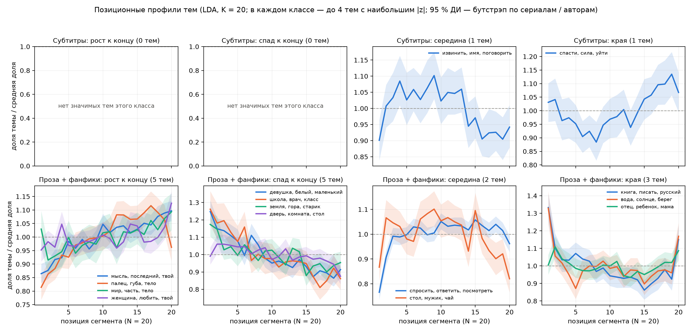

# Этап 3s — Plot Arceology: темы субтитров и прозы + фанфиков (выборочный прогон)

Отдельная LDA на каждом корпусе (правила словаря — этап 3). Позиционный профиль темы — средняя доля темы в сегменте по позиции (N = 20 равных по словам частей), сначала внутри единицы (сериал / автор), затем по единицам. R — профиль, делённый на среднюю долю темы (R = 1 — тема распределена ровно). Компоненты формы — проекции R на ортогональные многочлены Лежандра позиции: линейная (> 0 — рост к концу) и квадратичная (> 0 — края, < 0 — середина); z — относительно нулевой модели (перестановка сегментов внутри текста, 200 раз). Тема значима, если амплитуда профиля больше, чем в нулевой модели (FDR q = 0.05); класс — компонента с большим |z|.

## K = 20

### субтитры сериалов (Ororo, русские субтитры): 337 текстов, 117 единиц; ll/слово -7.794, средняя c_npmi 0.028

Классы формы профиля: плоский — 18, края — 1, середина — 1.

Проверка: 12 частей экранного времени (как у Schmidt) вместо 20 частей по словам — совпадение классов 80%; r(z лин.) = 0.89, r(z кв.) = 0.87.

Все 20 тем (по убыванию силы позиционного профиля)

| тема | слова | доля, % | класс | R(1) | R(N) | max R | пик | z лин. | z кв. | p (амплитуда) | c_npmi |
|---|---|---|---|---|---|---|---|---|---|---|---|
| 9 | спасти, сила, уйти, кровь, готовый, умереть, путь, последний | 7.43 | края | 1.03 | 1.07 | 1.13 | 19 | 4.62 | 5.14 | 0.005 | -0.01 |
| 18 | извинить, имя, поговорить, проблема, собираться, узнать, спросить, уйти | 7.34 | середина | 0.90 | 0.94 | 1.10 | 9 | -4.05 | -4.79 | 0.005 | 0.01 |
| 0 | женщина, муж, жена, господь, семья, жить, приехать, свадьба | 4.93 | плоский | 1.10 | 0.93 | 1.10 | 1 | -2.18 | -0.65 | 0.736 | 0.01 |
| 11 | сестра, мать, дорогой, мисс, сын, семья, брат, мадам | 2.30 | плоский | 1.07 | 1.00 | 1.12 | 9 | -1.39 | -0.60 | 0.786 | 0.05 |
| 17 | играть, игра, команда, момент, мозг, чувствовать, песня, группа | 3.73 | плоский | 0.94 | 1.00 | 1.07 | 11 | 0.95 | -0.03 | 0.711 | 0.03 |
| 16 | ребенок, просить, никакой, увидеть, любовь, жить, верить, показать | 5.04 | плоский | 0.95 | 1.08 | 1.08 | 20 | 2.61 | 1.29 | 0.194 | -0.02 |
| 15 | вода, тело, чувствовать, часть, происходить, момент, больший, надеяться | 3.85 | плоский | 1.04 | 1.10 | 1.10 | 20 | 0.35 | 1.72 | 0.652 | -0.00 |
| 14 | черт, чувак, папа, черта, слушать, дерьмо, хватить, подождать | 5.56 | плоский | 0.92 | 1.06 | 1.11 | 16 | 4.23 | 0.18 | 0.159 | 0.04 |
| 13 | доктор, папа, поговорить, происходить, случиться, рассказать, подождать, хватить | 6.53 | плоский | 0.99 | 0.98 | 1.07 | 14 | 1.53 | -0.75 | 0.512 | 0.03 |
| 12 | готовить, приготовить, разный, еда, попробовать, кухня, использовать, готовый | 3.63 | плоский | 1.00 | 0.92 | 1.09 | 6 | -2.51 | -2.74 | 0.328 | 0.09 |
| 10 | история, город, конец, мир, жить, земля, бояться, будущее | 5.73 | плоский | 1.04 | 1.08 | 1.09 | 19 | 2.29 | 3.00 | 0.060 | 0.02 |
| 1 | корабль, капитан, сэр, команда, президент, план, оружие, послать | 2.49 | плоский | 0.95 | 0.99 | 1.15 | 17 | 0.20 | 0.24 | 0.766 | 0.01 |
| 8 | суд, тюрьма, адвокат, показание, самолет, честь, штат, свидетель | 2.42 | плоский | 1.00 | 0.90 | 1.14 | 5 | -0.41 | -0.34 | 0.353 | 0.06 |
| 7 | помнить, остаться, час, минута, слушать, готовый, увидеться, конец | 6.50 | плоский | 1.02 | 1.05 | 1.08 | 19 | 0.30 | 2.26 | 0.617 | 0.00 |
| 6 | вопрос, информация, провести, компания, получить, операция, любой, прийтись | 5.32 | плоский | 0.98 | 0.92 | 1.08 | 11 | -3.10 | -3.03 | 0.010 | 0.02 |
| 5 | пара, свидание, ребята, тип, готовый, идеальный, испытание, выбрать | 2.94 | плоский | 1.00 | 0.96 | 1.14 | 19 | 0.42 | 0.38 | 0.771 | 0.03 |
| 4 | мистер, сэр, добрый, господин, просить, утро, мисс, прощение | 2.14 | плоский | 1.11 | 0.99 | 1.17 | 5 | -2.49 | 2.42 | 0.119 | 0.05 |
| 3 | ребенок, милый, извинить, мужчина, женщина, девушка, школа, вечер | 11.68 | плоский | 0.98 | 0.97 | 1.07 | 5 | -3.33 | -2.50 | 0.060 | 0.01 |
| 2 | деньга, позвонить, телефон, увидеть, машина, дверь, поехать, оставить | 5.77 | плоский | 1.03 | 0.97 | 1.08 | 9 | 0.46 | -1.36 | 0.383 | 0.05 |
| 19 | убить, полиция, убийство, мертвый, умереть, смерть, убийца, сын | 4.67 | плоский | 1.09 | 1.03 | 1.09 | 1 | 0.85 | 1.03 | 0.592 | 0.09 |

### проза + фанфики (Проза.ру, Ficbook): 999 текстов, 963 единиц; ll/слово -8.801, средняя c_npmi 0.062

Классы формы профиля: спад к концу — 5, рост к концу — 5, плоский — 5, края — 3, середина — 2.

Все 20 тем (по убыванию силы позиционного профиля)

| тема | слова | доля, % | класс | R(1) | R(N) | max R | пик | z лин. | z кв. | p (амплитуда) | c_npmi |
|---|---|---|---|---|---|---|---|---|---|---|---|
| 14 | девушка, белый, маленький, красивый, молодой, волос, цвет, черный | 4.94 | спад к концу | 1.25 | 0.91 | 1.25 | 1 | -14.14 | 3.73 | 0.005 | 0.10 |
| 13 | мысль, последний, твой, сон, слышать, должный, смочь, сила | 8.43 | рост к концу | 0.86 | 1.10 | 1.10 | 20 | 13.32 | -2.38 | 0.005 | 0.01 |
| 16 | палец, губа, тело, взгляд, голос, парень, плечо, спина | 7.56 | рост к концу | 0.81 | 0.96 | 1.12 | 17 | 12.74 | -6.76 | 0.005 | 0.06 |
| 8 | школа, врач, класс, доктор, учиться, урок, учитель, палата | 2.39 | спад к концу | 1.26 | 0.86 | 1.26 | 1 | -11.92 | 3.32 | 0.005 | -0.05 |
| 10 | спросить, ответить, посмотреть, парень, девушка, улыбнуться, решить, вопрос | 11.44 | середина | 0.77 | 0.96 | 1.06 | 15 | 8.47 | -10.05 | 0.005 | 0.05 |
| 6 | книга, писать, русский, читать, история, роман, новый, имя | 3.77 | края | 1.33 | 1.15 | 1.33 | 1 | -7.54 | 9.31 | 0.005 | 0.09 |
| 18 | вода, солнце, берег, небо, ночь, ветер, дождь, кот | 3.40 | края | 1.33 | 1.17 | 1.33 | 1 | -2.92 | 7.56 | 0.005 | 0.04 |
| 2 | земля, гора, старик, лес, город, трава, дорога, деревня | 3.53 | спад к концу | 1.17 | 0.95 | 1.17 | 1 | -7.53 | 2.04 | 0.005 | 0.06 |
| 12 | стол, мужик, чай, хлеб, пить, гость, двор, бутылка | 3.69 | середина | 0.87 | 0.82 | 1.10 | 9 | -3.75 | -7.46 | 0.005 | 0.07 |
| 1 | дверь, комната, стол, телефон, окно, открыть, выйти, квартира | 6.16 | спад к концу | 0.99 | 0.88 | 1.06 | 2 | -6.59 | -2.14 | 0.005 | 0.09 |
| 0 | работа, работать, деньга, новый, страна, город, начальник, рабочий | 5.74 | спад к концу | 1.09 | 0.90 | 1.09 | 1 | -5.45 | 0.79 | 0.005 | 0.04 |
| 3 | мир, часть, тело, ваш, земля, планета, путь, точка | 3.61 | рост к концу | 1.03 | 1.09 | 1.09 | 20 | 4.96 | 1.68 | 0.005 | 0.06 |
| 7 | отец, ребенок, мама, мать, сын, брат, родитель, жить | 5.72 | края | 1.00 | 1.09 | 1.11 | 2 | -0.97 | 4.58 | 0.005 | 0.14 |
| 5 | женщина, любить, твой, любовь, мужчина, понимать, муж, отношение | 8.02 | рост к концу | 0.95 | 1.13 | 1.13 | 20 | 4.54 | 2.22 | 0.005 | 0.07 |
| 19 | бог, король, отец, святой, церковь, мир, царь, душа | 2.87 | рост к концу | 1.06 | 1.10 | 1.10 | 16 | 3.13 | 2.71 | 0.010 | 0.06 |
| 11 | любой, вопрос, жить, право, новый, сила, случай, нужный | 6.22 | плоский | 1.07 | 1.01 | 1.07 | 1 | -1.13 | 1.61 | 0.264 | 0.01 |
| 9 | деньга, купить, магазин, вика, тысяча, хороший, убить, рынок | 1.75 | плоский | 0.86 | 1.01 | 1.10 | 15 | 2.47 | -1.83 | 0.224 | -0.05 |
| 15 | война, медаль, рядовой, военный, солдат, победа, офицер, отечественный | 2.11 | плоский | 1.00 | 1.01 | 1.11 | 19 | 1.88 | 1.04 | 0.741 | 0.27 |
| 4 | машина, дорога, ехать, город, час, поехать, поезд, самолет | 3.42 | плоский | 1.07 | 0.92 | 1.07 | 6 | -2.97 | 0.84 | 0.139 | 0.09 |
| 17 | нога, черный, собака, бежать, какой-то, стена, увидеть, свет | 5.23 | плоский | 1.02 | 0.95 | 1.06 | 16 | 0.70 | -0.39 | 0.109 | 0.02 |

### Сопоставление тем двух корпусов (K = 20; общий словарь 1744 лемм; взаимно ближайшие пары — 8; показаны 8 самых похожих)

| субтитры: тема | проза: тема | сходство (1 − JSD) | класс: субтитры | класс: проза | r профилей R |
|---|---|---|---|---|---|
| 3: ребенок, милый, извинить, мужчина, женщина, девушка | 5: женщина, любить, твой, любовь, мужчина, понимать | 0.21 | плоский | рост к концу | -0.31 |
| 6: вопрос, информация, провести, компания, получить, операция | 0: работа, работать, деньга, новый, страна, город | 0.20 | плоский | спад к концу | +0.38 |
| 9: спасти, сила, уйти, кровь, готовый, умереть | 13: мысль, последний, твой, сон, слышать, должный | 0.19 | края | рост к концу | +0.42 |
| 10: история, город, конец, мир, жить, земля | 2: земля, гора, старик, лес, город, трава | 0.19 | плоский | спад к концу | -0.26 |
| 2: деньга, позвонить, телефон, увидеть, машина, дверь | 1: дверь, комната, стол, телефон, окно, открыть | 0.18 | плоский | спад к концу | -0.10 |
| 12: готовить, приготовить, разный, еда, попробовать, кухня | 12: стол, мужик, чай, хлеб, пить, гость | 0.15 | плоский | середина | +0.62 |
| 15: вода, тело, чувствовать, часть, происходить, момент | 18: вода, солнце, берег, небо, ночь, ветер | 0.14 | плоский | края | +0.32 |
| 1: корабль, капитан, сэр, команда, президент, план | 15: война, медаль, рядовой, военный, солдат, победа | 0.13 | плоский | плоский | -0.29 |

Пар со сходством ≥ 0,5: 0; из них с одинаковым классом формы профиля — 0.

