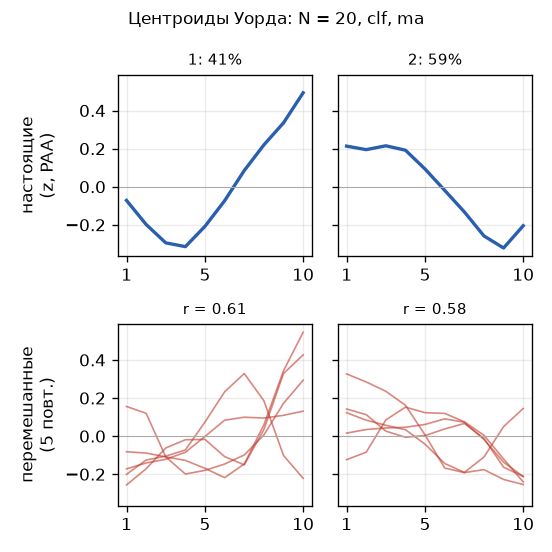
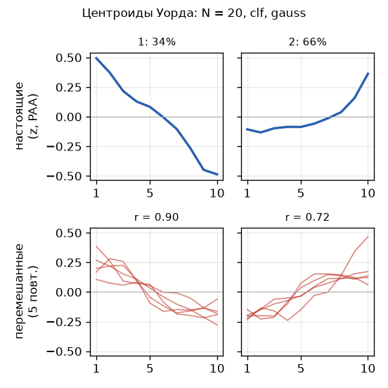
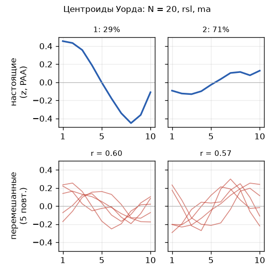
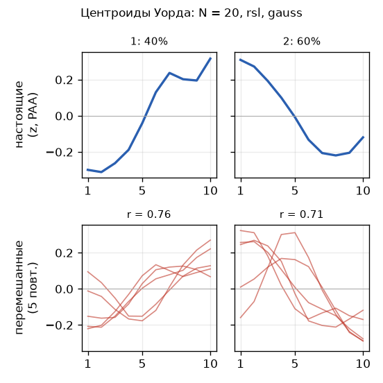
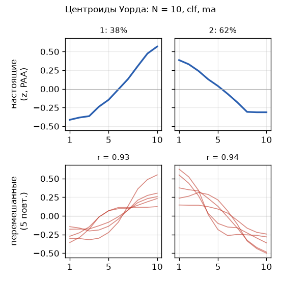
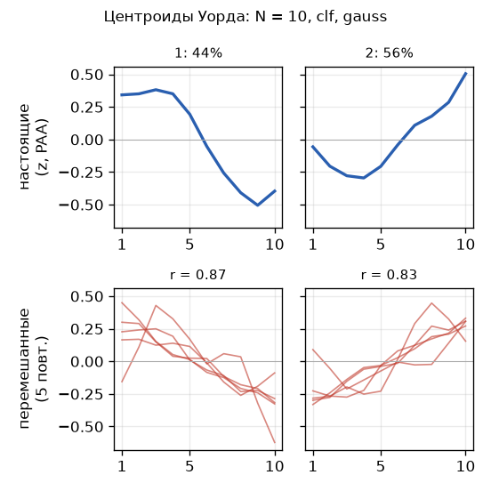
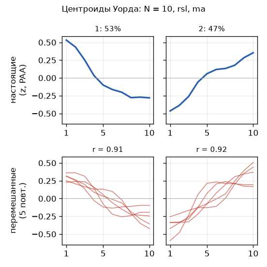
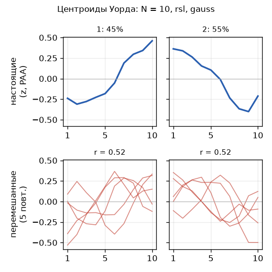

# Архетипы на перемешанных дугах (Ворота 4, п. 2)

Конвейер: z-дуга → сглаживание (скользящее среднее 0.15 длины; контроль — без сглаживания) → SVD (все тексты within_author_cap) и PAA (10 точек) + Уорд (до 1500 текстов на форму, вся база; k — по силуэту на настоящих дугах, k ∈ [2, 10]). Перемешанные — те же тексты, сегменты переставлены, 5 повторов (в таблицах — среднее [мин; макс] по повторам).

## N = 20, clf, сглаживание: скользящее среднее

| мода SVD | доля дисперсии: настоящие | перемешанные | |r| формы моды (наст. vs перем.) |
|---|---|---|---|
| 1 | 0.229 | 0.166 [0.165; 0.166] | 0.99 [0.98; 0.99] |
| 2 | 0.181 | 0.157 [0.157; 0.157] | 0.97 [0.96; 0.99] |
| 3 | 0.145 | 0.143 [0.143; 0.143] | 0.96 [0.96; 0.97] |
| 4 | 0.118 | 0.126 [0.126; 0.127] | 0.97 [0.96; 0.97] |

Сумма долей первых 4 мод: настоящие 0.672, перемешанные 0.592. Средняя дуга (по позициям) у настоящих: от -0.08 до +0.14 z.

Уорд: 8562 текстов; k = 2 (силуэт по k: 2: 0.130, 3: 0.086, 4: 0.064, 5: 0.055, 6: 0.046, 7: 0.048, 8: 0.042, 9: 0.043, 10: 0.033).

| кластер | доля (настоящие) | r центроидов наст. vs перем. |
|---|---|---|
| 1 | 0.41 | 0.61 [-0.03; 0.86] |
| 2 | 0.59 | 0.58 [0.31; 0.92] |

Силуэт: настоящие 0.130, перемешанные 0.080 [0.072; 0.091]. Средний r сопоставленных центроидов: 0.59.

Контроль k = 6: силуэт настоящие 0.046, перемешанные 0.037; r сопоставленных центроидов по кластерам: 0.63, 0.45, 0.61, 0.63, 0.57, 0.87 (среднее 0.63); доли кластеров (настоящие): 0.18, 0.08, 0.15, 0.31, 0.15, 0.13.

## N = 20, clf, сглаживание: гауссово ядро σ = 0.05 длины

| мода SVD | доля дисперсии: настоящие | перемешанные | |r| формы моды (наст. vs перем.) |
|---|---|---|---|
| 1 | 0.259 | 0.193 [0.193; 0.194] | 0.99 [0.98; 0.99] |
| 2 | 0.199 | 0.179 [0.178; 0.180] | 0.98 [0.97; 0.99] |
| 3 | 0.153 | 0.157 [0.157; 0.157] | 0.98 [0.97; 0.98] |
| 4 | 0.119 | 0.131 [0.131; 0.132] | 0.98 [0.97; 0.98] |

Сумма долей первых 4 мод: настоящие 0.730, перемешанные 0.660. Средняя дуга (по позициям) у настоящих: от -0.08 до +0.14 z.

Уорд: 8562 текстов; k = 2 (силуэт по k: 2: 0.130, 3: 0.085, 4: 0.071, 5: 0.059, 6: 0.056, 7: 0.052, 8: 0.052, 9: 0.050, 10: 0.047).

| кластер | доля (настоящие) | r центроидов наст. vs перем. |
|---|---|---|
| 1 | 0.34 | 0.90 [0.77; 0.99] |
| 2 | 0.66 | 0.72 [0.48; 0.95] |

Силуэт: настоящие 0.130, перемешанные 0.092 [0.086; 0.098]. Средний r сопоставленных центроидов: 0.81.

Контроль k = 6: силуэт настоящие 0.056, перемешанные 0.039; r сопоставленных центроидов по кластерам: 0.89, 0.77, 0.75, 0.60, 0.73, 0.55 (среднее 0.72); доли кластеров (настоящие): 0.12, 0.22, 0.24, 0.15, 0.10, 0.17.

## N = 20, clf, сглаживание: нет

| мода SVD | доля дисперсии: настоящие | перемешанные | |r| формы моды (наст. vs перем.) |
|---|---|---|---|
| 1 | 0.090 | 0.054 [0.054; 0.054] | 0.21 [0.07; 0.44] |
| 2 | 0.075 | 0.053 [0.053; 0.053] | 0.19 [0.03; 0.32] |
| 3 | 0.066 | 0.053 [0.053; 0.053] | 0.14 [0.03; 0.37] |
| 4 | 0.061 | 0.053 [0.053; 0.053] | 0.30 [0.15; 0.48] |

Сумма долей первых 4 мод: настоящие 0.292, перемешанные 0.214. Средняя дуга (по позициям) у настоящих: от -0.08 до +0.24 z.

Уорд: 8562 текстов; k = 2 (силуэт по k: 2: 0.054, 3: 0.042, 4: 0.035, 5: 0.027, 6: 0.024, 7: 0.020, 8: 0.018, 9: 0.014, 10: 0.012).

| кластер | доля (настоящие) | r центроидов наст. vs перем. |
|---|---|---|
| 1 | 0.30 | 0.15 [-0.05; 0.23] |
| 2 | 0.70 | 0.31 [0.11; 0.63] |

Силуэт: настоящие 0.054, перемешанные 0.038 [0.035; 0.040]. Средний r сопоставленных центроидов: 0.23.

Контроль k = 6: силуэт настоящие 0.024, перемешанные 0.014; r сопоставленных центроидов по кластерам: 0.42, 0.36, 0.53, 0.39, 0.40, 0.53 (среднее 0.44); доли кластеров (настоящие): 0.14, 0.16, 0.10, 0.15, 0.20, 0.25.

## N = 20, rsl, сглаживание: скользящее среднее

| мода SVD | доля дисперсии: настоящие | перемешанные | |r| формы моды (наст. vs перем.) |
|---|---|---|---|
| 1 | 0.208 | 0.165 [0.165; 0.166] | 1.00 [1.00; 1.00] |
| 2 | 0.174 | 0.157 [0.156; 0.157] | 1.00 [1.00; 1.00] |
| 3 | 0.145 | 0.143 [0.143; 0.144] | 1.00 [0.99; 1.00] |
| 4 | 0.121 | 0.126 [0.126; 0.126] | 1.00 [1.00; 1.00] |

Сумма долей первых 4 мод: настоящие 0.648, перемешанные 0.591. Средняя дуга (по позициям) у настоящих: от -0.05 до +0.09 z.

Уорд: 8562 текстов; k = 2 (силуэт по k: 2: 0.106, 3: 0.068, 4: 0.063, 5: 0.051, 6: 0.039, 7: 0.039, 8: 0.036, 9: 0.039, 10: 0.037).

| кластер | доля (настоящие) | r центроидов наст. vs перем. |
|---|---|---|
| 1 | 0.29 | 0.60 [0.11; 0.90] |
| 2 | 0.71 | 0.57 [0.31; 0.96] |

Силуэт: настоящие 0.106, перемешанные 0.077 [0.069; 0.086]. Средний r сопоставленных центроидов: 0.59.

Контроль k = 6: силуэт настоящие 0.039, перемешанные 0.033; r сопоставленных центроидов по кластерам: 0.66, 0.73, 0.76, 0.60, 0.85, 0.62 (среднее 0.70); доли кластеров (настоящие): 0.12, 0.17, 0.22, 0.30, 0.07, 0.11.

## N = 20, rsl, сглаживание: гауссово ядро σ = 0.05 длины

| мода SVD | доля дисперсии: настоящие | перемешанные | |r| формы моды (наст. vs перем.) |
|---|---|---|---|
| 1 | 0.238 | 0.193 [0.193; 0.194] | 1.00 [1.00; 1.00] |
| 2 | 0.194 | 0.179 [0.178; 0.179] | 1.00 [1.00; 1.00] |
| 3 | 0.155 | 0.157 [0.156; 0.158] | 1.00 [1.00; 1.00] |
| 4 | 0.123 | 0.131 [0.131; 0.131] | 1.00 [1.00; 1.00] |

Сумма долей первых 4 мод: настоящие 0.709, перемешанные 0.660. Средняя дуга (по позициям) у настоящих: от -0.05 до +0.10 z.

Уорд: 8562 текстов; k = 2 (силуэт по k: 2: 0.133, 3: 0.085, 4: 0.063, 5: 0.056, 6: 0.059, 7: 0.053, 8: 0.048, 9: 0.043, 10: 0.042).

| кластер | доля (настоящие) | r центроидов наст. vs перем. |
|---|---|---|
| 1 | 0.40 | 0.76 [0.31; 0.97] |
| 2 | 0.60 | 0.71 [0.18; 0.98] |

Силуэт: настоящие 0.133, перемешанные 0.095 [0.085; 0.111]. Средний r сопоставленных центроидов: 0.73.

Контроль k = 6: силуэт настоящие 0.059, перемешанные 0.036; r сопоставленных центроидов по кластерам: 0.68, 0.86, 0.68, 0.56, 0.75, 0.56 (среднее 0.68); доли кластеров (настоящие): 0.19, 0.21, 0.14, 0.15, 0.14, 0.17.

## N = 20, rsl, сглаживание: нет

| мода SVD | доля дисперсии: настоящие | перемешанные | |r| формы моды (наст. vs перем.) |
|---|---|---|---|
| 1 | 0.077 | 0.054 [0.053; 0.054] | 0.21 [0.05; 0.38] |
| 2 | 0.068 | 0.053 [0.053; 0.054] | 0.18 [0.03; 0.43] |
| 3 | 0.062 | 0.053 [0.053; 0.053] | 0.15 [0.01; 0.48] |
| 4 | 0.059 | 0.053 [0.053; 0.053] | 0.28 [0.00; 0.45] |

Сумма долей первых 4 мод: настоящие 0.265, перемешанные 0.213. Средняя дуга (по позициям) у настоящих: от -0.05 до +0.17 z.

Уорд: 8562 текстов; k = 2 (силуэт по k: 2: 0.053, 3: 0.036, 4: 0.022, 5: 0.019, 6: 0.016, 7: 0.015, 8: 0.013, 9: 0.014, 10: 0.012).

| кластер | доля (настоящие) | r центроидов наст. vs перем. |
|---|---|---|
| 1 | 0.30 | 0.21 [0.03; 0.28] |
| 2 | 0.70 | 0.18 [-0.00; 0.43] |

Силуэт: настоящие 0.053, перемешанные 0.036 [0.034; 0.037]. Средний r сопоставленных центроидов: 0.19.

Контроль k = 6: силуэт настоящие 0.016, перемешанные 0.010; r сопоставленных центроидов по кластерам: 0.47, 0.50, 0.29, 0.32, 0.46, 0.46 (среднее 0.42); доли кластеров (настоящие): 0.12, 0.18, 0.12, 0.21, 0.12, 0.26.

## N = 10, clf, сглаживание: скользящее среднее

| мода SVD | доля дисперсии: настоящие | перемешанные | |r| формы моды (наст. vs перем.) |
|---|---|---|---|
| 1 | 0.421 | 0.355 [0.355; 0.356] | 1.00 [1.00; 1.00] |
| 2 | 0.278 | 0.279 [0.279; 0.280] | 1.00 [0.99; 1.00] |
| 3 | 0.160 | 0.181 [0.181; 0.182] | 1.00 [1.00; 1.00] |
| 4 | 0.074 | 0.091 [0.090; 0.091] | 1.00 [1.00; 1.00] |

Сумма долей первых 4 мод: настоящие 0.933, перемешанные 0.906. Средняя дуга (по позициям) у настоящих: от -0.10 до +0.12 z.

Уорд: 8561 текстов; k = 2 (силуэт по k: 2: 0.203, 3: 0.173, 4: 0.122, 5: 0.112, 6: 0.106, 7: 0.102, 8: 0.093, 9: 0.090, 10: 0.080).

| кластер | доля (настоящие) | r центроидов наст. vs перем. |
|---|---|---|
| 1 | 0.38 | 0.93 [0.83; 1.00] |
| 2 | 0.62 | 0.94 [0.91; 0.98] |

Силуэт: настоящие 0.203, перемешанные 0.163 [0.150; 0.175]. Средний r сопоставленных центроидов: 0.94.

Контроль k = 6: силуэт настоящие 0.106, перемешанные 0.092; r сопоставленных центроидов по кластерам: 0.77, 0.94, 0.71, 0.78, 0.63, 0.74 (среднее 0.76); доли кластеров (настоящие): 0.12, 0.26, 0.17, 0.10, 0.15, 0.19.

## N = 10, clf, сглаживание: гауссово ядро σ = 0.05 длины

| мода SVD | доля дисперсии: настоящие | перемешанные | |r| формы моды (наст. vs перем.) |
|---|---|---|---|
| 1 | 0.230 | 0.171 [0.171; 0.172] | 0.99 [0.98; 0.99] |
| 2 | 0.181 | 0.160 [0.160; 0.161] | 0.97 [0.97; 0.98] |
| 3 | 0.145 | 0.145 [0.144; 0.145] | 0.97 [0.97; 0.98] |
| 4 | 0.117 | 0.126 [0.125; 0.127] | 0.97 [0.97; 0.98] |

Сумма долей первых 4 мод: настоящие 0.673, перемешанные 0.602. Средняя дуга (по позициям) у настоящих: от -0.10 до +0.17 z.

Уорд: 8561 текстов; k = 2 (силуэт по k: 2: 0.115, 3: 0.077, 4: 0.054, 5: 0.049, 6: 0.042, 7: 0.034, 8: 0.035, 9: 0.030, 10: 0.028).

| кластер | доля (настоящие) | r центроидов наст. vs перем. |
|---|---|---|
| 1 | 0.44 | 0.87 [0.67; 0.97] |
| 2 | 0.56 | 0.83 [0.77; 0.89] |

Силуэт: настоящие 0.115, перемешанные 0.065 [0.060; 0.069]. Средний r сопоставленных центроидов: 0.85.

Контроль k = 6: силуэт настоящие 0.042, перемешанные 0.027; r сопоставленных центроидов по кластерам: 0.63, 0.52, 0.63, 0.84, 0.62, 0.66 (среднее 0.65); доли кластеров (настоящие): 0.21, 0.23, 0.22, 0.14, 0.10, 0.10.

## N = 10, clf, сглаживание: нет

| мода SVD | доля дисперсии: настоящие | перемешанные | |r| формы моды (наст. vs перем.) |
|---|---|---|---|
| 1 | 0.159 | 0.112 [0.112; 0.113] | 0.31 [0.10; 0.47] |
| 2 | 0.134 | 0.112 [0.112; 0.112] | 0.25 [0.03; 0.50] |
| 3 | 0.119 | 0.112 [0.111; 0.112] | 0.37 [0.04; 0.78] |
| 4 | 0.110 | 0.111 [0.111; 0.112] | 0.39 [0.16; 0.58] |

Сумма долей первых 4 мод: настоящие 0.522, перемешанные 0.447. Средняя дуга (по позициям) у настоящих: от -0.11 до +0.18 z.

Уорд: 8561 текстов; k = 2 (силуэт по k: 2: 0.063, 3: 0.044, 4: 0.023, 5: 0.021, 6: 0.022, 7: 0.022, 8: 0.015, 9: 0.010, 10: 0.010).

| кластер | доля (настоящие) | r центроидов наст. vs перем. |
|---|---|---|
| 1 | 0.39 | 0.27 [0.05; 0.75] |
| 2 | 0.61 | 0.23 [0.02; 0.56] |

Силуэт: настоящие 0.063, перемешанные 0.042 [0.039; 0.046]. Средний r сопоставленных центроидов: 0.25.

Контроль k = 6: силуэт настоящие 0.022, перемешанные 0.015; r сопоставленных центроидов по кластерам: 0.51, 0.46, 0.40, 0.46, 0.48, 0.41 (среднее 0.45); доли кластеров (настоящие): 0.18, 0.21, 0.20, 0.17, 0.12, 0.12.

## N = 10, rsl, сглаживание: скользящее среднее

| мода SVD | доля дисперсии: настоящие | перемешанные | |r| формы моды (наст. vs перем.) |
|---|---|---|---|
| 1 | 0.401 | 0.355 [0.353; 0.356] | 1.00 [1.00; 1.00] |
| 2 | 0.280 | 0.280 [0.278; 0.281] | 1.00 [1.00; 1.00] |
| 3 | 0.166 | 0.181 [0.181; 0.182] | 1.00 [1.00; 1.00] |
| 4 | 0.079 | 0.091 [0.090; 0.091] | 1.00 [1.00; 1.00] |

Сумма долей первых 4 мод: настоящие 0.925, перемешанные 0.906. Средняя дуга (по позициям) у настоящих: от -0.07 до +0.07 z.

Уорд: 8561 текстов; k = 2 (силуэт по k: 2: 0.193, 3: 0.149, 4: 0.128, 5: 0.127, 6: 0.111, 7: 0.106, 8: 0.099, 9: 0.089, 10: 0.090).

| кластер | доля (настоящие) | r центроидов наст. vs перем. |
|---|---|---|
| 1 | 0.53 | 0.91 [0.77; 0.97] |
| 2 | 0.47 | 0.92 [0.84; 0.95] |

Силуэт: настоящие 0.193, перемешанные 0.166 [0.145; 0.186]. Средний r сопоставленных центроидов: 0.91.

Контроль k = 6: силуэт настоящие 0.111, перемешанные 0.089; r сопоставленных центроидов по кластерам: 0.79, 0.80, 0.86, 0.94, 0.58, 0.73 (среднее 0.78); доли кластеров (настоящие): 0.21, 0.11, 0.22, 0.18, 0.12, 0.16.

## N = 10, rsl, сглаживание: гауссово ядро σ = 0.05 длины

| мода SVD | доля дисперсии: настоящие | перемешанные | |r| формы моды (наст. vs перем.) |
|---|---|---|---|
| 1 | 0.211 | 0.171 [0.170; 0.172] | 1.00 [1.00; 1.00] |
| 2 | 0.176 | 0.161 [0.160; 0.161] | 1.00 [1.00; 1.00] |
| 3 | 0.145 | 0.144 [0.144; 0.145] | 1.00 [1.00; 1.00] |
| 4 | 0.120 | 0.126 [0.126; 0.127] | 1.00 [1.00; 1.00] |

Сумма долей первых 4 мод: настоящие 0.652, перемешанные 0.602. Средняя дуга (по позициям) у настоящих: от -0.07 до +0.10 z.

Уорд: 8561 текстов; k = 2 (силуэт по k: 2: 0.102, 3: 0.074, 4: 0.054, 5: 0.049, 6: 0.034, 7: 0.033, 8: 0.030, 9: 0.028, 10: 0.024).

| кластер | доля (настоящие) | r центроидов наст. vs перем. |
|---|---|---|
| 1 | 0.45 | 0.52 [0.18; 0.87] |
| 2 | 0.55 | 0.52 [-0.10; 0.76] |

Силуэт: настоящие 0.102, перемешанные 0.069 [0.060; 0.077]. Средний r сопоставленных центроидов: 0.52.

Контроль k = 6: силуэт настоящие 0.034, перемешанные 0.029; r сопоставленных центроидов по кластерам: 0.58, 0.79, 0.63, 0.54, 0.59, 0.69 (среднее 0.64); доли кластеров (настоящие): 0.15, 0.14, 0.17, 0.22, 0.14, 0.19.

## N = 10, rsl, сглаживание: нет

| мода SVD | доля дисперсии: настоящие | перемешанные | |r| формы моды (наст. vs перем.) |
|---|---|---|---|
| 1 | 0.143 | 0.112 [0.112; 0.113] | 0.25 [0.10; 0.55] |
| 2 | 0.127 | 0.112 [0.112; 0.112] | 0.31 [0.02; 0.72] |
| 3 | 0.116 | 0.112 [0.111; 0.112] | 0.24 [0.11; 0.38] |
| 4 | 0.111 | 0.111 [0.111; 0.112] | 0.31 [0.02; 0.60] |

Сумма долей первых 4 мод: настоящие 0.497, перемешанные 0.448. Средняя дуга (по позициям) у настоящих: от -0.07 до +0.12 z.

Уорд: 8561 текстов; k = 2 (силуэт по k: 2: 0.057, 3: 0.042, 4: 0.031, 5: 0.027, 6: 0.020, 7: 0.017, 8: 0.014, 9: 0.011, 10: 0.009).

| кластер | доля (настоящие) | r центроидов наст. vs перем. |
|---|---|---|
| 1 | 0.32 | 0.20 [0.05; 0.36] |
| 2 | 0.68 | 0.21 [0.01; 0.39] |

Силуэт: настоящие 0.057, перемешанные 0.035 [0.033; 0.037]. Средний r сопоставленных центроидов: 0.21.

Контроль k = 6: силуэт настоящие 0.020, перемешанные 0.009; r сопоставленных центроидов по кластерам: 0.35, 0.44, 0.29, 0.38, 0.59, 0.41 (среднее 0.41); доли кластеров (настоящие): 0.10, 0.23, 0.16, 0.17, 0.14, 0.21.
