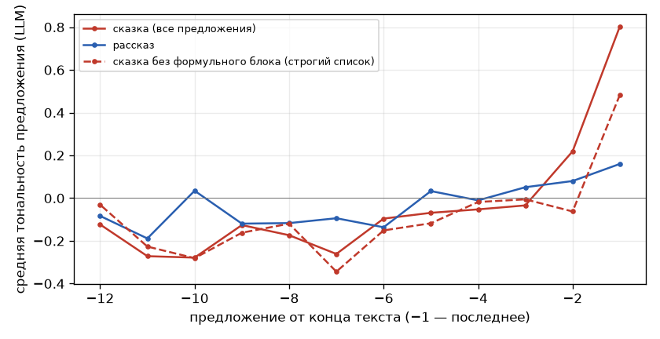

# Ворота 5, п. 2. Подъём концовки волшебной сказки: развязка или финальная формула

## 2.1. Контраст концовки без последнего сегмента (N = 20; середина — позиции 3–17)

Контраст текста = среднее z(зона) − среднее z(середина); z — внутри текста, без сглаживания. ДИ 95 % — пуассоновский бутстрэп по авторам (B = 1000). Колонка «− рассказ»: разница контрастов «форма − рассказ»; полный корпус — пары, сопоставленные по log(n_words) (|Δ| ≤ 0,05), LLM — рассказы той же длины (независимые группы).

### Сигнал clf, полный корпус (169594 дуг)

| форма | текстов | 18–19 (без последнего) | 20 (последний) | 19–20 | 18–19: − рассказ | пар с рассказом | 20: − рассказ |
|---|---|---|---|---|---|---|---|
| волшебная сказка (Афанасьев) | 179 | +0.038 [-0.117; +0.190] | +0.161 [-0.000; +0.349] | +0.104 [-0.042; +0.253] | -0.008 [-0.181; +0.168] | 179.000 | -0.129 [-0.386; +0.127] |
| сказка (fairytalez) | 1074 | -0.087 [-0.141; -0.028] | +0.262 [+0.167; +0.353] | +0.098 [+0.033; +0.165] | -0.114 [-0.190; -0.039] | 1074.000 | -0.032 [-0.129; +0.069] |
| рассказ | 145731 | -0.015 [-0.019; -0.010] | +0.268 [+0.260; +0.275] | +0.141 [+0.136; +0.147] |  |  |  |
| новелла | 5863 | +0.015 [-0.012; +0.038] | +0.245 [+0.210; +0.281] | +0.154 [+0.129; +0.181] | +0.032 [-0.001; +0.063] | 5862.000 | -0.040 [-0.082; +0.003] |
| фанфик | 13476 | +0.074 [+0.059; +0.089] | +0.355 [+0.330; +0.378] | +0.228 [+0.209; +0.247] | +0.107 [+0.086; +0.131] | 12177.000 | +0.085 [+0.058; +0.116] |
| короткая серия | 230 | -0.041 [-0.149; +0.081] | +0.016 [-0.126; +0.150] | +0.017 [-0.102; +0.150] | +0.020 [-0.135; +0.178] | 230.000 | -0.177 [-0.395; +0.037] |
| повесть | 1962 | -0.058 [-0.097; -0.022] | +0.193 [+0.133; +0.252] | +0.067 [+0.022; +0.113] | +0.029 [-0.027; +0.086] | 1897.000 | +0.011 [-0.065; +0.083] |
| роман | 1079 | -0.018 [-0.070; +0.034] | +0.212 [+0.135; +0.294] | +0.106 [+0.038; +0.175] | -0.021 [-0.120; +0.073] | 677.000 | -0.052 [-0.178; +0.084] |

### Сигнал rsl, полный корпус (169590 дуг)

| форма | текстов | 18–19 (без последнего) | 20 (последний) | 19–20 | 18–19: − рассказ | пар с рассказом | 20: − рассказ |
|---|---|---|---|---|---|---|---|
| волшебная сказка (Афанасьев) | 179 | +0.023 [-0.127; +0.164] | +0.326 [+0.140; +0.490] | +0.159 [+0.024; +0.303] | -0.020 [-0.188; +0.145] | 179.000 | +0.086 [-0.105; +0.295] |
| сказка (fairytalez) | 1074 | -0.052 [-0.111; +0.003] | +0.235 [+0.136; +0.334] | +0.096 [+0.021; +0.170] | -0.004 [-0.076; +0.062] | 1074.000 | -0.000 [-0.102; +0.096] |
| рассказ | 145730 | -0.003 [-0.008; +0.001] | +0.187 [+0.180; +0.193] | +0.101 [+0.096; +0.106] |  |  |  |
| новелла | 5863 | -0.003 [-0.024; +0.019] | +0.166 [+0.136; +0.197] | +0.092 [+0.068; +0.117] | -0.006 [-0.037; +0.024] | 5862.000 | -0.029 [-0.070; +0.011] |
| фанфик | 13473 | +0.024 [+0.010; +0.038] | +0.265 [+0.245; +0.284] | +0.156 [+0.140; +0.171] | +0.052 [+0.030; +0.075] | 12177.000 | +0.076 [+0.048; +0.106] |
| короткая серия | 230 | +0.037 [-0.072; +0.155] | +0.103 [-0.031; +0.244] | +0.082 [-0.039; +0.198] | +0.130 [-0.015; +0.283] | 230.000 | -0.056 [-0.252; +0.131] |
| повесть | 1962 | -0.054 [-0.092; -0.016] | +0.137 [+0.083; +0.193] | +0.031 [-0.014; +0.071] | +0.004 [-0.048; +0.059] | 1897.000 | +0.019 [-0.051; +0.093] |
| роман | 1079 | -0.036 [-0.085; +0.011] | +0.157 [+0.080; +0.233] | +0.072 [+0.011; +0.131] | -0.080 [-0.171; +0.008] | 673.000 | -0.030 [-0.152; +0.091] |

### LLM-дуги (1566 текстов; рассказы, новеллы, фанфики — той же длины, что сказки базы)

| группа | текстов | 18–19 (без последнего) | 20 (последний) | 19–20 | 18–19: − рассказ | 20: − рассказ |
|---|---|---|---|---|---|---|
| волшебная сказка (Афанасьев) | 178 | +0.129 [-0.012; +0.266] | +1.134 [+0.921; +1.342] | +0.646 [+0.502; +0.789] | +0.021 [-0.145; +0.186] | +0.688 [+0.425; +0.940] |
| сказка (fairytalez) | 300 | -0.042 [-0.165; +0.079] | +0.615 [+0.436; +0.807] | +0.274 [+0.140; +0.419] | -0.151 [-0.289; -0.004] | +0.169 [-0.063; +0.378] |
| рассказ | 298 | +0.108 [+0.003; +0.220] | +0.446 [+0.313; +0.584] | +0.315 [+0.200; +0.421] |  |  |
| новелла | 295 | +0.038 [-0.063; +0.141] | +0.364 [+0.230; +0.496] | +0.238 [+0.121; +0.355] | -0.071 [-0.223; +0.081] | -0.082 [-0.273; +0.114] |
| фанфик | 295 | +0.146 [+0.042; +0.256] | +0.386 [+0.232; +0.538] | +0.308 [+0.181; +0.425] | +0.038 [-0.105; +0.190] | -0.059 [-0.247; +0.150] |
| повесть (отрывки) | 100 | -0.225 [-0.376; -0.067] | -0.290 [-0.524; -0.036] | -0.247 [-0.409; -0.073] | -0.333 [-0.525; -0.149] | -0.736 [-1.003; -0.462] |
| роман (отрывки) | 100 | -0.033 [-0.194; +0.128] | -0.016 [-0.221; +0.198] | +0.012 [-0.163; +0.180] | -0.141 [-0.318; +0.052] | -0.462 [-0.725; -0.223] |

## 2.2–2.4. Разметка концовок по предложениям: развязка или финальная формула

Модель deepseek-v4.1-flash, та же инструкция; каждое предложение последних 2 сегментов — с 2 предыдущими предложениями как контекстом (не оцениваются). Сказки базы — все; рассказы — 100 из пар «сказка — рассказ», сопоставленных по log(n_words). Ответов без оценки: 0 без ответа, 63 skip — исключены.

### 2.3. Финальные формулы

| список | сказок с формулой | предложений в блоке, медиана | из них без шаблона (внутри блока) | смешанных «развязка + формула» с отдельно оценённой частью до формулы |
|---|---|---|---|---|
| строгий (канонические формулы) | 90 из 178 (51%) | 1 | 12 | 55 |
| расширенный (+ клише счастливого конца) | 118 из 178 (66%) | 1 | 13 | 79 |

Редакторских пометок (исключены): 3 предложений. Шаблоны — configs/s05_ending.yaml; список проверен глазами по последним 4 предложениям всех сказок базы. Формульный блок — от первого предложения с шаблоном среди последних 4 содержательных предложений до конца текста.

### Тональность частей концовки (сырые оценки −2…+2, среднее по текстам; ДИ — бутстрэп по авторам)

| список | сказок с формулой | формула | развязка (предложения до блока) | развязка + части смешанных до формулы | формула − развязка+ |
|---|---|---|---|---|---|
| strict | 90 | +1.016 [+0.806; +1.219] | -0.019 [-0.136; +0.110] | +0.022 [-0.085; +0.133] | +0.994 [+0.755; +1.224] |
| ext | 118 | +1.186 [+1.002; +1.379] | -0.021 [-0.119; +0.082] | +0.033 [-0.062; +0.138] | +1.153 [+0.947; +1.354] |

### 2.4. Держится ли светлая концовка сказки без формулы — сравнение с рассказами той же длины

Сырые баллы по предложениям и разница «минус середина своего текста» (середина — LLM-оценки сегментов 3–17, той же моделью). Единицы «предложение» и «сегмент» различаются по уровню, поэтому сравнивается разница сказка − рассказ (сдвиг уровня одинаков для обеих групп, если не зависит от формы).

| мера концовки | список формул | сказка | рассказ | сказка − рассказ, сырые | (конец − середина): сказка | (конец − середина): рассказ | (конец − середина): сказка − рассказ |
|---|---|---|---|---|---|---|---|
| все предложения последних 2 сегментов (с формулой) | — | +0.03 | -0.05 | +0.080 [-0.046; +0.206] | +0.29 | +0.41 | -0.113 [-0.241; +0.023] |
| последние 3 предложения (с формулой) | — | +0.33 | +0.10 | +0.231 [+0.059; +0.422] | +0.59 | +0.55 | +0.038 [-0.161; +0.220] |
| без формулы: развязка + части до формулы | strict | -0.00 | -0.05 | +0.042 [-0.084; +0.171] | +0.25 | +0.41 | -0.151 [-0.288; -0.018] |
| без формулы: развязка + части до формулы | ext | -0.02 | -0.05 | +0.025 [-0.099; +0.154] | +0.24 | +0.41 | -0.168 [-0.319; -0.038] |
| без формулы: последние 3 предложения | strict | +0.19 | +0.10 | +0.091 [-0.089; +0.274] | +0.45 | +0.55 | -0.102 [-0.288; +0.073] |
| без формулы: последние 3 предложения | ext | +0.14 | +0.10 | +0.039 [-0.143; +0.232] | +0.40 | +0.55 | -0.154 [-0.354; +0.051] |
| последнее предложение (с формулой) | — | +0.80 | +0.16 | +0.643 [+0.381; +0.894] | +1.06 | +0.61 | +0.450 [+0.154; +0.721] |
| без формулы: последнее предложение развязки | strict | +0.62 | +0.16 | +0.464 [+0.194; +0.703] | +0.88 | +0.61 | +0.271 [-0.009; +0.521] |
| без формулы: последнее предложение развязки | ext | +0.48 | +0.16 | +0.323 [+0.077; +0.596] | +0.74 | +0.61 | +0.130 [-0.141; +0.387] |
| только сегмент 20, все предложения (с формулой) | — | +0.23 | +0.06 | +0.170 [+0.003; +0.334] | +0.48 | +0.51 | -0.023 [-0.195; +0.153] |
| без формулы: только сегмент 20 | strict | +0.14 | +0.06 | +0.081 [-0.095; +0.244] | +0.39 | +0.51 | -0.112 [-0.274; +0.081] |
| без формулы: только сегмент 20 | ext | +0.10 | +0.06 | +0.047 [-0.139; +0.221] | +0.36 | +0.51 | -0.146 [-0.326; +0.048] |

### Сказки с формулой и без неё — подъём последнего сегмента на LLM-дугах (z, позиция 20 − середина)

| список | сказки | текстов | z(20) − середина | z(18–19) − середина |
|---|---|---|---|---|
| strict | с формулой | 90 | +1.203 [+0.839; +1.520] | +0.150 [-0.063; +0.341] |
| strict | без формулы | 88 | +1.064 [+0.773; +1.328] | +0.107 [-0.093; +0.291] |
| ext | с формулой | 118 | +1.338 [+1.040; +1.626] | +0.170 [+0.004; +0.344] |
| ext | без формулы | 60 | +0.732 [+0.379; +1.078] | +0.049 [-0.166; +0.273] |
| — | рассказы той же длины (для сравнения) | 298 | +0.446 [+0.311; +0.579] | +0.108 [+0.004; +0.211] |

### Последний сегмент сказки, заново оценённый без формульного блока (как сегмент, исходная инструкция)

| список | переоценено сегментов | сырой балл сегмента 20: с формулой → без | сказки: z(20) − середина | сказка − рассказ |
|---|---|---|---|---|
| strict | 89 | +0.73 → +0.46 | +0.982 [+0.761; +1.195] | +0.536 [+0.261; +0.793] |
| ext | 117 | +0.86 → +0.52 | +0.878 [+0.649; +1.109] | +0.432 [+0.140; +0.693] |

Для сравнения: исходная LLM-дуга, z(20) − середина, сказка − рассказ — см. 2.1.

