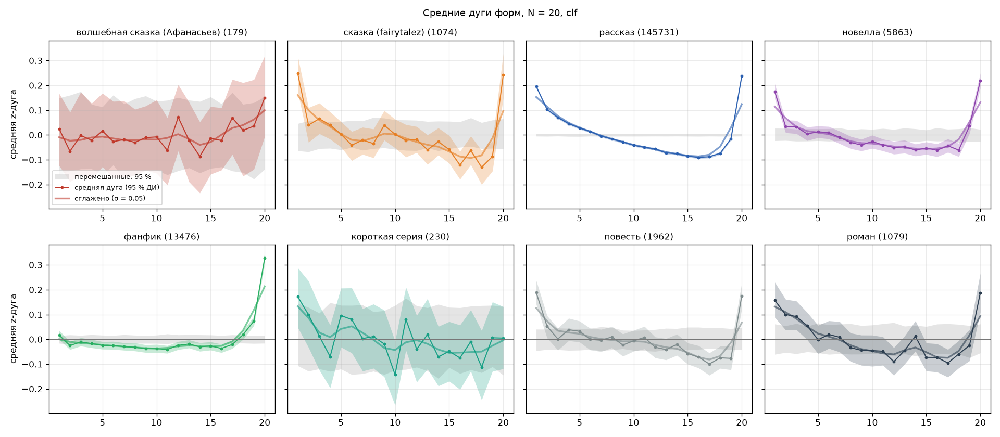
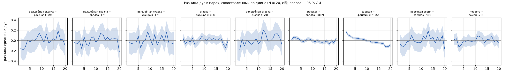
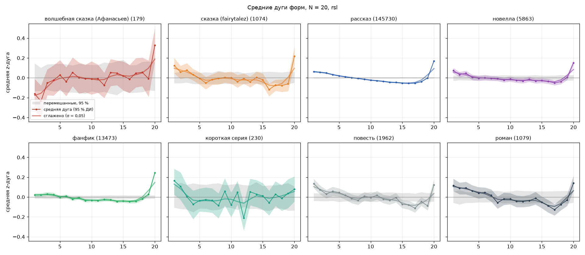
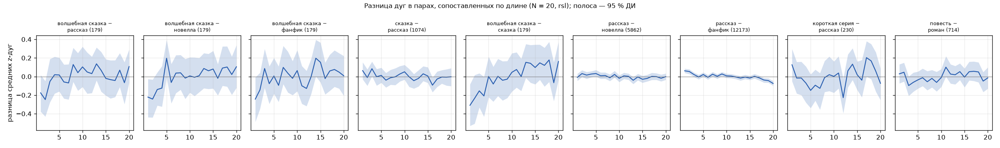
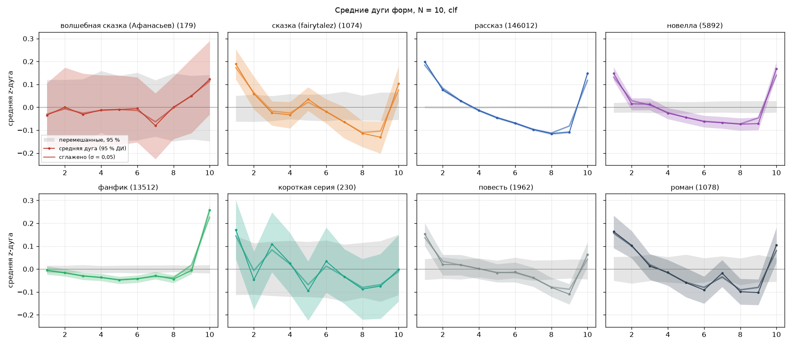
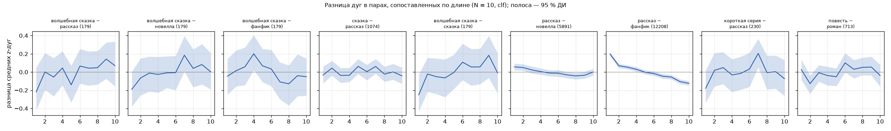
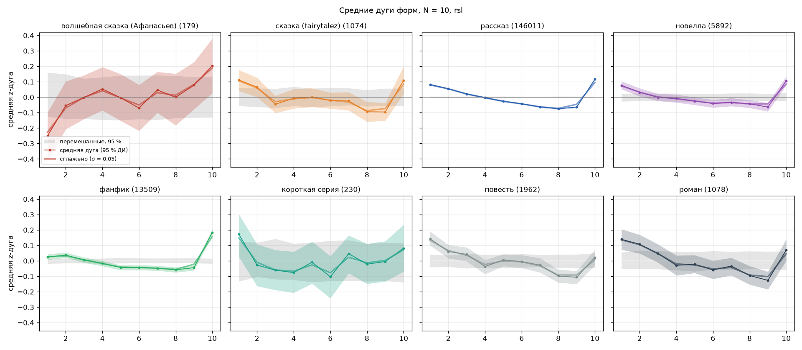
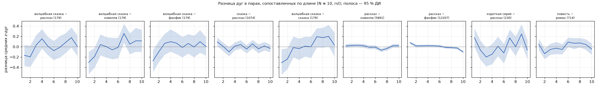
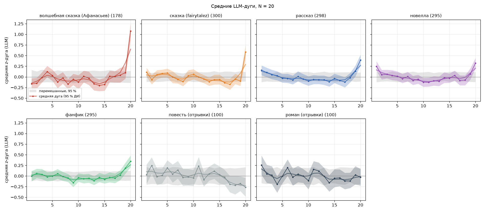

# Этап 5. RQ1 — средние дуги форм против перемешанных и друг против друга

Дуга — z внутри текста, без сглаживания (сглаживание σ = 0,05 длины — только на рисунках). Тексты within_author_cap (≤ 20 на автора). ДИ — пуассоновский бутстрэп по авторам (B = 1000); нулевая полоса — 200 перестановок сегментов внутри текстов; различия форм — пары, сопоставленные по log(n_words) (|Δ| ≤ 0.05), p — перестановка знака внутри пар (2000). Для сравнений со сказками главный сигнал — LLM-дуги (раздел 3); классификатор и RSL на полном корпусе — для прозы и как проверка.

## N = 20, сигнал clf: 169594 дуг

### Средняя дуга формы против перемешанных

| форма | текстов | SS средней дуги | SS перемешанных, 95 % | p | позиций вне полосы (из 20) | начало − середина | конец − середина |
|---|---|---|---|---|---|---|---|
| волшебная сказка (Афанасьев) | 179 | 0.0542 | 0.1782 | 0.975 | 0 | -0.011 | +0.102 |
| сказка (fairytalez) | 1074 | 0.1842 | 0.0289 | 0.005 | 9 | +0.172 | +0.105 |
| рассказ | 145731 | 0.1618 | 0.0002 | 0.005 | 19 | +0.182 | +0.144 |
| новелла | 5863 | 0.1075 | 0.0056 | 0.005 | 15 | +0.134 | +0.156 |
| фанфик | 13476 | 0.1262 | 0.0022 | 0.005 | 19 | +0.020 | +0.225 |
| короткая серия | 230 | 0.1150 | 0.1370 | 0.184 | 2 | +0.154 | +0.023 |
| повесть | 1962 | 0.1053 | 0.0154 | 0.005 | 8 | +0.142 | +0.071 |
| роман | 1079 | 0.1236 | 0.0293 | 0.005 | 9 | +0.155 | +0.108 |

Проверка: средние дуги, взвешенные по шуму (вес — по размеру сегмента, без формы):

| форма | r(невзвеш., взвеш.) | начало: без весов → с весами | конец: без весов → с весами |
|---|---|---|---|
| волшебная сказка (Афанасьев) | 0.997 | -0.011 → -0.002 | +0.102 → +0.101 |
| сказка (fairytalez) | 1.000 | +0.172 → +0.173 | +0.105 → +0.103 |
| рассказ | 1.000 | +0.182 → +0.182 | +0.144 → +0.145 |
| новелла | 1.000 | +0.134 → +0.133 | +0.156 → +0.156 |
| фанфик | 1.000 | +0.020 → +0.019 | +0.225 → +0.230 |
| короткая серия | 1.000 | +0.154 → +0.152 | +0.023 → +0.023 |
| повесть | 1.000 | +0.142 → +0.143 | +0.071 → +0.070 |
| роман | 1.000 | +0.155 → +0.155 | +0.108 → +0.108 |

### Различия форм на сопоставленных по длине парах

| пара (A − B) | пар | D | D перестановок, 95 % | p | позиций с ДИ ≠ 0 (из 20) | начало A − B | конец A − B |
|---|---|---|---|---|---|---|---|
| волшебная сказка (Афанасьев) − рассказ | 179 | 0.413 | 0.592 | 0.7701 | 0 | -0.192 | -0.069 |
| волшебная сказка (Афанасьев) − новелла | 179 | 0.393 | 0.598 | 0.8226 | 1 | -0.073 | -0.103 |
| волшебная сказка (Афанасьев) − фанфик | 179 | 0.379 | 0.604 | 0.8786 | 0 | -0.054 | -0.069 |
| сказка (fairytalez) − рассказ | 1074 | 0.237 | 0.245 | 0.0770 | 1 | -0.024 | -0.087 |
| волшебная сказка (Афанасьев) − сказка (fairytalez) | 179 | 0.450 | 0.603 | 0.5782 | 1 | -0.209 | -0.035 |
| рассказ − новелла | 5862 | 0.147 | 0.105 | 0.0005 | 6 | +0.046 | +0.003 |
| рассказ − фанфик | 12175 | 0.330 | 0.072 | 0.0005 | 17 | +0.151 | -0.097 |
| короткая серия − рассказ | 230 | 0.368 | 0.526 | 0.7196 | 1 | -0.107 | -0.047 |
| повесть − роман | 718 | 0.232 | 0.299 | 0.4738 | 1 | +0.028 | -0.023 |

## N = 20, сигнал rsl: 169590 дуг

### Средняя дуга формы против перемешанных

| форма | текстов | SS средней дуги | SS перемешанных, 95 % | p | позиций вне полосы (из 20) | начало − середина | конец − середина |
|---|---|---|---|---|---|---|---|
| волшебная сказка (Афанасьев) | 179 | 0.2143 | 0.1788 | 0.015 | 3 | -0.203 | +0.155 |
| сказка (fairytalez) | 1074 | 0.1091 | 0.0293 | 0.005 | 7 | +0.112 | +0.099 |
| рассказ | 145730 | 0.0575 | 0.0002 | 0.005 | 18 | +0.078 | +0.103 |
| новелла | 5863 | 0.0414 | 0.0055 | 0.005 | 9 | +0.069 | +0.094 |
| фанфик | 13473 | 0.0769 | 0.0024 | 0.005 | 17 | +0.040 | +0.156 |
| короткая серия | 230 | 0.1262 | 0.1263 | 0.055 | 2 | +0.160 | +0.082 |
| повесть | 1962 | 0.0835 | 0.0159 | 0.005 | 9 | +0.120 | +0.033 |
| роман | 1079 | 0.1005 | 0.0301 | 0.005 | 9 | +0.123 | +0.076 |

Проверка: средние дуги, взвешенные по шуму (вес — по размеру сегмента, без формы):

| форма | r(невзвеш., взвеш.) | начало: без весов → с весами | конец: без весов → с весами |
|---|---|---|---|
| волшебная сказка (Афанасьев) | 0.997 | -0.203 → -0.201 | +0.155 → +0.172 |
| сказка (fairytalez) | 1.000 | +0.112 → +0.110 | +0.099 → +0.098 |
| рассказ | 1.000 | +0.078 → +0.078 | +0.103 → +0.103 |
| новелла | 0.999 | +0.069 → +0.068 | +0.094 → +0.093 |
| фанфик | 1.000 | +0.040 → +0.043 | +0.156 → +0.158 |
| короткая серия | 1.000 | +0.160 → +0.157 | +0.082 → +0.082 |
| повесть | 1.000 | +0.120 → +0.120 | +0.033 → +0.033 |
| роман | 1.000 | +0.123 → +0.123 | +0.076 → +0.078 |

### Различия форм на сопоставленных по длине парах

| пара (A − B) | пар | D | D перестановок, 95 % | p | позиций с ДИ ≠ 0 (из 20) | начало A − B | конец A − B |
|---|---|---|---|---|---|---|---|
| волшебная сказка (Афанасьев) − рассказ | 179 | 0.428 | 0.580 | 0.6417 | 1 | -0.236 | -0.004 |
| волшебная сказка (Афанасьев) − новелла | 179 | 0.487 | 0.592 | 0.3673 | 2 | -0.253 | +0.042 |
| волшебная сказка (Афанасьев) − фанфик | 179 | 0.467 | 0.595 | 0.4823 | 2 | -0.214 | +0.007 |
| сказка (fairytalez) − рассказ | 1074 | 0.171 | 0.243 | 0.7236 | 2 | +0.029 | -0.002 |
| волшебная сказка (Афанасьев) − сказка (fairytalez) | 179 | 0.622 | 0.606 | 0.0390 | 2 | -0.300 | +0.019 |
| рассказ − новелла | 5862 | 0.087 | 0.103 | 0.3133 | 2 | +0.011 | -0.010 |
| рассказ − фанфик | 12173 | 0.137 | 0.072 | 0.0005 | 7 | +0.057 | -0.060 |
| короткая серия − рассказ | 230 | 0.473 | 0.525 | 0.1649 | 1 | +0.061 | -0.003 |
| повесть − роман | 714 | 0.225 | 0.301 | 0.5777 | 0 | +0.038 | -0.031 |

## N = 10, сигнал clf: 169939 дуг

### Средняя дуга формы против перемешанных

| форма | текстов | SS средней дуги | SS перемешанных, 95 % | p | позиций вне полосы (из 10) | начало − середина | конец − середина |
|---|---|---|---|---|---|---|---|
| волшебная сказка (Афанасьев) | 179 | 0.0262 | 0.0998 | 0.841 | 0 | -0.023 | +0.134 |
| сказка (fairytalez) | 1074 | 0.0876 | 0.0176 | 0.005 | 6 | +0.226 | +0.140 |
| рассказ | 146012 | 0.1099 | 0.0001 | 0.005 | 10 | +0.243 | +0.192 |
| новелла | 5892 | 0.0723 | 0.0031 | 0.005 | 8 | +0.187 | +0.208 |
| фанфик | 13512 | 0.0761 | 0.0013 | 0.005 | 7 | +0.026 | +0.290 |
| короткая серия | 230 | 0.0686 | 0.0870 | 0.109 | 1 | +0.192 | +0.019 |
| повесть | 1962 | 0.0486 | 0.0096 | 0.005 | 4 | +0.180 | +0.091 |
| роман | 1078 | 0.0818 | 0.0172 | 0.005 | 6 | +0.198 | +0.139 |

### Различия форм на сопоставленных по длине парах

| пара (A − B) | пар | D | D перестановок, 95 % | p | позиций с ДИ ≠ 0 (из 10) | начало A − B | конец A − B |
|---|---|---|---|---|---|---|---|
| волшебная сказка (Афанасьев) − рассказ | 179 | 0.325 | 0.466 | 0.4993 | 0 | -0.236 | +0.051 |
| волшебная сказка (Афанасьев) − новелла | 179 | 0.289 | 0.456 | 0.6482 | 1 | -0.213 | -0.020 |
| волшебная сказка (Афанасьев) − фанфик | 179 | 0.291 | 0.457 | 0.6527 | 1 | -0.058 | -0.063 |
| сказка (fairytalez) − рассказ | 1074 | 0.124 | 0.184 | 0.5627 | 0 | -0.043 | -0.051 |
| волшебная сказка (Афанасьев) − сказка (fairytalez) | 179 | 0.349 | 0.469 | 0.3773 | 1 | -0.284 | -0.042 |
| рассказ − новелла | 5891 | 0.103 | 0.079 | 0.0030 | 4 | +0.064 | +0.007 |
| рассказ − фанфик | 12208 | 0.282 | 0.056 | 0.0005 | 8 | +0.207 | -0.115 |
| короткая серия − рассказ | 230 | 0.291 | 0.401 | 0.4533 | 1 | -0.211 | -0.105 |
| повесть − роман | 713 | 0.198 | 0.230 | 0.1849 | 1 | +0.025 | -0.039 |

## N = 10, сигнал rsl: 169935 дуг

### Средняя дуга формы против перемешанных

| форма | текстов | SS средней дуги | SS перемешанных, 95 % | p | позиций вне полосы (из 10) | начало − середина | конец − середина |
|---|---|---|---|---|---|---|---|
| волшебная сказка (Афанасьев) | 179 | 0.1236 | 0.1065 | 0.015 | 2 | -0.257 | +0.198 |
| сказка (fairytalez) | 1074 | 0.0501 | 0.0173 | 0.005 | 5 | +0.139 | +0.138 |
| рассказ | 146011 | 0.0400 | 0.0001 | 0.005 | 9 | +0.107 | +0.141 |
| новелла | 5892 | 0.0276 | 0.0031 | 0.005 | 7 | +0.100 | +0.129 |
| фанфик | 13509 | 0.0477 | 0.0012 | 0.005 | 8 | +0.051 | +0.211 |
| короткая серия | 230 | 0.0603 | 0.0835 | 0.189 | 1 | +0.205 | +0.114 |
| повесть | 1962 | 0.0495 | 0.0090 | 0.005 | 4 | +0.163 | +0.044 |
| роман | 1078 | 0.0692 | 0.0171 | 0.005 | 6 | +0.166 | +0.096 |

### Различия форм на сопоставленных по длине парах

| пара (A − B) | пар | D | D перестановок, 95 % | p | позиций с ДИ ≠ 0 (из 10) | начало A − B | конец A − B |
|---|---|---|---|---|---|---|---|
| волшебная сказка (Афанасьев) − рассказ | 179 | 0.367 | 0.440 | 0.2519 | 0 | -0.187 | -0.014 |
| волшебная сказка (Афанасьев) − новелла | 179 | 0.478 | 0.454 | 0.0330 | 3 | -0.331 | +0.088 |
| волшебная сказка (Афанасьев) − фанфик | 179 | 0.342 | 0.460 | 0.4173 | 1 | -0.308 | -0.028 |
| сказка (fairytalez) − рассказ | 1074 | 0.170 | 0.188 | 0.1334 | 2 | +0.101 | -0.026 |
| волшебная сказка (Афанасьев) − сказка (fairytalez) | 179 | 0.515 | 0.471 | 0.0215 | 3 | -0.346 | -0.006 |
| рассказ − новелла | 5891 | 0.093 | 0.079 | 0.0045 | 2 | +0.020 | +0.023 |
| рассказ − фанфик | 12207 | 0.137 | 0.055 | 0.0005 | 3 | +0.075 | -0.103 |
| короткая серия − рассказ | 230 | 0.450 | 0.407 | 0.0170 | 2 | +0.188 | -0.053 |
| повесть − роман | 714 | 0.222 | 0.234 | 0.0890 | 1 | +0.049 | -0.047 |

## LLM-дуги (deepseek-v4.1-flash, N = 20): 1566 текстов — главный сигнал для сравнений со сказками

Рассказы, новеллы, фанфики — в диапазоне длины сказок базы (643–3 179 слов), ≤ 1 текста на автора; повести и романы — каждый сегмент отрывком ≈ 350 слов. Текстов с нулевой дисперсией LLM-дуги (все сегменты одной оценки) — 3, исключены.

| группа | текстов | SS | SS перемешанных, 95 % | p | позиций вне полосы | начало − середина | конец − середина |
|---|---|---|---|---|---|---|---|
| волшебная сказка (Афанасьев) | 178 | 1.3961 | 0.1722 | 0.005 | 8 | -0.107 | +0.640 |
| сказка (fairytalez) | 300 | 0.4809 | 0.1021 | 0.005 | 5 | +0.056 | +0.275 |
| рассказ | 298 | 0.2842 | 0.1074 | 0.005 | 5 | +0.179 | +0.313 |
| новелла | 295 | 0.2567 | 0.1114 | 0.005 | 4 | +0.192 | +0.240 |
| фанфик | 295 | 0.2229 | 0.1073 | 0.005 | 3 | +0.067 | +0.304 |
| повесть (отрывки) | 100 | 0.3908 | 0.2984 | 0.015 | 6 | +0.128 | -0.232 |
| роман (отрывки) | 100 | 0.2591 | 0.3041 | 0.144 | 3 | +0.172 | +0.018 |

### Различие средних LLM-дуг: группа − Афанасьев (D = √Σ разница²; p — перестановка меток групп)

| группа − Афанасьев | D | D перестановок, 95 % | p | начало: разница | конец: разница |
|---|---|---|---|---|---|
| сказка (fairytalez) | 0.731 | 0.531 | 0.0005 | +0.162 | -0.365 |
| рассказ | 0.876 | 0.532 | 0.0005 | +0.286 | -0.327 |
| новелла | 0.955 | 0.542 | 0.0005 | +0.299 | -0.400 |
| фанфик | 0.869 | 0.543 | 0.0005 | +0.174 | -0.336 |
| повесть (отрывки) | 1.592 | 0.704 | 0.0005 | +0.234 | -0.871 |
| роман (отрывки) | 1.350 | 0.704 | 0.0005 | +0.279 | -0.621 |

