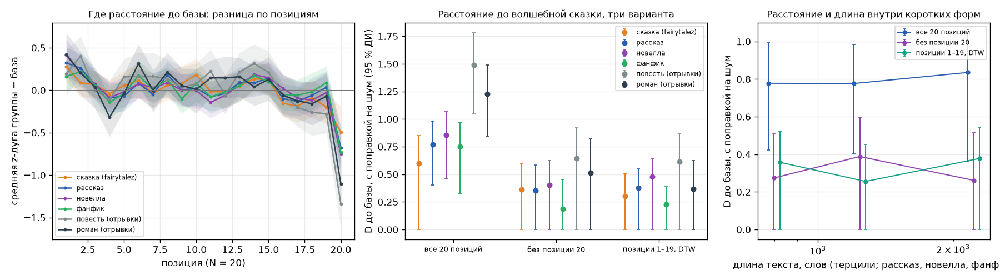

# Этап 6. RQ2 — расстояние до волшебной сказки

Решения Ворот 5 (2026-11-26). База — средняя LLM-дуга сказок базы Афанасьева (deepseek-v4.1-flash, N = 20). Основной анализ — только LLM-дуги (один измеритель для базы и прозы): рассказы, новеллы, фанфики — 300 текстов той же длины, что сказки базы (643–3 179 слов), ≤ 1 текста на автора; повести и романы — по 100, каждый сегмент — отрывок ≈ 350 слов (не целый сегмент — точки для сравнения, не для выводов о длине); fairytalez — для ориентира. Дуга — z внутри текста. Расстояние между выборочными средними смещено вверх шумом выборки, поэтому главная величина — **D с поправкой на смещение** (на шкале D²: 2·D² − среднее бутстрэп-D*²; ДИ — базовый бутстрэп на той же шкале; пуассоновский бутстрэп по авторам, база и группа независимо, B = 1000); сырое D — для справки. p — перестановка меток «база / группа» (2000).

Варианты расстояния: **все 20 позиций** (евклидово); **без позиции 20** (z пересчитан по позициям 1–19 — последний сегмент не влияет и на нормировку); **позиции 1–19, DTW** (полоса ±2 позиции).

## Вариант «все 20 позиций»: 178 сказок базы; текстов с нулевой дисперсией дуги исключено — 3

| группа | текстов | D (с поправкой на шум) [95 % ДИ] | D сырое | p | D сырое, перемешанные дуги | доля D² на позицию 20 |
|---|---|---|---|---|---|---|
| сказка (fairytalez) | 300 | 0.601 [0.000; 0.850] | 0.731 | 0.0005 | 1.194 | 0.55 (без поправки 0.45) |
| рассказ | 298 | 0.771 [0.402; 0.983] | 0.876 | 0.0005 | 1.204 | 0.69 (без поправки 0.60) |
| новелла | 295 | 0.854 [0.460; 1.068] | 0.955 | 0.0005 | 1.213 | 0.69 (без поправки 0.62) |
| фанфик | 295 | 0.752 [0.322; 0.974] | 0.869 | 0.0005 | 1.215 | 0.81 (без поправки 0.70) |
| повесть (отрывки) | 100 | 1.491 [1.054; 1.782] | 1.592 | 0.0005 | 1.249 | 0.77 (без поправки 0.71) |
| роман (отрывки) | 100 | 1.229 [0.846; 1.488] | 1.350 | 0.0005 | 1.255 | 0.74 (без поправки 0.67) |

Ориентиры: |база| (расстояние плоской дуги до базы) = 1.182; сырое D двух случайных половин сказок базы друг до друга — медиана 0.642 (95 % — 0.824) — столько даёт один шум выборки.

## Вариант «без позиции 20»: 178 сказок базы; текстов с нулевой дисперсией дуги исключено — 4

| группа | текстов | D (с поправкой на шум) [95 % ДИ] | D сырое | p | D сырое, перемешанные дуги |
|---|---|---|---|---|---|
| сказка (fairytalez) | 300 | 0.361 [0.000; 0.598] | 0.548 | 0.0325 | 0.519 |
| рассказ | 297 | 0.355 [0.000; 0.582] | 0.546 | 0.0285 | 0.511 |
| новелла | 295 | 0.404 [0.000; 0.626] | 0.578 | 0.0145 | 0.512 |
| фанфик | 295 | 0.189 [0.000; 0.452] | 0.456 | 0.2219 | 0.516 |
| повесть (отрывки) | 100 | 0.645 [0.000; 0.921] | 0.843 | 0.0005 | 0.620 |
| роман (отрывки) | 100 | 0.513 [0.000; 0.820] | 0.754 | 0.0165 | 0.614 |

Ориентиры: |база| (расстояние плоской дуги до базы) = 0.450; сырое D двух случайных половин сказок базы друг до друга — медиана 0.640 (95 % — 0.831) — столько даёт один шум выборки.

## Вариант «позиции 1–19, DTW»: 178 сказок базы; текстов с нулевой дисперсией дуги исключено — 4

| группа | текстов | D (с поправкой на шум) [95 % ДИ] | D сырое | p | D сырое, перемешанные дуги |
|---|---|---|---|---|---|
| сказка (fairytalez) | 300 | 0.304 [0.000; 0.510] | 0.444 | 0.0105 | 0.378 |
| рассказ | 297 | 0.377 [0.000; 0.548] | 0.465 | 0.0100 | 0.376 |
| новелла | 295 | 0.478 [0.000; 0.642] | 0.544 | 0.0010 | 0.375 |
| фанфик | 295 | 0.225 [0.000; 0.389] | 0.337 | 0.1269 | 0.382 |
| повесть (отрывки) | 100 | 0.616 [0.000; 0.864] | 0.713 | 0.0005 | 0.431 |
| роман (отрывки) | 100 | 0.366 [0.000; 0.625] | 0.550 | 0.0225 | 0.431 |

Ориентиры: |база| (расстояние плоской дуги до базы) = 0.450; сырое D двух случайных половин сказок базы друг до друга — медиана 0.436 (95 % — 0.607) — столько даёт один шум выборки.

## Сколько расстояния даёт концовка

| группа | D, все 20 | D, без 20 | D, 1–19 DTW | доля D² на позицию 20 | p без 20 | p 1–19 DTW |
|---|---|---|---|---|---|---|
| сказка (fairytalez) | 0.601 [0.000; 0.850] | 0.361 [0.000; 0.598] | 0.304 [0.000; 0.510] | 0.55 | 0.0325 | 0.0105 |
| рассказ | 0.771 [0.402; 0.983] | 0.355 [0.000; 0.582] | 0.377 [0.000; 0.548] | 0.69 | 0.0285 | 0.0100 |
| новелла | 0.854 [0.460; 1.068] | 0.404 [0.000; 0.626] | 0.478 [0.000; 0.642] | 0.69 | 0.0145 | 0.0010 |
| фанфик | 0.752 [0.322; 0.974] | 0.189 [0.000; 0.452] | 0.225 [0.000; 0.389] | 0.81 | 0.2219 | 0.1269 |
| повесть (отрывки) | 1.491 [1.054; 1.782] | 0.645 [0.000; 0.921] | 0.616 [0.000; 0.864] | 0.77 | 0.0005 | 0.0005 |
| роман (отрывки) | 1.229 [0.846; 1.488] | 0.513 [0.000; 0.820] | 0.366 [0.000; 0.625] | 0.74 | 0.0165 | 0.0225 |

D — с поправкой на шум, [95 % ДИ]. Доля D² на позицию 20 — вклад последней позиции в квадрат расстояния средней дуги группы до базы (вариант «все 20»; с поправкой на шум по позициям); при равномерном вкладе было бы 1/20 = 0,05. Варианты «все 20» и «без 20» нормированы по-разному (z по 20 и по 19 позициям) — сравнивать их D напрямую можно лишь приближённо; доля D² отвечает на вопрос точнее.

## Растёт ли расстояние с длиной (короткие формы той же длины, что сказки)

Расстояние текста до базы ~ форма + log(n_words), МНК; ДИ наклона — бутстрэп по текстам (≤ 1 текста на автора). Расстояние отдельного текста в основном шум (SNR дуги ≈ 2, этап 4), поэтому важнее агрегатный D по терцилям длины (ниже).

| вариант | текстов | наклон по log(n_words) | на 2-кратный рост длины | среднее расстояние текста |
|---|---|---|---|---|
| все 20 позиций | 888 | 0.009 [-0.041; 0.063] | +0.006 | 4.522 |
| без позиции 20 | 887 | 0.001 [-0.017; 0.019] | +0.001 | 4.375 |
| позиции 1–19, DTW | 887 | 0.005 [-0.013; 0.023] | +0.003 | 4.206 |

### D средней дуги до базы по терцилям длины (рассказ, новелла, фанфик вместе)

| вариант | терциль длины | текстов | D (с поправкой) [95 % ДИ] | D сырое |
|---|---|---|---|---|
| все 20 позиций | 648–986 слов | 295 | 0.778 [0.422; 0.993] | 0.879 |
| все 20 позиций | 986–1559 слов | 297 | 0.777 [0.403; 0.985] | 0.879 |
| все 20 позиций | 1559–3169 слов | 296 | 0.836 [0.361; 1.047] | 0.930 |
| без позиции 20 | 648–986 слов | 295 | 0.275 [0.000; 0.510] | 0.499 |
| без позиции 20 | 986–1559 слов | 297 | 0.388 [0.000; 0.598] | 0.570 |
| без позиции 20 | 1559–3169 слов | 295 | 0.262 [0.000; 0.515] | 0.491 |
| позиции 1–19, DTW | 648–986 слов | 295 | 0.358 [0.000; 0.524] | 0.449 |
| позиции 1–19, DTW | 986–1559 слов | 297 | 0.256 [0.000; 0.454] | 0.407 |
| позиции 1–19, DTW | 1559–3169 слов | 295 | 0.378 [0.000; 0.544] | 0.453 |

