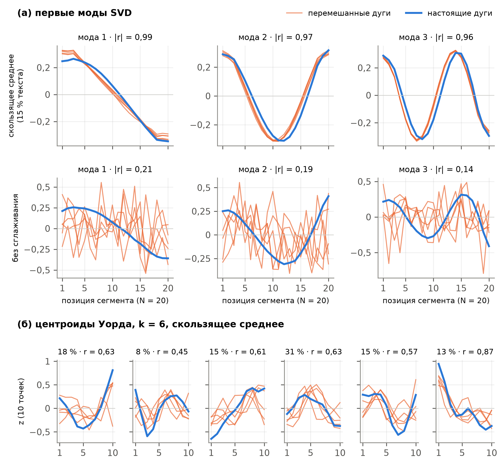
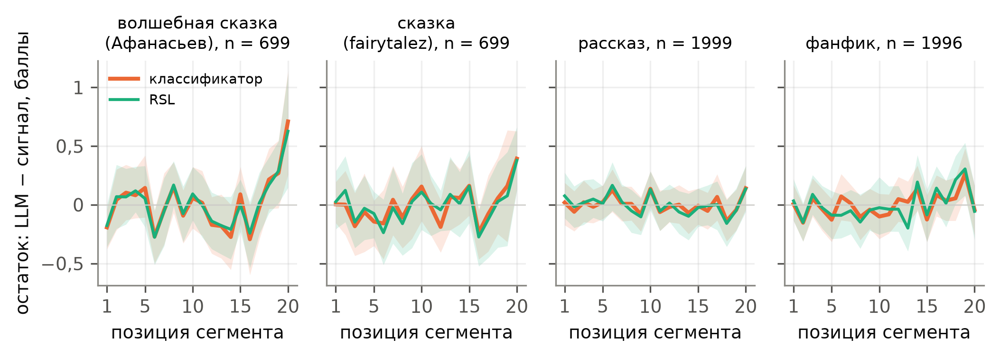
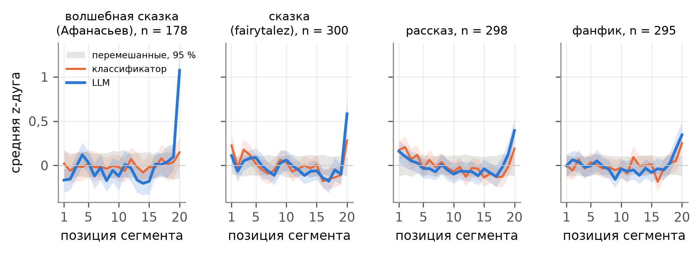

<!-- Черновик v1 русской версии (2026-11-26). Анонимная версия для рецензирования: без имён и ссылки на репозиторий.
     Лимит «Диалога»: ≤ 20 000 знаков с пробелами без аннотации и литературы; счёт — src/s10_count.py.
     Пометки [ЖДЁТ РАЗМЕТКИ] — места, которые заполняются после человеческой проверки (партия студентов). -->

# Рамка волшебной сказки: эмоциональные дуги русской прозы на фоне перемешанных текстов

*(рабочее название в плане — «От сказки к роману: эмоциональные и тематические дуги в русской прозе разных форм»)*

**Аннотация.** Мы сравниваем эмоциональные дуги русской волшебной сказки (179 текстов из собрания А. Н. Афанасьева) и
современной сетевой прозы (рассказы, новеллы, повести, романы с Проза.ру и фанфики-ориджиналы с Ficbook, около 170 тыс.
текстов). Каждое сравнение делается против дуг тех же текстов с переставленными сегментами и с контролем длины.
Получено три результата. (1) «Архетипы» дуг в духе Reagan et al. на этом материале создаёт сглаживание: моды SVD
и центроиды кластеров воспроизводятся на перемешанных дугах. (2) Лексические сигналы тональности систематически
занижают концовки сказок, поэтому средняя дуга сказки по классификатору неотличима от перемешанной, а по разметке
большой языковой модели (LLM) она самая выраженная из всех форм. (3) Сказка отличается от прозы той же длины рамкой:
тёмным началом и светлым последним сегментом; середина текста не отличается. Подъём концовки держится на кратком
благополучном исходе и на финальной формуле. Длина текста внутри диапазона длин сказки на расстояние до неё не влияет.

---

## 1. Введение

Идея, что у повествования есть «форма» — траектория эмоционального тона от начала к концу, — стала вычислимой
благодаря словарным и нейросетевым оценкам тональности. Reagan et al. [1] свели дуги художественных текстов из Project Gutenberg
к шести архетипам с помощью SVD и кластеризации, и с тех пор архетипы дуг используются как готовое описание сюжета.
Пакет syuzhet М. Джокерса [8] сделал такие дуги
массовым инструментом. Критика с самого начала касалась сглаживания: фильтр низких частот способен рисовать «сюжетные»
волны там, где их нет [9]. Обзор подходов к форме повествования дан в книге К. Элкинс [10]. Для русского материала
устойчивых оценок этого рода почти нет, а словари тональности строились на отзывах и новостях, а не на художественной
прозе. Два вопроса при этом обычно остаются без проверки. Во-первых, отличаются ли найденные формы от того, что даёт
сглаживание шумного ряда без всякого сюжета. Во-вторых, одинаково ли измеритель тональности работает в начале,
середине и конце текста.

Волшебная сказка — удобная точка отсчёта: её композиция описана В. Я. Проппом [2] как последовательность функций от
недостачи или вредительства к ликвидации беды и свадьбе. Мы спрашиваем: (RQ1) отличаются ли средние дуги форм друг
от друга и от средней дуги перемешанных текстов; (RQ2) насколько и где дуга прозы удалена от дуги волшебной сказки и
растёт ли это расстояние с длиной формы.

Вклад статьи — методический и содержательный. Мы показываем, что архетипы отдельных текстов на русском материале —
в основном артефакт сглаживания (раздел 3). Лексические сигналы дают позиционную ошибку, которая переворачивает
вывод о сказке (раздел 4). Отличие сказки от прозы сосредоточено в рамке — первых и последнем сегментах (раздел 5).
Тематический канал рассмотрен кратко (раздел 6).

## 2. Данные и методы

**Корпуса** (табл. 1). База — 179 волшебных сказок (ATU 300–749, не короче 600 слов) из «Народных русских сказок»
А. Н. Афанасьева [3]. Для проверки взят мировой фольклор с fairytalez.com в двойном переводе (оригинал → английский →
машинный на русский). Проза — рассказы (2018–2025), новеллы, повести и романы (2023–2025) с Проза.ру; форма — рубрика,
выбранная автором. Главы склеены в произведения по заголовкам. Фанфики-ориджиналы (2025–2026) — с Ficbook, это первые
страницы выдачи по релевантности, а не случайная выборка. В статистике на автора приходится не больше 20 текстов.

**Табл. 1.** Корпуса после отбора (дуги N = 20)

| форма | источник | текстов | авторов | медиана слов | в выборке LLM-дуг |
|---|---|---|---|---|---|
| волшебная сказка | Афанасьев | 179 | 120 сюжетов* | 1 292 | 179 |
| сказка (перевод) | fairytalez | 1 074 | 109 сборников* | 1 473 | 300 |
| рассказ | Проза.ру | 145 731 | 31 568 | 1 311 | 300 |
| новелла | Проза.ру | 5 863 | 2 146 | 1 205 | 300 |
| фанфик-ориджинал | Ficbook | 13 477 | 8 221 | 2 934 | 300 |
| повесть | Проза.ру | 1 962 | 1 263 | 18 248 | 100 (отрывки) |
| роман | Проза.ру | 1 079 | 710 | 50 714 | 100 (отрывки) |

*Кластер бутстрэпа для сказок — сюжет (варианты одной сказки) или сборник. Прозу в выборке LLM-дуг брали той же длины,
что сказки (643–3 179 слов), не больше одного текста на автора.

**Дуги.** Текст делится на N = 20 сегментов равной длины по целым предложениям (проверка — N = 10). Медианный
сегмент сказки — около 65 слов. Тональность
сегмента измеряется тремя сигналами:
- классификатором rubert-tiny2 [4];
- словарём RuSentiLex [5] (RSL);
- LLM deepseek-v4.1-flash с инструкцией «тональность фрагмента в целом от −2 до +2 и доминирующая эмоция»;
  температура 0, рассуждения отключены, модель видит только текст сегмента без указания формы и места в тексте.

LLM размечала все 20 сегментов у 1 579 текстов: все 179 сказок базы, по 300 fairytalez, рассказов, новелл и фанфиков,
по 100 повестей и романов (у них — отрывок около 350 слов из каждого сегмента). Лексические сигналы посчитаны для
всего корпуса.

Дуга нормируется внутри текста (z-оценки), поэтому сравнивается форма дуги, а не уровень тональности: уровень
лексических сигналов смещён по форме (у сказок — на 0,16–0,34 балла относительно LLM). Сглаживание
применяется только на рисунках.

**Валидация** (табл. 2). Золотая выборка — 400 сегментов, стратифицированных по формам (60 из сказок), плюс 30 скрытых
повторов. Их разметили шесть LLM; опорная разметка — медиана оценок.
- **Надёжность LLM:** согласие моделей с собой ρ = 0,87–1,00, между собой — 0,76–0,90, с консенсусом остальных —
  0,81–0,92.
- **Серебро:** 11 400 сегментов по 7 стратам, размеченных одной моделью (deepseek-v4.1-flash, согласие с консенсусом
  остальных моделей ρ = 0,92), — для оценки сигналов по формам и по позиции сегмента.
- **Эмоции исключены** из анализа: словари и классификатор эмоций согласуются с LLM на уровне macro-F1 ≈ 0,2.
- **Человеческая проверка** — двойная слепая разметка партии концовок и середин [ЖДЁТ РАЗМЕТКИ].

LLM-разметка всех сегментов 1 579 текстов выборки LLM-дуг стоила 419 ₽, валидация — 372 ₽.

**Табл. 2.** Согласие сигналов с консенсусом шести LLM (ρ Спирмена, золото; в скобках — 95 % ДИ)

| сигнал | все (400) | проза (340) | сказки Афанасьева (60) |
|---|---|---|---|
| классификатор | 0,52 [0,44; 0,60] | 0,58 [0,50; 0,67] | 0,35 [0,07; 0,60] |
| RuSentiLex | 0,41 [0,31; 0,50] | 0,44 [0,35; 0,54] | 0,29 [−0,01; 0,55] |
| LLM (одна модель против консенсуса остальных) | 0,92 | — | — |
| люди против консенсуса LLM | [ЖДЁТ РАЗМЕТКИ] | | |

**Статистика.** Единица вывода — автор: доверительные интервалы считаются пуассоновским бутстрэпом по авторам
(1 000 повторов). Средняя дуга формы сравнивается с полосой средних дуг тех же текстов с переставленными сегментами
(200 перестановок). Различия форм проверяются на парах, сопоставленных по log длины, или на прозе той же длины, что
сказки, и перестановкой меток. Пары сопоставляются по log числа слов (|Δ| ≤ 0,05) без возвращения; для LLM-дуг
длина контролируется отбором прозы в диапазоне длин сказки.

Расстояние до сказки D — евклидово расстояние между средними дугами формы и сказки, в трёх вариантах: по всем
20 позициям, без позиции 20 и по позициям 1–19 с DTW. Расстояние между выборочными средними смещено вверх шумом,
поэтому D исправлено на смещение: на шкале D² из удвоенного наблюдаемого значения вычитается среднее бутстрэп-копий,
интервал — базовый бутстрэп. О сходстве (а не об отсутствии отличия) говорим только по тесту эквивалентности (TOST)
с порогом, заданным до расчёта.

## 3. Архетипы — артефакт сглаживания

Отдельная дуга из 20 сегментов шумная. Отношение сигнал/шум, оценённое бутстрэпом предложений, имеет медиану
1,3–2,1 для коротких форм. Тест связности отличает дугу от перемешанной лишь у 12–26 % текстов при ожидаемых 5 %.
Если сгладить такие дуги скользящим средним и разложить по SVD, первые моды настоящих и перемешанных дуг совпадают
по форме (|r| = 0,96–0,99, рис. 1а). Без сглаживания совпадения нет (|r| = 0,14–0,21). Шесть центроидов Уорда после
сглаживания тоже повторяются на перемешанных дугах (r = 0,45–0,87, в среднем 0,63, рис. 1б), а силуэт кластеризации
мал и почти одинаков (0,046 против 0,037).

Значит, «архетипы» в этой постановке описывают в основном свойства сглаживающего фильтра, а не сюжет. Поэтому дальше
мы работаем с агрегатами — средними дугами форм с интервалами и с полосой перемешанных текстов.

**Рис. 1.** Архетипы на настоящих (синие) и перемешанных (оранжевые, 5 повторов) дугах; классификатор, N = 20.
(а) Первые три моды SVD при скользящем среднем (15 % текста) и без сглаживания. (б) Шесть центроидов Уорда после
скользящего среднего; в заголовке — доля текстов кластера и r с центроидом перемешанных.

## 4. Позиционная ошибка лексических сигналов

Остаток «LLM минус откалиброванный сигнал» должен быть одинаков на всех позициях. У прозы он почти постоянен, у сказок
резко растёт к концу (рис. 3). В последних двух сегментах сказок Афанасьева классификатор и словарь занижают
тональность примерно на полбалла шкалы −2…+2 относительно середины, у fairytalez — на 0,3. Нормировка внутри текста
этого не исправляет: ошибка меняет форму дуги, а не только её уровень. По чтению примеров словарь не видит
благополучного исхода, выраженного событием («обвенчались», «воротился домой») и архаичной формулой.

Следствие принципиально. По классификатору средняя дуга сказки неотличима от перемешанной (p = 0,975), по LLM — самая
выраженная из всех форм (рис. 2). Лексические сигналы привели бы к противоположному выводу о сказке. Поэтому в
сравнениях со сказкой главный сигнал — LLM, а лексические сигналы используются для прозы и как проверка.

**Рис. 3.** Остаток «LLM − сигнал» по позиции сегмента (серебро; классификатор — оранжевый, RSL — бирюзовый; 95 % ДИ).
В концовках сказок оба сигнала занижают тональность; у прозы остаток по позиции почти постоянен.

## 5. Волшебная сказка против прозы: рамка

**RQ1.** Средние LLM-дуги сказок, рассказа, новеллы и фанфика отличаются от перемешанных (p = 0,005 — минимум при 200 перестановках), повестей — p = 0,015; у романов (отрывки) отличие не обнаружено (p = 0,14). Проза
той же длины имеет U-образную среднюю дугу: светлое начало, провал в середине, подъём к концу (рис. 2). Дуга
сказки Афанасьева отличается от дуг рассказа, новеллы, фанфика и fairytalez (перестановка меток, p < 0,001). Внутри
прозы, на полном корпусе по лексическим сигналам, устойчиво отличается только фанфик от рассказа.

**Рис. 2.** Средние дуги (z внутри текста, N = 20): LLM (синие, 95 % ДИ) и классификатор на тех же текстах
(оранжевые); серая полоса — 95 % средних LLM-дуг тех же текстов с переставленными сегментами.

**RQ2: где расстояние.** Расстояние средней дуги прозы до сказки с поправкой на смещение составляет 0,75–0,85 для
рассказа, новеллы и фанфика (табл. 3). 69–81 % его квадрата приходится на последнюю позицию. Если её убрать, рассказ и
новелла отличаются от сказки слабо (p = 0,03 и 0,015), и 63–68 % остатка приходится на позиции 1–2; по позициям 3–19
отличия нет (p = 0,38). Сказка отличается от прозы **рамкой**: тёмным началом и светлым последним сегментом, а середина
текста у них общая. У фанфика без концовки отличие не обнаружено (p = 0,22). Эквивалентность (TOST, порог — половина
расстояния рассказа) не показана ни для одной группы.

Исходная гипотеза «чем длиннее форма, тем дальше от сказки» в пределах данных не подтверждается: внутри диапазона длин
сказки (≈ 650–3 200 слов) наклон расстояния по log длины близок к нулю (+0,009 [−0,041; +0,063]). Повести и романы
дальше от сказки (1,2–1,5), тоже за счёт концовки, но их дуги размечены по отрывкам, и вывод о длине формы из этого
не делается.

**Начало.** Тёмное начало сказки держится по всем трём сигналам и не сводится к первому сегменту: без него разница
с рассказом остаётся (+0,16 [+0,01; +0,31]). Среди самых тёмных начал — недостача и вредительство, то есть исходные
функции Проппа. У переводных сказок fairytalez эффекта начала нет, поэтому мы формулируем его как свойство русской
волшебной сказки.

**Концовка.** Подъём сосредоточен в последних ≈ 5 % текста; на сегментах 18–19 сказка от рассказа не отличается.
Разметка последних двух сегментов по предложениям (с двумя предложениями контекста) показывает:
- финальная формула («жить-поживать да добра наживать», «и я там был, мёд-пиво пил») есть у 51–66 % сказок и даёт
  самые светлые предложения (+1,0…+1,2);
- остальные предложения развязки в среднем нейтральны, кроме последнего события — свадьбы, награды, общего веселья;
- если оценить последний сегмент заново без формульных предложений, подъём относительно рассказа сохраняется примерно
  на три четверти.

Различить, видит ли LLM исход сюжета или знает жанровую условность, может только человек [ЖДЁТ РАЗМЕТКИ: результат
партии; анализ отдельно для сказок с формулой и без неё зафиксирован до разметки].

**Табл. 3.** Сказка против рассказа той же длины (LLM-дуги, N = 20; [95 % ДИ])

| мера | значение |
|---|---|
| начало: z(1–2) − середина, рассказ − сказка | +0,29 [+0,13; +0,45] |
| то же без первого сегмента: z(2–3) | +0,16 [+0,01; +0,31] |
| середина: D по позициям 3–19, p | 0,38 |
| конец: z(18–19) − середина, сказка − рассказ | +0,02 [−0,15; +0,19] |
| конец: z(20) − середина, сказка − рассказ | +0,69 [+0,43; +0,94] |
| D до сказки (все 20 позиций) | 0,77 [0,40; 0,98] |
| доля D² на позиции 20 / на позициях 1–2 (без 20) | 0,69 / 0,63 |
| сказок с финальной формулой | 51 % (строгий список) / 66 % (расширенный) |
| сегмент 20 без формулы: z(20) − середина, сказка − рассказ | +0,54 [+0,28; +0,79] |
| люди: (конец − середина), сказка − рассказ | [ЖДЁТ РАЗМЕТКИ] |

## 6. Тематический канал

Тематическая траектория — последовательность эмбеддингов сегментов (multilingual-e5-small [6], весь корпус, без
усечения) или распределений тем LDA (K = 50). У сказки по сырой скорости смены темы траектория «медленнее», но это
эффект масштаба: её сегменты лежат в компактной области пространства, и внутритекстовые расстояния у неё на 0,026
меньше. После нормировки скорости на средний попарный разброс сегментов текста соседние сегменты сказки остаются
относительно ближе друг к другу, чем у прозы: нормированная скорость ниже на 4–8 % внутри диапазонов размера сегмента
(−0,045 [−0,054; −0,036] к рассказу при контроле размера). Формы прозы между собой почти не различаются.

Связность зависит от канала. В эмбеддингах соседние сегменты ближе случайных пар своего текста на 7–24 % (медиана),
и это значимо у 91–98 % текстов. В LDA отношение 0,93–0,96, связности почти нет.

## 7. Обсуждение и ограничения

Волшебная сказка отличается от современной прозы той же длины не всей траекторией, а рамкой — тёмным зачином
с недостачей и вредительством и коротким светлым финалом с формулой. Это согласуется с пропповской композицией и
показывает, что «сюжетность» сказки на уровне тональности держится на краях текста. Тематическая преемственность
соседних сегментов есть почти в каждом тексте, а связная дуга тональности — лишь у меньшинства. Часть тематической
преемственности тривиальна: те же персонажи и место действия.

Для исследований дуг из этого следуют три практических правила. Форму дуги нужно сравнивать с дугами тех же
текстов с переставленными сегментами — иначе легко принять свойства фильтра за свойства сюжета. Измеритель нужно
проверять по позиции, а не только в среднем: ошибка, сосредоточенная в концовках, не видна в общей корреляции и при
этом переворачивает вывод. Разметку LLM разумно использовать как основной измеритель там, где она согласуется с
другими моделями и проходит человеческую проверку. Вся LLM-разметка этой работы (валидация, дуги, разметка
концовок по предложениям) стоила около 830 ₽.

Вопросы о многомасштабности дуг длинных форм, о совпадении поворотных точек тонального и тематического каналов и о
связи формы дуги с читательской реакцией вынесены в отдельную работу.

Ограничения:
- LLM — измеритель с возможным знанием жанра; человеческая проверка концовок идёт, а скрыть жанр от людей полностью
  нельзя — сказочный стиль узнаётся по языку;
- fairytalez — двойной машинный перевод;
- фанфики — выдача по релевантности;
- форма на Проза.ру — рубрика автора;
- повести и романы в LLM-дугах — отрывки.

Код, конфигурации и отчёты доступны в анонимном репозитории [ссылка для рецензирования].

---

## Литература (черновик; не входит в лимит знаков; библиографию проверить)

1. Reagan A. J., Mitchell L., Kiley D., Danforth C. M., Dodds P. S. The emotional arcs of stories are dominated by six basic shapes // EPJ Data Science. 2016. Vol. 5. Art. 31.
2. Пропп В. Я. Морфология сказки. Л.: Academia, 1928.
3. Народные русские сказки А. Н. Афанасьева: в 3 т. М.: Наука, 1984–1985.
4. seara/rubert-tiny2-russian-sentiment (модель Hugging Face, ревизия ad9be38671). [уточнить способ цитирования]
5. Loukachevitch N., Levchik A. Creating a General Russian Sentiment Lexicon // Proc. LREC 2016.
6. Wang L. et al. Multilingual E5 Text Embeddings: A Technical Report. arXiv:2402.05672, 2024. [проверить]
7. Schuirmann D. J. A comparison of the two one-sided tests procedure… // J. Pharmacokinetics and Biopharmaceutics. 1987. [проверить]
8. Jockers M. L. Syuzhet: Extract Sentiment and Plot Arcs from Text. R package, 2015. [проверить]
9. Swafford A. Problems with the Syuzhet Package. Blog post, 2015. [проверить]
10. Elkins K. The Shapes of Stories: Sentiment Analysis for Narrative. Cambridge University Press, 2022. [проверить]
