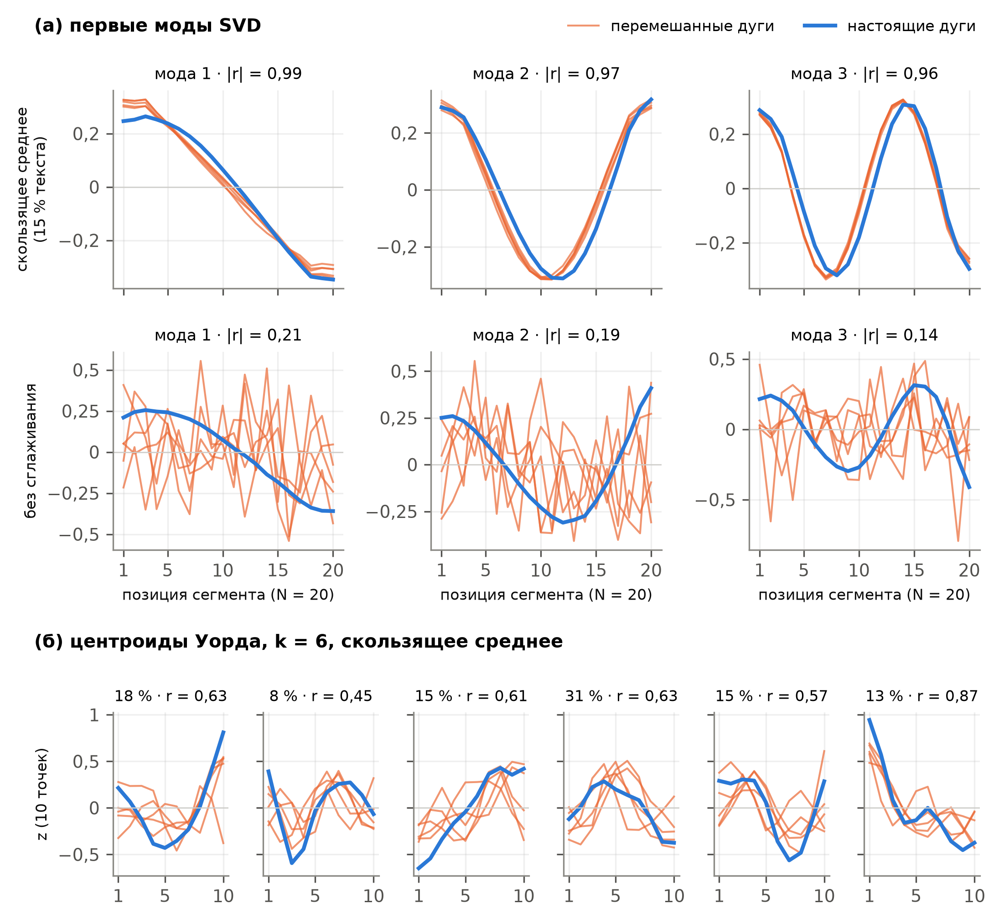
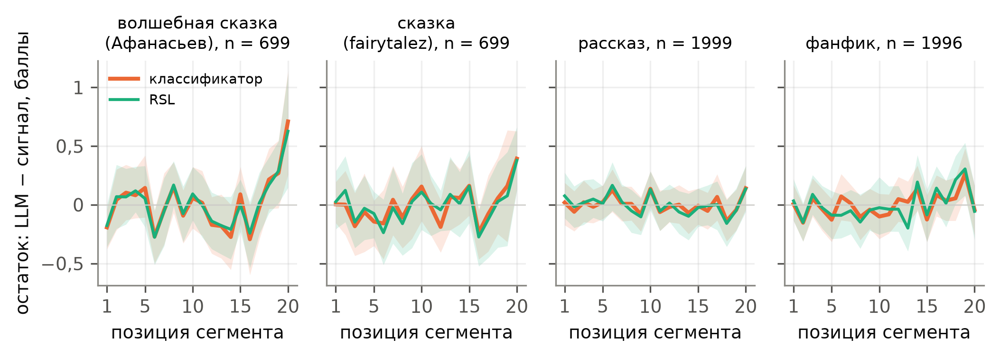
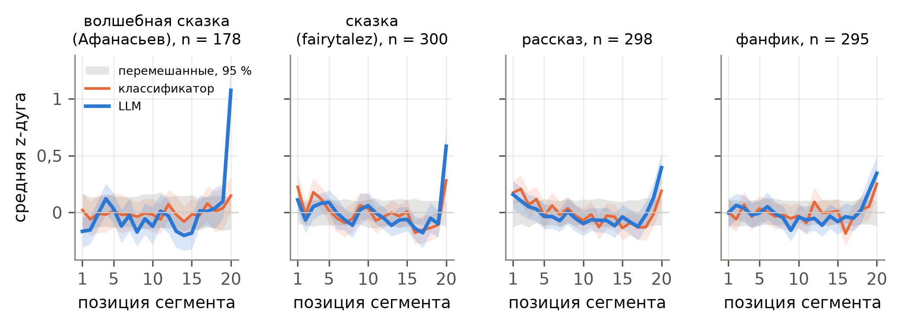
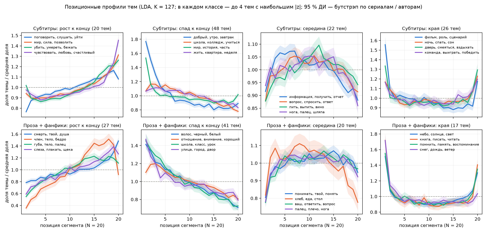

<!-- Подробная версия русского текста (2026-11-27), без ограничения длины — по решению пользователя.
     Версия для «Диалога» (≤ 20 000 знаков) — reports/paper/ru/paper_ru.md; из этой версии её потом ужимаем.
     Анонимная: без имён и ссылки на репозиторий. [ЖДЁТ РАЗМЕТКИ] — заполняется после человеческой проверки.
     Все числа — из отчётов reports/*.md (ссылки на источник — в квадратных скобках «отчёт: …» в комментариях). -->

# Эмоциональные дуги русской волшебной сказки и современной прозы

**Аннотация.** Мы сравниваем эмоциональные дуги русской волшебной сказки (179 текстов из собрания
А. Н. Афанасьева) и современной сетевой прозы — рассказов, новелл, повестей и романов с Проза.ру и
фанфиков-ориджиналов с Ficbook, около 170 тыс. текстов. Каждое сравнение делается против дуг тех же текстов
с переставленными сегментами и с контролем длины; единица статистического вывода — автор. Получено три
результата. (1) «Архетипы» дуг в духе Reagan et al. на этом материале создаёт сглаживание: моды SVD и центроиды
кластеров воспроизводятся на перемешанных дугах. (2) Лексические сигналы тональности систематически занижают
концовки сказок: по классификатору отличие средней дуги сказки от перемешанной не обнаружено, а по разметке
большой языковой модели (LLM) её дуга самая выраженная из всех форм. (3) Сказка отличается от прозы той же
длины рамкой: тёмным началом и светлым последним сегментом; в середине текста отличий не обнаружено. По разметке
LLM подъём концовки держится на кратком благополучном исходе и на финальной формуле. Длина текста внутри
диапазона длин сказки на расстояние до неё не влияет. Дополнительно мы повторяем анализ «Plot Arceology»
Б. Шмидта на двух корпусах — субтитрах англоязычных сериалов в русском переводе и прозе с фанфиками — и
сравниваем позиционные профили тем.

**Ключевые слова:** эмоциональные дуги, анализ тональности, волшебная сказка, нулевые модели, большие языковые
модели, тематическое моделирование, сетевая литература.

---

## 1. Введение

Идея, что у повествования есть «форма» — траектория эмоционального тона от начала к концу, — старше
вычислительных методов: К. Воннегут описывал сюжеты как кривые «удачи» героя [11]. Словарные и нейросетевые
оценки тональности сделали эту идею вычислимой. Reagan et al. [1] свели дуги 1 327 художественных текстов
Project Gutenberg к шести формам, и с тех пор «архетипы» дуг используются как готовое описание сюжета — для
сравнения жанров, предсказания популярности, анализа отдельных романов.

«Эмоциональная дуга» в этой работе, как в [1], — траектория **тональности** (от негативной к позитивной).
Эмоциональные категории (радость, страх, гнев…) не анализируются: доступные для русского языка словари и
классификатор эмоций согласуются с опорной разметкой на уровне macro-F1 ≈ 0,2 (раздел 4.3).

Два вопроса при построении дуг проверяются редко.

1. **Отличаются ли найденные формы от того, что даёт шум.** Отдельная дуга короткого текста шумная, а
   сглаживание превращает любой шумный ряд в плавную кривую. Сравнивать нужно с дугами тех же текстов, у которых
   порядок сегментов переставлен: такая нулевая модель сохраняет распределение значений и разрушает только
   порядок. Нулевая модель Reagan et al. — перемешивание слов текста — проверка заметно слабее (раздел 2).
2. **Одинаково ли измеритель работает в начале, середине и конце текста.** Корреляция сигнала с опорной разметкой
   «в среднем» может быть приемлемой, а ошибка — сосредоточенной на определённых позициях. Если она сосредоточена
   там, где лежит интересующий нас эффект, вывод переворачивается.

Для русской художественной прозы оценок дуг почти нет, а ресурсы тональности (словари, обучающие корпуса
классификаторов) построены на новостях, отзывах и постах соцсетей.

Волшебная сказка — удобная точка отсчёта. Её композиция описана В. Я. Проппом [2] как последовательность функций
от недостачи или вредительства к ликвидации беды и свадьбе; она коротка, канонична и хорошо собрана. Если
вычислительная дуга чего-то стоит, она должна видеть хотя бы пропповскую рамку. Мы спрашиваем:

- **RQ1.** Отличаются ли средние дуги форм (волшебная сказка, рассказ, новелла, повесть, роман, фанфик) друг от
  друга и от средней дуги перемешанных текстов?
- **RQ2.** Насколько и где дуга прозы удалена от дуги волшебной сказки, и растёт ли это расстояние с длиной формы?

Исходная гипотеза RQ2 — «чем длиннее форма, тем дальше её дуга от сказки» — была сформулирована до анализа;
в пределах данных она не подтвердилась (раздел 9).

Вклад статьи — методический и содержательный:

- архетипы отдельных текстов на русском материале — в основном артефакт сглаживания (раздел 6);
- лексические сигналы дают позиционную ошибку, сосредоточенную в концовках сказок, которая переворачивает вывод
  о сказке (раздел 7);
- отличие сказки от прозы сосредоточено в рамке — первых и последнем сегментах (разделы 8–10);
- тематический канал: соседние сегменты тематически связны почти в каждом тексте, а позиционные профили тем
  в прозе и в субтитрах сериалов устроены по-разному (раздел 11).

## 2. Связанные работы

**Дуги и архетипы.** Reagan et al. [1] строили дуги по окнам в 10 000 слов, оценённым словарём labMT, и сводили
их к шести формам тремя способами: SVD, иерархической кластеризацией и самоорганизующимися картами. Их нулевая
модель — тексты с перемешанными словами («word salad») и «нонсенс», порождённый марковской цепью на биграммах
каждой книги. У нулевых текстов спектр сингулярных чисел более пологий, а кластеры менее отчётливы (итоговая
стоимость связывания 1 400 против 7 000 у настоящих книг). Перемешивание слов, однако, разрушает не только
порядок, но и концентрацию тональности внутри окна: по построению окна такого текста почти одинаковы по тональности,
и отличие от него — низкий порог. Перестановку предложений авторы называют среди возможных нулевых моделей, но
не используют.

Пакет syuzhet [8] сделал дуги массовым инструментом. Критика с самого начала касалась фильтра: дуга приближалась
несколькими синусоидами (преобразование Фурье с отсечением высоких частот), и такое приближение добавляет ложные
«горбы» — эффект Гиббса, ringing [9]. Элкинс [10] сравнила больше трёх десятков моделей тональности, от словарей
до глубоких сетей, ставя вопрос, какая модель подходит какому повествованию; на «бессюжетном» романе Вульф
простые лексические методы оказались неожиданно действенными [12]. Bizzoni et al. [13] переходят от формы
к динамике и связывают фрактальные свойства дуг с читательскими оценками.

**Жанр и форма.** Мохаммад [14] сравнил эмоциональную лексику сказок и романов и нашёл, что её плотность у сказок
разбросана шире. Kim et al. [15] на 2 100 книгах пяти жанров показали, что у жанров узнаваемые эмоциональные
траектории, а приключения выделяются прежде всего к концу текста. Boyd et al. [16] на ~40 тыс. повествований
нашли общую структуру по служебным словам — постановку сцены, развитие сюжета и когнитивное напряжение. Toubia
et al. [17] измеряют семантическую траекторию текста в пространстве эмбеддингов — скорость, объём, извилистость — и
связывают её с успехом фильмов и сериалов. Фанфикшен как отдельный корпус вычислительно изучали Milli и Bamman
[18].

**Plot Arceology.** Б. Шмидт [25, 26] обучил тематическую модель на десятках тысяч сценариев фильмов и сериалов
(субтитры OpenSubtitles), разделённых на равные части экранного времени, и показал, что усреднённая траектория
текста в пространстве тем образует «дугу», которая сохраняет порядок частей, хотя модель о порядке не знает. По
отдельным темам он нашёл устойчивые позиционные профили: «грандиозный» язык о мире и правительстве — по краям
сценария, разговоры о правде и лжи растут к концу, о бизнесе и компаниях — убывают. В блоге 2014 г. он пишет,
что у модели 127 тем («since I only have 127 topics»); мы используем то же число как один из вариантов K
(раздел 11.2).

**Сказка.** Вычислительные работы по Проппу размечают функции вручную на малых корпусах (15 русских волшебных
сказок в ProppLearner [19]). Нас интересует не сами функции, а то, видны ли зачин и развязка на уровне
тональности и чем сказка отличается от современной прозы той же длины.

**Измерители.** Обзор Kim и Klinger [20] систематизирует работы по тональности и эмоциям в литературоведении — от
отслеживания сюжета до эмоциональности текстов; обзор Сметанина [22] — приложения анализа тональности для русского
языка. Словарь RuSentiLex [5] и классификатор rubert-tiny2 [4] (обучен на новостях, отзывах и постах соцсетей,
в том числе RuSentiment [21]) не рассчитаны на художественную прозу, тем более на архаичный язык сказки. Большие
языковые модели как разметчики в ряде задач точнее краудсорсинга [23], но качество зависит от задачи, и
разметка требует проверки на людях [24].

## 3. Данные

### 3.1. Корпуса

**Волшебная сказка (база).** «Народные русские сказки» А. Н. Афанасьева [3]. Из 518 русских текстов собрания
по разделам ATU отобраны волшебные сказки (ATU 300–749) не короче 600 слов — 179 текстов (из 227 волшебных;
при пороге 400 слов — 208). Остальные типы (о животных, легенды, новеллистические, анекдоты, кумулятивные)
в базу не входят. В статистике кластер бутстрэпа для сказок — **сюжет** (варианты одной сказки, 120 кластеров),
а не «автор»: у фольклорных текстов автора нет, а варианты одного сюжета не независимы.

**Сказки в переводе (проверка).** Мировой фольклор с fairytalez.com: 1 893 текста, 1 074 после отбора; переведены
дважды (оригинал → английский → машинный перевод на русский). Кластер — сборник или собиратель (109). Этот
корпус помогает отделить жанровые свойства от свойств русского языка, но не от перевода.

**Проза.** Проза.ру: рассказы (2018–2025), новеллы, повести и романы (2023–2025). Форма — рубрика, которую выбрал
автор. Повесть одной записью — не короче 10 000 слов, роман — 20 000; более короткие записи или записи
с «продолжение следует» считаются главами, и главы одного произведения склеены по заголовкам («связанные
произведения»). Строгие пороги для проверки устойчивости — 15 000 и 40 000 слов.

**Фанфики.** Ficbook, ориджиналы (оригинальные произведения, без фандома), 2025–2026 гг. Это первые страницы выдачи
по релевантности, а не случайная выборка.

**Общие правила отбора:** не короче 600 слов, без стихоподобных текстов и дублей, без текстов на украинском и
белорусском (доля букв і/ї/є/ґ/ў) и с ≥ 30 % слов латиницей. В статистике на автора приходится не больше 20 текстов
(within_author_cap).

**Табл. 1.** Корпуса после отбора (дуги N = 20)

| форма | источник | текстов | авторов (кластеров) | медиана слов | в выборке LLM-дуг |
|---|---|---|---|---|---|
| волшебная сказка | Афанасьев | 179 | 120 сюжетов | 1 292 | 179 |
| сказка (перевод) | fairytalez | 1 074 | 109 сборников | 1 473 | 300 |
| рассказ | Проза.ру | 145 731 | 31 568 | 1 311 | 300 |
| новелла | Проза.ру | 5 863 | 2 146 | 1 205 | 300 |
| фанфик-ориджинал | Ficbook | 13 477 | 8 221 | 2 934 | 300 |
| короткая серия | Проза.ру (склеенные) | 230 | 185 | 5 414 | — |
| повесть | Проза.ру | 1 962 | 1 263 | 18 248 | 100 (отрывки) |
| роман | Проза.ру | 1 079 | 710 | 50 714 | 100 (отрывки) |

Выборка LLM-дуг: проза взята той же длины, что сказки базы (643–3 179 слов), не больше одного текста на автора.

### 3.2. Предобработка и сегментация

Из текстов удалены заголовки глав, примечания, служебные строки, ссылки и знаки ударения; доля слов после очистки —
медиана 0,99–1,00 по группам. Предложения и токены — `razdel`, леммы и части речи — `pymorphy3`. Всего после
очистки — 286 тыс. документов и 973 млн слов (вместе с главами и текстами, не вошедшими в аналитическую выборку).

Текст делится на N = 20 сегментов равной длины по целым предложениям: граница — конец предложения, ближайший
к k·T/N, в каждом сегменте не меньше одного предложения; проверка — N = 10. Медианный сегмент сказки базы — около
65 слов (медиана длины базы 1 288 слов), рассказа — 66, новеллы — 61, фанфика — 143, повести — 951, романа — 2 742.

### 3.3. Субтитры сериалов (для раздела 11.2)

Корпус Ororo: субтитры 4 015 сериалов (1963–2026 гг.; по метаданным — 2 389 американских, 846 британских,
остальные — Австралия, Канада, Новая Зеландия и др.). Русские субтитры есть у 84 705 эпизодов, найдены в
архиве — 84 574. Почти все сериалы — англоязычные, поэтому русские субтитры — **переводы** (часть — любительские,
с сайтов переводчиков). Из субтитров удалены тайм-коды, разметка, ремарки в квадратных скобках и короткие
ремарки в круглых («(смеётся)»), тексты песен (строки с ♪), подписи переводчиков и релиз-групп, ссылки; подряд
идущие одинаковые реплики склеены. Оставлены эпизоды не короче 1 000 слов с долей кириллицы ≥ 0,8.
После фильтров осталось 82 190 эпизодов 3 423 сериалов. Медиана длины эпизода — 3 184 слова, или 41,6 минуты
экранного времени (межквартильный размах — 2 410–4 142 слова). У сериалов, вошедших в анализ, страны
производства по метаданным такие: США — 63,7 %, Великобритания — 24,0 %, Канада и Австралия — по 3,7 %.
Медианный год выпуска — 2020.

## 4. Измерители тональности

### 4.1. Сигналы

Тональность сегмента измеряется тремя сигналами.

- **Классификатор** rubert-tiny2-russian-sentiment [4] (ревизия ad9be38671): оценка = P(позитив) − P(негатив);
  сегмент — средневзвешенное по кускам ≤ 512 токенов.
- **Словарь RuSentiLex** [5] (RSL): (число позитивных − число негативных лемм) / число слов; многословные
  выражения в однословном сопоставлении не участвуют; слово с разной полярностью в разных значениях — 0.
- **LLM** deepseek-v4.1-flash (через провайдера provod.ai) с инструкцией разметчика: «оцени тональность фрагмента
  в целом по шкале −2…+2 и доминирующую эмоцию — ровно одну из списка; если фрагмент невозможно оценить — skip».
  Температура 0, рассуждения отключены. Модель видит только текст сегмента — без названия формы, без места
  в тексте и без соседних сегментов.

Дополнительно на валидации проверены словари LinisCrowd и NRC EmoLex (русская версия — машинный перевод).

### 4.2. Объём LLM-разметки

LLM размечала все 20 сегментов у 1 579 текстов: все 179 сказок базы, по 300 fairytalez, рассказов, новелл и
фанфиков, по 100 повестей и романов. Сегменты повестей и романов (медиана 950 и 2 740 слов) целиком размечать
дорого и ненадёжно — тон внутри такого сегмента меняется, — поэтому у них размечен связный отрывок около 350 слов
из каждого сегмента. Лексические сигналы посчитаны для всего корпуса.

Стоимость: дуги — 419 ₽, валидация (6 моделей на золоте и одна на серебре) — 372 ₽, разметка концовок по
предложениям (раздел 10.3) — 36,57 ₽; всего около 830 ₽.

### 4.3. Валидация

Человеческая разметка на момент написания не завершена (раздел 4.4), поэтому опорная разметка — LLM. Это не
замена человеческой: модели могут ошибаться согласованно. Мы проверяем (а) надёжность самих LLM и (б) согласие
сигналов с консенсусом LLM.

**Золото.** 400 сегментов, стратифицированных по формам (60 — из сказок Афанасьева, по 68 из рассказов, новелл,
фанфиков, отрывков повестей и романов), плюс 30 скрытых повторов. Их разметили шесть моделей разных
производителей; консенсус — медиана оценок (не меньше трёх моделей).

- **Согласие модели с собой** по скрытым повторам при температуре 0: ρ = 0,87–1,00 (недетерминизм API).
- **Согласие моделей между собой:** ρ = 0,76–0,90.
- **Каждая модель против консенсуса остальных:** ρ = 0,81–0,92; у deepseek-v4.1-flash — 0,92 (одна из двух лучших),
  поэтому она выбрана основной.

**Серебро.** 11 400 сегментов по 7 стратам, размеченных deepseek-v4.1-flash, — для оценки сигналов по формам
и, главное, по позиции сегмента (раздел 7).

**Табл. 2.** Согласие сигналов тональности с опорной разметкой (ρ Спирмена; [95 % ДИ, бутстрэп по авторам])

| сигнал | золото: все (400) | золото: проза (340) | золото: сказки Афанасьева (60) | серебро: проза (9 993) | серебро: сказки Афанасьева (699) |
|---|---|---|---|---|---|
| классификатор | 0,52 [0,44; 0,60] | 0,58 [0,50; 0,67] | 0,35 [0,07; 0,60] | 0,57 [0,56; 0,59] | 0,30 [0,23; 0,37] |
| RuSentiLex | 0,41 [0,31; 0,50] | 0,44 [0,35; 0,54] | 0,29 [−0,01; 0,55] | 0,47 [0,45; 0,48] | 0,37 [0,30; 0,44] |
| LinisCrowd | 0,37 [0,28; 0,45] | 0,40 [0,30; 0,48] | 0,21 [−0,09; 0,47] | 0,47 [0,46; 0,49] | 0,24 [0,17; 0,30] |
| NRC (полярность) | 0,33 [0,23; 0,41] | 0,35 [0,26; 0,44] | 0,29 [0,06; 0,52] | 0,35 [0,33; 0,36] | 0,23 [0,17; 0,28] |
| LLM: одна модель против консенсуса остальных | 0,92 | — | — | — | — |
| люди против консенсуса LLM | [ЖДЁТ РАЗМЕТКИ] | | | | |

На прозе классификатор достигает ρ ≈ 0,55–0,70 (рассказ 0,69 [0,50; 0,84], фанфик 0,64 [0,44; 0,78]); на сказках
Афанасьева все лексические сигналы заметно хуже. **Эмоции** исключены из анализа: классификатор эмоций CEDR и
NRC совпадают с доминирующей эмоцией консенсуса в 33–37 % случаев, macro-F1 0,19–0,23.

Уровень тональности лексических сигналов смещён по формам: у сказок — на 0,16–0,34 балла шкалы −2…+2 относительно
LLM. Поэтому дуга нормируется внутри текста (z-оценки), и сравнивается её форма, а не уровень.

### 4.4. Человеческая проверка (протокол зафиксирован до разметки)

Партия для двух разметчиков: 100 сказок базы и 100 рассказов той же длины; у каждого текста — последний сегмент
и два случайных разных сегмента середины (из позиций 6–15), всего 600 фрагментов в перемешанном порядке; 30 %
текстов размечают оба разметчика, у каждого 10 скрытых повторов; нагрузка — около 400 фрагментов и 5,3 ч на
человека. Инструкция не упоминает гипотезу, формы и слово «сказка». Мощность основного критерия при эффекте,
равном LLM-оценке, — 0,95 (симуляция; при добавочном шуме разметчика σ = 1 — 0,67).

- **Основной критерий:** (концовка − среднее двух сегментов середины) у сказок больше, чем у рассказов; 95 % ДИ
  разницы не включает 0.
- **Анализ по подгруппам (зафиксирован до получения разметки):** тот же контраст отдельно для сказок с финальной
  формулой в последнем сегменте и без неё (строгий и расширенный списки), каждая подгруппа против всех рассказов.
  Если у людей подъём есть только у сказок с формулой — вывод о «благополучном исходе без формулы» держится
  только на LLM.
- **Ограничение:** скрыть жанр от людей полностью нельзя — сказочный стиль узнаётся по языку.

[ЖДЁТ РАЗМЕТКИ: согласие людей между собой и с собой; согласие с консенсусом LLM; основной критерий; подгруппы.]

## 5. Статистический аппарат

**Дуга.** Ряд из N оценок тональности сегментов, нормированный внутри текста (z). Сглаживание (скользящее среднее
15 % длины или гауссово ядро σ = 0,05 длины) применяется только на рисунках и в разделе 6, где его влияние
проверяется.

**Единица вывода — автор.** Доверительные интервалы — пуассоновский бутстрэп по авторам (B = 1 000): каждому автору
присваивается вес ~ Poisson(1), средние пересчитываются с весами. Для сказок кластер — сюжет, для fairytalez —
сборник.

**Нулевая модель — перестановка сегментов внутри текста.** Средняя дуга формы сравнивается с полосой средних дуг
тех же текстов с переставленными сегментами (200 перестановок): статистика — сумма квадратов средней дуги (SS),
p — доля перестановок с SS не меньше наблюдаемой (минимум 1/201 ≈ 0,005). Для отдельных текстов — тесты
связности (автокорреляция lag 1), изрезанности и числа поворотов против 100 перестановок.

**Контроль длины.** Длина текста меняет размер сегмента, а с ним — шум дуги. Сравнения форм делаются тремя
способами: (а) пары, сопоставленные по log числа слов (ближайший сосед, |Δ| ≤ 0,05, без возвращения);
(б) внутри квантильных интервалов длины; (в) модели со случайными эффектами автора
`метрика ~ форма + log(n_words) + (1 | автор)`. LLM-дуги прозы с самого начала отобраны в диапазоне длин сказки.

**Различие средних дуг двух групп** — D = √Σ(разница средних)², p — перестановка меток групп (2 000 раз).

**Расстояние до сказки** (RQ2) — евклидово расстояние между средними LLM-дугами формы и сказки, в трёх вариантах:
по всем 20 позициям; без позиции 20 (z пересчитан по позициям 1–19, так что последний сегмент не влияет и на
нормировку); по позициям 1–19 с динамической трансформацией времени (DTW, полоса Сакоэ–Тибы ±2 позиции [27]).
Расстояние между выборочными средними смещено вверх шумом. Поэтому D исправлено на смещение на шкале D²:
θ̂ = 2D̂² − mean(D*²), где D* — бутстрэп-копии; интервал — базовый бутстрэп на шкале D², затем корень (отрицательные
значения — 0). Вклад позиции в D² — квадрат разницы минус её бутстрэп-дисперсия.

**Сходство.** Отсутствие значимого отличия не означает сходства. О сходстве говорим только по тесту
эквивалентности TOST [7]: эквивалентность показана, если верхняя односторонняя 95 % граница D меньше порога δ,
заданного до расчёта (половина D рассказа без позиции 20; δ = 0,178).

**Множественные сравнения.** В разделе 11 — поправка Бенджамини–Хохберга (FDR q = 0,05) [28] по темам модели.

## 6. Шум дуги и архетипы

**Отдельная дуга шумная.** Отношение сигнал/шум (дисперсия дуги между сегментами к средней бутстрэп-дисперсии
сегмента по предложениям; 4 509 текстов) имеет медиану 1,7–2,1 у коротких форм для классификатора и 1,3–1,6 для
словаря; у повестей и романов — 3,1–4,3 и 2,2–3,1 (длинные сегменты усредняют шум). Тест связности (lag 1) отличает
дугу от перемешанной у 15–26 % текстов для классификатора и у 12–23 % для словаря (Афанасьев — 18 % и 17 %,
рассказ — 17 % и 12 %) при ожидаемых 5 %; число поворотов ниже, чем у перемешанной, — у 4–7 %.

**Архетипы на перемешанных дугах.** Мы повторили конвейер «z-дуга → сглаживание → SVD и кластеризация Уорда»
на настоящих дугах (классификатор, N = 20; SVD — все тексты within_author_cap, Уорд — до 1 500 текстов на форму)
и на тех же дугах с переставленными сегментами (5 повторов).

**Табл. 3.** Архетипы на настоящих и перемешанных дугах (классификатор, N = 20)

| сглаживание | доля дисперсии 4 мод SVD: настоящие / перемешанные | \|r\| формы мод 1–3 (наст. vs перем.) | силуэт Уорда k = 6: наст. / перем. | r центроидов k = 6 (среднее) |
|---|---|---|---|---|
| скользящее среднее 15 % | 0,672 / 0,592 | 0,99 / 0,97 / 0,96 | 0,046 / 0,037 | 0,63 (0,45–0,87) |
| гауссово ядро σ = 0,05 | 0,730 / 0,660 | 0,99 / 0,98 / 0,98 | 0,056 / 0,039 | 0,72 (0,55–0,89) |
| без сглаживания | 0,292 / 0,214 | 0,21 / 0,19 / 0,14 | 0,024 / 0,014 | 0,44 (0,36–0,53) |

После сглаживания первые моды SVD настоящих и перемешанных дуг совпадают по форме почти полностью (рис. 1а);
центроиды кластеров тоже в основном повторяются (рис. 1б). Силуэт кластеризации мал при любом k (по силуэту
оптимально k = 2: 0,130 у настоящих против 0,080 у перемешанных) — дуги не распадаются на отчётливые группы. Без
сглаживания совпадения мод нет, но и доля дисперсии первых мод мала: структура, которую «находит» SVD
после сглаживания, — это в основном собственные функции сглаживающего фильтра, применённого к шуму.

Значит, «архетипы» в этой постановке описывают в основном свойства фильтра, а не сюжет. Дальше мы работаем
с агрегатами — средними дугами форм с интервалами и с полосой перемешанных текстов.

**Рис. 1.** Архетипы на настоящих (синие) и перемешанных (оранжевые, 5 повторов) дугах; классификатор, N = 20.
(а) Первые три моды SVD при скользящем среднем (15 % текста) и без сглаживания. (б) Шесть центроидов Уорда после
скользящего среднего; в заголовке — доля текстов кластера и r с центроидом перемешанных.

## 7. Позиционная ошибка лексических сигналов

**Остаток по позиции.** На серебре (11 391 сегмент) лексический сигнал калибруется внутри формы
(tone ~ a + b·сигнал — снимает сдвиг уровня и масштаб формы), и остаток «LLM минус калиброванный сигнал»
усредняется по позиции сегмента. Если измеритель работает одинаково по всему тексту, остаток постоянен. У прозы
он почти постоянен, у сказок резко растёт к концу (рис. 2): в последних двух сегментах сказок Афанасьева
классификатор и словарь занижают тональность относительно середины примерно на полбалла шкалы −2…+2, у fairytalez —
на 0,3.

**Табл. 4.** Эффект концовки в остатке (позиции 19–20 против середины, с контролем log длины сегмента;
[95 % ДИ])

| форма | классификатор | RuSentiLex |
|---|---|---|
| волшебная сказка (Афанасьев) | +0,51 [+0,24; +0,77] | +0,47 [+0,21; +0,74] |
| сказка (fairytalez) | +0,35 [+0,12; +0,59] | +0,31 [+0,08; +0,54] |

Длина сегмента эффект не объясняет: медиана длины концовок и середины у сказок одинакова (61 / 61 слово), эффект
есть во всех терцилях длины. Нормировка внутри текста его не исправляет: ошибка меняет форму дуги, а не только
её уровень.

**Что именно не видят лексические сигналы.** По чтению 15 концовок с наибольшим остатком: почти все — сюжетная
развязка без оценочной лексики (свадьба, награда, исцеление, возвращение) и формула благополучия; LLM ставит
+1…+2, классификатор — около нуля или ниже, иногда реагируя на «тревожные» слова предыдущего эпизода. Количественно
это проверено на предложениях концовок (раздел 10.3): финальная формула светлее развязки той же сказки по LLM на
1,10 SD [0,83; 1,37], по RuSentiLex — лишь на 0,29 SD [0,19; 0,39] (у 41 % формул нет ни одного слова словаря),
а классификатор оценивает формулу даже ниже концовок рассказов (−0,32 SD [−0,52; −0,13]).

У прозы зеркальный, но слабый эффект — в началах новелл и повестей: светлая экспозиция (природа, сезон, ироническая
завязка) выражена описанием, а не оценочными словами.

**Следствие.** По классификатору отличие средней дуги сказки от перемешанной не обнаружено (p = 0,975), по LLM
её дуга самая выраженная из всех форм (p = 0,005, минимум при 200 перестановках; раздел 8). Лексические сигналы
привели бы к противоположному выводу о сказке. Поэтому в сравнениях со сказкой главный сигнал — LLM, а лексические
сигналы используются для прозы полного корпуса и как проверка.

**Рис. 2.** Остаток «LLM − калиброванный сигнал» по позиции сегмента (серебро; классификатор — оранжевый, RSL —
бирюзовый; 95 % ДИ). В концовках сказок оба сигнала занижают тональность; у прозы остаток по позиции почти постоянен.

## 8. RQ1: средние дуги форм

**Полный корпус, лексические сигналы.** Средние дуги всех форм прозы отличаются от перемешанных (p = 0,005;
вне полосы — 8–19 позиций из 20 для классификатора). Общая форма — U: светлое начало, провал в середине, подъём
к концу (у рассказа по классификатору начало − середина +0,18, конец − середина +0,14). У фанфика начало почти
на уровне середины (+0,02), а концовка выше всех (+0,23). На сопоставленных по длине парах внутри прозы устойчиво
отличается только фанфик от рассказа (D = 0,33 при 95 % перестановок 0,07, p = 0,0005; 17 позиций с ДИ ≠ 0);
рассказ и новелла отличаются слабо (D = 0,15 против 0,10), повесть и роман — нет (p = 0,47).

**Табл. 5.** Средние дуги против перемешанных (N = 20; p — перестановка сегментов, 200 раз)

| форма | текстов | классификатор: p | RSL: p | LLM: текстов | LLM: p | LLM: начало − середина | LLM: конец − середина |
|---|---|---|---|---|---|---|---|
| волшебная сказка (Афанасьев) | 179 | 0,975 | 0,015 | 178 | 0,005 | −0,11 | +0,64 |
| сказка (fairytalez) | 1 074 | 0,005 | 0,005 | 300 | 0,005 | +0,06 | +0,28 |
| рассказ | 145 731 | 0,005 | 0,005 | 298 | 0,005 | +0,18 | +0,31 |
| новелла | 5 863 | 0,005 | 0,005 | 295 | 0,005 | +0,19 | +0,24 |
| фанфик | 13 476 | 0,005 | 0,005 | 295 | 0,005 | +0,07 | +0,30 |
| повесть | 1 962 | 0,005 | 0,005 | 100 (отрывки) | 0,015 | +0,13 | −0,23 |
| роман | 1 079 | 0,005 | 0,005 | 100 (отрывки) | 0,144 | +0,17 | +0,02 |

Начало — позиции 1–2, конец — 19–20, середина — остальные (z). Взвешивание по шуму (вес — по размеру сегмента)
средние дуги не меняет (r ≥ 0,997).

**LLM-дуги.** Средняя дуга сказки Афанасьева — самая выраженная (SS = 1,40 при 95 % перестановок 0,17): тёмное
начало и резкий подъём в последнем сегменте. Её отличие от дуг fairytalez, рассказа, новеллы и фанфика — p = 0,0005
(перестановка меток; D = 0,73–0,96 при 95 % перестановок 0,53–0,54). У романов (отрывки) отличие средней дуги от
перемешанной не обнаружено (p = 0,144), у повестей p = 0,015, причём концовка повести по отрывкам темнее середины.

**Наивные эффекты формы и длина.** Многие «эффекты формы» на полном корпусе — эффекты длины. Например, связность
дуги (lag 1) у повести и романа наивно выше, чем у рассказа (+0,05 и +0,07), а с контролем длины и автора —
нет (−0,01 [−0,02; −0,00] и −0,02 [−0,03; 0,00]); изрезанность и число поворотов ведут себя так же. Устойчивым
к контролю длины остаётся подъём концовки фанфика (+0,085 [+0,066; +0,105] для классификатора).

**Рис. 3.** Средние дуги (z внутри текста, N = 20): LLM (синие, 95 % ДИ) и классификатор на тех же текстах
(оранжевые); серая полоса — 95 % средних LLM-дуг тех же текстов с переставленными сегментами.

## 9. RQ2: расстояние до волшебной сказки

**Табл. 6.** Расстояние средней LLM-дуги до сказки (с поправкой на смещение; [95 % ДИ]; p — перестановка меток)

| группа | текстов | D, все 20 позиций | доля D² на позиции 20 | D без позиции 20 | p | D, позиции 1–19, DTW | p |
|---|---|---|---|---|---|---|---|
| сказка (fairytalez) | 300 | 0,60 [0,00; 0,85] | 0,55 | 0,36 [0,00; 0,60] | 0,033 | 0,30 [0,00; 0,51] | 0,011 |
| рассказ | 298 | 0,77 [0,40; 0,98] | 0,69 | 0,36 [0,00; 0,58] | 0,029 | 0,38 [0,00; 0,55] | 0,010 |
| новелла | 295 | 0,85 [0,46; 1,07] | 0,69 | 0,40 [0,00; 0,63] | 0,015 | 0,48 [0,00; 0,64] | 0,001 |
| фанфик | 295 | 0,75 [0,32; 0,97] | 0,81 | 0,19 [0,00; 0,45] | 0,22 | 0,23 [0,00; 0,39] | 0,13 |
| повесть (отрывки) | 100 | 1,49 [1,05; 1,78] | 0,77 | 0,65 [0,00; 0,92] | 0,0005 | 0,62 [0,00; 0,86] | 0,0005 |
| роман (отрывки) | 100 | 1,23 [0,85; 1,49] | 0,74 | 0,51 [0,00; 0,82] | 0,017 | 0,37 [0,00; 0,63] | 0,023 |

Ориентиры: расстояние плоской дуги до сказки — 1,18 (по 20 позициям) и 0,45 (по 19); сырое D двух случайных
половин сказок базы друг до друга — медиана 0,64: столько даёт один шум выборки.

**Где расстояние.** На последнюю позицию приходится 69–81 % квадрата расстояния рассказа, новеллы и фанфика до
сказки (при равномерном вкладе было бы 5 %). Без неё рассказ и новелла отличаются от сказки слабо (p = 0,03 и
0,015), у фанфика отличие не обнаружено (p = 0,22). Остаток без позиции 20 у рассказа и новеллы на 63–68 %
приходится на позиции 1–2 (при равномерном вкладе — 11 %); по позициям 3–19 отличий не обнаружено (D = 0,07–0,08,
p = 0,38; эквивалентность на этих позициях не проверялась). Эквивалентность без позиции 20 (TOST, δ = 0,178) не
показана ни для одной группы: верхние 95 % границы D — 0,44–0,90.

Сказка, таким образом, отличается от прозы той же длины **рамкой**: тёмным началом и светлым последним сегментом.

**Длина.** Исходная гипотеза «чем длиннее форма, тем дальше от сказки» в пределах данных не подтверждается. Внутри
диапазона длин сказки (≈ 650–3 200 слов; рассказ, новелла и фанфик вместе) наклон расстояния текста до базы по
log длины близок к нулю: +0,009 [−0,041; +0,063] (на двукратный рост длины — +0,006); D средней дуги по терцилям
длины — 0,78, 0,78 и 0,84 с перекрывающимися интервалами. Повести и романы дальше от сказки (1,2–1,5), тоже
за счёт концовки, но их дуги размечены по отрывкам, и вывода о длине формы из этого мы не делаем.

**Классификатор (вторичный анализ, полный корпус).** По классификатору все формы почти на одном расстоянии от
сказки (D = 0,00–0,18 с интервалами от 0), а эффект формы в моделях с длиной и автором — порядка 0,001–0,006. Это
ожидаемо: у классификатора средняя дуга самой сказки не отличается от перемешанной (раздел 7), и «база» почти
плоская.

## 10. Рамка сказки: начало и концовка

### 10.1. Начало

Тёмное начало сказки держится по всем трём сигналам и не сводится к первому сегменту (зачину).

**Табл. 7.** Начало: z(сегменты) − z(середина), разница групп [95 % ДИ]

| сигнал | (а) сегменты 1–2: рассказ − сказка | новелла − сказка | фанфик − сказка | (б) без зачина, сегменты 2–3: рассказ − сказка |
|---|---|---|---|---|
| LLM | +0,29 [+0,13; +0,45] | +0,30 [+0,15; +0,45] | +0,17 [+0,02; +0,33] | +0,16 [+0,01; +0,31] |
| классификатор | +0,24 [+0,10; +0,38] | +0,17 [+0,03; +0,32] | −0,01 [−0,16; +0,15] | +0,21 [+0,02; +0,37] |
| RuSentiLex | +0,23 [+0,08; +0,40] | +0,31 [+0,15; +0,46] | +0,24 [+0,08; +0,41] | +0,23 [+0,09; +0,39] |

Среди 15 начальных сегментов с самой низкой LLM-оценкой — недостача и вредительство, исходные функции Проппа:
бездетность стариков, сиротство, смерть жены, злая мачеха, змей, пожирающий людей, обман и козни сестёр. У переводных
сказок fairytalez эффекта начала нет (рассказ − fairytalez: +0,12 [−0,01; +0,26]), поэтому мы формулируем его как
свойство русской волшебной сказки, а не жанра вообще.

### 10.2. Концовка: где именно подъём

**Табл. 8.** Концовка: контраст z(зона) − z(середина 3–17), LLM-дуги [95 % ДИ]

| группа | 18–19 | 20 | сказка − группа: 18–19 | сказка − группа: 20 |
|---|---|---|---|---|
| волшебная сказка (Афанасьев) | +0,13 [−0,01; +0,27] | +1,13 [+0,92; +1,34] | | |
| сказка (fairytalez) | −0,04 [−0,17; +0,08] | +0,62 [+0,44; +0,81] | | |
| рассказ | +0,11 [+0,00; +0,22] | +0,45 [+0,31; +0,58] | +0,02 [−0,15; +0,19] | +0,69 [+0,43; +0,94] |
| новелла | +0,04 [−0,06; +0,14] | +0,36 [+0,23; +0,50] | | |
| фанфик | +0,15 [+0,04; +0,26] | +0,39 [+0,23; +0,54] | | |

Подъём сосредоточен в последних ≈ 5 % текста; на сегментах 18–19 отличий сказки от рассказа не обнаружено.
Постепенного нарастания к концу нет.

### 10.3. Концовка: развязка или формула

Последние два сегмента всех 178 сказок базы (с полной LLM-дугой) и 100 рассказов той же длины (пары по log длины)
размечены по предложениям: каждое предложение — с двумя предыдущими как контекстом (контекст не оценивается),
той же моделью и инструкцией (3 709 запросов, 63 пропуска — 1,7 %, в основном короткие реплики).

**Финальные формулы.** Шаблоны проверены глазами по последним четырём предложениям всех сказок базы; два уровня:
строгий (канонические формулы: «стали жить-поживать да добра наживать», «и я там был, мёд-пиво пил, по усам
текло, а в рот не попало», «сказке конец» и т. п.) и расширенный (+ клише счастливого конца: «припеваючи», «долго
и счастливо», «в любви и согласии»). Формульный блок — от первого предложения с шаблоном среди последних четырёх
содержательных до конца текста. Смешанные предложения («…женился на ней; после того воротился домой и стал
жить-поживать») разрезаны по последней границе перед формулой («;», «,», «—», «:», « и », « а », « да »), и часть
до формулы оценена отдельно (55 и 79 предложений).

- Формула есть у **51 %** сказок (90 из 178) по строгому списку и у **66 %** (118) по расширенному.
- Формульные предложения — самые светлые: +1,02 [+0,81; +1,22] (строгий список) и +1,19 [+1,00; +1,38]
  (расширенный) по шкале −2…+2.
- Остальные предложения развязки в среднем нейтральны (−0,02 [−0,14; +0,11]); выделяется последнее событие
  развязки — свадьба, награда, общее веселье: без формулы последнее предложение сказки на +0,46 [+0,19; +0,70]
  светлее последнего предложения рассказа.

**Последний сегмент без формулы.** У сказок с формулой последний сегмент заново оценён как сегмент, исходной
инструкцией, но без формульного блока (89 и 117 сегментов). Его сырой балл падает с +0,73 до +0,46 (строгий
список), но подъём относительно рассказа сохраняется примерно на три четверти: z(20) − середина, сказка − рассказ —
+0,54 [+0,28; +0,79] против +0,69 на исходной дуге (по расширенному списку +0,43 [+0,14; +0,69]).

**Подгруппы на исходных дугах.** У сказок без формулы (строгий список, 88) подъём последнего сегмента
+1,06 [+0,77; +1,33], с формулой (90) — +1,20 [+0,84; +1,52]; по расширенному списку сказки без формулы (60)
поднимаются меньше: +0,73 [+0,38; +1,08] против +1,34. У рассказов — +0,45.

**Лексические сигналы на тех же предложениях.** Чтобы проверить, видят ли словарь и классификатор формулу, оба
посчитаны на тех же предложениях (в единицах SD своего сигнала по всем этим предложениям):

**Табл. 9.** Предложения концовок: формула, развязка, рассказы (SD сигнала; [95 % ДИ, бутстрэп по авторам])

| сигнал | формула − развязка | формула − рассказ | развязка − рассказ | формул > 0 |
|---|---|---|---|---|
| LLM | +1,10 [+0,83; +1,37] | +1,13 [+0,87; +1,37] | +0,03 [−0,13; +0,19] | 64 % |
| классификатор | −0,14 [−0,35; +0,07] | −0,32 [−0,52; −0,13] | −0,18 [−0,31; −0,05] | 25 % |
| RuSentiLex | +0,29 [+0,19; +0,39] | +0,30 [+0,18; +0,43] | +0,01 [−0,08; +0,10] | 44 % |

90 сказок с формулой (строгий список), 106 предложений формулы, 975 — развязки; 100 рассказов, 1 344 предложения.
Классификатор и словарь видят только само предложение, LLM — ещё два предыдущих.

Классификатор формулу не видит вовсе; словарь видит её примерно на четверть эффекта LLM — архаичная лексика
формул («поживать», «наживать», «мёд-пиво») в словаре почти не представлена.

**Чего этот анализ не решает.** По отдельным предложениям благополучный исход без формулы почти не виден (кроме
последнего события), а по целому сегменту — виден. Это либо целостное прочтение ситуации моделью, либо её знание
жанровой условности («в конце сказки всё хорошо»). Различить это может только человеческая разметка
[ЖДЁТ РАЗМЕТКИ: основной критерий и подгруппы «с формулой / без формулы»].

**Табл. 10.** Сказка против рассказа той же длины: сводка (LLM-дуги, N = 20; [95 % ДИ])

| мера | значение |
|---|---|
| начало: z(1–2) − середина, рассказ − сказка | +0,29 [+0,13; +0,45] |
| то же без первого сегмента: z(2–3) | +0,16 [+0,01; +0,31] |
| середина: D по позициям 3–19, p | 0,38 |
| конец: z(18–19) − середина, сказка − рассказ | +0,02 [−0,15; +0,19] |
| конец: z(20) − середина, сказка − рассказ | +0,69 [+0,43; +0,94] |
| D до сказки (все 20 позиций) | 0,77 [0,40; 0,98] |
| доля D² на позиции 20 / на позициях 1–2 (без 20) | 0,69 / 0,63 |
| сказок с финальной формулой | 51 % (строгий список) / 66 % (расширенный) |
| сегмент 20 без формулы: z(20) − середина, сказка − рассказ | +0,54 [+0,28; +0,79] |
| люди: (конец − середина), сказка − рассказ | [ЖДЁТ РАЗМЕТКИ] |

## 11. Тематический канал

### 11.1. Траектории текста в пространстве тем и эмбеддингов

Тематическая траектория — последовательность представлений сегментов текста: распределений тем LDA (K = 50 и 100;
леммы существительных, прилагательных и глаголов без имён собственных и стоп-слов; модель обучена на
сбалансированной выборке форм — по 8 000 кусков по 200 лемм на группу) или эмбеддингов multilingual-e5-small [6]
(весь корпус, сегменты целиком, без усечения). Метрики: сырая скорость — среднее расстояние соседних сегментов;
внутритекстовое попарное — средний разброс сегментов текста; нормированная скорость = скорость / попарное
(< 1 — соседние сегменты ближе случайных пар своего текста). Метрики немонотонно зависят от размера сегмента,
поэтому формы сравниваются внутри диапазонов размера или с поправкой сплайном по log размера.

**Сказка: компактность, а не медленность.** У сказки сырая скорость смены темы ниже (−0,028 [−0,029; −0,026]
к рассказу при контроле размера), но и попарный разброс ниже на столько же (−0,026): её сегменты лежат в компактной
области пространства. После нормировки соседние сегменты сказки остаются относительно ближе друг к другу, чем у
прозы: −0,045 [−0,054; −0,036], или 4–8 % внутри диапазонов размера сегмента. У переводных сказок эффект меньше
(−0,033), формы прозы между собой почти не различаются (новелла +0,000, фанфик +0,009).

**Связность зависит от канала.** В эмбеддингах соседние сегменты ближе случайных пар своего текста на 7–24 %
(медиана по формам), и перестановочный тест значим у 91–98 % текстов. В LDA отношение 0,93–0,96 — связности
почти нет: темы LDA на коротких сегментах стянуты к априорному распределению. Тематическая преемственность
соседних сегментов, таким образом, есть почти в каждом тексте, а связная дуга тональности — лишь у пятой части.

### 11.2. Plot Arceology: темы субтитров и темы прозы

**Постановка.** Мы повторяем анализ Шмидта [25, 26] на двух корпусах. Первый — русские субтитры сериалов
(раздел 3.3). Второй — проза и фанфики: рассказ, новелла, повесть, роман и фанфик. Сказки сюда не входят: их
слишком мало для отдельной модели на сотни тем.

На каждом корпусе обучена своя LDA (tomotopy) с K = 50, 100 и 127; K = 127 — число тем в блоге Шмидта [26].
Параметры обучения:
- 40 000 кусков по 200 знаменательных лемм, не больше 20 кусков на текст;
- субтитры: не больше 3 эпизодов на сериал (9 864 эпизода из 3 419 сериалов);
- проза: по 8 000 кусков на каждую из пяти форм;
- словарь строится по правилам раздела 11.1: 22 509 лемм у субтитров и 30 342 у прозы;
- α = 0,1, η = 0,01, 1 000 итераций, seed 42.

Затем модель выводит распределение тем для каждого из N = 20 сегментов текста.
- Субтитры: не больше 10 случайных эпизодов на сериал, всего 26 943 эпизода из 3 423 сериалов. Эпизод делится
  на 20 равных по словам частей по границам реплик.
- Проза и фанфики: 10 099 текстов 9 173 авторов, не больше одного текста автора в каждой форме; сегменты
  раздела 3.2.

**Позиционный профиль темы.** Профиль — средняя доля темы в сегменте как функция позиции. Доли усредняются
сначала внутри единицы (сериала или автора), затем по единицам; профиль делится на среднюю долю темы, R = 1
означает равномерное распределение.

Форму профиля описывают две компоненты: проекции R на дискретные ортогональные многочлены позиции.
- Линейная: > 0 — тема растёт к концу.
- Квадратичная: > 0 — тема сосредоточена на краях, < 0 — в середине.

Каждая компонента переводится в z относительно нулевой модели: 200 перестановок сегментов внутри текста.
Отдельно проверяется, что амплитуда профиля больше, чем при перестановке. Это проверка с поправкой
Бенджамини–Хохберга [28], q = 0,05. Минимальное достижимое p при 200 перестановках равно 0,005, и у большинства тем
оно достигнуто. Значимая тема получает класс по компоненте с большим |z|: «рост к концу», «спад к концу»,
«края» или «середина». Незначимая тема получает класс «плоский». ДИ профилей — бутстрэп по сериалам или авторам,
1 000 повторов.

**Таблица 11.** Классы позиционных профилей тем (число тем).

| корпус | K | рост к концу | спад к концу | края | середина | плоский | средняя c_npmi |
|---|---|---|---|---|---|---|---|
| субтитры | 50 | 10 | 24 | 10 | 6 | 0 | 0,071 |
| субтитры | 100 | 18 | 44 | 17 | 18 | 3 | 0,053 |
| субтитры | 127 | 20 | 48 | 26 | 22 | 11 | 0,056 |
| проза + фанфики | 50 | 13 | 16 | 9 | 10 | 2 | 0,095 |
| проза + фанфики | 100 | 22 | 34 | 17 | 14 | 13 | 0,087 |
| проза + фанфики | 127 | 27 | 41 | 17 | 20 | 22 | 0,083 |

**Позиция значима почти для всех тем.** В обоих корпусах у большинства тем есть позиционный профиль, который
выходит за пределы нулевой модели. При K = 127 плоских тем 11 из 127 в субтитрах и 22 из 127 в прозе. Самый
частый класс — «спад к концу»: это темы экспозиции, которые концентрируются в начале текста. Поэтому тематический
канал, в отличие от тональности, несёт позицию почти во всём тексте (ср. раздел 11.1).

**Субтитры (K = 127; рис. 4, верхний ряд).**
- **Рост к концу.**
  - Разговорные темы развязки: «поговорить, слушать, уйти, случиться», z лин. = 49,4.
  - Смерть и опасность: «убить, умереть, бежать, спасти», R(20) = 1,26; «боль, смерть, причинить», R(20) = 1,24.
  - Любовь и чувство: «чувствовать, любовь, счастливый, сердце», R(20) = 1,45.
  - Правда и ложь: «рассказать, правда, верить, врать, ложь», z лин. = 27,6, R(20) = 1,13.
  - Мольба: «просить, прощение, ждать, бояться».
  - Брань: «черт, чертов, дерьмо».
- **Спад к концу.**
  - Утро: «добрый, утро, завтрак, кофе», R(1) = 1,77 — эпизод часто начинается утром.
  - Темы обстановки: школа (R(1) = 1,07, R(20) = 0,78), работа и офис, полиция и расследование, еда, вечеринка.
- **Края.**
  - Темы кино и шоу: «фильм, роль, сценарий», R(1) = 1,56.
  - Сон: «ночь, спать, сон».
  - Спорт: «команда, выиграть, победить».
- **Середина.**
  - Расспросы и обмен информацией: «информация, получить, отчет», «вопрос, спросить, ответ».
  - Застолье: «пить, выпить, вино».

**Проза и фанфики (K = 127; рис. 4, нижний ряд).** Позиционные профили прозы сильнее, чем у субтитров: R на
краях доходит до 1,6–1,7.
- **Спад к концу.** Это темы описательной экспозиции:
  - внешность: «волос, черный, белый, платье», R(1) = 1,41, R(20) = 0,71;
  - школа и институт;
  - улица и город, деревня, работа;
  - отношения между персонажами: «отношение, внимание, общение».
- **Рост к концу.**
  - Смерть: «смерть, душа, умереть, боль», R(20) = 1,48; «старик, могила, кладбище», R(20) = 1,49.
  - Любовь: «любовь, любить, сердце, счастие», R(20) = 1,62.
  - Слёзы и примирение: «слеза, плакать, простить, обнять», R(1) = 0,59.
  - Эротика: «член, тело, бедро» (R(1) = 0,36, максимум 1,52 в 18-м сегменте); «губа, тело, поцелуй». В основном
    это фанфики; темы растут к концу, но перед последним сегментом спадают.
  - Действие: «удар, боль, крик, кровь»; «нога, упасть, бежать».
  - Диалог: «спросить, ответить, улыбнуться».
- **Края — темы лирической рамки:**
  - пейзаж: «небо, солнце, свет, ветер», R(1) = 1,51, R(20) = 1,30; «снег, дождь, ветер, зима», R(1) = 1,72;
  - письмо и литература: «книга, писать, автор, стих», R(1) = 1,72;
  - память: «помнить, память, воспоминание, детство»;
  - время и будущее: «новый, мир, будущее, прошлое», R(20) = 1,61.
- **Середина.** Сцены за столом («хлеб, еда, стол») и диалог («понимать, понять»).

**Сравнение с Шмидтом.** Сопоставимые темы ведут себя так.
- **Повторяется:**
  - Правда и ложь растут к концу. В субтитрах тема «рассказать, правда, верить, врать, ложь» имеет z лин. = 27,6.
  - Бизнес убывает к концу. В субтитрах тема «компания, бизнес, деньга, рынок» имеет z лин. = −11,0,
    R(20) = 0,88; тема «офис, уволить, клиент, контракт» — z лин. = −18,5.
- **Повторяется частично:**
  - «Грандиозный» язык о мире и правительстве. У Шмидта он на краях. В субтитрах тема «страна, правительство,
    война, министр, президент» повышена в начале эпизода: R(1) = 1,18, z кв. = +4,7. В конце повышения нет:
    R(20) = 0,91. Поэтому класс — «спад к концу». Так же ведёт себя тема «мир, история, часть, город, страна, век»:
    R(1) = 1,53, R(20) = 1,02, z кв. = +21,9, z лин. = −23,6. Начальную половину «рамки» мы видим, конечную — нет.
- **В обоих наших корпусах.** Смерть и любовь растут к концу и в субтитрах, и в прозе.

**Проверка разбиением по экранному времени.** Шмидт делил сценарий на равные части экранного времени, а не слов.
Мы повторили расчёт профилей субтитров на 12 частях экранного времени по началу реплики. Совпадение классов и
корреляции компонент:

| K | совпадение классов | r(z лин.) | r(z кв.) |
|---|---|---|---|
| 50 | 94 % | 0,99 | 0,95 |
| 100 | 86 % | 0,99 | 0,97 |
| 127 | 80 % | 0,99 | 0,96 |

Компоненты формы почти не зависят от того, делится эпизод по словам или по времени; классы расходятся чаще,
чем компоненты, — вероятно, у тем с близкими |z| двух компонент (это мы отдельно не проверяли).

**Сопоставление тем двух корпусов.** Темы сопоставлены по сходству распределений слов на общем словаре (20 123
леммы). Сходство — 1 − расстояние Йенсена–Шеннона; пара входит в сопоставление, если её темы взаимно ближайшие.
Число таких пар: 32 при K = 50, 56 при K = 100, 71 при K = 127.

Сходство даже лучших пар умеренное: 0,26–0,45, ни одна пара не достигает 0,5. Корпуса различаются регистром,
устный диалог против авторского повествования, поэтому одинаковых тем в них почти нет. Ближе всего бытовые
темы: деньги, машина, сон, дверь и комната, врач, еда, школа.

Среди 30 лучших пар при K = 127 класс формы совпадает у 8. Корреляция профилей R положительна у 24 пар, медиана
r = 0,50, r ≥ 0,5 у 16 пар. При K = 100 те же показатели — 9, 25, 0,52 и 16; при K = 50 — 5, 19, 0,34 и 12.
Совпадение классов низкое, а корреляция профилей заметная. Вероятная причина — смешанные формы профиля (например,
«спад к концу» с повышенными краями), при которых класс решается небольшой разницей |z|.

Самые согласованные пары при K = 127:
- «любовь, чувство, счастливый» ↔ «любовь, любить, сердце, счастие»: обе растут к концу, r = +0,96;
- школа: r = +0,88;
- еда: r = +0,90;
- сон: обе на краях, r = +0,78.

Есть и пары с противоположными профилями. Тема врача и больницы в субтитрах убывает к концу, в прозе растёт,
r = −0,34. Спорт в субтитрах на краях, в прозе убывает, r = −0,51.

Эти корреляции описательные. Сходство профилей двух корпусов мы не утверждаем: для этого нужна проверка
эквивалентности с заранее заданным порогом, а её мы не проводили.

**Рис. 4.** Позиционные профили тем, LDA с K = 127; верхний ряд — субтитры, нижний — проза и фанфики. В каждом
классе показаны до 4 значимых тем с наибольшим |z| соответствующей компоненты; правило отбора задано до просмотра
результатов. По оси Y — доля темы, делённая на её среднюю долю. Полосы — 95 % ДИ, бутстрэп по сериалам или
авторам.

**Артефакты и оговорки.**
- **Ремарки для слабослышащих.** В субтитрах осталась тема «дверь, смеяться, вздыхать, звук, музыка, смех, стук»
  (0,5 % текста, класс «края»). Это ремарки, оформленные без скобок, которые фильтр не распознал. Повышение на
  краях, вероятно, связано с заставкой и финальными титрами.
- **Имена персонажей.** Несколько тем субтитров содержат имена персонажей отдельных сериалов, например «кларк».
- **Темы прозы смешивают формы.** Эротические темы относятся в основном к фанфикам, «деревенские» — к повестям и
  рассказам. Профиль такой темы описывает в первую очередь те тексты, где она есть.
- **Воспроизводимость.** LDA обучалась в 8 потоков, поэтому повторное обучение с тем же seed может дать немного
  другие темы; это предупреждение выдаёт tomotopy. Обученные модели сохранены.
- **Число тем у Шмидта.** В блоге [26] сказано «127 topics», в одном из пересказов этой работы фигурирует модель
  на 128 тем. Статью 2015 г. [25] сверить не удалось. Различие в одну тему на выводы не влияет.

Полные таблицы всех тем для трёх K, с верхними словами, долями, z и c_npmi, приведены в отчёте
`reports/03s_arceology.md`.

## 12. Обсуждение

**Рамка как жанровый признак.** Волшебная сказка отличается от современной прозы той же длины не всей траекторией,
а рамкой — тёмным зачином с недостачей и вредительством и коротким светлым финалом с формулой. Это согласуется
с пропповской композицией и показывает, что «сюжетность» сказки на уровне тональности держится на краях текста.
У Kim et al. [15] жанр приключений тоже выделяется прежде всего к концу траектории; у сказки отличие сосредоточено
в последних ≈ 5 % текста, а в середине отличий от прозы той же длины не обнаружено. Проза же имеет свою общую
U-образную дугу: светлая экспозиция, провал в середине, подъём к концу.

**Архетипы и нулевая модель.** Результат об архетипах не опровергает Reagan et al. [1] — их материал, окна
и измеритель другие, — но уточняет их нулевую модель: перемешивание слов по построению выравнивает тональность
окон, и отличие от него — низкий порог; перестановка сегментов сохраняет распределение значений, и её архетипы
после сглаживания не проходят. Это эмпирическая сторона проблемы фильтра, о которой писала Swafford [9]: при
отношении сигнал/шум около 2 сглаживание определяет форму дуги сильнее, чем текст.

**Измеритель важнее метода.** Вывод Элкинс [10] о зависимости дуги от модели здесь конкретен: лексические сигналы
ошибаются не равномерно, а в концовках, и именно там, где лежит главное отличие сказки. Общая корреляция
классификатора с опорной разметкой (0,52) не предупреждает об этой ошибке.

**Нормировка в тематическом канале.** Сырые скорости семантической траектории [17] требуют нормировки: без неё
«медленность» сказки — следствие того, что её сегменты лежат компактнее, а не связности.

**Практические правила.**
1. Форму дуги сравнивать с дугами тех же текстов с переставленными сегментами — иначе легко принять свойства
   фильтра за свойства сюжета.
2. Измеритель проверять по позиции, а не только в среднем: ошибка, сосредоточенная в концовках, не видна в общей
   корреляции и при этом переворачивает вывод.
3. Длину контролировать до сравнения форм: многие наивные «эффекты формы» — эффекты размера сегмента.
4. О сходстве говорить только по тесту эквивалентности с порогом, заданным заранее.
5. LLM-разметку использовать как основной измеритель там, где модели согласуются между собой и разметка проходит
   человеческую проверку. Вся LLM-разметка этой работы стоила около 830 ₽.

Многомасштабность дуг длинных форм, совпадение поворотных точек тонального и тематического каналов и связь формы
дуги с читательской реакцией — предмет отдельной работы.

## 13. Ограничения

- **LLM как измеритель** может знать жанр: согласие моделей между собой не заменяет проверки на людях [24].
  Человеческая проверка концовок идёт, но скрыть жанр от людей полностью нельзя — сказочный стиль узнаётся по языку.
- **Смешение факторов.** Сравнение сказки с прозой смешивает жанр, эпоху (записи XIX века против текстов
  2018–2026 гг.) и регистр (фольклорная запись против сетевой прозы). fairytalez помогает отделить жанр от русского
  языка, но не от перевода: это двойной машинный перевод.
- **Выборка фанфиков** — выдача Ficbook по релевантности, а не случайная выборка.
- **Форма на Проза.ру** — рубрика, выбранная автором; граница «рассказ / новелла» размыта.
- **Повести и романы** в LLM-дугах размечены по отрывкам около 350 слов из каждого сегмента; вывод о длине формы
  по ним не делается.
- **Субтитры** (раздел 11.2) — в основном переводы англоязычных сериалов; их темы описывают переведённый диалог,
  а не русскую телевизионную драматургию.
- **Опорная разметка** — LLM; человеческое золото на момент написания не готово.

## 14. Воспроизводимость

Код, конфигурации (seed = 42) и отчёты всех этапов доступны в анонимном репозитории [ссылка для рецензирования];
промежуточные результаты кэшируются по хешу конфигурации. Исходные корпуса не распространяются (условия источников),
но доступны идентификаторы текстов.

---

## Литература

1. Reagan A. J., Mitchell L., Kiley D., Danforth C. M., Dodds P. S. The emotional arcs of stories are dominated by six basic shapes // EPJ Data Science. 2016. Vol. 5. Art. 31.
2. Пропп В. Я. Морфология сказки. Л.: Academia, 1928.
3. Народные русские сказки А. Н. Афанасьева: в 3 т. М.: Наука, 1984–1985.
4. seara. rubert-tiny2-russian-sentiment [программный ресурс: модель классификации тональности] // Hugging Face. 2023 (посл. изм. 2024-10-29). URL: https://huggingface.co/seara/rubert-tiny2-russian-sentiment. DOI 10.57967/hf/3765. Ревизия ad9be38671d4444945734cce7cdaadacc5002cc4 (обращение 2026-11-24). Лицензия MIT.
5. Loukachevitch N., Levchik A. Creating a General Russian Sentiment Lexicon // Proc. LREC 2016.
6. Wang L., Yang N., Huang X., Yang L., Majumder R., Wei F. Multilingual E5 Text Embeddings: A Technical Report. arXiv:2402.05672, 2024.
7. Schuirmann D. J. A comparison of the two one-sided tests procedure and the power approach for assessing the equivalence of average bioavailability // Journal of Pharmacokinetics and Biopharmaceutics. 1987. Vol. 15, № 6. P. 657–680.
8. Jockers M. L. syuzhet: Extracts Sentiment and Sentiment-Derived Plot Arcs from Text. R package. CRAN, 2015 (версия 1.0.7 — 2023).
9. Swafford A. Problems with the Syuzhet Package // Anglophile in Academia (блог). 2015. 2 March.
10. Elkins K. The Shapes of Stories: Sentiment Analysis for Narrative. Cambridge: Cambridge University Press, 2022 (Elements in Digital Literary Studies). DOI 10.1017/9781009270403.
11. Vonnegut K. Palm Sunday: An Autobiographical Collage. New York: Delacorte Press, 1981.
12. Elkins K., Chun J. Can Sentiment Analysis Reveal Structure in a “Plotless” Novel? arXiv:1910.01441, 2019.
13. Bizzoni Y., Peura T., Thomsen M. R., Nielbo K. Sentiment Dynamics of Success: Fractal Scaling of Story Arcs Predicts Reader Preferences. arXiv:2112.07497, 2021.
14. Mohammad S. From Once Upon a Time to Happily Ever After: Tracking Emotions in Novels and Fairy Tales // Proc. 5th ACL-HLT Workshop on Language Technology for Cultural Heritage, Social Sciences, and Humanities (LaTeCH). Portland, 2011. P. 105–114.
15. Kim E., Padó S., Klinger R. Investigating the Relationship between Literary Genres and Emotional Plot Development // Proc. LaTeCH-CLfL. Vancouver, 2017. P. 17–26.
16. Boyd R. L., Blackburn K. G., Pennebaker J. W. The narrative arc: Revealing core narrative structures through text analysis // Science Advances. 2020. Vol. 6, № 32. eaba2196.
17. Toubia O., Berger J., Eliashberg J. How quantifying the shape of stories predicts their success // PNAS. 2021. Vol. 118, № 26. e2011695118.
18. Milli S., Bamman D. Beyond Canonical Texts: A Computational Analysis of Fanfiction // Proc. EMNLP 2016. Austin, 2016. P. 2048–2053.
19. Finlayson M. A. ProppLearner: Deeply annotating a corpus of Russian folktales to enable the machine learning of a Russian formalist theory // Digital Scholarship in the Humanities. 2017. Vol. 32, № 2. P. 284–300.
20. Kim E., Klinger R. A Survey on Sentiment and Emotion Analysis for Computational Literary Studies // Zeitschrift für digitale Geisteswissenschaften. 2019. № 4. DOI 10.17175/2019_008_v2.
21. Rogers A., Romanov A., Rumshisky A., Volkova S., Gronas M., Gribov A. RuSentiment: An Enriched Sentiment Analysis Dataset for Social Media in Russian // Proc. COLING 2018. Santa Fe, 2018. P. 755–763.
22. Smetanin S. The Applications of Sentiment Analysis for Russian Language Texts: Current Challenges and Future Perspectives // IEEE Access. 2020. Vol. 8. P. 110693–110719.
23. Gilardi F., Alizadeh M., Kubli M. ChatGPT outperforms crowd workers for text-annotation tasks // PNAS. 2023. Vol. 120, № 30. e2305016120.
24. Ziems C., Held W., Shaikh O., Chen J., Zhang Z., Yang D. Can Large Language Models Transform Computational Social Science? // Computational Linguistics. 2024. Vol. 50, № 1. P. 237–291.
25. Schmidt B. M. Plot Arceology: A Vector-Space Model of Narrative Structure // Proc. 2015 IEEE International Conference on Big Data. 2015. P. 1667–1672. DOI 10.1109/BigData.2015.7363937.
26. Schmidt B. M. Fundamental plot arcs, seen through multidimensional analysis of thousands of TV and movie scripts // Sapping Attention (блог). 2014. December.
27. Sakoe H., Chiba S. Dynamic programming algorithm optimization for spoken word recognition // IEEE Transactions on Acoustics, Speech, and Signal Processing. 1978. Vol. 26, № 1. P. 43–49.
28. Benjamini Y., Hochberg Y. Controlling the false discovery rate: a practical and powerful approach to multiple testing // Journal of the Royal Statistical Society. Series B. 1995. Vol. 57, № 1. P. 289–300.
